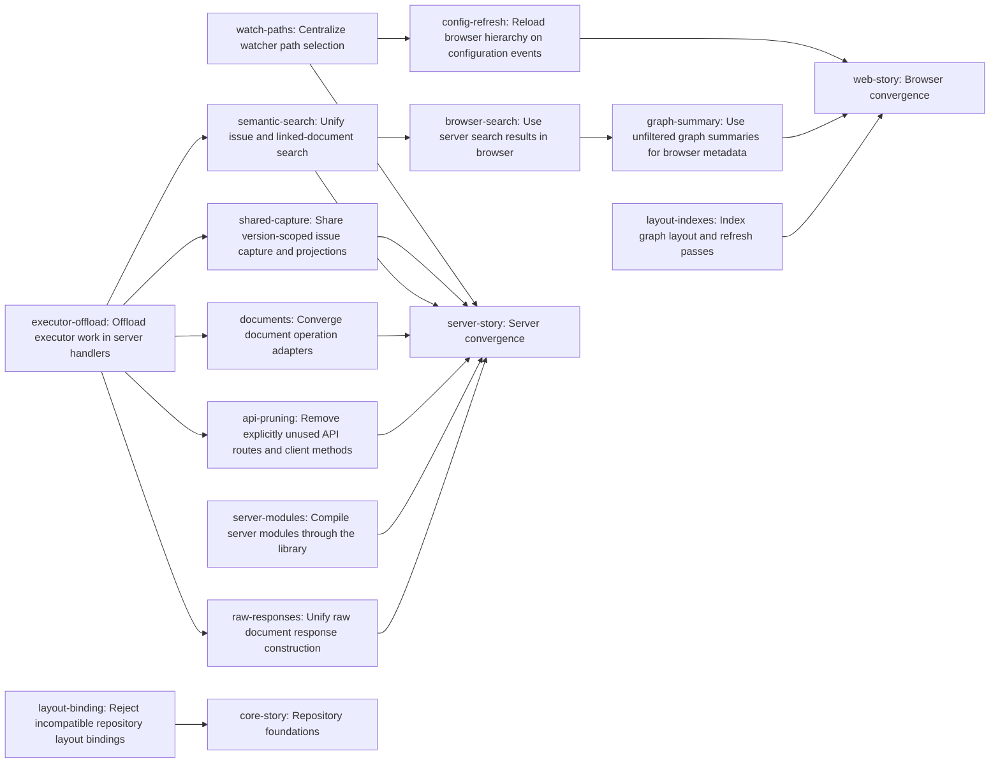

# Plan: Frontends share core (0f8efc37)

> Planning node: 110a4a2f. Authoritative graph: [breakdown.json](breakdown.json).

## Outcome and criterion approach

| Criterion | Approach | Evidence / open gap |
|---|---|---|
| REQ-01 | Consume the Git owner's shared bootstrap migration. | c5062e21-331d-4ab8-8468-3535d16d634f owns startup. |
| REQ-02 | Make layout binding fallible at its existing boundary. | Investigation: construction consumers. |
| REQ-03 | Move watcher relevance to storage's path vocabulary. | Investigation: watcher. |
| REQ-04 | Invalidate on configuration change and reload fresh hierarchy. | Investigation: configuration. |
| REQ-05 | Supply browser metadata from the full graph summary. | Investigation: route/client map. |
| REQ-06 | Share capture and derived projections by invalidation version. | Investigation: capture and concurrency. |
| REQ-07 | Offload executor calls through one server-owned helper. | Investigation: classifier. |
| REQ-08 | Share semantic issue and linked-document search across adapters. | Investigation: search options and consumers. |
| REQ-09 | Consume Git primitives and converge document adapters. | Investigation: document operations. |
| REQ-10 | Remove only the specified routes and reuse matching result types. | Investigation: route/client map. |
| REQ-11 | Import library modules from the server binary. | Investigation: build topology. |
| REQ-12 | Consolidate raw response, MIME and percent handling. | Investigation: raw responses. |
| REQ-15 | Index node and cluster lookups in bulk passes. | Investigation: layout. |

## Shared architectural contracts

### `executor-helper` [implementation-produced] — Executor offload

`executor-offload` owns one server helper for blocking executor work and shared error classification; executor consumers call it without moving HTTP concerns into core.

### `search-options` [plan-fixed] — Search composition

`jit issue search` and HTTP share semantic matching over ID, title and description. Default issue search remains case-insensitive whole-query title/description substring and ID prefix with filters; HTTP regex and case options apply to those fields and linked documents. Top-level `jit search` remains raw-file and history search with its existing flags and corpus, sharing the existing ripgrep mechanism. Documentation distinguishes the two capabilities.

### `capture-version` [plan-fixed] — Refresh cache

One captured issue snapshot feeds graph and base issue projections per tracker version. Concurrent requests share in-flight work; failed attempts permit retry, and old completion cannot replace a newer generation. The supported `/issues` response applies fresh `with_reported_documents` discovery over captured records without relisting issues: artifact add/delete/rename stays visible after cache warm. Configuration events invalidate projections and load fresh declarations. Tracker versions are invalidation hints, not transaction revisions; reads never hold a writer lock across async work.

### `browser-summary` [plan-fixed] — Graph metadata

Labels and dependency names derive from the complete graph before view filtering. Search ignores results from obsolete queries or versions. Hierarchy reloads use a fresh configuration read, never the executor lifetime cache.

## Generated decomposition overview

<!-- jit:breakdown-overview:begin -->
| Key | Title | Type | Outcome | Contracts | Sources | Footprint | Landing | Depends on |
|---|---|---|---|---|---|---|---|---|
| layout-binding | Reject incompatible repository layout bindings | task | Reject incompatible repository layout bindings. | — | REQ-02 | touches 5, uncertain | — | — |
| watch-paths | Centralize watcher path selection | task | Centralize watcher path selection. | — | REQ-03, REQ-04 | touches 2 | — | — |
| config-refresh | Reload browser hierarchy on configuration events | task | Reload browser hierarchy on configuration events. | browser-summary | REQ-04 | touches 3 | — | watch-paths |
| shared-capture | Share version-scoped issue capture and projections | task | Share version-scoped issue capture and projections. | executor-helper, capture-version | REQ-06 | touches 4 | — | executor-offload |
| executor-offload | Offload executor work in server handlers | task | Offload executor work in server handlers. | — | REQ-07 | touches 1 | — | — |
| semantic-search | Unify issue and linked-document search | task | Unify issue and linked-document search. | executor-helper, search-options | REQ-08 | touches 4 | — | executor-offload |
| browser-search | Use server search results in browser | task | Use server search results in browser. | search-options | REQ-08 | touches 5 | — | semantic-search |
| documents | Converge document operation adapters | task | Converge document operation adapters. | executor-helper | REQ-09 | touches 5 | — | executor-offload |
| api-pruning | Remove explicitly unused API routes and client methods | task | Remove explicitly unused API routes and client methods. | executor-helper | REQ-10 | touches 4 | — | executor-offload |
| server-modules | Compile server modules through the library | task | Compile server modules through the library. | — | REQ-11 | touches 2 | — | — |
| raw-responses | Unify raw document response construction | task | Unify raw document response construction. | executor-helper | REQ-12 | touches 4 | — | executor-offload |
| graph-summary | Use unfiltered graph summaries for browser metadata | task | Use unfiltered graph summaries for browser metadata. | browser-summary | REQ-05 | touches 6 | — | browser-search |
| layout-indexes | Index graph layout and refresh passes | task | Index graph layout and refresh passes. | — | REQ-15 | touches 4 | — | — |
| core-story | Repository foundations | story | Repository foundations. | — | REQ-02, REQ-01 | — | — | layout-binding |
| server-story | Server convergence | story | Server convergence. | — | REQ-06 | — | — | watch-paths, shared-capture, semantic-search, documents, api-pruning, server-modules, raw-responses |
| web-story | Browser convergence | story | Browser convergence. | — | REQ-05 | — | — | config-refresh, graph-summary, layout-indexes |

<!-- jit:breakdown-overview:end -->

## Material risks and owner decisions

| Risk / decision | Resolution and rationale |
|---|---|
| Startup overlap | c5062e21-331d-4ab8-8468-3535d16d634f owns startup's adoption of `commands/bootstrap::open_repository`, including recovery; breakdown must re-home its external dependency to `core-story`, which aggregates REQ-01. a807e699 already delivered bootstrap. No duplicate startup leaf. |
| Git document overlap | `documents` consumes 933ff852 (which transitively consumes 1acfa592 and 83c8632f); d48e28bf and a273667c own reader/path primitives. Re-home 933ff852-7cc9-4902-a424-626b882df531 to `documents`; do not recreate Git operations. |
| Concurrent peer changes | Re-home fb38bf1f-a4b0-4acf-9b5b-bda244d0ee09 to `api-pruning` and `documents` for moved result types; 487f45a9-bd42-47f8-8dd1-6487ad287793 to `executor-offload` for error classification; f35c86de-e4fa-4ce9-bf48-ee1378115355 to `documents` for dispatch repair. Preserve independent browser, watcher, layout and capture frontier. |
| Search corpus | Steward chose to preserve raw-file and history search in top-level `jit search`; the linked-document restriction applies to HTTP semantic search. Empty linked-document paths must not broaden that search. |
| Public HTTP surfaces | Preserve /issues, /health and document diff; remove only the four specified routes. The separate D-23 owner retires MCP. |
| Derived-document visibility | Cache base issue data and graph, then compose the live artifact overlay. Rejected full-response memoization because artifacts lie outside the data-root watch; rejected dynamic multi-root watching as unnecessary mechanism. |
| Inherited planning prerequisite | Keep completed semantic-types epic 2195c98f on P: its canonical identities are the foundation investigated during planning; no unfulfilled implementation prerequisite was moved onto P. |
| Browser hierarchy | Keep existing container selection policy; indexing adds no new policy. |
| Scope and source universe | Known and required source universe is REQ-01 through REQ-12 and REQ-15. REQ-01 is contributed by the core story and externally satisfied by c5062e21; all 13 criteria require coverage labels. No finding or design identifiers are claimed as additional sources. |

## Investigation sources

- [Investigation](investigation.md) — current evidence and exhaustive consumer inventories.

Validation source arguments: `--known-source REQ-NN --required-source REQ-NN --required-criterion 0f8efc37/REQ-NN` for each of 01–12 and 15, plus `--required-criterion '{core-story.short_id}/REQ-01' --required-criterion '{server-story.short_id}/REQ-01' --required-criterion '{web-story.short_id}/REQ-01'`. Use the helper's `validate` with `--config .jit/config.toml --plan plan.md --deny-warnings`, then `render --write`, `render --check`, and `jit issue batch-create --from-json breakdown.json --dry-run --json` from the repository root using the artifact paths.
