# Plan: Give every identity and closed vocabulary one semantic type (2195c98f)

> Planning node: 8aa53c43. Authoritative graph:
> [breakdown.json](breakdown.json).

## Outcome and criterion approach

Every criterion types a value at its parse boundary and deletes the restatements it replaces (`@/inv/semantic-types`, `@/charter/D-18`). Each entry lands green. Most families need no bridge. The `Issue.id` flip and the event envelope do need one, so each is staged behind a named temporary alias that a later entry in this epic removes.

| Criterion | Approach | Evidence / open gap |
|---|---|---|
| REQ-01 | `issue-identity-newtype` is adopted behind `alias-staging-bridge`. The command families are retyped first, then repository-state, validation and output, then storage and the domain, and the flip comes last. Gate-run ids, gate keys and drafts with pre-derived ids follow once the flip has landed. | Investigation, identity §4 and §7 |
| REQ-02 | `issue-id-prefix` types the shared resolver that 16d63038 creates. The command families then move the parse out to the CLI and server boundary. | Identity C7, REQ-02 |
| REQ-03 | Each staged family replaces its truncation sites with `short_id()`. The server serves `short_id`, and the web renders it. | Identity C8; DEC-12 |
| REQ-04 | `Option<&IssueId>` over `EventBody`, once the envelope has landed. | Identity C9 |
| REQ-05 | `event-body-view` migrates the matchers first: production code, then tests. The `event-envelope` swap follows. | Identity §4 envelope probe |
| REQ-06 | The agent becomes an `Assignee`, then come `LeaseId` and `WorktreeId`, then the lease's `IssueId`, which also deletes the short-id tolerance. | Identity C3; DEC-11, DEC-15 |
| REQ-07 | `virtual-path-constructors` adds issue-record, gate-run and schema constructors. Well-known-file literals are swept in four module families. | Identity C10; DEC-14 |
| REQ-08 | One predicate on classified `VirtualPath` targets. | Profile C5, REQ-08 |
| REQ-09 | `ProfileId` moves to `domain::identity`, and dependency resolution compares values. | Profile REQ-09; DEC-06 |
| REQ-10 | `wire-vocabulary-macro` plus one entry per vocabulary, including the DEC-21 twins. | Vocab C1–C10 |
| REQ-11 | `system-actor-constants`, then the gate-run actor, the agent identity and the query filter. | Identity C12–C13; DEC-19 |
| REQ-12 | State and priority value lists come from the macro. Projections are typed. | Vocab C7, C10; DEC-20 |
| REQ-13 | Event tags and artifact-plan codes go through the macro. `PlanError` derives `thiserror`. | Vocab C13–C15 |
| REQ-14 | `Ord` on `Priority`, ordered after aa423d02. | Vocab C17 |
| REQ-15 | `compiled-graph-assertions`: one entry per assertion kind, with `id-pattern` shared. | Vocab C18–C20 |
| REQ-16 | One constructor first, then the callers propagate its error. | Vocab C21; DEC-22 |
| REQ-17 | Each typing entry deletes its interior strings. A residual identity sweep and the `Debug`-render sweep close the remainder. No grep enforcement check is added. | a122b9b3 precedent |

## Shared architectural contracts

### `identity-newtype-convention` [plan-fixed] — Identity newtype shape

Identity types live in `crates/jit/src/domain/identity.rs` and are imported as `crate::domain::identity::<Type>`, following the 842b0ac6 module-path convention. Each type has a private inner value and a validating `TryFrom<&str>`/`FromStr` with a `thiserror` error that names the input. Serde goes through `#[serde(try_from = "String", into = "String")]`, and `#[schemars(with = "String")]` keeps the published schema a plain string. `as_str()` is the only string view. UUID-backed ids (`IssueId`, `GateRunId`, `LeaseId`) accept only the canonical lowercase hyphenated form, checked as `to_string() == input`. Token ids (`GateKey`, `ProfileId`) use the shared lowercase-kebab predicate, and `WorktreeId` accepts a non-empty token without whitespace.

### `issue-identity-newtype` [implementation-produced] — Validated issue id

A canonical-string newtype with `as_str()` and `short_id() -> &str` as its only derivations (DEC-07). It sits beside the bridge under a staging name until the flip gives it the name `IssueId`.

### `alias-staging-bridge` [implementation-produced] — Temporary IssueId alias

`pub type IssueId = String;` at the final path, plus an `IssueIdStaging` trait that gives `String` a `short_id()`. Staging entries use only operations that are valid on both the alias and the newtype. Parameters are retyped outside-in, so each caller is already typed when its callee changes. This is a named bridge with a tracked removal condition: the flip entry deletes it, and that entry depends transitively on every staging entry (`@/inv/canonical-cutover`, `@/inv/convention-convergence`).

### `issue-id-prefix` [implementation-produced] — Parsed id prefix

`IssueIdPrefix` owns `MIN_ID_PREFIX_LENGTH` and the normalisation rules of the shared resolver. Resolution maps `&IssueIdPrefix` to `IssueId`.

### `test-issue-id-fixture` [implementation-produced] — Canonical test ids

One deterministic fixture in `test_utils` that maps a seed to a distinct canonical `IssueId`. Unit tests and integration tests both use it (`@/inv/shared-test-contracts`).

### `event-envelope` [plan-fixed] — Event envelope shape

`struct Event { id, timestamp, #[serde(flatten)] body: EventBody }`, where `EventBody` is `#[serde(tag = "type", rename_all = "snake_case")]`. Drafts build `EventBody`, and only the finalizer builds `Event`. The probe in the investigation showed that canonical log bytes are unchanged and `parse_known_events` decodes the envelope unmodified. Flatten forbids `deny_unknown_fields` on `Event`.

### `event-body-view` [implementation-produced] — Temporary body view

`pub type EventBody = Event;` plus `Event::body()` and `into_body()`. Matchers move to `match event.body() { EventBody::X {..} }` while the enum is unchanged. The envelope entry replaces the alias with the real body enum and deletes the alias.

### `wire-vocabulary-macro` [implementation-produced] — Closed wire vocabulary declaration

A crate-local `macro_rules!` in `domain/vocabulary.rs` takes `Variant = "wire"` entries. It emits the enum with per-variant serde renames, `const fn as_str`, `ALL`, an exact `FromStr` and `Display`. One owning test proves the macro (`@/inv/orthogonal-tests`). A consumer keeps sorting by `as_str()` wherever the declaration order and the alphabetical order differ.

### `exact-token-parsing` [plan-fixed] — Exact canonical tokens

A closed vocabulary parses only the token its serde form emits: no case folding, no alias, and no `md` (DEC-17). Every token list derives from `ALL`.

### `virtual-path-constructors` [plan-fixed] — Typed path constructors

`VirtualPath::issue_record(&IssueId)` and `VirtualPath::gate_run_record(&GateRunId)` are infallible, because the identity module of `repository_state/path.rs` builds the descendant and the id guarantees one safe component. `VirtualPath::schema(name)` validates its component. Well-known `.jit` files are constants in `declare_well_known_paths!`, and host paths derive through `RepositoryLayout::resolve`. Files under `.git/jit/` are out of scope (DEC-14).

### `system-actor-constants` [implementation-produced] — Engine actors as constants

`Assignee` stores `Cow<'static, str>` parts behind its private fields and gains a `const fn` constructor for engine-owned actors. Associated constants name the list, admin, recovery and lease-check actors and the automated gate executor. Parsing and the serialized form are unchanged.

### `compiled-graph-assertions` [plan-fixed] — Typed assertion configuration

Each graph assertion lowers its table at load through a `Raw*` struct, following the existing `RawGateRecency` pattern. It fails with `RuleConfigError::InvalidAssertion { rule, .. }`. Evaluation reads typed fields only. Rule serialization emits the same keys.

### `id-pattern` [implementation-produced] — Compiled pattern

`IdPattern { source, regex }` compares and serializes by source and fails construction on an invalid source. Rule criteria patterns, label coverage and item kinds share it.

## Generated decomposition overview

<!-- jit:breakdown-overview:begin -->
| Key | Title | Type | Outcome | Contracts | Sources | Footprint | Landing | Depends on |
|---|---|---|---|---|---|---|---|---|
| issue-id-types | Validated issue identity type with an alias staging bridge | task | A validated issue-id newtype exists beside a temporary String alias and short-id trait. | identity-newtype-convention | REQ-01, REQ-03, DEC-07, DEC-08 | creates 1, touches 1 | — | — |
| graph-node-id-views | Graph node traits expose dependency ids as string views | task | GraphNode and HierarchyNode yield dependency ids as borrowed string views. | — | REQ-01, REQ-17 | touches 5 | — | — |
| canonical-unit-test-ids | Library unit tests take canonical issue ids from one fixture | task | Library unit tests take issue ids from one shared fixture that yields canonical ids. | alias-staging-bridge | REQ-01, REQ-17 | touches 12 | — | issue-id-types |
| canonical-integration-test-ids | Integration tests take canonical issue ids from the shared fixture | task | Integration suites take issue ids from the shared canonical fixture. | test-issue-id-fixture | REQ-01, REQ-17 | touches 1, uncertain | — | canonical-unit-test-ids |
| issue-draft-identity | Issue drafts carry their pre-derived identifier | task | Issue drafts take their id from the identifier authority, so no empty-string issue id exists. | alias-staging-bridge | REQ-01, DEC-09 | touches 5 | — | issue-id-types |
| prefix-resolution | Id prefixes parse once into an IssueIdPrefix | task | Prefix resolution maps a parsed IssueIdPrefix to an IssueId through the one shared resolver. | alias-staging-bridge | REQ-02, DEC-03 | touches 18 | — | issue-id-types |
| stage-graph-command-issue-ids | Dependency, graph and template commands carry typed issue ids | task | Graph-editing commands hold issue ids as IssueId and take user ids as IssueIdPrefix. | alias-staging-bridge, issue-id-prefix | REQ-01, REQ-17, DEC-08 | touches 7 | — | prefix-resolution |
| stage-gate-command-issue-ids | Gate commands carry typed issue ids | task | Gate commands hold issue ids as IssueId and take user ids as IssueIdPrefix. | alias-staging-bridge, issue-id-prefix | REQ-01, REQ-17, DEC-08 | touches 5 | — | prefix-resolution |
| stage-lifecycle-command-issue-ids | Issue lifecycle commands carry typed issue ids | task | Lifecycle commands hold issue ids as IssueId and take user ids as IssueIdPrefix. | alias-staging-bridge, issue-id-prefix | REQ-01, REQ-17, DEC-08 | touches 8 | — | prefix-resolution |
| stage-document-command-issue-ids | Document-family commands carry typed issue ids | task | Document-family commands hold issue ids as IssueId and take user ids as IssueIdPrefix. | alias-staging-bridge, issue-id-prefix | REQ-01, REQ-17, DEC-08 | touches 6 | — | prefix-resolution |
| stage-dispatch-issue-ids | Executor core and CLI dispatch carry typed issue ids | task | The executor core and CLI dispatch hold issue ids as IssueId. | alias-staging-bridge, issue-id-prefix | REQ-01, REQ-17, DEC-08 | touches 3 | — | prefix-resolution |
| stage-repository-state-issue-ids | Repository-state mutations carry typed issue ids | task | Repository-state code holds issue ids as IssueId. | alias-staging-bridge | REQ-01, REQ-17, DEC-08 | touches 4 | — | stage-graph-command-issue-ids, stage-gate-command-issue-ids, stage-lifecycle-command-issue-ids, stage-document-command-issue-ids, stage-dispatch-issue-ids, issue-draft-identity |
| stage-validation-issue-ids | Validation carries typed issue ids | task | Validation code holds issue ids as IssueId. | alias-staging-bridge | REQ-01, REQ-17, DEC-08 | touches 3 | — | stage-graph-command-issue-ids, stage-gate-command-issue-ids, stage-lifecycle-command-issue-ids, stage-document-command-issue-ids, stage-dispatch-issue-ids |
| stage-error-output-issue-ids | Errors and output carry typed issue ids | task | Error and output types hold issue ids as IssueId. | alias-staging-bridge | REQ-01, REQ-17, DEC-08 | touches 3 | — | stage-graph-command-issue-ids, stage-gate-command-issue-ids, stage-lifecycle-command-issue-ids, stage-document-command-issue-ids, stage-dispatch-issue-ids |
| stage-storage-issue-ids | Storage trait and backends take issue ids as IssueId | task | The storage trait, backends and index take issue ids as IssueId. | alias-staging-bridge | REQ-01, REQ-17, DEC-08 | touches 7 | — | stage-repository-state-issue-ids, stage-validation-issue-ids, stage-error-output-issue-ids |
| stage-domain-issue-ids | Domain types carry issue ids as IssueId | task | Domain structs, event bodies and domain functions declare issue ids as IssueId. | alias-staging-bridge | REQ-01, REQ-17, DEC-08 | touches 6 | — | stage-storage-issue-ids, event-issue-accessor |
| issue-id-flip | IssueId becomes the validated newtype | task | The validated newtype takes the IssueId name, and the String alias and staging trait are gone. | issue-identity-newtype, alias-staging-bridge | REQ-01, REQ-17, DEC-07, DEC-08, DEC-15 | touches 1, uncertain | — | stage-domain-issue-ids, lease-issue-identity, graph-node-id-views, canonical-integration-test-ids |
| issue-record-path-storage | Issue record paths come from a VirtualPath constructor | task | VirtualPath::issue_record derives record paths from an IssueId in storage and repository-state code. | virtual-path-constructors, issue-identity-newtype | REQ-01, REQ-07 | touches 6 | — | issue-id-flip |
| issue-record-path-commands | Commands take issue record paths from the VirtualPath constructor | task | Commands and validation take issue record paths from the VirtualPath constructor. | virtual-path-constructors | REQ-07 | touches 10 | — | issue-record-path-storage |
| gate-run-ids | Gate runs are identified by a validated GateRunId | task | Gate runs carry a validated GateRunId from draft to record path. | identity-newtype-convention, virtual-path-constructors | REQ-01, DEC-09 | touches 13 | — | issue-record-path-storage |
| gate-key-registry-type | Gate keys are a validated GateKey in the registry and gate runs | task | Gate definitions, gate runs, gate events and the store use a validated GateKey. | identity-newtype-convention | REQ-01, DEC-10 | touches 8 | — | issue-id-flip, domain-profile-id |
| gate-key-issue-fields | Issue gate fields are keyed by GateKey | task | Issue gate fields and gate-key arguments use GateKey. | identity-newtype-convention | REQ-01, REQ-17 | touches 10 | — | gate-key-registry-type |
| server-short-id-field | Server issue responses carry the domain short id | task | Server issue and graph responses carry the domain-derived short id. | issue-identity-newtype | REQ-03, DEC-12 | touches 1 | — | issue-id-flip |
| web-short-id-render | Web UI renders the server-provided short id | task | Web views render the server-provided short id with no id truncation. | — | REQ-03, DEC-12 | touches 4 | — | server-short-id-field |
| identity-boundary-sweep | Raw identity strings remain only at parse and render boundaries | task | Residual raw identity strings inside the engine are replaced by their identity types. | issue-identity-newtype | REQ-17 | uncertain | — | issue-record-path-commands, gate-run-ids, gate-key-issue-fields, server-short-id-field |
| event-body-view | Production event matchers read events through a body view | task | Production code matches event variants through Event::body() and the EventBody name. | event-envelope | REQ-05, DEC-13 | touches 19 | — | — |
| event-body-test-view | Event tests match variants through the body view | task | Test code matches event variants through the body view. | event-body-view | REQ-05, DEC-13 | touches 14 | — | event-body-view |
| event-envelope | Event becomes an envelope around a tagged body | task | Event holds id and timestamp once around a flattened EventBody that drafts build. | event-envelope, event-body-view | REQ-05, DEC-13 | touches 6 | — | event-body-test-view |
| event-issue-accessor | Event issue accessor returns an optional IssueId | task | The event issue accessor returns Option<&IssueId> with no empty-string sentinel. | event-envelope, alias-staging-bridge | REQ-04 | touches 4 | — | event-envelope, issue-id-types |
| system-actor-constants | System actors are named Assignee constants | task | Each engine-owned actor is a named Assignee constant. | system-actor-constants | REQ-11 | touches 6 | — | — |
| gate-run-actor | Gate-run actors are Assignee values | task | Gate-run actors are stored and read as Assignee values. | system-actor-constants | REQ-11 | touches 5 | — | system-actor-constants |
| agent-identity-assignee | Resolved agent identity is an Assignee | task | The agent identity is an Assignee from resolution to lease record. | system-actor-constants | REQ-06, REQ-11 | touches 4 | — | system-actor-constants |
| lease-worktree-ids | Lease and worktree ids are dedicated types | task | Lease and worktree ids are validated LeaseId and WorktreeId values. | identity-newtype-convention | REQ-06, DEC-11 | touches 8 | — | agent-identity-assignee, issue-id-types |
| lease-issue-identity | Lease records name their issue by IssueId | task | Leases name their issue by IssueId with no short-id tolerance. | alias-staging-bridge | REQ-01, REQ-06, DEC-15 | touches 3 | — | lease-worktree-ids |
| query-assignee-filter | Query assignee filters parse to an Assignee | task | Query assignee filters hold a parsed Assignee, and the reference shows working filters. | — | REQ-11, REQ-17, DEC-19 | touches 3 | — | — |
| wire-vocabulary-macro | One macro declares a closed wire vocabulary | task | A crate-local macro states each variant's wire spelling once, proven on GateStatus. | wire-vocabulary-macro, exact-token-parsing | REQ-10, REQ-13, DEC-16, DEC-17 | creates 1, touches 4 | — | — |
| event-tag-vocabulary | Event tags declare their wire spelling once | task | Event tags and scopes state their wire spelling once and are typed where compared. | wire-vocabulary-macro, exact-token-parsing | REQ-13, DEC-16 | touches 5 | — | wire-vocabulary-macro, event-envelope |
| artifact-plan-codes | Artifact-plan codes declare their wire spelling once | task | Artifact-plan codes state their wire spelling once. | wire-vocabulary-macro, exact-token-parsing | REQ-13 | touches 1 | — | wire-vocabulary-macro |
| plan-error-derive | Artifact-plan errors use the derive-based error convention | task | PlanError and InventoryError derive Display and Error with unchanged messages. | — | REQ-13 | touches 2 | — | — |
| lifecycle-state-vocabulary | Lifecycle state tokens come from one declaration | task | Lifecycle state tokens come from one macro declaration. | wire-vocabulary-macro, exact-token-parsing | REQ-10, REQ-12, DEC-17 | touches 7 | — | wire-vocabulary-macro |
| priority-vocabulary | Priority tokens come from one declaration | task | Priority tokens come from one macro declaration. | wire-vocabulary-macro, exact-token-parsing | REQ-10, REQ-12, DEC-17 | touches 5 | — | lifecycle-state-vocabulary |
| priority-ord | Priority orders by rank through Ord | task | Priority orders by rank through Ord, with no rank match left. | — | REQ-14 | touches 3 | — | priority-vocabulary |
| validation-strictness-vocabulary | Validation strictness is typed at load | task | Validation strictness decodes once into Strictness. | wire-vocabulary-macro, exact-token-parsing | REQ-10, DEC-17 | touches 5 | — | wire-vocabulary-macro |
| content-format-vocabulary | Content format is typed at load | task | Content format decodes once into ContentFormat with exact tokens. | wire-vocabulary-macro, exact-token-parsing | REQ-10, DEC-17 | touches 5 | — | validation-strictness-vocabulary |
| kind-scope-vocabulary | Item-kind scope has one enum | task | Item-kind scope has one domain enum with serde. | wire-vocabulary-macro, exact-token-parsing | REQ-10 | touches 3 | — | wire-vocabulary-macro |
| transform-kind-vocabulary | Template transform kind is typed at load | task | Template transform kinds decode once into TransformKind. | wire-vocabulary-macro, exact-token-parsing | REQ-10 | touches 4 | — | wire-vocabulary-macro |
| projection-mode-style-vocabulary | Projection mode and style reach output typed | task | Projection render reports carry mode and style as enums. | wire-vocabulary-macro, exact-token-parsing | REQ-10 | touches 2 | — | wire-vocabulary-macro |
| gate-finding-vocabulary | Built-in gate findings use closed severity and disposition enums | task | Engine-emitted gate findings use closed severity, disposition and origin enums. | wire-vocabulary-macro, exact-token-parsing | REQ-10, DEC-18 | touches 2 | — | wire-vocabulary-macro |
| repository-action-owner | Repository action owners are one enum | task | Repository action owners are one enum, matched by variant. | wire-vocabulary-macro, exact-token-parsing | REQ-10 | touches 10 | — | wire-vocabulary-macro |
| projection-typed-fields | Validation projections hold typed state and priority | task | Validation projections hold typed State and Priority. | exact-token-parsing | REQ-12, DEC-20 | touches 1 | — | priority-vocabulary |
| rule-severity-scope-vocabulary | Rule severity and scope tokens come from one declaration | task | Rule severity and scope state their spelling once. | wire-vocabulary-macro, exact-token-parsing | REQ-10, DEC-21 | touches 2 | — | lifecycle-state-vocabulary |
| type-hierarchy-kind-vocabulary | Type-hierarchy and label-uniqueness rule options are typed | task | Type-hierarchy kind and label-uniqueness scope decode once into enums. | wire-vocabulary-macro, exact-token-parsing | REQ-10, REQ-15, DEC-21 | touches 3 | — | rule-severity-scope-vocabulary |
| gate-stage-mode-vocabulary | Gate stage and mode tokens come from one declaration | task | Gate stage and mode state their spelling once. | wire-vocabulary-macro, exact-token-parsing | REQ-10, DEC-21 | touches 1 | — | wire-vocabulary-macro |
| error-code-vocabulary | Error codes come from one declaration | task | Error codes state their spelling once. | wire-vocabulary-macro, exact-token-parsing | REQ-10, DEC-21 | touches 1 | — | wire-vocabulary-macro |
| divergence-vocabulary | Store divergence tokens come from one declaration | task | Store divergence vocabularies state their spelling once. | wire-vocabulary-macro, exact-token-parsing | REQ-10, DEC-21 | touches 1 | — | wire-vocabulary-macro |
| debug-token-renders | Human output renders vocabulary tokens, not Debug names | task | Human output prints vocabulary wire tokens. | wire-vocabulary-macro, exact-token-parsing | REQ-10, REQ-17 | touches 2 | — | priority-vocabulary |
| compiled-id-pattern | Rule patterns compile at declaration load | task | Criteria patterns compile once at load through one IdPattern type. | compiled-graph-assertions | REQ-15 | touches 3 | — | — |
| item-kind-id-pattern | Item kinds hold their id pattern as IdPattern | task | Item kinds hold their id pattern as the shared IdPattern. | id-pattern | REQ-15 | touches 1 | — | compiled-id-pattern |
| typed-label-reference | Label-reference assertions are typed at load | task | Label-reference assertions decode into a typed configuration at load. | compiled-graph-assertions | REQ-15 | touches 4 | — | type-hierarchy-kind-vocabulary |
| typed-dependency-shape | Dependency-shape assertions are typed at load | task | Dependency-shape assertions decode into a typed configuration with a load-parsed selector. | compiled-graph-assertions | REQ-15 | touches 3 | — | typed-label-reference |
| typed-label-coverage | Label-coverage assertions are typed and compiled at load | task | Label-coverage assertions decode into a typed configuration with a compiled pattern. | compiled-graph-assertions, id-pattern | REQ-15 | touches 5 | — | typed-dependency-shape, compiled-id-pattern |
| hierarchy-config-constructor | HierarchyConfig has one fallible constructor from declarations | task | One fallible constructor builds HierarchyConfig from declarations. | — | REQ-16, DEC-22 | touches 4 | — | — |
| hierarchy-config-callers | Hierarchy callers propagate the constructor's error | task | Hierarchy callers propagate the one constructor's error. | — | REQ-16, DEC-22 | touches 11 | — | hierarchy-config-constructor |
| schema-path-constructor | Schema paths come from a VirtualPath constructor | task | Schema file paths come from one validated VirtualPath constructor. | virtual-path-constructors | REQ-07 | touches 7 | — | — |
| well-known-paths-repository-state | Repository-state code names well-known files through VirtualPath constants | task | Repository-state code names well-known files only through VirtualPath constants. | virtual-path-constructors | REQ-07, DEC-14 | touches 6 | — | schema-path-constructor |
| well-known-paths-commands | Commands name well-known files through VirtualPath constants | task | Commands name well-known files only through VirtualPath constants. | virtual-path-constructors | REQ-07, DEC-14 | touches 9 | — | well-known-paths-repository-state |
| well-known-paths-storage | Storage and configuration code name well-known files through VirtualPath constants | task | Storage and loaders name well-known files only through VirtualPath constants. | virtual-path-constructors | REQ-07, DEC-14 | touches 11 | — | well-known-paths-commands |
| control-file-path-constants | Worktree and server files under .jit have VirtualPath constants | task | Worktree identity and server files under .jit are named through VirtualPath constants. | virtual-path-constructors | REQ-07, DEC-14 | touches 4 | — | well-known-paths-storage |
| reserved-target-predicate | One VirtualPath predicate recognises reserved application targets | task | Reserved application targets are recognised by one VirtualPath predicate after classification. | virtual-path-constructors | REQ-08 | touches 3 | — | — |
| domain-profile-id | ProfileId is defined in the domain layer | task | ProfileId and its kebab predicate live in domain::identity. | identity-newtype-convention | REQ-09, DEC-06 | touches 14 | — | issue-id-types |
| typed-profile-dependency-resolution | Profile dependency resolution compares ProfileId values | task | Profile dependency resolution and the package graph compare ProfileId values. | — | REQ-09, DEC-06 | touches 2 | — | domain-profile-id |
| issue-identity | Issue identity is one validated type end to end | story | Issue identity, prefixes, gate-run ids, gate keys and record paths are typed end to end, with the staging bridge removed. | — | REQ-01, REQ-02, REQ-03, REQ-07, REQ-17 | — | — | web-short-id-render, identity-boundary-sweep |
| event-records | Events are an envelope around a tagged body | story | Events hold id and timestamp once around a tagged body, with a typed optional issue accessor. | — | REQ-04, REQ-05 | — | — | event-issue-accessor |
| actor-identity | Actors and leases carry typed identities | story | System actors, gate-run actors, query filters and lease records carry Assignee and dedicated id types. | — | REQ-06, REQ-11 | — | — | gate-run-actor, lease-issue-identity, query-assignee-filter |
| wire-vocabularies | Closed vocabularies state their wire spelling once | story | Each closed vocabulary is one macro-declared enum with exact-token parsing and no restated token. | — | REQ-10, REQ-12, REQ-13, REQ-14 | — | — | event-tag-vocabulary, artifact-plan-codes, plan-error-derive, priority-ord, content-format-vocabulary, kind-scope-vocabulary, transform-kind-vocabulary, projection-mode-style-vocabulary, gate-finding-vocabulary, repository-action-owner, projection-typed-fields, type-hierarchy-kind-vocabulary, gate-stage-mode-vocabulary, error-code-vocabulary, divergence-vocabulary, debug-token-renders |
| typed-declarations | Declarations are typed and compiled at load | story | Graph assertions and the type hierarchy are typed and validated when declarations load. | — | REQ-15, REQ-16 | — | — | item-kind-id-pattern, typed-label-coverage, hierarchy-config-callers |
| repository-paths | Repository paths and profile identity are typed | story | Well-known files, schema paths and reserved targets go through VirtualPath, and ProfileId lives in the domain. | — | REQ-07, REQ-08, REQ-09 | — | — | control-file-path-constants, reserved-target-predicate, typed-profile-dependency-resolution |

```mermaid
flowchart LR
    N0["issue-id-types: Validated issue identity type with an alias staging bridge"]
    N1["graph-node-id-views: Graph node traits expose dependency ids as string views"]
    N2["canonical-unit-test-ids: Library unit tests take canonical issue ids from one fixture"]
    N3["canonical-integration-test-ids: Integration tests take canonical issue ids from the shared fixture"]
    N4["issue-draft-identity: Issue drafts carry their pre-derived identifier"]
    N5["prefix-resolution: Id prefixes parse once into an IssueIdPrefix"]
    N6["stage-graph-command-issue-ids: Dependency, graph and template commands carry typed issue ids"]
    N7["stage-gate-command-issue-ids: Gate commands carry typed issue ids"]
    N8["stage-lifecycle-command-issue-ids: Issue lifecycle commands carry typed issue ids"]
    N9["stage-document-command-issue-ids: Document-family commands carry typed issue ids"]
    N10["stage-dispatch-issue-ids: Executor core and CLI dispatch carry typed issue ids"]
    N11["stage-repository-state-issue-ids: Repository-state mutations carry typed issue ids"]
    N12["stage-validation-issue-ids: Validation carries typed issue ids"]
    N13["stage-error-output-issue-ids: Errors and output carry typed issue ids"]
    N14["stage-storage-issue-ids: Storage trait and backends take issue ids as IssueId"]
    N15["stage-domain-issue-ids: Domain types carry issue ids as IssueId"]
    N16["issue-id-flip: IssueId becomes the validated newtype"]
    N17["issue-record-path-storage: Issue record paths come from a VirtualPath constructor"]
    N18["issue-record-path-commands: Commands take issue record paths from the VirtualPath constructor"]
    N19["gate-run-ids: Gate runs are identified by a validated GateRunId"]
    N20["gate-key-registry-type: Gate keys are a validated GateKey in the registry and gate runs"]
    N21["gate-key-issue-fields: Issue gate fields are keyed by GateKey"]
    N22["server-short-id-field: Server issue responses carry the domain short id"]
    N23["web-short-id-render: Web UI renders the server-provided short id"]
    N24["identity-boundary-sweep: Raw identity strings remain only at parse and render boundaries"]
    N25["event-body-view: Production event matchers read events through a body view"]
    N26["event-body-test-view: Event tests match variants through the body view"]
    N27["event-envelope: Event becomes an envelope around a tagged body"]
    N28["event-issue-accessor: Event issue accessor returns an optional IssueId"]
    N29["system-actor-constants: System actors are named Assignee constants"]
    N30["gate-run-actor: Gate-run actors are Assignee values"]
    N31["agent-identity-assignee: Resolved agent identity is an Assignee"]
    N32["lease-worktree-ids: Lease and worktree ids are dedicated types"]
    N33["lease-issue-identity: Lease records name their issue by IssueId"]
    N34["query-assignee-filter: Query assignee filters parse to an Assignee"]
    N35["wire-vocabulary-macro: One macro declares a closed wire vocabulary"]
    N36["event-tag-vocabulary: Event tags declare their wire spelling once"]
    N37["artifact-plan-codes: Artifact-plan codes declare their wire spelling once"]
    N38["plan-error-derive: Artifact-plan errors use the derive-based error convention"]
    N39["lifecycle-state-vocabulary: Lifecycle state tokens come from one declaration"]
    N40["priority-vocabulary: Priority tokens come from one declaration"]
    N41["priority-ord: Priority orders by rank through Ord"]
    N42["validation-strictness-vocabulary: Validation strictness is typed at load"]
    N43["content-format-vocabulary: Content format is typed at load"]
    N44["kind-scope-vocabulary: Item-kind scope has one enum"]
    N45["transform-kind-vocabulary: Template transform kind is typed at load"]
    N46["projection-mode-style-vocabulary: Projection mode and style reach output typed"]
    N47["gate-finding-vocabulary: Built-in gate findings use closed severity and disposition enums"]
    N48["repository-action-owner: Repository action owners are one enum"]
    N49["projection-typed-fields: Validation projections hold typed state and priority"]
    N50["rule-severity-scope-vocabulary: Rule severity and scope tokens come from one declaration"]
    N51["type-hierarchy-kind-vocabulary: Type-hierarchy and label-uniqueness rule options are typed"]
    N52["gate-stage-mode-vocabulary: Gate stage and mode tokens come from one declaration"]
    N53["error-code-vocabulary: Error codes come from one declaration"]
    N54["divergence-vocabulary: Store divergence tokens come from one declaration"]
    N55["debug-token-renders: Human output renders vocabulary tokens, not Debug names"]
    N56["compiled-id-pattern: Rule patterns compile at declaration load"]
    N57["item-kind-id-pattern: Item kinds hold their id pattern as IdPattern"]
    N58["typed-label-reference: Label-reference assertions are typed at load"]
    N59["typed-dependency-shape: Dependency-shape assertions are typed at load"]
    N60["typed-label-coverage: Label-coverage assertions are typed and compiled at load"]
    N61["hierarchy-config-constructor: HierarchyConfig has one fallible constructor from declarations"]
    N62["hierarchy-config-callers: Hierarchy callers propagate the constructor's error"]
    N63["schema-path-constructor: Schema paths come from a VirtualPath constructor"]
    N64["well-known-paths-repository-state: Repository-state code names well-known files through VirtualPath constants"]
    N65["well-known-paths-commands: Commands name well-known files through VirtualPath constants"]
    N66["well-known-paths-storage: Storage and configuration code name well-known files through VirtualPath constants"]
    N67["control-file-path-constants: Worktree and server files under .jit have VirtualPath constants"]
    N68["reserved-target-predicate: One VirtualPath predicate recognises reserved application targets"]
    N69["domain-profile-id: ProfileId is defined in the domain layer"]
    N70["typed-profile-dependency-resolution: Profile dependency resolution compares ProfileId values"]
    N71["issue-identity: Issue identity is one validated type end to end"]
    N72["event-records: Events are an envelope around a tagged body"]
    N73["actor-identity: Actors and leases carry typed identities"]
    N74["wire-vocabularies: Closed vocabularies state their wire spelling once"]
    N75["typed-declarations: Declarations are typed and compiled at load"]
    N76["repository-paths: Repository paths and profile identity are typed"]
    N0 --> N2
    N2 --> N3
    N0 --> N4
    N0 --> N5
    N5 --> N6
    N5 --> N7
    N5 --> N8
    N5 --> N9
    N5 --> N10
    N6 --> N11
    N7 --> N11
    N8 --> N11
    N9 --> N11
    N10 --> N11
    N4 --> N11
    N6 --> N12
    N7 --> N12
    N8 --> N12
    N9 --> N12
    N10 --> N12
    N6 --> N13
    N7 --> N13
    N8 --> N13
    N9 --> N13
    N10 --> N13
    N11 --> N14
    N12 --> N14
    N13 --> N14
    N14 --> N15
    N28 --> N15
    N15 --> N16
    N33 --> N16
    N1 --> N16
    N3 --> N16
    N16 --> N17
    N17 --> N18
    N17 --> N19
    N16 --> N20
    N69 --> N20
    N20 --> N21
    N16 --> N22
    N22 --> N23
    N18 --> N24
    N19 --> N24
    N21 --> N24
    N22 --> N24
    N25 --> N26
    N26 --> N27
    N27 --> N28
    N0 --> N28
    N29 --> N30
    N29 --> N31
    N31 --> N32
    N0 --> N32
    N32 --> N33
    N35 --> N36
    N27 --> N36
    N35 --> N37
    N35 --> N39
    N39 --> N40
    N40 --> N41
    N35 --> N42
    N42 --> N43
    N35 --> N44
    N35 --> N45
    N35 --> N46
    N35 --> N47
    N35 --> N48
    N40 --> N49
    N39 --> N50
    N50 --> N51
    N35 --> N52
    N35 --> N53
    N35 --> N54
    N40 --> N55
    N56 --> N57
    N51 --> N58
    N58 --> N59
    N59 --> N60
    N56 --> N60
    N61 --> N62
    N63 --> N64
    N64 --> N65
    N65 --> N66
    N66 --> N67
    N0 --> N69
    N69 --> N70
    N23 --> N71
    N24 --> N71
    N28 --> N72
    N30 --> N73
    N33 --> N73
    N34 --> N73
    N36 --> N74
    N37 --> N74
    N38 --> N74
    N41 --> N74
    N43 --> N74
    N44 --> N74
    N45 --> N74
    N46 --> N74
    N47 --> N74
    N48 --> N74
    N49 --> N74
    N51 --> N74
    N52 --> N74
    N53 --> N74
    N54 --> N74
    N55 --> N74
    N57 --> N75
    N60 --> N75
    N62 --> N75
    N67 --> N76
    N68 --> N76
    N70 --> N76
```

<!-- jit:breakdown-overview:end -->

## Material risks and owner decisions

| Risk / decision | Resolution and rationale |
|---|---|
| DEC-01 Cutover boundary | Chosen: 842b0ac6 lands first and deletes the items it lists. This epic types only what survives. Rejected: typing items that are about to be deleted. |
| DEC-02 842b0ac6 edge | Chosen: remove the edge from 8aa53c43, because it is consumed by implementation rather than needed for planning. External dependency 842b0ac6 → manifest keys `issue-id-types`, `graph-node-id-views`, `event-body-view`, `system-actor-constants`, `query-assignee-filter`, `wire-vocabulary-macro`, `plan-error-derive`, `compiled-id-pattern`, `hierarchy-config-constructor`, `schema-path-constructor`, `reserved-target-predicate` (every root; re-home at breakdown). Rejected: keeping it on the planning node. |
| DEC-03 16d63038 | Chosen: external dependency 16d63038 → manifest key `prefix-resolution`. The flip and every command staging entry reach it transitively, so no further edge is needed (a direct one would be transitively redundant). Rejected: absorbing resolver behaviour here. |
| DEC-04 aa423d02 | Chosen: external dependency aa423d02 → manifest keys `priority-ord` and `stage-lifecycle-command-issue-ids`, which both edit `commands/issue.rs` near `claim_next`. Rejected: rebasing over it. |
| DEC-05 Work owned elsewhere | Chosen: no work here for strategic resolution (f368ce3d), CLI filter groups (df129d9e), the event-log parser and lease sequences (f8a6b298), or evaluation algorithms (16c53cc2). 7d1bfe89 was merged at `39ac419f0`, so `query-assignee-filter` needs no edge. Rejected: edges to downstream epics, which already depend on 2195c98f. |
| DEC-06 Profile scope | Chosen: move `ProfileId` to the domain, and type dependency resolution and the package graph. `ProfilePackageId`, semver versions and record comparisons stay with 3d9a0ce3. Rejected: retyping code that D-8 deletes. No edge to 3d9a0ce3. |
| DEC-07 IssueId representation | Chosen: a canonical-string newtype with strict decoding. Rejected: a `Uuid` inner, which adds an allocation at every string boundary and a second canonical form. |
| DEC-08 Staging | Chosen: alias staging, verified by criteria in each family and caught by the compiler at the flip. Rejected: a big-bang flip spread over non-green commits (293 errors). Risk: staging steps are not compiler-checked, and the flip's residue is uncertain, which its footprint declares. |
| DEC-09 Draft identity | Chosen: issue and gate-run drafts carry the id from `identifier_at`. Rejected: id-less draft types (more types) and a nil-UUID placeholder (a sentinel). |
| DEC-10 Gate-key grammar | Verified: the registry enforces no grammar (`declarations/gates.rs:159`; only the duplicate check at `:281`). Chosen: lowercase-kebab through the shared domain predicate, which every key in this repository satisfies. Rejected: non-empty only, which leaves keys unvalidated. |
| DEC-11 WorktreeId | Chosen: a non-empty token without whitespace, built by both fallbacks. Rejected: removing the fallbacks. Risk: a worktree root path that contains whitespace now errors instead of yielding an id. |
| DEC-12 Web short ids | Chosen: the server serves `short_id`, and the web renders it (two entries). Rejected: declaring the web a boundary outside REQ-03. |
| DEC-13 Event naming | Chosen: `Event` is the envelope and `EventBody` the tagged body, per REQ-05. Rejected: an `EventRecord` envelope. The rename is split green through `event-body-view`. |
| DEC-14 REQ-07 scope | Chosen: `.jit`-resident files get constants, including `worktree.json`, `server.pid.json` and `server.log`. Rejected: covering `.git/jit/` control-plane files. |
| DEC-15 Local lease data | Chosen: short-id lease records are rejected once ids are validated, and a checkout's gitignored claims log is rewritten once. Rejected: a compatibility reader. Repository `.jit/` data keeps its serialized shapes. |
| DEC-16 Vocabulary macro | Chosen: a crate-local `macro_rules!`, owned by one entry and consumed by every vocabulary entry. Rejected: strum, which adds two proc-macro crates and a second statement of the rename rule. |
| DEC-17 Exact tokens | Chosen: exact canonical tokens only. Rejected: case folding and the `md` alias. |
| DEC-18 Gate-finding vocabulary | Chosen: closed enums for engine-emitted findings, with the wire fields kept open. Rejected: an open enum with an `Other` fallback. |
| DEC-19 Query assignee | Chosen: a strict `Assignee`, with the `NOT assignee:*` example fixed in the same entry. Rejected: keeping silent non-matches. |
| DEC-20 Projection schema | Chosen: accept the change from a string schema to an enum schema. Rejected: keeping `String` fields. |
| DEC-21 Unnamed token twins | Chosen: rule severity and scope, gate stage and mode, `ErrorCode`, the divergence enums and the type-hierarchy kind, each in a bounded macro entry. Rejected: leaving them out, which is a convergence defect. |
| DEC-22 HierarchyConfig | Chosen: one fallible constructor at three production sites. The silent fallback is removed, and callers propagate the error. Rejected: also validating at declaration load (optional follow-up). |
| Shared-file contention | `domain/types.rs`, `main.rs`, `commands/mod.rs`, `declarations/rules.rs`, `validation/graph.rs` and `crates/server/src/routes.rs` are edited by several entries. Edges serialize same-region rewrites, such as the event chain before domain staging, the rule-assertion chain, and the well-known-path chain. The remaining overlaps are disjoint hunks, which the footprint advisories list. |
| Investigation corrections | There are 9 applied-record readers, not 7, and one reserved-target matcher with two call sites. There are 14 production short-id truncation sites, and `claim.rs:1057` is test code. `dependency.rs:551-572` is a tenth prefix site, which `stage-graph-command-issue-ids` converts. The `claim_coordinator` sites are lease tolerance, which `lease-issue-identity` deletes. There are three production `HierarchyConfig` sites, not four. |

## Investigation sources

- [Investigation](investigation.md) holds the consumer and file inventories, the experiment evidence (293-error flip, envelope probe) and the split points. Its criterion numbers are pre-2abebdd7c, and its header maps them.
