# Plan: Remove execution-lead friction in gate, document and profile workflows (3d9a0ce3)

> Planning node: b5ba1b61. Authoritative graph:
> [breakdown.json](breakdown.json).

## Outcome and criterion approach

Each fix should shrink code, configuration or procedure (`@/charter/D-18`). The gate and
document criteria are carried mostly by the existing children, narrowed and corrected
(OD table below), plus a few new tasks that close the gaps the investigation found. The
profile criteria are one serial track: first the `@/charter/D-8` deletion, then the new
apply-once behaviour, then convergence of the parallel mechanisms that survive.

| Criterion | Approach | Evidence / open gap |
|---|---|---|
| REQ-01 | Existing child **72d89161** removes the commit-based skip and the dirty-tree field. New work accepts `.` as a root and excludes the paths jit writes during a mutation, derived from layout constants (OD-10). This repository's root lists then collapse, and secret scanning stops reusing verdicts (OD-11). Gates without inputs meet the criterion vacuously. | [children §2a](investigation-children.md#a-req-01-each-checker-executes-once-over-unchanged-inputs-whatever-commits-the-tracker-makes) |
| REQ-02 | Existing child **fd9bfab8** classifies exec-checker exit 75. New work extends the same boundary to built-in checkers, which today record faults as `failed` or record no run. **8673dc5e** makes attestations runs, so manual verdicts are covered too (OD-13). | [children §2b](investigation-children.md#b-req-02-every-gate-run-record-distinguishes-a-fault-from-a-verdict) |
| REQ-03 | Existing child **66986f88** derives an issue's documents from its artifact directories through one pure domain function (OD-12). New work removes the explicit links that became redundant. Archiving those documents is `derived-document-archival`, which no criterion here names. | [children §2c](investigation-children.md#c-req-03-worktree-artifacts-linked-after-merge-with-no-tracker-write) |
| REQ-04 | The D-8 deletion lands one surface at a time: commands, the package-producing scripts moved onto pack, capture, selector tags, validation, three-way publication, records, and the lifecycle event. Replace rendering and dependent-wins composition follow. The uncommitted-target refusal closes the code chain because it waits on another epic. Docs land after the surface they describe settles. | [profile §1.5](investigation-profile.md#15-e643ef66-failures-the-code-that-produces-each-and-the-d-8-deletion-that-removes-each), [§3](investigation-profile.md#3-consumer-sweep) |
| REQ-05 | Existing child **3754095f** carries the code and the reintroduction test, corrected to cover the `graph deps` state glyph. It runs after the profile command removal, which deletes the agreement renderer's markers. Documented output examples follow it as their own task. | [children §2d](investigation-children.md#d-req-05-words-not-emoji) |
| REQ-06 | One command-layer selection value is built once per invocation and consumed by plan, apply, diff and init; graph resolution stays the pure domain function. | [profile §5](investigation-profile.md#5-architecture-fit), C1-C7 |
| REQ-07 | A dry run is the apply computation in rehearse mode, so it hits final validation like the apply does (`@/charter/D-20`). | [profile §5](investigation-profile.md#5-architecture-fit), C14 |
| REQ-08 | Per-target value hashing goes with its only display consumer (OD-7), taking the canonical copies that served it. Whatever copies remain then converge on the repository-state function, guarded by a test that fails under `preserve_order`. | [profile §4](investigation-profile.md#4-primitive-verification), C12-C13 |
| REQ-09 | Graph error, conflict origin (packages only, OD-6) and package type each merge in their own task. The three single-variant enums (source, selector, origin; OD-17) are unwrapped one per task. | C15-C18 |
| REQ-10 | Validation runs once inside the selection value. The registry is parsed once inside the registry declaration's composition. | C8-C10 |
| REQ-11 | `ContributionRegistry` becomes the one declaration over the data-root path constants, and every renderer goes through `contribution_in_registry`. | C20-C21 |
| REQ-12 | The unified result derives its schema. Conflict and subject wire mirrors become derives once remedies are gone. | C19, [profile §4](investigation-profile.md#4-primitive-verification) |
| REQ-13 | Dead and test-only entries are pruned after the selection value exists. Tests migrate to the surviving entry, and duplicates of composition-owned properties are dropped. | [profile §1.3](investigation-profile.md#13-criterion-level-status-req-13-detail) |
| REQ-14 | `ProfilePackageId` is replaced by the domain `ProfileId` from 2195c98f, after the deletions remove about two thirds of its sites. | [profile §1.4](investigation-profile.md#14-moved-criteria-req-14-and-req-15) |
| REQ-15 | Versions become semver types at decode, and the four unreachable parse variants go. | [profile §1.4](investigation-profile.md#14-moved-criteria-req-14-and-req-15) |

## Shared architectural contracts

### `apply-once-semantics` [plan-fixed] — What applying a package means after D-8

A package is rendered into the repository, and from then on the repository owns every
value. No record, claim, fingerprint or drift check exists. Composition follows declared
dependency order, and the dependent package wins a key both declare. Two packages with no
dependency path between them that declare one key differently are refused (OD-4). Rendering
replaces the whole entry under an identity (OD-3). The repository is never a conflict
party, so a conflict names packages only (OD-6). In a git repository, apply refuses while a
path it writes differs from HEAD. Without git it proceeds, and diff is the comparison to
read first. A selector is a bare package directory path, with no `id:` or `path:` tag
(OD-2, OD-17). Init over an absent data root is exempt (OD-5, `@/charter/D-4`). The lifecycle
event records id, version and variables (OD-8). Publication goes through one redo record
(`@/charter/D-17`).

### `tracker-written-paths` [implementation-produced] — Paths that never enter a digest

The set of paths jit writes during a mutation: issue records, events, gate runs, the index,
locks, scratch, worktree state, and the bootstrap lock. It is derived from the storage
layout constants and follows a relocated data root. Configuration under the data root stays
digestible (OD-10). Producer: `digest-input-scope`.

### `fault-verdict-boundary` [plan-fixed] — Error versus failed

`error` means the checker could not judge: it could not start, timed out, was killed, hit a
configuration or integrity fault, or exited 75. `failed` is a verdict on repository content.
An evaluation that records `error` exits with the runner-error code (10) and JSON verdict
`error`. No run status is added. Errored runs are never reused, so the next evaluation
retries them. Killing the jit process records no run; killing the checker records an error
run. fd9bfab8 applies this to exec checkers; built-in checkers follow the same boundary.

### `derived-documents` [plan-fixed] — Documents an issue owns by location

An issue's derived documents are the files under its resolved artifact directory in each
declared documentation area. A pure domain function returns them. They carry no type and
no label (OD-12). An explicit link remains for paths outside the directory and for
metadata such as the plan label. A repository that declares no areas derives nothing.

### `profile-selection` [implementation-produced] — One selection per invocation

A command-layer value built once from selectors and variable options. It holds the
selected packages, their closure, the resolved graph, the validated variable inputs and
the resolved content. Plan, apply, diff and init take it. `ResolvedProfileGraph::resolve`
stays the pure function underneath. Producer: `profile-selection-path`.

### `profile-run-result` [implementation-produced] — One result for plan and apply

One run over the selection with a publish, rehearse or report mode returns one result type
with one status enum. Its schema is derived. Producer: `profile-unified-result`.

### `canonical-json` [plan-fixed] — The one canonical serialization

`serde_json::to_value` followed by serialization, owned by repository-state serialization
(`repository_state/mutation.rs`) and imported by profile hashing. With `preserve_order` off,
the recursive canonicalize helpers are identity, so the survivor needs no helper. A unit test
over a struct whose fields are declared out of key order fails if the feature is enabled.
Shipped package identity hashes and on-disk record bytes are unchanged.

### `contribution-registry` [plan-fixed] — The registry declaration

`ContributionRegistry` declares the five engine registries. Their paths come from the
`VirtualPath` constants. `contribution_in_registry` is the one presence lookup. The
registry vocabulary is engine mechanism (`@/inv/domain-agnostic`).

## Generated decomposition overview

<!-- jit:breakdown-overview:begin -->
| Key | Title | Type | Outcome | Contracts | Sources | Footprint | Landing | Depends on |
|---|---|---|---|---|---|---|---|---|
| digest-input-scope | Accept the worktree root as a gate input root | task | A `.` input root covers the worktree, and paths jit writes during a mutation never enter an input digest. | — | REQ-01, OD-10 | touches 5 | — | — |
| repo-gate-inputs-whole-tree | Declare this repository's tree-wide gate inputs as the worktree root | task | This repository's tree-wide gates digest the worktree root minus generated trees, and secret scanning runs on each evaluation. | tracker-written-paths | REQ-01, OD-11 | touches 1 | — | digest-input-scope |
| builtin-checker-faults | Record built-in checker faults as error runs | task | A built-in checker that cannot judge records an error run, and evaluation exits with the runner-error code. | fault-verdict-boundary | REQ-02 | touches 2 | — | — |
| derived-document-archival | Archive derived documents with their issue | task | Archiving an issue moves the files under its artifact directories along with its linked documents. | derived-documents | OD-12 | touches 3 | — | — |
| inside-link-cleanup | Remove redundant explicit links inside artifact directories | task | This repository's records carry no metadata-free explicit link to a file inside the owning issue's artifact directory. | derived-documents | REQ-03, OD-12 | uncertain | — | — |
| status-word-docs | Show word status markers in documented command output | task | Documented command output shows word status markers in place of emoji. | — | REQ-05 | touches 10 | — | — |
| profile-record-commands-removal | Remove the record-reading profile subcommands | task | No profile subcommand reads applied-profile records or reconciles a repository with an installed package. | apply-once-semantics | REQ-04, OD-1, OD-16 | touches 10 | — | — |
| release-pack-migration | Produce the shipped workflow package by packing its directory | task | The release workflow and the package-content check produce the package with pack instead of capture. | apply-once-semantics | REQ-04 | touches 3 | — | — |
| profile-capture-removal | Remove profile capture | task | No capture path exists; package authors edit the manifest and pack produces the archive. | apply-once-semantics | REQ-04 | touches 8 | — | profile-record-commands-removal, release-pack-migration |
| profile-id-selector-removal | Remove the profile selector tags | task | A profile selector is a bare package directory path; the show id argument and the applied field are gone. | apply-once-semantics | REQ-04, OD-2, OD-17 | touches 11 | — | profile-capture-removal |
| profile-validation-removal | Remove profile checks from repository validation | task | Repository validation emits no profile-ownership finding, and its repair mode reads no package. | apply-once-semantics | REQ-04 | touches 5 | — | — |
| profile-three-way-removal | Remove three-way profile publication | task | Composition decides a target from package contents alone; fingerprints, record claims and remedies are gone. | apply-once-semantics | REQ-04, OD-6 | touches 10 | — | profile-id-selector-removal, profile-validation-removal |
| profile-record-removal | Remove applied-profile records | task | Profile application and selection neither write nor read applied-profile records. | apply-once-semantics | REQ-04 | touches 12 | — | profile-three-way-removal |
| profile-lifecycle-event | Record what was applied in the profile lifecycle event | task | The lifecycle event names the package id, version and variables applied, with a record-free status vocabulary. | apply-once-semantics | REQ-04, OD-8 | touches 7 | — | profile-record-removal |
| profile-replace-rendering | Write the package value over an existing registry entry | task | Applying a package replaces an existing registry entry under the same identity with the package's value. | apply-once-semantics, contribution-registry | REQ-04, OD-3 | touches 1 | — | profile-record-removal |
| profile-dependent-wins | Let the dependent package win a key both packages declare | task | Composition resolves a key two packages declare by dependency order and refuses unrelated packages that differ. | apply-once-semantics, contribution-registry, profile-selection | REQ-04, OD-4 | touches 2 | — | profile-replace-rendering, profile-selection-path |
| profile-selection-path | Build one profile selection per invocation | task | Plan, apply, diff and init resolve selectors, the package graph and variable inputs once through one selection value. | — | REQ-06, REQ-10 | touches 4 | — | profile-lifecycle-event |
| profile-dirty-target-refusal | Refuse a profile apply over uncommitted target changes | task | In a git repository apply refuses while a path it writes differs from HEAD; without git it proceeds. | apply-once-semantics, profile-selection | REQ-04, OD-5 | touches 2, uncertain | — | — |
| profile-entrypoint-pruning | Prune dead and test-only profile executor entry points | task | The profile executor exposes only the entry points production dispatch reaches. | profile-selection | REQ-13 | touches 3 | — | profile-dependent-wins |
| profile-unified-result | Report profile plans through the apply result type | task | A dry run executes the apply computation read-only, including final validation, and returns the apply result. | profile-selection | REQ-07, REQ-12 | touches 9 | — | profile-entrypoint-pruning |
| profile-derived-wire | Derive profile conflict serialization | task | Profile conflict and target-subject types serialize through derived impls with a published error-detail schema. | profile-run-result | REQ-12 | touches 3 | — | profile-unified-result |
| profile-conflict-origin | Name profile conflict parties by package only | task | One conflict-origin type names the packages in a conflict, in one wire spelling. | profile-run-result, apply-once-semantics | REQ-09, OD-6 | touches 5 | — | profile-derived-wire |
| profile-graph-error-merge | Fold the profile dependency error into the graph error | task | Each package-graph refusal surfaces as one graph error type and maps to the profile error code. | — | REQ-09 | touches 5 | — | profile-registry-declaration |
| profile-package-type-merge | Use one validated profile package type | task | Package apply, pack and archive extraction share one validated package type. | — | REQ-09 | touches 6 | — | profile-graph-error-merge |
| profile-package-source-unwrap | Unwrap the single-variant package source enum | task | Package loading takes the package directory path with no single-variant source enum. | — | REQ-09 | touches 4 | — | profile-package-type-merge |
| profile-selector-unwrap | Make the profile selector a package path | task | A profile selector is the package directory path, with no single-variant selector enum. | apply-once-semantics | REQ-09, OD-17 | touches 8 | — | profile-package-source-unwrap |
| profile-origin-unwrap | Serialize a profile origin as its directory path | task | A package origin is its worktree-relative directory path, with no single-variant origin enum. | — | REQ-09 | touches 17 | — | profile-selector-unwrap |
| profile-registry-declaration | Derive registry target paths from one registry declaration | task | Registry paths come from one declaration, renderers share one presence lookup, and each registry is parsed once per composition. | contribution-registry | REQ-10, REQ-11 | touches 3 | — | profile-conflict-origin |
| profile-show-target-set | Show a package's target set without value hashes | task | Profile show prints the target set; per-target value hashing is gone while the package identity hash stays. | canonical-json | REQ-08, OD-7 | touches 10 | — | profile-origin-unwrap |
| canonical-json-single | Keep one canonical JSON function | task | One canonical-JSON function serializes sorted-key bytes for its callers, and a test fails when key order is preserved. | canonical-json | REQ-08, OD-14 | touches 4 | — | profile-show-target-set |
| profile-semver-model | Type profile versions as semver values | task | Package versions and requirements are parsed once at decode into semver types; graph resolution has no version-parse error. | — | REQ-15, OD-15 | touches 9 | — | canonical-json-single |
| profile-package-id-removal | Identify profile packages by the domain profile id | task | The surviving profile model names packages by the domain ProfileId; the separate package identifier type is gone. | — | REQ-14, OD-14, OD-15 | touches 8 | — | profile-semver-model |
| profile-reference-docs | Rewrite the profiles reference around apply-once | task | Profile reference pages describe apply, diff, pack and add with no records, ownership or remedies. | apply-once-semantics | REQ-04, OD-3, OD-4, OD-8, OD-17 | touches 7 | — | profile-conflict-origin |
| profile-cli-docs | Rewrite the profile command reference | task | The CLI reference, grammar, MCP readme and changelog describe the surviving profile surface only. | profile-run-result | REQ-04, OD-2, OD-7, OD-17 | touches 5 | — | profile-show-target-set |
| profile-refusal-docs | Describe the uncommitted-target refusal in the profile references | task | The profile references describe the uncommitted-target refusal and its no-git behaviour. | apply-once-semantics | REQ-04, OD-5 | touches 2 | — | profile-dirty-target-refusal, profile-reference-docs, profile-cli-docs |

```mermaid
flowchart LR
    N0["digest-input-scope: Accept the worktree root as a gate input root"]
    N1["repo-gate-inputs-whole-tree: Declare this repository's tree-wide gate inputs as the worktree root"]
    N2["builtin-checker-faults: Record built-in checker faults as error runs"]
    N3["derived-document-archival: Archive derived documents with their issue"]
    N4["inside-link-cleanup: Remove redundant explicit links inside artifact directories"]
    N5["status-word-docs: Show word status markers in documented command output"]
    N6["profile-record-commands-removal: Remove the record-reading profile subcommands"]
    N7["release-pack-migration: Produce the shipped workflow package by packing its directory"]
    N8["profile-capture-removal: Remove profile capture"]
    N9["profile-id-selector-removal: Remove the profile selector tags"]
    N10["profile-validation-removal: Remove profile checks from repository validation"]
    N11["profile-three-way-removal: Remove three-way profile publication"]
    N12["profile-record-removal: Remove applied-profile records"]
    N13["profile-lifecycle-event: Record what was applied in the profile lifecycle event"]
    N14["profile-replace-rendering: Write the package value over an existing registry entry"]
    N15["profile-dependent-wins: Let the dependent package win a key both packages declare"]
    N16["profile-selection-path: Build one profile selection per invocation"]
    N17["profile-dirty-target-refusal: Refuse a profile apply over uncommitted target changes"]
    N18["profile-entrypoint-pruning: Prune dead and test-only profile executor entry points"]
    N19["profile-unified-result: Report profile plans through the apply result type"]
    N20["profile-derived-wire: Derive profile conflict serialization"]
    N21["profile-conflict-origin: Name profile conflict parties by package only"]
    N22["profile-graph-error-merge: Fold the profile dependency error into the graph error"]
    N23["profile-package-type-merge: Use one validated profile package type"]
    N24["profile-package-source-unwrap: Unwrap the single-variant package source enum"]
    N25["profile-selector-unwrap: Make the profile selector a package path"]
    N26["profile-origin-unwrap: Serialize a profile origin as its directory path"]
    N27["profile-registry-declaration: Derive registry target paths from one registry declaration"]
    N28["profile-show-target-set: Show a package's target set without value hashes"]
    N29["canonical-json-single: Keep one canonical JSON function"]
    N30["profile-semver-model: Type profile versions as semver values"]
    N31["profile-package-id-removal: Identify profile packages by the domain profile id"]
    N32["profile-reference-docs: Rewrite the profiles reference around apply-once"]
    N33["profile-cli-docs: Rewrite the profile command reference"]
    N34["profile-refusal-docs: Describe the uncommitted-target refusal in the profile references"]
    N0 --> N1
    N6 --> N8
    N7 --> N8
    N8 --> N9
    N9 --> N11
    N10 --> N11
    N11 --> N12
    N12 --> N13
    N12 --> N14
    N14 --> N15
    N16 --> N15
    N13 --> N16
    N15 --> N18
    N18 --> N19
    N19 --> N20
    N20 --> N21
    N27 --> N22
    N22 --> N23
    N23 --> N24
    N24 --> N25
    N25 --> N26
    N21 --> N27
    N26 --> N28
    N28 --> N29
    N29 --> N30
    N30 --> N31
    N21 --> N32
    N28 --> N33
    N17 --> N34
    N32 --> N34
    N33 --> N34
```

<!-- jit:breakdown-overview:end -->

## Material risks and owner decisions

| Risk / decision | Resolution and rationale |
|---|---|
| OD-1 e643ef66 study | Rejected `resolution:obsolete`. Charter D-8 (revised 2026-10-15) is the ruling the study awaited, and investigation [§1.5](investigation-profile.md#15-e643ef66-failures-the-code-that-produces-each-and-the-d-8-deletion-that-removes-each) maps each failure to the D-8 deletion that removes it. Rejected: running the study, which would restate D-8. |
| OD-2 `id:` selector | Deleted; it resolves only through applied records. Rejected: redefining `id:` over a packages root, which adds mechanism (D-18). |
| OD-3 Rendering over an existing entry | Whole-entry replace under the identity. Rejected: deep merge, which keeps undeclared fields; insert-only, which contradicts D-8's "writes the new rendering". |
| OD-4 Two packages declaring one key | The dependent package wins; unrelated differing packages are refused. This is new work, since today every differing definition is contested. Rejected: contesting dependent overrides. |
| OD-5 Uncommitted targets | Refuse when a written path differs from HEAD; proceed without git; init with an absent data root is exempt. The query lives in f4d9502a's git CLI module. Rejected: resurrecting `changed_worktree_paths`. |
| OD-6 Conflict parties | Packages only. Rejected: a merged enum keeping a repository variant with no producer. |
| OD-7 `profile show` hashes | Print the target set only, and drop per-target value hashing; the package identity hash stays. Rejected: keeping a hash family for one display. |
| OD-8 Lifecycle event | Records id, version and variables. Rejected: id and variables only, which fails D-8's "records what was applied". |
| OD-9 Repository-local drift checks | `contribution_drift.rs`, `drift_report.rs`, `repository_package.rs` and `template_region.rs` stay out of scope. They are escalated to the steward as a D-8-adjacent follow-up. |
| OD-10 Digest exclusion | Paths jit writes during a mutation, derived from layout constants. Rejected: excluding the whole data root, which gives stale verdicts after configuration edits. |
| OD-11 Secret scanning | This repository's `secret-detection` gate drops its inputs and executes on each evaluation. Rejected: keeping inputs, which would reuse a pass over a new secret in an issue record. |
| OD-12 Derived document metadata | None; explicit links carry metadata. Rejected for this epic: deriving the plan location from the template and dropping label and doc_type, which is a larger, separate decision. |
| OD-13 Attestation visibility | 8673dc5e publishes attestations as gate-run records (attestor, time, status). Rejected: projecting `gates_status` into the run views, which keeps two sources. |
| OD-14 Cross-epic order | `profile-package-id-removal` depends on 2195c98f's ProfileId task once that task exists, else on 2195c98f. `profile-dirty-target-refusal` depends on 3a3b86cf, f4d9502a's git-module task holding the dirty-path query. `canonical-json-single` converges whatever canonical copies remain when it lands, and `profile-semver-model` types the v2 wire; the one 842b0ac6 edge is OD-16. |
| OD-15 Steward facts | Carried in the Notes of the semver and package-id tasks. `semver` needs `features = ["serde"]`. schemars 0.8.22's `semver` feature covers `Version` only, so both version types use `#[schemars(with = "String")]` and no schemars feature is enabled. `VersionReq` has no `Ord`. The profile-id comparisons in record code go with records; the ones in dependency resolution are fixed in 2195c98f. The version that `profile-lifecycle-event` adds to the event gets its semver type in `profile-semver-model`. |
| OD-16 Manifest v2 first | `profile-record-commands-removal` lands after 842b0ac6's `adopt-manifest-version-two` task (its REQ-06). That task is small and touches `commands/profile.rs`, `package.rs`, `package_capture.rs`, `profile_cli_tests.rs`, `profile_edit_refresh_cli_tests.rs` and `docs/reference/profiles.md`, so our deletions land over its fixtures once, and `profile-capture-removal` follows through the manifest chain. Enforcement: the 3d9a0ce3 breakdown adds the edge if that issue exists at batch-create time. Otherwise the planning lead reports it to the milestone steward, who adds the edge when the issue is created. No edge goes to the 842b0ac6 epic. Rejected: the reverse order, where that task edits test files our capture removal deletes and our larger deletions rebase repeatedly over its fixture changes. |
| OD-17 Selector form | After `id:` removal, a selector is a bare package directory path, and the `path:` tag goes too, since it is a prefix with one alternative (D-18). `profile-id-selector-removal` changes the grammar and its callers; `profile-selector-unwrap` unwraps the type. Rejected: keeping `path:DIR`. |
| Hot files | Every pair of tasks that shares `commands/profile.rs`, `repository_state/profile_apply.rs` or `main.rs` is ordered by the manifest. The only parallel profile branches share none of the three files: `release-pack-migration` beside `profile-record-commands-removal`, `profile-validation-removal` beside the early deletions, and `profile-replace-rendering` beside the lifecycle event and selection path. `domain/types.rs` is ordered the same way. `profile-semver-model` follows `canonical-json-single` because both may touch `profile/wire.rs` and `profile/package.rs`. |
| Cross-epic stall | None for `profile-dirty-target-refusal`: f4d9502a's git-module query landed, so the refusal lands ahead of the code chain, and only `profile-refusal-docs` waits on it. |
| Documentation staleness | Adopter docs describe removed commands between the deletions and the docs tasks. Accepted: the docs tasks follow the surface they describe. The generated events and error-code references are regenerated in the tasks that change their sources (`profile-lifecycle-event`, `profile-three-way-removal`). |
| Cross-epic merge collisions | 842b0ac6 REQ-13/REQ-01 (the cutover test, `validate.rs`); df129d9e (`main.rs` JSON-error emitters and REQ-21 renderers versus 3754095f and 8673dc5e); 2195c98f (record readers mooted here). Mitigation: merge often, and whoever lands second edits the shared test. |
| Test migration | About 76 `apply_profile_package` unit tests move to the surviving entry in `profile-entrypoint-pruning`. Duplicates of composition-owned properties are dropped rather than ported. |
| Release workflow | `profile list`, capture (moved to pack first) and selector tags leave `release-artifacts.yml` across three tasks. Only the workflow itself can run those steps, so review checks them explicitly. |
| Shared gate files | `digest-input-scope` and 72d89161 edit disjoint functions of `gate_execution.rs` and different sections of `custom-gates.md`. |

### Existing-child integration

The live existing children carry these changes in their tracker descriptions, labels and
edges. The scaffold's P → child edges are removed and C → child is restored, transitively
reduced. At breakdown each live child that depends on no other bracketed issue gains a
dependency on the breakdown node B (a3437bab), so implementation waits for the approved
graph. Rejecting e643ef66 and adding da12ad66 → 5f71a48d reduced the v1.0 tag task's
redundant edge to 5f71a48d (bb03df0a); reachability is unchanged.

| Child | Change | Coverage label | Edges |
|---|---|---|---|
| 72d89161 | Narrowed to removing the commit-based skip, `already_passed`, the dirty-tree field and the `--force` help, leaving one reuse mechanism in docs (REQ-01, 02, 05, 06). Its `.` root and tracker-path exclusion are `digest-input-scope`. | `satisfies:3d9a0ce3/REQ-01` | none |
| fd9bfab8 | Background corrected: 126/127 and signals already map to error, and it names which terminated process records nothing. REQ-02 reads "every other checker exit keeps its current status". | `satisfies:3d9a0ce3/REQ-02` | none |
| 8673dc5e | Design fixed: an attestation publishes a gate-run record (OD-13), stated as its REQ-04. | none | 8673dc5e depends on 72d89161 |
| 66986f88 | Narrowed to the pure derived-document function and its consumers (doc list, link check, server reads), with no type or label on derived documents: REQ-01, 02, 04, 05. Link cleanup is `inside-link-cleanup`, and archival is `derived-document-archival`. Background corrected: conformance attributes by short-id prefix without a link. | `satisfies:3d9a0ce3/REQ-03` | none |
| f37d228e | Unchanged. | none | none |
| 3754095f | Narrowed to code and the reintroduction test (REQ-01..03). Background corrected: init output has no markers, and the only gate markers are on `gate add` and `gate preset apply`. Adds the `graph deps` state glyph. Profile-validate markers are deleted by the profile track. Documentation examples are `status-word-docs`. | `satisfies:3d9a0ce3/REQ-05` | 3754095f depends on f37d228e |
| da12ad66 | Unchanged. | none | da12ad66 depends on 2d10f1dd; da12ad66 depends on 5f71a48d |
| e643ef66 | Rejected `resolution:obsolete` (OD-1). | n/a | P → e643ef66 edge removed |
| dcbfc47a | Rejected. | n/a | P edge removed |

### External edge re-homes

- `builtin-checker-faults` depends on fd9bfab8.
- `derived-document-archival` depends on 66986f88.
- `inside-link-cleanup` depends on 66986f88.
- 3754095f depends on `profile-record-commands-removal`.
- `status-word-docs` depends on 3754095f.
- `profile-record-commands-removal` depends on 842b0ac6's `adopt-manifest-version-two` issue when it exists at batch-create time; otherwise the milestone steward adds the edge (OD-16).
- `profile-dirty-target-refusal` depends on 3a3b86cf (f4d9502a's git-module task).
- `profile-package-id-removal` depends on 2195c98f (its ProfileId task once it exists).
- C depends on the manifest sinks through `dep add --reduce`, and on the live existing children.

## Investigation sources

- [Profile investigation](investigation-profile.md) — claim classification, consumer sweep, primitives, cross-epic overlap.
- [Children investigation](investigation-children.md) — gate, document and output claims, gaps per criterion, sizing, coupling.
- Charter `dev/vision/9db27a3a-charter.md`: D-4, D-8, D-17, D-18, D-20, D-21.
