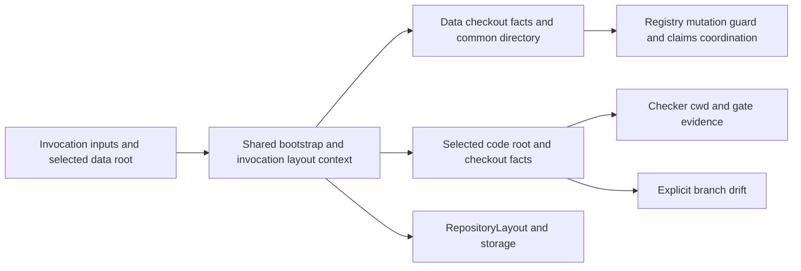

# Select code worktree independently of data root

**Issue:** 5046408a  
**Type:** enhancement  
**Priority:** high  
**Date:** 2026-11-05

## Problem Statement

A data repository can be nested inside or separate from a code checkout. The existing data-root Git probe also supplies the worktree root, so a nested data repository produces overlapping layout roots and a separate one supplies the wrong checker directory and evidence. The invocation needs one layout carrying both authorities.

## Success Criteria

The authoritative criteria are @/issue/5046408a/requirement/REQ-01 through @/issue/5046408a/requirement/REQ-08. They require data-relative config and overriding environment selection, unchanged default, nested and separate repositories, code-root checker evidence, data-common-dir coordination, typed invalid-root errors, and canonical documentation.

## Design

Add optional `[worktree] root` to `WorktreeConfig` in `crates/jit/src/config.rs` and `worktree_root_override` to `RepositoryInvocation`. CLI dispatch, init dispatch, and server startup capture `JIT_WORKTREE_ROOT` once as an OS path and pass it explicitly. Resolve environment first, then config, then the existing derivation. Both relative inputs are relative to the selected data root; absolute inputs remain absolute. An explicitly supplied empty path is invalid, not absent. Do not add a CLI flag or a global cache. Select data root first, then resolve root once in `commands/bootstrap.rs`, and pass the resulting `WorktreePaths` and `RepositoryLayout` through existing executor, store, recovery and server wiring.

Validate the selected path before final layout construction: it must exist, be a directory, and be neither equal to nor below the data root. Traverse root ancestry without following links; reject a symlink at any component instead of canonicalizing it away. Use storage capability/root identity evidence and the pure containment rules in `repository_state/path.rs`; wrap unsafe-root errors with the setting source. A typed invalid-root error includes the supplied and resolved path where available, source (`JIT_WORKTREE_ROOT` or `[worktree].root`), and reason (missing, non-directory, data-root overlap, inaccessible/unsafe path). Never silently fall back on invalid supplied values. Preserve ordinary config parse/I/O errors; a missing config during init is absence, not a fabricated configuration.

### Bootstrap consistency and recovery

`JitConfig::load` requires a layout for reads; `declarations::assemble_configuration` already supplies the shared pure parser. Factor storage-owned no-follow declaration capture and existing admission primitives, not a second parser or unsynchronized raw read. With no pending record, capture data declarations and the existing admission observation (record presence, event-log length/tail and root identity), assemble config, and resolve the candidate code root. On reads retain and revalidate that observation across the consumer's repository capture: never admit config A, discard its observation, and combine its root with a later snapshot B. A pending record or crossed commit returns the existing bounded retryable conflict; readers neither lock writers nor replay. For a clean-store mutation acquire correctly ordered session locks and revalidate selection and root identity before admitting a session; if a record appears, release/restart into the recovery protocol below rather than applying it under the candidate layout. Claim-first reopen and retained sessions obey the same handoff. Reuse the storage admission retry owner rather than building a parallel protocol in commands.

**Authoritative decision:** @/charter/D-26 binds worktree writes to their original root; the implementation footprint awaits steward acceptance and independent re-review. Existing redo records carry root-relative operations but no identity or path for the committing worktree. A record committed against A cannot safely be replayed against a later invocation's B, including when the record already installed a config selecting B. A retry alone cannot satisfy recovery. The accepted direction is a typed optional binding in the existing record header containing the normalized absolute no-follow worktree root and filesystem identity, required exactly for worktree operations and derived from the committing session. Data-only records require no binding. Validate binding presence against operation root classes, update the canonical wire version and fixtures together with explicit rejection of unsupported records, and apply the same validation to the in-memory store. A separate review must accept the concrete footprint before implementation. The alternative per-operation absolute targets duplicate authority; a sidecar, config postimage, fingerprint alone, or asking operators to reproduce environment does not establish the original target.

The recovery protocol is: peek through no-follow data capabilities only to select locks; acquire the recorded worktree bootstrap lock before data/repository/events locks, reopen and revalidate record and both identities, and restart if changed. Recover data-only records with data-only capabilities and no fabricated worktree. Verify the bound worktree identity before any replay write; missing, moved, replaced, inaccessible or symlink-rebound root yields typed recovery failure, leaves the entire record intact and never substitutes the current selection. Replay to the recorded root before final config selection; release recovery guards and select/revalidate the new layout in normal lock order, never silently rebinding a retained session. Recover prior committed work before validating a new invalid selection, preserve startup counts and `jit recover` error classification. A root-opening or bootstrap-lock failure before final validation is also a typed recovery failure. @/charter/D-27 selects recovery before policy for new work: a mutation or `jit recover` completes already committed redo under D-26 before evaluating linked-data write policy for the new invocation. The policy cannot revoke an existing durable commit; do not construct a declaration-postimage overlay. Recovery preserves the record's original audit bytes and emits no new override event. On a clean store, refusal still precedes new mutation/session effects. On a pending store, refusal may follow only recovery of the old record; it cannot publish new work. Evaluate coherent recovered configuration and the explicit invocation override after recovery and before opening the new mutation session. Reads retain D-25 and never recover. Record replacement or changed identities after the lock-selection peek releases guards and restarts without acquiring a second worktree lock under data locks. Derive the binding from the committing session for both ordinary and absent-data-root stage publication. Validate the original root before every replay operation, including data puts.

The scratch record is local recovery state and therefore deliberately carries local root evidence; it remains the single durable authority. Integrate the clean-state handoff with this recovery path, then obtain independent re-review and steward footprint acceptance before implementation.

### Authority and consumer inventory

`WorktreePaths::git()` currently builds a checkout at `worktree_root` conditional on data-root Git classification; this representation cannot express two independent repositories. Retain distinct data checkout identity/top-level/common-dir and selected code checkout facts in the same invocation-owned `LayoutContext`, with explicitly named accessors. Probe each attempted distinct context at most once using existing exact, canonical and top-level alias reuse (a descendant is not automatically an alias, since it may contain a nested repository); do not make `git_repository` mean code membership or repurpose `write_checkout()` globally. Preserve no-setting behavior exactly. Data checkout facts govern `holds_linked_store`, primary data root, linked-write policy and its audit path, worktree projections, `shared_jit`, claim/lease lock and data-history mutation guard. For an external non-Git store the guard has no data history; it must not use a divergent invocation checkout. Existing relocated coordination semantics remain as before where no data checkout exists; a configured root must not cause a data Git repository's common dir to be replaced.

| Consumer | Required authority and projection |
| --- | --- |
| `commands/gate_check.rs`, `commands/validate.rs` explicit branch drift | Checker cwd and relative subdirectory, gate HEAD/branch and drift use the selected code root/checkout. If code is non-Git, evidence must not fall back to Git data. |
| Gate-registry mutation guard | Data checkout history only; a non-Git external data store has no guard history even when coordination or code checkout is Git. |
| `commands/document.rs`, `storage/json.rs`, server document paths | Worktree-relative document read/diff, document history and missing committed-asset lookup all use the selected code root/checkout; do not query tracker history for code documents. Preserve each API's existing non-Git/error behavior. |
| `commands/init.rs`, `commands/profile.rs` | Preserve data classification for init; profile write/dirty checks retain the checkout owning the affected write paths, not a globally repurposed code accessor. |
| `commands/claim.rs`, `storage/claim_coordinator.rs`, lease validation and `commands/worktree.rs` | Preserve data or relocated coordination checkout and its branch, identities, worktree listing and shared common directory. `worktree` output identifies the coordination checkout consistently with its branch, not an unrelated selected code root. |
| `storage/json.rs::primary_layout`, `storage/worktree_identity.rs`, `for_worktree_root` | Map primary data root from the data checkout and preserve selected code root for document/worktree paths; never use a data checkout root as a substitute code root. Identity-only projections use coordination identity/root explicitly, not an equal-root two-root layout. If a primary data root and selected code root cannot form a safe layout, factor data-only access instead of constructing a fake root or weakening overlap checks. |

Audit every direct `worktree_root`, `git()`, `write_checkout()`, `is_worktree()`, `checkout_top_level()` and `for_worktree_root()` consumer, including `gate_execution.rs` tests, before changing accessors. Preserve local/primary issue-storage fallback and the existing absence of a committed-HEAD issue tier; do not reintroduce one. Core storage remains usable without Git; Git-required operations retain their typed failures (@/charter/D-4).

The external Git-module plan's DEC-04 and DEC-23 locate this issue outside its manifest; the steward's data-history guard ruling supersedes its broad selected-worktree wording for that guard. No graph or manifest changes are part of this issue. Pending Git-floor policy and shared revision-producer work are separate; do not assume either is approved.

### Process budget

No configured root: retain the current ordinary-read one-probe and external bootstrap at most two-probe budgets, with external traversal at most $N+1$ for $N$ distinct checkout contexts (DEC-27). With an independently configured code root, data and code are distinct contexts: at most one data probe plus one code probe; aliases reuse `LayoutContext` observations, and projected traversal adds at most one probe per previously unobserved distinct checkout. If data is non-Git and existing relocated coordination context differs from selected code, that third distinct context may need one probe; state and prove the bound as the number of distinct contexts, not an unqualified two. Count attempted contexts including non-Git probes; a selection retry that changes context may add its distinct probe while reusing the invocation context. No extra probe per consumer, and no new Git process for config parsing. Count head/evidence operations separately from layout probes under their existing budgets.

## Implementation Steps

1. Obtain independent re-review and steward acceptance of this footprint before implementation.
2. Test first. In `storage/redo_record.rs`, add typed root binding, presence/structure validation and canonical format version; derive it from the committing session in `storage/repository_state_store.rs`. Update `storage/memory.rs` and canonical fixtures; share structural/binding rules with the filesystem backend while keeping backend capability checks at their own boundary. In `storage/capability_fs.rs` and `storage/redo_apply.rs`, support required data-only/worktree capabilities and validate identity before any replay write, keeping one applier.
3. Factor no-follow data declaration observation and existing admission/recovery primitives in `storage/repository_state_store.rs`, with `storage/json.rs` binding APIs; implement peek, ordered lock acquisition, revalidation, replay and clean-state handoff described above. Reuse `declarations/mod.rs` assembly through `config.rs`. Update `commands/bootstrap.rs`, `crates/jit/src/dispatch/mod.rs`, `crates/jit/src/dispatch/init.rs`, `crates/server/src/lib.rs`, `crates/jit/src/errors.rs`, and `crates/jit/src/output/failure.rs` for typed errors and serialization, with explicit environment input, source-aware selection, retained and claim-first sessions.
4. Refactor `storage/worktree_paths.rs` to retain data, coordination and code facts in its existing invocation context; use `repository_state/path.rs` for pure root evidence and containment without changing its overlap contract. Update `commands/gate_check.rs`, `commands/validate.rs`, `commands/document.rs`, `commands/init.rs`, `commands/profile.rs`, `commands/worktree.rs`, `commands/claim.rs`, `storage/claim_coordinator.rs`, `storage/worktree_identity.rs`, `storage/json.rs`, `crates/server/src/routes.rs`, `crates/jit/src/gate_execution.rs`, and `crates/jit/src/test_utils.rs` according to the authority table. Do not copy another worker's uncommitted guard changes.
5. Update `docs/reference/storage-format.md` for root selection, coordination and changed recovery binding, and `docs/how-to/deployment.md` for the environment variable. Describe shipped behavior, not dogfood policy. Run focused owning tests, then required workspace checks and configured issue gates. Lead handles issue state, linking and commits.

## Testing Approach

| Owner / cheapest layer | Property |
| --- | --- |
| Config/bootstrap unit tests | Config and environment precedence, relative and absolute roots, missing config/init, invalid values and typed source/path, no-follow rejection and no-setting parity; explicit inputs only. |
| Storage admission suite | Config commit between capture and consumer/session handoff, record appearance, data-root replacement, claim-first reopen and retained session; bounded nonblocking conflict and no replay by readers. Cover record appearance and changed root across recovery-to-final-session handoff. |
| Redo representation unit suite | Binding required exactly for worktree-bearing records; structural validation, round-trip and canonical version rejection; existing tests retain ownership of root-relative disjointness. |
| Shared replay/crash suite | Commit for A, then invoke with B by environment or config, including a config put already installed before interruption; replay only A and leave B untouched. Inject interruptions around puts and record removal and prove repeated recovery converges. |
| Storage capability/preflight suite | Missing, replaced, inaccessible or symlink-rebound original root prevents all replay writes and leaves the record; reopening the original matching identity permits recovery. |
| Storage bootstrap/session policy suite | Pending redo changing write policy allow→refuse and refuse→allow, before and after partial config application, plus explicit override: replay exactly the original audit bytes without a new override event, then apply recovered policy to new work. Test record replacement and lock/identity races; clean refusal has no effects, pending refusal has only the old recovery effects. |
| Data-only recovery suite | A config update recovers without any usable code root or fabricated worktree capability; subsequent selection uses recovered config/override. Record changes after peek, data-root replacement and lock order are owned by the storage session suite. |
| `storage/worktree_paths.rs` tests | Nested and separate Git data roots, code/data checkout facts, symlink/overlap boundaries, common dir and linked-store classification, non-Git data and relocated coordination; distinct-context probe counts and aliases. |
| Existing process-budget CLI suite | Child-only environment; ordinary and split reads count layout probes within the stated bounds, including distinct external contexts. |
| Gate/guard harness or CLI boundary | Separate divergent repositories prove checker cwd and recorded code commit/branch, explicit drift observes code, registry guard observes data under opposing data/code histories in both directions, external non-Git data does not inherit code history, and non-Git code never inherits data evidence. Each consumer tests its wiring only. |
| Claim coordination tests | Lease and claims lock under data common dir for nested and separate Git stores with independent linked-code/data combinations; preserve non-Git behavior and identity/branch projection. |
| Document and primary-layout tests | Code document content/history/assets agree under divergent histories; primary data fallback and identity projection do not substitute the data root for code or construct overlapping roots. |
| Server/bootstrap and CLI integration | Each passes the environment selection into shared bootstrap; one end-to-end nested-store opening and error serialization. The linked-policy CLI boundary verifies clean refusal and pending recovery-before-refusal plus override audit behavior; `recover_command_tests.rs` updates the existing worktree-record fixture only. No process-global environment or cwd mutation. |

The planned test files are `crates/jit/src/storage/redo_record.rs` (representation unit tests), `crates/jit/src/storage/memory.rs`, `crates/jit/src/storage/redo_conformance.rs`, `crates/jit/src/storage/repository_state_store_tests.rs`, `crates/jit/src/storage/repository_state_store_contention_tests.rs`, `crates/jit/src/storage/repository_state_store_fixtures.rs`, `crates/jit/src/storage/worktree_paths.rs`, `crates/jit/src/commands/bootstrap.rs`, `crates/jit/src/config.rs`, `crates/jit/src/output/failure.rs`, `crates/server/src/lib.rs`, `crates/jit/tests/cli_repo_workflow/git_process_budget_tests.rs`, `crates/jit/tests/cli_repo_workflow/cross_worktree_integration_tests.rs`, `crates/jit/tests/cli_repo_workflow/claim_integration_tests.rs`, `crates/jit/tests/cli_repo_workflow/linked_checkout_write_policy_tests.rs`, `crates/jit/tests/cli_issue/recover_command_tests.rs`, `crates/jit/tests/cli_repo_workflow/worktree_identity_tests.rs`, `crates/jit/tests/cli_repo_workflow/document_history_tests.rs`, `crates/jit/tests/cli_repo_workflow/document_asset_scan_tests.rs`, and `crates/jit/tests/cli_gate/gate_cli_integration_test.rs`. Use an explicit data-only constructor that leaves `crates/jit/tests/cli_repo_workflow/lease_enforcement_tests.rs` unchanged; if the constructor cannot preserve that call site, request footprint acceptance before editing it. Reuse existing suites and fixtures; no additional Cargo test target. If implementation exposes a required file outside this footprint, return it for steward review before expanding scope.

Run `cargo fmt --all -- --check`, `cargo clippy --workspace --all-targets`, and `cargo test`, plus configured issue gates after implementation. Use the shared Git counting fixture and owned temporary directories; set the worker's prescribed `TMPDIR` before builds/tests. No full build or gates are part of planning.

## Risks and Open Questions

- Independent review and steward acceptance of the concrete footprint remain blocking; recovery must not use uncommitted/stale configuration or a guessed worktree.
- Root aliases, linked worktrees and non-Git data with a distinct invocation checkout expose authority mismatches; cover the distinct contexts explicitly.
- Independent design review and steward acceptance are mandatory before implementation. Preserve @/inv/derived-state-coherence, @/inv/atomic-writes and @/inv/architecture-dependency-direction.
