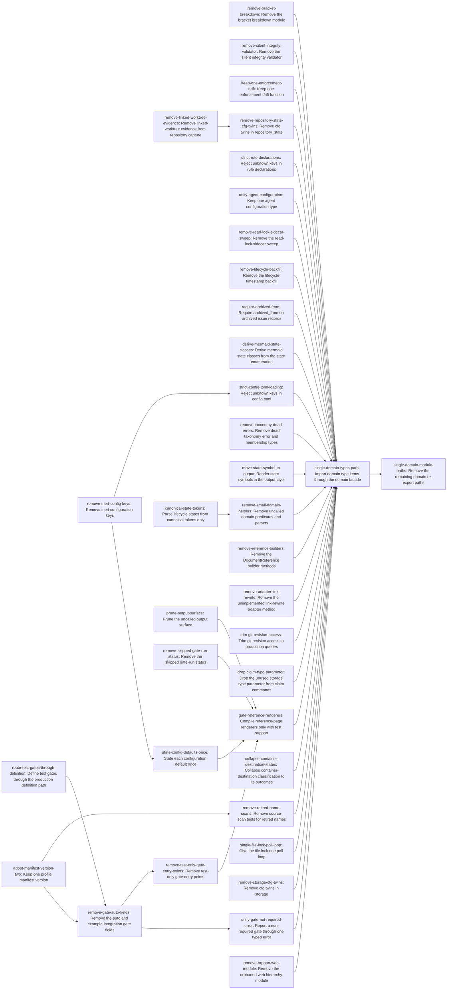

# Plan: Remove dead code and compatibility shims across the workspace (842b0ac6)

> Planning node: 201634a8. Authoritative graph:
> [breakdown.json](breakdown.json).

## Outcome and criterion approach

Every criterion is a removal or a convergence onto a surviving path (`@/charter/D-18`, `@/inv/canonical-cutover`). Breadth comes from many independent families, so the graph is wide. Edges exist only where two tasks rewrite the same region, or where one change must precede another.

| Criterion | Approach | Evidence / open gap |
|---|---|---|
| REQ-01 | Three independent deletions: the breakdown module, the silent validator, and the strict drift twin. The tolerant drift function takes the plain name. | Investigation A, REQ-01 |
| REQ-02 | Remove the linked-evidence chain from capture spec, image, store and gate evidence. Capture stops resolving worktree paths. | Investigation A, REQ-02 |
| REQ-03 | First delete the inert keys and their three readers. Then state each default once: one layered lookup, named constants projected into the runtime-defaults reference, and `config show` rendered from `full_snapshot`. | Investigation B, REQ-03 |
| REQ-04 | `strict-declaration-loading`, applied separately to `config.toml`, rule declarations and `agent.toml`; the last is folded into the agent-config task. | Investigation B, REQ-04 |
| REQ-05 | Keep the production agent type; resolver seams take the environment and loader as parameters. | Investigation A, REQ-05 |
| REQ-06 | Convert both profiles and every fixture to version 2. Delete version-1 decoding and canonical-JSON identity. | Investigation B, REQ-06 |
| REQ-07 | Delete the sweep and `read_issues`. The owning test compares the data root before and after a listing, excluding the index lock. | Investigation A, REQ-07 |
| REQ-08 | Vertical deletion. Old logs parse through the existing retired-tag tolerance. | Investigation A, REQ-08 |
| REQ-09 | `lifecycle-state-tokens`: one exact-token `State::from_str`; rule parsing delegates to it. | Investigation B, REQ-09 |
| REQ-10 | First route test gates through `define_gate`. Then delete both fields and make `GateDefinition` strict. | Investigation B, REQ-10 |
| REQ-11 | Decode-boundary invariant on `Issue`. The revive fallback collapses, and legacy-record tests go. schemars 0.8 ignores `serde(try_from)`, so the `Issue` schema keeps describing `archived_from`. | Investigation B, REQ-11; `schemars_derive-0.8.22/src/attr/schemars_to_serde.rs` |
| REQ-12 | `classDef` set derived from `State::all()`. | Investigation B, REQ-12 |
| REQ-13 | Delete the retired-name scans and keep the ownership tests. Runs after REQ-06, because the decoder authority test lives in the same file. | Investigation A, REQ-13 |
| REQ-14 | `domain-import-path`: the type facade task, then the module-path task. The facade task depends on every sink of the rest of the graph, so both land last. | Investigation C, REQ-14 |
| REQ-15 | Delete the uncalled output API. Derive the exit-code table from `ExitCode::description`. | Investigation C, REQ-15 |
| REQ-16 | Split by module family: taxonomy errors, the skipped gate-run status (a wire change), the state symbol (moved to output), small domain helpers, and reference builders. | Investigation C, REQ-16 |
| REQ-17 | Delete the trait method; feature-gated adapters are exercised. | Investigation C, REQ-17 |
| REQ-18 | Delete the test-only queries. `Arc<io::Error>` and a `String` path payload make the error `Clone`. | Investigation A, REQ-18 |
| REQ-19 | Signature cleanup and a lease-check deletion. | Investigation A, REQ-19 |
| REQ-20 | Two tasks: converge the not-required error, and remove the test-only gate entry points. | Investigation A, REQ-20 |
| REQ-21 | Three-variant destination state. Missing location evidence becomes `ArtifactEvidenceError`. | Investigation C, REQ-21 |
| REQ-22 | The existing `cfg(any(test, feature = "test-support"))` on each renderer; the evidence is a feature-off build with warnings denied. | Investigation C, REQ-22 |
| REQ-23 | One private poll loop. The `try_*` variants and the path accessor become `cfg(test)`. | Investigation A, REQ-23 |
| REQ-24 | Split into a storage task and a `repository_state` task. Twins under opposite `test`/`test-support` conditions go, and re-exports become unconditional. Platform-conditional (`cfg(unix)`) implementations stay. | Investigation A, REQ-24 |
| REQ-25 | Delete the one orphaned module. | Investigation C, REQ-25 |

## Shared architectural contracts

### `removal-hygiene` [plan-fixed] — How a deletion lands

A removed item takes its tests with it, or its tests are rewritten against the surviving path, which then owns the property once (`@/inv/orthogonal-tests`). No test is added to assert that a removed name is absent. Prose that names a removed item is fixed in the same change (`@/inv/essential-code-prose`). Generated references are regenerated, not hand-edited. History files (`CHANGELOG.md`, `dev/archive/`, `dev/studies/`, `dev/benchmarks/`) stay.

### `strict-declaration-loading` [plan-fixed] — Strict configuration and declaration types

Every serde type loaded from `config.toml`, `agent.toml`, `rules.toml` or `gates.toml` derives `deny_unknown_fields` and carries no `serde(alias)`. A load error preserves the toml/serde cause, so the output names the unknown key. Callers must not wrap it in an opaque context or print it with `{}` alone. Free-form payloads are validated at load through typed `Raw*` structs; `RawGateRecency` (`declarations/rules.rs`) shows the pattern.

### `lifecycle-state-tokens` [plan-fixed] — Lifecycle states use exact canonical tokens

`State` parses only the exact token its serde form emits, with no case folding and no alias, through one parser (`State::from_str`). Every state token list, table or class set derives from `State::all()` and `State::as_str()` and is never copied by hand. Other vocabularies, such as priority and gate-run status, are outside this contract.

### `domain-import-path` [plan-fixed] — One import path per domain type

An item defined in `domain/types.rs` is imported as `crate::domain::<Item>`, through a private `mod types` and `pub use types::*`. An item of any other module is imported by its module path (`domain::item::X`, `crate::graph::X`, `crate::labels::x`). Neither `domain/mod.rs` nor `lib.rs` re-exports it. A type added later follows the same rule.

## Generated decomposition overview

<!-- jit:breakdown-overview:begin -->
| Key | Title | Type | Outcome | Contracts | Sources | Footprint | Landing | Depends on |
|---|---|---|---|---|---|---|---|---|
| remove-bracket-breakdown | Remove the bracket breakdown module | task | The bracket breakdown module, its orphaned template-role helper, and its tests are gone. | removal-hygiene | REQ-01 | touches 8 | — | — |
| remove-silent-integrity-validator | Remove the silent integrity validator | task | The uncalled silent integrity validator, with its libgit2 document-reference check, is gone. | removal-hygiene | REQ-01 | touches 1 | — | — |
| keep-one-enforcement-drift | Keep one enforcement drift function | task | Enforcement drift has one function, named enforcement_drift, which production and tests both call. | removal-hygiene | REQ-01, DEC-drift-name | touches 3 | — | — |
| remove-linked-worktree-evidence | Remove linked-worktree evidence from repository capture | task | Repository capture carries no linked-worktree evidence and spawns no git process for it. | removal-hygiene | REQ-02 | touches 15 | — | — |
| remove-inert-config-keys | Remove inert configuration keys | task | The inert worktree-mode, operation, lock, and event settings are gone from code, tests, and docs. | removal-hygiene | REQ-03, DEC-inert-readers, DEC-exit4-lever | touches 16 | — | — |
| state-config-defaults-once | State each configuration default once | task | Each configuration default has one named statement that accessors, printers, and docs derive from. | removal-hygiene | REQ-03 | touches 6 | — | remove-inert-config-keys |
| strict-config-toml-loading | Reject unknown keys in config.toml | task | config.toml loading rejects an unknown key with an error naming it, at each layer. | removal-hygiene, strict-declaration-loading | REQ-04, DEC-config-errors | touches 7 | — | remove-inert-config-keys |
| strict-rule-declarations | Reject unknown keys in rule declarations | task | Rule declarations reject unknown keys at load and spell the doc-type selector one way. | removal-hygiene, strict-declaration-loading | REQ-04, DEC-selector-spelling, DEC-rule-typing | touches 5 | — | — |
| unify-agent-configuration | Keep one agent configuration type | task | One strict agent configuration type exists, and tests call the production agent-id resolver. | removal-hygiene, strict-declaration-loading | REQ-05, REQ-04, DEC-agent-config | touches 3 | — | — |
| adopt-manifest-version-two | Keep one profile manifest version | task | Profile manifests have one wire version, version 2, with one identity hashing scheme. | removal-hygiene | REQ-06, DEC-manifest-v2 | touches 17 | — | — |
| remove-read-lock-sidecar-sweep | Remove the read-lock sidecar sweep | task | Listing issues writes nothing beyond the index lock, and the sidecar sweep with its trait method is gone. | removal-hygiene | REQ-07, DEC-lock-files | touches 6 | — | — |
| remove-lifecycle-backfill | Remove the lifecycle-timestamp backfill | task | The lifecycle-timestamp backfill is gone, and logs holding its record still load. | removal-hygiene | REQ-08, DEC-backfill-parse | touches 17 | — | — |
| canonical-state-tokens | Parse lifecycle states from canonical tokens only | task | Lifecycle states parse only from their exact serde tokens, through one parser. | removal-hygiene, lifecycle-state-tokens | REQ-09, DEC-state-tokens | touches 6 | — | — |
| route-test-gates-through-definition | Define test gates through the production definition path | task | Tests define gates through define_gate, and the test-only definition method is gone. | removal-hygiene | REQ-10, DEC-gate-strict | touches 9 | — | — |
| remove-gate-auto-fields | Remove the auto and example-integration gate fields | task | Gate declarations hold no auto or example-integration field, and automation reads mode alone. | removal-hygiene, strict-declaration-loading | REQ-10, DEC-gate-auto-flag, DEC-gate-strict | touches 28 | — | route-test-gates-through-definition, adopt-manifest-version-two |
| require-archived-from | Require archived_from on archived issue records | task | Archived issue records without archived_from fail to decode, and the revive fallback is gone. | removal-hygiene | REQ-11, DEC-archived-from | touches 6 | — | — |
| derive-mermaid-state-classes | Derive mermaid state classes from the state enumeration | task | Mermaid export declares one class per lifecycle state, derived from the state enumeration. | removal-hygiene, lifecycle-state-tokens | REQ-12 | touches 2 | — | — |
| remove-retired-name-scans | Remove source-scan tests for retired names | task | No test asserts the absence of retired names, and structural tests assert current ownership. | removal-hygiene | REQ-13, DEC-alias-test | touches 3 | — | adopt-manifest-version-two |
| single-domain-types-path | Import domain type items through the domain facade | task | Items of domain/types.rs resolve through one compiler-enforced path, the domain facade. | removal-hygiene, domain-import-path | REQ-14, DEC-domain-path | touches 39 | — | remove-bracket-breakdown, remove-silent-integrity-validator, keep-one-enforcement-drift, strict-config-toml-loading, strict-rule-declarations, unify-agent-configuration, remove-read-lock-sidecar-sweep, remove-lifecycle-backfill, require-archived-from, derive-mermaid-state-classes, remove-retired-name-scans, remove-taxonomy-dead-errors, move-state-symbol-to-output, remove-small-domain-helpers, remove-reference-builders, remove-adapter-link-rewrite, trim-git-revision-access, drop-claim-type-parameter, unify-gate-not-required-error, collapse-container-destination-states, gate-reference-renderers, single-file-lock-poll-loop, remove-storage-cfg-twins, remove-repository-state-cfg-twins, remove-orphan-web-module |
| single-domain-module-paths | Remove the remaining domain re-export paths | task | Domain submodule, graph, and label items resolve only by module path, with no crate-root copies. | removal-hygiene, domain-import-path | REQ-14, DEC-domain-path | touches 33 | — | single-domain-types-path |
| prune-output-surface | Prune the uncalled output surface | task | Each output macro, error constructor, exit-code helper, and context method has a production caller. | removal-hygiene | REQ-15, DEC-exit-code-table | touches 3 | — | — |
| remove-taxonomy-dead-errors | Remove dead taxonomy error and membership types | task | The taxonomy holds no discarded error enum, unconstructed variant, or test-only membership checker. | removal-hygiene | REQ-16, DEC-hierarchy-error | touches 4 | — | — |
| remove-skipped-gate-run-status | Remove the skipped gate-run status | task | Gate-run status has no skipped variant in the type, CLI, schema, references, or web model. | removal-hygiene | REQ-16 | touches 7 | — | — |
| move-state-symbol-to-output | Render state symbols in the output layer | task | One output-layer function maps a lifecycle state to its symbol, and the domain twin is gone. | removal-hygiene | REQ-16, DEC-state-symbol | touches 3 | — | — |
| remove-small-domain-helpers | Remove uncalled domain predicates and parsers | task | Uncalled item-kind scope parsing, state and namespace predicates, and the git error helper are gone. | removal-hygiene | REQ-16 | touches 3 | — | canonical-state-tokens |
| remove-reference-builders | Remove the DocumentReference builder methods | task | DocumentReference has no builder methods, and tests share one reference fixture. | removal-hygiene | REQ-16, DEC-docref-builders | touches 13 | — | — |
| remove-adapter-link-rewrite | Remove the unimplemented link-rewrite adapter method | task | Document adapters expose no link-rewrite method, and library code holds no unimplemented macro. | removal-hygiene | REQ-17 | touches 1 | — | — |
| trim-git-revision-access | Trim git revision access to production queries | task | Git revision access exposes production queries only, and its error type derives Clone. | removal-hygiene | REQ-18 | touches 2 | — | — |
| drop-claim-type-parameter | Drop the unused storage type parameter from claim commands | task | Claim commands carry no unused storage type parameter, and the uncalled lease check is gone. | removal-hygiene | REQ-19 | touches 2 | — | — |
| unify-gate-not-required-error | Report a non-required gate through one typed error | task | A gate that is not required is reported through GateNotRequiredError alone. | removal-hygiene | REQ-20 | touches 3 | — | remove-gate-auto-fields |
| remove-test-only-gate-entry-points | Remove test-only gate entry points | task | Gate presets hold no rule constructor, and no test-only checker entry or passthrough remains. | removal-hygiene | REQ-20 | touches 4 | — | remove-gate-auto-fields |
| collapse-container-destination-states | Collapse container-destination classification to its outcomes | task | Container-destination classification has one variant per outcome, and missing location evidence is an error. | removal-hygiene | REQ-21 | touches 3 | — | — |
| gate-reference-renderers | Compile reference-page renderers only with test support | task | Reference-page renderers compile only into builds that include the generated-artifact checks. | removal-hygiene | REQ-22, DEC-renderer-gating | touches 10 | — | prune-output-surface, remove-skipped-gate-run-status, state-config-defaults-once, remove-test-only-gate-entry-points |
| single-file-lock-poll-loop | Give the file lock one poll loop | task | The file lock has one poll loop, and its non-blocking variants and path accessor exist only in tests. | removal-hygiene | REQ-23, DEC-lock-path | touches 1 | — | — |
| remove-storage-cfg-twins | Remove cfg twins in storage | task | Storage holds no cfg twin and no dead-code allow on a public item. | removal-hygiene | REQ-24, DEC-dead-code-scope | touches 2 | — | — |
| remove-repository-state-cfg-twins | Remove cfg twins in repository_state | task | repository_state holds no cfg re-export twin, uncalled scaffold, or test-only membership diff. | removal-hygiene | REQ-24, DEC-dead-code-scope | touches 3 | — | remove-linked-worktree-evidence |
| remove-orphan-web-module | Remove the orphaned web hierarchy module | task | Each web UI source module is imported by the application or its tests. | removal-hygiene | REQ-25, DEC-web-orphan | touches 1 | — | — |

<!-- jit:breakdown-overview:end -->

## Material risks and owner decisions

| Risk / decision | Resolution and rationale |
|---|---|
| DEC-lock-files | Chosen: the execution lead deletes the 19 untracked, ignored `.jit/issues/*.lock` files in the primary checkout at integration and records the listing as evidence. Rejected: carrying the deletion in a commit, because ignored files cannot be committed. |
| DEC-backfill-parse | Chosen: rely on the existing unknown-tag skip in `parse_known_events`, owned by `storage/json.rs:1831`, with evidence from this repository's log loading under validation. Rejected: a parse-only variant (a compatibility shim), and rewriting this repository's log (it rewrites history for no gain). |
| DEC-domain-path | Chosen: the `domain::<Type>` facade with a private `mod types`, which the compiler enforces, with sibling and crate-root re-exports removed in a second task. The facade task depends on every other sink, so both land last. Rejected: `domain::types::` everywhere, because it means about 546 hand edits with no compiler enforcement. |
| DEC-exit-code-table | Chosen: derive `generate_exit_codes` from `ExitCode::description`, which removes the hand copy at `schema.rs:835`. Rejected: deleting `description` and keeping the copy, because the copy is a single-source-prose defect. |
| DEC-hierarchy-error | Chosen: `extract_type` returns `Option`, and `HierarchyError` is deleted. Rejected: keeping the enum minus `UnknownType`, because every caller discards it. |
| DEC-state-symbol | Chosen: one output-layer state-symbol renderer; the domain method is deleted. Rejected: dropping the item from scope, because presentation does not belong in the domain and the twin is a convergence defect. |
| DEC-docref-builders | Chosen: delete all six builders; tests share one fixture. Rejected: deleting only the zero-caller pair, because the test-only builders keep test code inside the production API. |
| DEC-renderer-gating | Chosen: the existing `test-support` cfg, with the worker recording a feature-off `cargo check` as evidence. Rejected: a new CI step, because it costs a build for one property. |
| DEC-web-orphan | Chosen: delete the module, with no import-graph guard. Rejected: knip or a vitest guard, because REQ-25 asks for none (D-18). |
| DEC-lock-path | Chosen: `#[cfg(test)]` on the accessor and its field, matching the criterion text. Rejected: deleting the accessor and its assertions, because the criterion says the accessor exists in test builds. |
| DEC-drift-name | Chosen: rename `enforcement_drift_tolerant` to `enforcement_drift`. Rejected: keeping the suffix, because it only distinguished the deleted twin. |
| DEC-agent-config | Chosen: keep `agent_config::AgentConfig` with production's required fields, drop the inert `default_ttl_secs`, and put `agent.toml` strictness on that type. Rejected: a separate strictness task, because it would edit a type the same change deletes. |
| DEC-dead-code-scope | Chosen: REQ-24 covers `allow(dead_code)` on public items, and twins under opposite `test`/`test-support` conditions. The `pub(crate)` configuration-dependent allows and the platform-conditional implementations stay. Rejected: removing them, because they hold code that is live in other build configurations or on other platforms. |
| DEC-alias-test | Chosen: REQ-13 also deletes the retired-verb absence tests at `command_alias_tests.rs:99` and `gate_status_all_strict_test.rs:249`, and the decoder authority test at `:1382` is updated by the REQ-06 task. Rejected: leaving the verb tests, because they follow the same retired-name pattern. |
| DEC-exit4-lever | Chosen: the `malformed-config-toml` setup kind. Rejected: `JIT_ENFORCE_LEASES=<invalid>`, because bedf0962 may delete that variable. |
| DEC-state-tokens | Chosen: exact snake_case tokens matching serde, with case folding removed. Priority parsing is out of scope. Rejected: case-insensitive parsing, because it keeps two token rules. |
| DEC-selector-spelling | Chosen: `has_doc_type`, which the writers and the reference already use. Rejected: `has-doc-type`, because it appears in one how-to only. |
| DEC-rule-typing | Chosen: typed `Raw*` validation at load, keeping the table payload. Rejected: fully typing the assertions, which belongs to 2195c98f. |
| DEC-gate-auto-flag | Chosen: `gate define --auto` stays (CLI sugar, not a declaration field). Rejected: removing it, because that is a separate CLI-surface choice. |
| DEC-gate-strict | Chosen: `GateDefinition` becomes strict in the field-removal task, and the four automated test gates take a repository-validation checker. Rejected: leaving it tolerant, because a stale `auto` would then load silently. |
| DEC-config-errors | Chosen: `JitConfig::load` errors carry the serde cause. Rejected: the opaque context, because it fails "names the key". |
| DEC-inert-readers | Chosen: REQ-03 covers `config show`, `config get` and `config validate`. Rejected: covering `config show` only, because the investigation found three readers. |
| DEC-manifest-v2 | Chosen: version 2 everywhere, with the dogfood dependency at `"*"` and the release-contract script reading `compatible-jit`. The same task re-applies the dogfood profile if the identity change invalidates a record. Rejected: keeping version-1 decoding, because it is a compatibility shim. |
| DEC-archived-from | Chosen: required at the decode boundary. Rejected: a validation finding, because only `jit validate` would see it. |
| DEC-follow-ups | Not planned. Reported to the steward: the archive short-id destination fallback (`artifact_classifier.rs:417-431`, `storage/artifact_planning.rs:27-75`, `commands/archive.rs:203-224`), and f4d9502a background bullets that REQ-01 and REQ-18 make moot. |
| External dependency d92f54aa | Attaches to manifest keys `remove-inert-config-keys` and `strict-config-toml-loading` (re-home at breakdown). Both edit the `config.rs` coordination structs that d92f54aa changes, and its rejection test folds into the strictness owner. |
| External dependency bedf0962 | Attaches to manifest key `state-config-defaults-once` (re-home at breakdown). It owns `enforce_leases` resolution. |
| External dependency 6ff14f21 | Attaches to manifest keys `remove-silent-integrity-validator`, `remove-inert-config-keys`, `unify-agent-configuration` and `route-test-gates-through-definition` (re-home at breakdown). Its uncommitted edits sit in `validate_integrity_silent`, the `config.rs` tests and the gate harness. |
| External dependency d23c58c0 | Attaches to manifest key `remove-taxonomy-dead-errors` (re-home at breakdown). Its hunks in `type_taxonomy.rs` are disjoint. |
| External dependency cd2ed136 | Attaches to manifest key `derive-mermaid-state-classes` (re-home at breakdown). Already merged; its issue still awaits gates. |
| Overlap 16d63038 | Mild, no edge. It edits the `IssueStore` trait and its impls, which `remove-read-lock-sidecar-sweep` also edits. Hunks are disjoint; whichever lands second rebases. |
| Overlap df129d9e | Mild, no edge. It shares `main.rs`, `cli.rs`, `output.rs`, `output_macros.rs` and `schema.rs` with `remove-lifecycle-backfill`, `prune-output-surface` and `drop-claim-type-parameter`. If `output_macros.rs` ends up empty, whichever task lands second deletes it. |
| Shared-file contention | `config.rs`, `domain/types.rs`, `commands/gate.rs`, `commands/gate_check.rs`, `output.rs` and `main.rs` are edited by several tasks in disjoint regions. The overview's footprints mark them, and edges serialize only the conflicting regions. The domain-path tasks are sed-driven and land after every other task, so no later task reintroduces a `domain::types::` path. |

## Investigation sources

- [Investigation](investigation.md) owns the consumer and file inventories, footprints, size estimates and split points for slices A, B and C.
