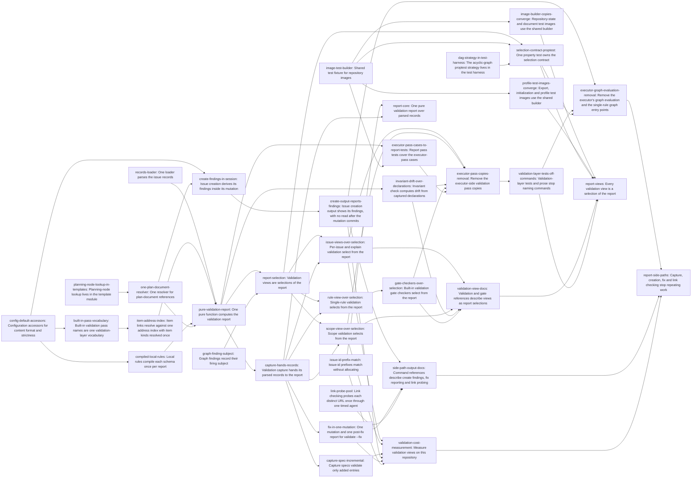

# Plan: Compute one validation report and derive every validation view from it (9876a23a)

> Planning node: 2df01664. Authoritative graph:
> [breakdown.json](breakdown.json).

## Outcome and criterion approach

Repository validation becomes one pure validation-layer function, `validation::report`, over a captured validation (the image plus the index and records the one loader parsed) and the inputs its caller supplies. Every view, CLI or gate checker, captures once, computes that report and selects from it through one membership predicate (`@/charter/D-20`). Only whole `jit validate` and the `repository_validation` checker read history; they hand the report the record-fidelity and document-reference verdicts as an optional input (DEC-17). Shared resolution (records, plan documents, item addresses, item kinds, issue-id prefixes, schemas, configuration defaults) moves to one function each before the report is assembled, preferring an existing primitive to a new type (`@/charter/D-18`, DEC-18). The side paths stop repeating work: capture specs grow incrementally, issue creation derives findings in its mutation, `--fix` publishes once, and link checking probes each URL once. Each issue body is written against the code as it stands after the upstream tasks the entry follows, and cites current lines.

| Criterion | Approach | Evidence / open gap |
|---|---|---|
| REQ-01 | `pure-validation-report` replaces `validate_repository`, its `_with_materializations` twin and the `Result` pair with `report(&CapturedValidation, &ReportInputs)`, the history verdicts an optional input (DEC-17); the executor's second graph computation goes in `executor-graph-evaluation-removal`, and the checkers' pipelines in `gate-checkers-over-selection`. | Investigation, core §1.1, §4.2, §5.1; [audit](audit.md) Finding 1 |
| REQ-02 | `report-selection` adds finding provenance (with `graph-finding-subject`) and `select`/`explain`; `issue-views-over-selection`, `rule-view-over-selection` and `scope-view-over-selection` make each view capture once, read no history, and select. | Core §1.2–1.5, §5.2 |
| REQ-03 | `gate-checkers-over-selection` maps each checker to its selection (`checker-selections`) and owns one parity test against `jit validate`. | Core §1.6 |
| REQ-04 | `selection-contract-proptest` checks every selection against an oracle written from `selection-membership`, over generated images covering every finding kind, built with `image-test-builder` and the harness graph strategy (`dag-strategy-in-test-harness`); view tests shrink to wiring (DEC-11). | Core §4.4, §6.1, §6.2 |
| REQ-05 | `invariant-drift-over-declarations` moves the last production consumer off the drift copy; `executor-pass-cases-to-report-tests` moves their test cases onto the report passes; `executor-pass-copies-removal` deletes the copies; checkers stop calling whole validation for subsets. | Core §1.7 |
| REQ-06 | `planning-node-lookup-in-templates`, `built-in-pass-vocabulary`, the claims-index check deleted by f8a6b298 (DEC-09), and `validation-layer-tests-off-commands` for tests and rustdoc. | Core §2 row 3, §5.3 |
| REQ-07 | `item-address-index` (one index per report, kinds resolved once on captured declarations); `issue-id-prefix-match` removes the per-candidate allocation in container-pointer and coverage-label matching (DEC-10). The per-issue `show_item` path goes with the issue view. | Core §4.6, §5.4; capture C4 |
| REQ-08 | The per-issue view becomes one capture and one report and skips the divergence view, the history verdicts and the claims index, so its work is a subset of whole validation's; `validation-cost-measurement` records interleaved release-build pairs on a copy of this repository (DEC-12). Re-measured on 120402067: per-issue 5.81 s against whole 4.53 s. | Capture §5 REQ-08 A; [audit](audit.md) |
| REQ-09 | `capture-spec-incremental`: per-entry validation and the base requests applied once per capture (DEC-16). | Capture C1–C3, §4 |
| REQ-10 | `records-loader` converges three loaders; `capture-hands-records` hands capture's parse to the report, the divergences, document-reference discovery and record fidelity. | Core §2 row 5, §4.3; [audit](audit.md) Finding 1 |
| REQ-11 | `compiled-local-rules`: one shared `SchemaEngine` per report (DEC-18). | Core §4.5 |
| REQ-12 | `one-plan-document-resolver` (one resolver and one plan-content reader); `config-default-accessors` (the two forwarding wrappers go). | Core §5.6; [audit](audit.md) Finding 2 |
| REQ-13 | `create-findings-in-session` derives findings from the mutation image through one captured graph-evaluation helper (DEC-18); `create-output-reports-findings` renders them identically and removes post-publish reads (DEC-13). | Capture C6, §5 REQ-13 A |
| REQ-14 | `fix-in-one-mutation` (DEC-14, DEC-04(2), DEC-04(3)). | Capture C7, §4, §5 REQ-14 A |
| REQ-15 | `link-probe-pool` (DEC-15). | Capture C8, §4 |

## Shared architectural contracts

### `selection-membership` [plan-fixed] — What each selection admits

A finding carries its origin (local rule; graph rule, with whether the rule is repository-wide at transition; or a built-in pass), its firing subject, its attribution and whether it is a configuration error.

- **Whole**: every finding, and the structural failure. Admitted only from a report that carries the history verdicts; otherwise it fails with a typed error.
- **Issue(I)**: findings attributed to I from local rules, graph rules and the item-link pass; configuration errors of graph rules whose selector matches I, when their subject is I or absent; and `rules-file`. It excludes `enforcement-drift`, `review-placeholder`, unattributed findings and the structural failure. Kept findings are reported with I as their issue.
- **Scope(C)**: S = `bracket_scope_ids(C, issues, breakdown type of C's template)`. Local-rule and item-link findings attributed to a member of S; graph findings attributed to a member of S from rules not repository-wide at transition; configuration errors whose subject is in S, or subject-less ones of rules matching a member of S; `enforcement-drift`; `rules-file`. It excludes `review-placeholder` and the structural failure. Rules are evaluated over the whole repository (DEC-06).
- **Rule(I, R)**: a rule `select_graph_rule` cannot select for I is a `RuleSelectionFault`, which the CLI renders as one error finding naming R; otherwise R's findings whose subject is I, with their own attribution, plus R's subject-less configuration errors; `rules-file` when the rule set is unloadable.
- **Explain(I)**: one outcome per rule; a matched rule fails exactly when the Issue(I) selection holds a finding of it.

A failed record-fidelity or document-reference verdict is part of the structural failure, so only Whole reports it. A prefix resolves against the report's records through the shared resolver, with today's not-found and ambiguity errors. A report without parsed records fails every selection but Whole with its structural error. Sources: DEC-05, DEC-06, DEC-07, DEC-17; investigation core §5.2.

### `checker-selections` [plan-fixed] — Built-in checker to selection

`repository_validation` reports Whole (findings and structural failure) from a report its own history-reading capture builds; `issue_validation` reports Issue(gated issue); `rule_validation { rule }` reports Rule(gated issue, rule); `label_target_validation { label_namespace }` reports Scope(target named by the gated issue's single label in that namespace). The issue, rule and label-target checkers read no event-log history and no gate-run listing. A run's status follows the built-in fault classification: an unloadable rule set, a `RuleSelectionFault`, and a missing, repeated, unresolvable or ambiguous target label are faults that record `error`; content findings record `failed`. `review_placeholder` is not a report view.

### `validation-report` [implementation-produced] — The one report

`validation::report(&CapturedValidation, &ReportInputs) -> ValidationReport` in the validation layer is the only report computation. `CapturedValidation` pairs a captured image with the index and records the loader parsed (`CapturedValidation::from_image` parses them when the caller has none). `ReportInputs` carries the evaluation instant and an optional history input holding the record-fidelity and document-reference verdicts, which only whole `jit validate` and the `repository_validation` checker supply (DEC-17). `ValidationReport` holds the passes reached, the structural failure, whether history was supplied, and the findings with a wire projection to `RuleReport`. Producer: `pure-validation-report`.

### `report-selection` [implementation-produced] — Selection operation

`ValidationReport::select(&Selection) -> Result<RuleReport, _>` and `ValidationReport::explain(issue) -> Result<ExplainReport, _>`, implementing `selection-membership` through one predicate over findings with provenance. Producer: `report-selection`.

### `graph-finding-subject` [implementation-produced] — Firing subject

`GraphFinding.subject: Option<IssueId>` is the issue whose rule application fired the finding; `None` for `label-uniqueness` and rule-level configuration errors. Producer: `graph-finding-subject`.

### `parsed-records` [implementation-produced] — One records loader

One `repository_state` function parses every issue record the captured `.jit/issues` listing names from a byte source into parsed records, in listing order, checks embedded ids and returns typed errors. Membership comes from the listing; the index holds tombstones only. Producer: `records-loader`.

### `built-in-pass` [implementation-produced] — Built-in pass names

`BuiltInPass` in the validation layer, declared through the wire-vocabulary macro, names `rules-file`, `dangling-item-link`, `enforcement-drift` and `review-placeholder`. Producer: `built-in-pass-vocabulary`.

### `planning-node-lookup` [implementation-produced] — Planning node in templates

`crate::templates` owns `find_planning_node`, `planning_node_plan_path`, the plan-document label and `declared_container_label` with the container-token interpolation. Producer: `planning-node-lookup-in-templates`.

### `plan-document-resolver` [implementation-produced] — One plan resolver

One `crate::templates` function maps a container, the issues by id and the template registry to its plan-document reference and whether its planning node is done; one function reads plan content from an image for the issues its caller holds. Producer: `one-plan-document-resolver`.

### `config-default-accessors` [implementation-produced] — Configuration defaults

`JitConfig::content_format()` (Markdown when undeclared) and `JitConfig::strictness()` (loose when undeclared) are the only readers of those defaults; no forwarding wrapper remains. Producer: `config-default-accessors`.

### `compiled-local-rules` [implementation-produced] — Shared schema engine

Local-rule evaluation accepts a caller's `SchemaEngine`, whose cache keys compiled validators by schema, and repository validation passes one engine across its issues; `evaluate_local` keeps its signature over an engine of its own. No compiled-rule-set type is added (DEC-18). Producer: `compiled-local-rules`.

### `address-index` [implementation-produced] — Item address index

A domain address index over issue-embedded and project items resolves canonical and issue-scoped addresses; `CapturedRepositoryDeclarations` carries the item kinds resolved once. Producer: `item-address-index`.

### `image-test-builder` [implementation-produced] — Test images

`jit::test_harness` builds a closed `RepositoryImage` from any `RepositoryEntry` values (files, absences, directories, symlinks, tail reads), listings and pinned document evidence keyed by revision and path, over a derived or caller-supplied capture spec and a fixed or caller-supplied layout. Producer: `image-test-builder`.

### `incremental-capture-spec` [implementation-produced] — Spec growth

`CaptureSpec::discover_paths`, `discover_tail`, `discover_kinds` and `discover_listings` validate only added entries and the listing count, clone nothing, and leave the spec unchanged on refusal; a capture applies its base requests once, not in every discovery round. Producer: `capture-spec-incremental`.

### `creation-findings` [implementation-produced] — Creation findings

Issue creation returns `findings` (wire `ReportedFinding`): the new issue's local-rule findings and the graph-rule findings attributed to it, from the mutation's captured issues plus the new record, the mutation timestamp and plan content from the mutation image. One captured graph-evaluation helper derives that evidence and evaluates graph rules for creation and for the transition, field-update, lifecycle, dependency-removal and bulk-update paths (DEC-18). Producer: `create-findings-in-session`.

## Generated decomposition overview

<!-- jit:breakdown-overview:begin -->
| Key | Title | Type | Outcome | Contracts | Sources | Footprint | Landing | Depends on |
|---|---|---|---|---|---|---|---|---|
| planning-node-lookup-in-templates | Planning-node lookup lives in the template module | task | Planning-node and container-label resolution move from commands into crate::templates. | — | REQ-06, DEC-05 | touches 6 | — | — |
| one-plan-document-resolver | One resolver for plan-document references | task | Plan-document references resolve through one function, and plan content is read through one function. | planning-node-lookup | REQ-12, DEC-05, DEC-18 | touches 5 | — | planning-node-lookup-in-templates |
| config-default-accessors | Configuration accessors for content format and strictness | task | The content-format and strictness defaults are read only through the JitConfig accessors, which have their own tests. | — | REQ-12, DEC-18 | touches 6 | — | — |
| built-in-pass-vocabulary | Built-in validation pass names are one validation-layer vocabulary | task | The built-in pass rule names become a closed vocabulary in the validation layer. | — | REQ-06, DEC-05 | touches 8 | — | config-default-accessors |
| compiled-local-rules | Local rules compile each schema once per report | task | Repository validation evaluates its issues against one shared schema engine, so each schema compiles once per report. | — | REQ-11, DEC-18 | touches 2 | — | config-default-accessors |
| graph-finding-subject | Graph findings record their firing subject | task | Each graph finding records the issue whose rule application produced it, separately from its attribution. | — | REQ-02, DEC-07 | touches 1 | — | — |
| issue-id-prefix-match | Issue-id prefixes match without allocating | task | IssueIdPrefix::matches compares a prefix with a candidate id without allocating a normalised copy of the id. | — | REQ-07, REQ-08, DEC-10, DEC-18 | touches 1 | — | — |
| item-address-index | Item links resolve against one address index with item kinds resolved once | task | Repository validation resolves item links through one address index, and resolves item kinds once from the captured declarations. | — | REQ-07, DEC-10 | touches 5 | — | built-in-pass-vocabulary |
| records-loader | One loader parses the issue records | task | Listed issue records are parsed by one loader shared by validation, capture and mutation bases. | — | REQ-10, DEC-05 | creates 1, touches 4 | — | — |
| pure-validation-report | One pure function computes the validation report | task | A single pure validation-layer function computes the whole-repository report from a captured image and injected inputs. | parsed-records, address-index, compiled-local-rules, plan-document-resolver, built-in-pass | REQ-01, REQ-06, DEC-05, DEC-09, DEC-17 | touches 9 | — | records-loader, item-address-index, compiled-local-rules, one-plan-document-resolver |
| capture-hands-records | Validation capture hands its parsed records to the report | task | Whole-repository validation parses its records once, during capture, and the report reads them. | validation-report, parsed-records | REQ-10, DEC-05, DEC-17 | touches 3 | — | pure-validation-report |
| image-test-builder | Shared test fixture for repository images | task | Tests close a RepositoryImage over declared entries, listings and pinned evidence through one shared fixture. | — | REQ-04, DEC-11 | touches 1 | — | — |
| image-builder-copies-converge | Repository-state and document test images use the shared builder | task | Core repository-state and document test modules build images through the shared builder and keep no private copy. | image-test-builder | REQ-04, DEC-11 | touches 6 | — | image-test-builder |
| profile-test-images-converge | Export, initialization and profile test images use the shared builder | task | Export, initialization and profile-application test modules build images through the shared builder. | image-test-builder | REQ-04, DEC-11 | touches 3 | — | image-test-builder |
| report-selection | Validation views are selections of the report | task | ValidationReport answers whole, issue, scope, rule and explain selections through one membership predicate. | validation-report, graph-finding-subject, selection-membership, built-in-pass | REQ-02, DEC-05, DEC-06, DEC-07, DEC-17 | touches 4 | — | pure-validation-report, graph-finding-subject |
| dag-strategy-in-test-harness | The acyclic-graph proptest strategy lives in the test harness | task | The acyclic dependency-graph proptest strategy moves to the library test harness for unit-test modules to share. | — | REQ-04, DEC-11 | touches 2 | — | — |
| selection-contract-proptest | One property test owns the selection contract | task | A proptest over generated images checks each selection against an oracle written from the membership contract. | report-selection, image-test-builder, selection-membership | REQ-04, DEC-11 | creates 1, touches 1 | — | report-selection, image-test-builder, dag-strategy-in-test-harness |
| issue-views-over-selection | Per-issue and explain validation select from the report | task | jit validate <id> and --explain capture once and select from the one report; the whole-repository rule-report arm goes. | report-selection, validation-report, selection-membership | REQ-02, REQ-08, DEC-07, DEC-11, DEC-17 | touches 6 | — | report-selection, capture-hands-records |
| rule-view-over-selection | Single-rule validation selects from the report | task | jit validate <id> --rule <rule> captures once and selects the rule's findings for the issue from the one report. | report-selection, validation-report, selection-membership | REQ-02, DEC-11, DEC-17 | touches 2 | — | report-selection, capture-hands-records |
| scope-view-over-selection | Scope validation selects from the report | task | jit validate --scope evaluates rules over the whole repository and restricts the report to the container's bracket scope. | report-selection, validation-report, selection-membership | REQ-02, DEC-06, DEC-11, DEC-17 | touches 2 | — | report-selection, capture-hands-records |
| invariant-drift-over-declarations | Invariant check computes drift from captured declarations | task | jit invariant check computes drift through the report's drift function over one captured image, with no unloadable-gate case. | validation-report | REQ-05, DEC-08 | touches 4 | — | pure-validation-report |
| gate-checkers-over-selection | Built-in validation gate checkers select from the report | task | Each built-in validation checker computes the one report over its image and returns its selection. | report-selection, validation-report, checker-selections, selection-membership | REQ-03, REQ-05, DEC-03, DEC-11, DEC-17 | touches 2 | — | rule-view-over-selection |
| executor-pass-cases-to-report-tests | Report pass tests cover the executor-pass cases | task | The report's item-link, drift and placeholder tests assert each case the executor-pass unit tests cover. | validation-report, image-test-builder | REQ-05, DEC-11 | touches 1 | — | pure-validation-report, image-test-builder |
| executor-pass-copies-removal | Remove the executor-side validation pass copies | task | The executor's dangling-link, drift and placeholder passes, the scoped graph entry point and their unit tests are gone. | validation-report | REQ-05 | touches 2 | — | issue-views-over-selection, scope-view-over-selection, invariant-drift-over-declarations, gate-checkers-over-selection, executor-pass-cases-to-report-tests |
| validation-layer-tests-off-commands | Validation-layer tests and prose stop naming commands | task | Nothing under crates/jit/src/validation names a commands item, tests and rustdoc included. | image-test-builder, validation-report | REQ-06 | touches 4 | — | executor-pass-copies-removal |
| validation-view-docs | Validation and gate references describe views as report selections | task | The validation, gate and invariant references describe views as selections of one report. | selection-membership, checker-selections | REQ-02, REQ-03, DEC-06, DEC-07, DEC-08 | touches 6 | — | issue-views-over-selection, scope-view-over-selection, invariant-drift-over-declarations, gate-checkers-over-selection |
| capture-spec-incremental | Capture specs validate only added entries | task | Growing a capture spec checks only the entries a call adds, and a capture applies its base requests once. | — | REQ-09, DEC-16, DEC-18 | touches 2 | — | capture-hands-records |
| link-probe-pool | Link checking probes each distinct URL once through one timed agent | task | Document link checking probes each distinct external URL once, through one HTTP agent with a timeout and bounded threads. | — | REQ-15, DEC-15 | touches 4 | — | — |
| create-findings-in-session | Issue creation derives its findings inside its mutation | task | Issue creation returns the new issue's advisory findings through the one captured graph-evaluation helper. | plan-document-resolver | REQ-13, DEC-13, DEC-18 | touches 6 | — | config-default-accessors, one-plan-document-resolver |
| create-output-reports-findings | Issue creation output shows its findings, with no read after the mutation commits | task | issue create shows the returned findings identically in human and JSON output with no read after the mutation commits. | creation-findings | REQ-13, DEC-13 | touches 6 | — | create-findings-in-session |
| executor-graph-evaluation-removal | Remove the executor's graph evaluation and the single-rule graph entry points | task | Graph findings come only from the report's evaluation and the mutation derivations; the single-rule entry points are gone. | validation-report | REQ-01 | touches 5 | — | create-output-reports-findings, validation-layer-tests-off-commands, selection-contract-proptest |
| fix-in-one-mutation | One mutation and one post-fix report for validate --fix | task | --fix derives its fixes from one capture, commits them in one mutation and always shows one post-fix report. | validation-report | REQ-14, DEC-14, DEC-04 | touches 12 | — | capture-hands-records |
| side-path-output-docs | Command references describe create findings, fix reporting and link probing | task | The command reference states the create, fix and link-check behaviour once. | creation-findings | REQ-13, REQ-14, REQ-15, DEC-13, DEC-14, DEC-15 | touches 3 | — | create-output-reports-findings, fix-in-one-mutation, link-probe-pool |
| validation-cost-measurement | Measure validation views on this repository | task | A scripted release-build run of interleaved pairs on a copy of this repository records per-issue against whole validation. | — | REQ-08, DEC-12 | creates 1, touches 1 | — | issue-views-over-selection, scope-view-over-selection, capture-spec-incremental, create-output-reports-findings, fix-in-one-mutation, issue-id-prefix-match |
| report-core | One pure validation report over parsed records | story | One pure report function over once-parsed records, shared resolvers and compiled rules. | — | REQ-01, REQ-06, REQ-07, REQ-10, REQ-11, REQ-12 | — | — | issue-id-prefix-match, capture-hands-records |
| report-views | Every validation view is a selection of the report | story | Every validation view and built-in validation checker is a selection of the one report. | — | REQ-02, REQ-03, REQ-04, REQ-05, REQ-06 | — | — | image-builder-copies-converge, profile-test-images-converge, selection-contract-proptest, validation-view-docs, validation-layer-tests-off-commands |
| report-side-paths | Capture, creation, fix and link checking stop repeating work | story | Capture, issue creation, --fix and link checking do their work once, and the measured views meet the bound. | — | REQ-08, REQ-09, REQ-13, REQ-14, REQ-15 | — | — | executor-graph-evaluation-removal, side-path-output-docs, validation-cost-measurement |

<!-- jit:breakdown-overview:end -->

## Material risks and owner decisions

| Risk / decision | Resolution and rationale |
|---|---|
| DEC-01 Upstream 2195c98f | Chosen: each root depends on the specific 2195c98f tasks whose code it edits, reduced so no edge is implied by another; the epic-level 9876a23a → 2195c98f edge stays. Rejected: one edge per root onto the whole epic, which holds every entry until 2195c98f closes. External dependency 855d027d → `planning-node-lookup-in-templates`, `config-default-accessors`, `graph-finding-subject`, `image-test-builder`, `dag-strategy-in-test-harness`. External dependency 42bcaa6e → `config-default-accessors`. External dependency 7e8f1525 → `graph-finding-subject`. External dependency e1a6c8c2 → `records-loader`. External dependency f8f80eea → `pure-validation-report`. External dependency 72dfc0d7 → `pure-validation-report`. External dependency bc1955a8 → `item-address-index`. External dependency b4fe7887 → `item-address-index`. Reached transitively, so a direct edge would be rejected as redundant: 1c5da41d, 7abcc22d, c400730c, 0102769f, 5fac48b8, 75951558, 804a8605, d72bf093 and c1c86312 (through 855d027d), 96bb0941 and 3f026bb1 (through 42bcaa6e), 5613ef50, af9c277d, b48d7b2a and 6826f966 (through 7e8f1525), 62a0085a (through f8f80eea), and every 842b0ac6 task, e1af39db, cd7b6c4a, 81e7cdc3 and 69af08af included (every 2195c98f root depends on 842b0ac6). |
| DEC-02 f8a6b298 and f4d9502a neighbours | Chosen: our entries wait where they edit a function those tasks edit. External dependency 5b0e3d63 (done) → `records-loader` (`load_records`). External dependency c3e3e2ff (done) → `pure-validation-report` (claims-index reader). External dependency 725af076 → `capture-spec-incremental` (`discover_paths`). Swapped on 2026-11-04: 725af076 now depends on `image-builder-copies-converge` (cf49da17), replacing the earlier edge in the other direction, because 725af076 rewrites the test-image helpers that cf49da17 deletes. No edge onto f649c144 or 47d62472: no entry edits `validate_leases`, `check_worktree_exists` or `validate_branch_drift`. No edge onto 53d19851 (DEC-09). Rejected: edges from those tasks onto ours, which would delay other epics. |
| DEC-03 39710b3b | Chosen: external dependency 39710b3b → `gate-checkers-over-selection`; the checker entry keeps its fault classification (`checker-selections`). Rejected: landing first and changing the dispatch under 39710b3b. |
| DEC-04 Steward rulings and df129d9e, b697a3f7 order | (1) External dependency 8b7f2973 (done) → `create-findings-in-session`; `create-output-reports-findings` follows it. (2) `fix-in-one-mutation` publishes every fix through one mutation with the existing `Issue::derive_readiness_correction` applied to the projected set until none remains; no parallel readiness derivation. b697a3f7's readiness-derivation task depends on `fix-in-one-mutation` and converges its fixpoint loop later. Rejected: introducing the pure cascade here. (3) 525bd61a is rejected as a duplicate; since 8ffd504de a zero-fix `--fix` already fails over an invalid repository, so `fix-in-one-mutation` REQ-03 asserts the remaining change, the post-fix report's findings in human and JSON output. (4) External edge 578ed10d (b697a3f7) → `executor-graph-evaluation-removal` (f22147ec): 578ed10d depends on f22147ec, because 578ed10d REQ-01 moves `capture_validation_image_with`, which f22147ec deletes. (5) No edge between `create-output-reports-findings` and 3f816619, or between `fix-in-one-mutation` and 06ee9b67 (both df129d9e): each pair rewrites the same CLI arm, and the second lander adapts (agreed with df129d9e's lead). External dependency 9ecde705 → `link-probe-pool`. No edge onto f37d228e, which is done. |
| Integration notes (DEC-04(5)) | 5962427b and 9cc3056a are done: view and report entries put their methods on `ValidationOps` within the facade's bounds, and human findings render through `render_validation_findings` (`crates/jit/src/output.rs:338`). If 06ee9b67's validate handler exists when a view, `--fix` or whole-report entry lands, the entry edits `crates/jit/src/dispatch/validate.rs` instead of the `main.rs` arm and returns its findings outcome. 3f816619 moves the `issue create` arm to a handler: `create-output-reports-findings` edits whichever exists. Profile-lifecycle tasks of 3d9a0ce3 may rewrite `commands/profile.rs`; `pure-validation-report` changes only its report call and error variant there. |
| DEC-05 One report | Chosen: `validation-report` with selections (`report-selection`), reusing `Finding`, `ReportedFinding`, `RuleReport`, `RuleOutcome` and `ExplainReport`. Rejected: keeping the `Result<Report, Failure>` pair and filtering per view, which leaves every view matching two shapes. Steward ruling 2026-11-04 (`capture-hands-records`): the one record decoder keeps the raw value fidelity needs; a repeated issue field is rejected with its line and column as the typed decode always did, a repeated unknown key loads as before, and type errors keep their position. |
| DEC-06 Scope as restriction | Chosen: rules evaluate over the whole repository and scope restricts by attribution (`selection-membership`); stated with a test that fails today in `scope-view-over-selection`. Rejected: evaluating rules over a sliced image, a second computation. |
| DEC-07 Narrowed configuration errors | Chosen: issue and explain selections keep configuration errors whose subject is the issue or absent; `rules-file` always in, `enforcement-drift` always out; `GraphFinding` gains `subject`. Asserted in `report-selection` and, with tests that fail today, `issue-views-over-selection`. Rejected: today's "any configuration error of an applicable rule", which reports other issues' pointer errors. |
| DEC-08 Unloadable `gates.toml` | Chosen: the report fails with a typed error naming the file, and `invariant-drift-over-declarations` makes `jit invariant check` do the same, flipping `test_check_reports_unloadable_gate_registry` and deleting the drift computation's then-dead unloadable-gate case. It follows `pure-validation-report` directly. Rejected: tolerating it as unloadable drift in one surface only. Steward ruling 2026-11-04: `jit invariant check` obtains its declarations through the lock-free storage loads until the read driver's lock-free capture exists (b697a3f7's 578ed10d REQ-08 retires them), per `@/charter/D-22`. |
| DEC-09 Claims-index check | Resolved 2026-11-04: f8a6b298's 2f563673 (absorbing 53d19851) deleted the machine-local claims-index check before `pure-validation-report` dispatched, so `ReportInputs` carries no claims input and the planned bridge was never built. |
| DEC-10 Address index and prefix matching | Chosen: `item-address-index` extracts the existing set into a domain index and resolves item kinds once on captured declarations; `issue-id-prefix-match` makes `IssueIdPrefix::matches` allocation-free, which serves `resolve_container` and `label_credits_id` alike. Rejected: an index keyed to `AddressableItem` that also serves `show_item`, a wider scope than REQ-07; an issue-id index type in `GraphEvaluationContext` (DEC-18). |
| DEC-11 Selection test ownership | Chosen: `selection-contract-proptest` owns the contract; per-view tests shrink to wiring in each view entry; `image-test-builder`, `image-builder-copies-converge` and `profile-test-images-converge` give one image builder, accepting any `RepositoryEntry`, listings, pinned evidence and a derived or caller-supplied spec, that every test module closing an image uses; `RepositoryImage`'s own `close` tests and the production closes in `apply_overlay` and storage capture are not helpers (`@/inv/shared-test-contracts`). The proptest's oracle is written from `selection-membership`, independent of the production predicate. Rejected: per-view example matrices. |
| DEC-12 REQ-08 evidence | Chosen: `validation-cost-measurement` generalises `scripts/benchmark-mutation-cost.sh` and records a release-build run in `dev/active/9876a23a-one-validation-report/benchmark/`: at least five interleaved `validate`/`validate <id>` pairs, the median pair difference judged against zero, the load threshold stated. A miss is a blocking finding against `issue-views-over-selection`. Rejected: an automated wall-clock bound in the suite (debug build, shared-host noise, suite budget). |
| DEC-13 Creation findings | Chosen: findings from the mutation's captured image (`creation-findings`), identical in human and JSON output, not suppressed by `--force`; JSON gains `IssueCreateResponse.findings`. Document-reading passes are not evaluated, since a mutation image holds no issue documents. Rejected: capturing the full validation closure on every create. Steward amendment 2026-11-04: `create-findings-in-session` REQ-02 confines its no-pairing clause to mutation paths; the validation views' pairings go with the report work. Steward ruling 2026-11-04: `issue create --orphan` is removed (5d5a1794 D-01). Steward amendment 2026-11-04: `create-output-reports-findings` criteria trimmed to one renderer and JSON-only findings in `--json` mode. |
| DEC-14 One-mutation `--fix` | Chosen: no pre-fix report; hierarchy, reduction, readiness and derived-state fixes fold into one plan from one capture; one post-fix report always rendered, its exit status authoritative; `--dry-run` runs the same derivation. `jit recover` keeps its derived-state-only repair. Rejected: separate publishers under one held session, which still writes one redo record per publisher. Steward ruling 2026-11-04: `capture-hands-records` leaves the other `--fix` steps' decodes to this task, whose REQ-01 requires the one capture's parsed records; `jit recover` no longer depends on issue records. |
| DEC-15 Link probing | Chosen: one `ureq` agent with a request timeout, distinct URLs deduplicated, a fixed `std::thread::scope` pool; transport failures and timeouts stay `unreachable_url` errors and the never-produced `url_validation_failed` branch goes. Rejected: rayon or tokio (new dependency); reclassifying transport failures as warnings, a behaviour change REQ-15 does not ask for. |
| DEC-16 Incremental capture | Chosen: per-entry validation and the base requests applied once per capture, both in `capture-spec-incremental`, ordered after `capture-hands-records`, which edits the same capture closure. Document references keep one bounded capture each (a04207965), so no reference round is batched; the former `document-reference-round-batched` (e16493fc) is rejected. Other one-at-a-time callers (`gate_check.rs` precheck documents, `overlay.rs`) become linear through the incremental spec. Rejected: batching callers over the clone-and-revalidate spec. |
| DEC-17 History verdicts | Chosen (owner): record fidelity reads the whole event log and every gate run through `read_history_log`, outside `CaptureSpec`, and only whole `jit validate` and the `repository_validation` checker run it (f8a6b298 DEC-19). It and document-reference resolution reach the report as an optional `ReportInputs` history input, supplied only by those two readers; Whole is admitted only from a report that carries it, and every other view and checker states in its criteria that it reads no event-log history and no gate-run listing. Record fidelity consumes the loader's parsed records and index plus the stored bytes it compares (`capture-hands-records`), so REQ-10 holds. Rejected: moving fidelity into `CaptureSpec`, which f8a6b298 DEC-19 rejects; a second, history-free Whole for `run_rules(None)`, whose arm has no production caller and goes in `issue-views-over-selection`. |
| DEC-18 Net production lines | Chosen (owner): prefer an existing primitive to a new type. `compiled-local-rules` shares one `SchemaEngine`; `issue-id-prefix-match` replaces the planned id index; `create-findings-in-session` adds one captured graph-evaluation helper that replaces five hand-built copies instead of adding a sixth; `one-plan-document-resolver` also merges the two plan-content readers. Overtaken work merges: `command-config-defaults` (145b4d57) folds into `config-default-accessors`, whose accessors already exist, and is rejected. Estimated epic total ≈ −1,050 production lines ([audit](audit.md)). Rejected: a compiled-rule-set type and an id-index type, each about +40 lines for a criterion an existing primitive meets. |
| Behaviour changes | Each is stated with its asserting test in the owning entry: scope sees the whole repository and reports `rules-file` for an unloadable rule set; the label-target checker sees the whole repository; issue and explain configuration errors, and the issue checker's, narrow; issue views include `rules-file` and exclude drift; the rule view reports `rules-file` for an unloadable rule set while the checkers keep recording an `error` run; `jit invariant check` fails on an unloadable gate registry; `issue create` reports findings in JSON and `--force` no longer hides them; `--fix` renders the post-fix report and exits by it; an unresponsive URL fails after the timeout instead of stalling. |
| Forced gate re-evaluations | Under the shared host-fault rule (2026-11-04): `3acaa5a3` and `e2082ba9` cargo-ci re-evaluated with `--force` after reusing run `ce967ef2`, which failed under the reverted disk-backed TMPDIR. The forced runs `b8a00dd6` and `04611a35` failed on ENOSPC under /tmp (host fault); `3acaa5a3`'s forced run `a4778b4c` hit ENOSPC from /tmp inode exhaustion; authoritative runs then move to a lead-owned `/dev/shm` TMPDIR (steward ruling) and are re-evaluated with `--force`. |
| Terminal sizing | Each terminal delivers one class with at most four criteria. Entries kept whole for a build reason state it in Background: `records-loader` (private loaders), `pure-validation-report` (signatures that only compile together), `fix-in-one-mutation` (return value and renderer). The deletions of public executor and graph functions are separate entries because the build does not flag uncalled public items; test relocations (`executor-pass-cases-to-report-tests`, `dag-strategy-in-test-harness`, the image-builder convergences) are separate from the entries that need them. The chain-link heuristic postdates the reviewed plan; the entries it flags carry a `chain-link` override naming the distinct function each edits. |
| Shared-file contention | `commands/validate.rs`, `validation/repository.rs`, `commands/gate_check.rs` and `commands/mod.rs` are edited by several entries in distinct functions; same-function edits are ordered by edges (`config-default-accessors` before the views and checkers, the item-link pass through `built-in-pass-vocabulary` then `item-address-index`, `rule_validation_outcome` through `rule-view-over-selection` then `gate-checkers-over-selection`, the capture closure through `capture-hands-records` then `capture-spec-incremental`, plan-content callers through `one-plan-document-resolver` then `create-findings-in-session`). The drift pass is the exception: `report-selection` and `invariant-drift-over-declarations` both follow `pure-validation-report` with no edge between them (owner decision), and the second lander adapts. `image-test-builder` and `dag-strategy-in-test-harness` add distinct items to `test_harness.rs`. |

## Investigation sources

- [Investigation](investigation.md): pipeline map, claim classification, primitive verification, consumer sweeps and option analyses for the report and its views, and for capture, creation, `--fix` and link checking.
- [Audit](audit.md): re-measured costs and the owner-approved amendment (DEC-17, DEC-18) against 120402067.
