# Plan: Converge previews and coupled derivations on the mutation session (b697a3f7)

> Planning node: 0dc73711. Authoritative graph:
> [breakdown.json](breakdown.json).

## Outcome and criterion approach

Every preview and read runs the mutation session of the operation it describes and never publishes (`read-only-session`, `@/charter/D-20`). Every mutation derives its coupled state, readiness, field events and lease checks inside its own plan and publishes one redo record (`@/charter/D-17`). Each duplicated loader, primitive or rule converges on one form (`@/charter/D-18`). Each issue body is written against the code as it stands after the entries and external tasks it follows, and cites current lines.

| Criterion | Approach | Evidence / open gap |
|---|---|---|
| REQ-01 | `readiness-derivation` adds the pure derivation (`readiness-corrections`). `readiness-correction-intents` gives the graph edits one helper. `readiness-in-update-plans` and `readiness-in-auto-done-plan` put the corrections in the field, lifecycle and automatic-Done plans. `validate-fix-readiness-convergence` moves the one-mutation `--fix` onto the helper (DEC-05, DEC-10). | Investigation, session §1 C1–C3, G1–G3, §5 REQ-01/02 |
| REQ-02 | Corrections ride in the primary plan, and `readiness-follow-up-removal` deletes the post-commit publishers. | Session §1 REQ-02 |
| REQ-03 | `state-derivation-convergence` builds one state derivation with prechecks (DEC-11). `bulk-field-events-converge` and `dedicated-field-commands-through-update` give one field derivation, owned by a property test over the three paths. | Session §4 field divergences, G4 |
| REQ-04 | `lease-required-error` defines the message once. `lease-check-in-session` and `template-lease-in-session` move the checks into the publishing session under the claims-first lock order. `lease-check-coverage` extends the checked set to bulk and `dep add`/`dep rm` (`lease-checked-writes`, DEC-04, DEC-08). | Session C5, C6, G5, G6 |
| REQ-05 | `bulk-preview-removal` deletes the uncalled preview (DEC-06). `bulk-apply-one-session` folds the apply derivation over one session and one record. | Session C7, C7f, §5 REQ-05 B2 |
| REQ-06 | `archive-preview-through-execute-planner` runs the execute planner read-only and owns the preview-equals-execute test. `archive-candidates-one-session` plans every candidate on one growing image after `image-identity-token` (DEC-12). `citation-scan-module`, `archive-discovery-tests-to-domain` and `archive-storage-planners-removal` remove the storage-only planners. | Archive §1 C1–C3, §5.1–5.2 |
| REQ-07 | `container-destination-evidence-once` | Archive C4, C5 |
| REQ-08 | `archive-reference-resolution-once` | Archive C6 |
| REQ-09 | `configuration-assembler` (DEC-15), then `configuration-assembly-callers` and `configuration-declarations-mirror-removal`. | Configuration C2, C3, §5 REQ-09 A |
| REQ-10 | `declaration-capture-helper` gives reads a captured bundle. The command and frontend migrations and `effective-rules-tests-onto-declarations` move the readers. `config-manager-disk-readers-removal` and `executor-config-caches-removal` delete the disk readers. `mutation-base-carries-declarations` and `derivations-use-base-declarations` parse once per captured image (DEC-07). | Configuration C1, C4, C5 |
| REQ-11 | `gate-preset-catalog`, `gate-preset-reads-captured`, `gate-preset-manager-removal` | Configuration C6 |
| REQ-12 | `gate-evidence-capture`, `gate-evaluation-resolves-once` (DEC-07) | Configuration C7–C9 |
| REQ-13 | `image-identity-token` (`image-identity`) | Configuration C10–C12, §5 REQ-13 A |
| REQ-14 | `redo-parent-handles-once` | Storage C1, C2 |
| REQ-15 | `redo-subset-crash-proof` proves replay from any subset of persisted operations under `redo-crash-model`. `redo-directory-sync-coalescing` coalesces syncs only if that proof passes, and otherwise documents why per-operation syncs stay (DEC-18). | Storage C3, §4 |
| REQ-16 | `capability-fs-module`, `leaf-open-once`, `profile-reads-through-storage` (DEC-19), `record-commit-through-capabilities` | Storage C4–C7 |
| REQ-17 | `atomic-publication-core` (`atomic-publication`), `control-files-publish-through-core`, and `lease-records-publish-through-core` for the lease records and claims sequence that replace the claims index (DEC-07, DEC-21). | Storage C8–C10, §5 D3–D4 |
| REQ-18 | `layout-violation-domain-type`, `root-relative-path-in-domain` (DEC-13), `domain-typed-errors` | Archive C7–C10; storage REQ-18 row |
| REQ-19 | `declaration-file-set` names the declaration set from the layout (DEC-14). `snapshot-from-one-image` writes stored bytes from one image. `one-form-docs` states the contents. | Archive C11, C12, §5.4 |
| REQ-20 | One entry or pair per sub-item, each crediting REQ-20 and naming its sub-item in the outcome. Process liveness: `process-liveness-primitive` (DEC-20). Declaration modules: `declaration-reads-in-storage`. Safe paths: the two `safe-path-validator-*` entries. Scopes: `issue-scope-type` and `snapshot-scope-to-issue-scope`. Status summary: `status-summary-beside-queries` (DEC-17). Type extraction: `type-extraction-exact-values` (DEC-16). Edit distance: `edit-distance-once`. Claims coordinator: `claim-coordinator-opening`. Issue loading: `issue-lookup-one-path`. No-follow reads: `nofollow-store-reads`. Ancestor walking: `ancestor-walker-once`. Write-if-changed: `write-if-changed-constructor`. Creation stamping: `creation-stamping-one-derivation`. Initialization errors: `initialization-errors-typed`. Archive destination: `archive-destination-no-legacy-fallback`, with its docs in `one-form-docs`. | Investigation part sweeps for each sub-item |

## Shared architectural contracts

### `read-only-session` [plan-fixed] — Previews and reads use the mutation session

A preview, candidate listing, snapshot read or declaration read opens the operation's own mutation session through `with_mutation_session`, captures and derives exactly as the operation does, and returns `SessionStep::Done` without applying a plan. It holds the repository write lock and completes a leftover redo record at open, as `jit validate` does today. No separate read-session type exists (DEC-09).

### `lease-checked-writes` [plan-fixed] — Which writes check leases

Every user-requested write to an existing issue's record checks that issue's lease inside its publishing session against the claims evidence the guard captured. The guard is taken before the repository session (claims-first lock order). This covers field and state updates, assign, unassign, gate add, remove, pass and fail, automatic gate pass, template application, bulk update for each changed match, and `dep add`/`dep rm` on the dependent issue. System-derived writes check nothing: readiness corrections of dependents, `validate --fix`, archive and recovery. Lease-enforcement mode resolution belongs to bedf0962 (done). Lease storage belongs to f8a6b298 (DEC-04, DEC-08).

### `redo-crash-model` [plan-fixed] — Crash model for directory syncs

File data is durable after `sync_all`. A directory entry is durable after its directory's fsync returns. Any subset of entries not yet synced may persist. The record is durable before the first live write and is removed only after every distinct parent the pass touched has been synced. Record operations are pairwise path-disjoint and idempotent (DEC-18; investigation storage §4).

### `readiness-corrections` [implementation-produced] — Pure readiness derivation

`readiness_corrections(base, projected, scope)` in the domain returns, in issue-id order, the Promote and Demote corrections that the projected issue set implies. The scope is `Affected` (changed or new dependency sets, plus direct dependents of issues whose effective terminality changed) or `All`. One pass is complete. Producer: `readiness-derivation`.

### `readiness-correction-intents` [implementation-produced] — Readiness intents in a plan

One command helper turns the corrections into plan intents. Promotion passes graph rules through `derive_state_transition` and records a blocked transition as today. Demotion is direct (DEC-10). Producer: `readiness-correction-intents`.

### `lease-required-error` [implementation-produced] — Missing-lease error

`LeaseRequiredError { issue_id }` in `errors.rs` carries the only definition of the missing-lease message. Strict mode returns it, and warn mode renders its `Display`. Producer: `lease-required-error`.

### `archive-planner-session` [implementation-produced] — Generic archive planner

The archive execute planner runs over any `IssueStore + RepositoryStateStore`, and preview and candidates call it in a read-only session. Producer: `archive-preview-through-execute-planner`.

### `declaration-file-set` [implementation-produced] — Declaration files from the layout

One repository-layout function names the declaration files and declaration directories the layout defines, including the gate-presets directory. Base capture and snapshot read through it. Producer: `declaration-file-set`.

### `configuration-assembler` [implementation-produced] — One configuration assembly

A pure `declarations` function builds a `JitConfig` from optional config, template and invariant bytes. An absent config yields the empty config, and a malformed `[item_kinds]` is a structural error. Producer: `configuration-assembler`.

### `declaration-capture` [implementation-produced] — Captured declarations for reads

An executor helper captures the declaration set read-only and returns the parsed declarations with namespaces and a fallible `hierarchy()`. Producer: `declaration-capture-helper`.

### `mutation-base-declarations` [implementation-produced] — Declarations on the mutation base

The captured mutation base carries its declarations, parsed at most once per captured image on first use. Producer: `mutation-base-carries-declarations`.

### `gate-preset-catalog` [implementation-produced] — One preset catalog

A pure catalog over built-in presets and captured preset bytes keyed by the gate-presets path, with listing and lookup. Producer: `gate-preset-catalog`.

### `gate-evidence` [implementation-produced] — One gate evidence capture

One function captures gate evidence for evaluation and prechecks and enforces the prompt size limit at capture. Documents are captured only where the capture spec holds them (`@/issue/8454236c/decision/D-1`). Producer: `gate-evidence-capture`.

### `image-identity` [implementation-produced] — Shared image with a token

`RepositoryImage` shares its data behind an `Arc` and carries an identity token minted at close. Sessions recognise their image by the token, and equality compares data. Producer: `image-identity-token`.

### `capability-fs` [implementation-produced] — No-follow primitive module

`storage/capability_fs.rs` owns `CapabilityRoots`, the parent walks, the no-follow opens and the repository-file readers, with its own error type. The session and redo apply both import it, and redo apply imports nothing from the session. Producer: `capability-fs-module`.

### `leaf-open` [implementation-produced] — One leaf open

One non-blocking, no-follow leaf open with an fstat recheck serves every storage file reader. Producer: `leaf-open-once`.

### `redo-subset-proof` [implementation-produced] — Subset-replay verdict

The conformance property that replay from any persisted subset of a record converges on both backends, plus its recorded verdict. Producer: `redo-subset-crash-proof`. Its verdict decides `redo-directory-sync-coalescing`.

### `atomic-publication` [implementation-produced] — One file publication

One capability-rooted publish with a uuid stage name and a `Durability` argument, plus a path entry for control files outside the repository roots. Producer: `atomic-publication-core`.

### `domain-root-relative-path` [implementation-produced] — Domain path type

`RootRelativePath` and its parse error live in a pure domain module, with no re-export from `repository_state`. Producer: `root-relative-path-in-domain`.

### `issue-scope` [implementation-produced] — One issue scope

A domain `IssueScope { All, Issue, Label }` with one parser, a typed error and one selection over issues. Producer: `issue-scope-type`.

## Generated decomposition overview

<!-- jit:breakdown-overview:begin -->
| Key | Title | Type | Outcome | Contracts | Sources | Footprint | Landing | Depends on |
|---|---|---|---|---|---|---|---|---|
| readiness-derivation | One pure readiness derivation over a projected issue set | task | A pure domain function returns the Ready and Backlog corrections that a projected issue set implies. | — | REQ-01, DEC-10 | creates 1, touches 1 | — | — |
| readiness-correction-intents | Graph edits carry readiness corrections through one helper | task | Deletion, dependency edits and template edges derive dependent readiness through one command helper. | readiness-corrections | REQ-01, DEC-10 | touches 4 | — | readiness-derivation |
| readiness-in-update-plans | Field and lifecycle updates carry their readiness corrections | task | Single-issue field and lifecycle state changes include dependent readiness corrections in their own redo record. | readiness-correction-intents | REQ-01, REQ-02, DEC-10 | touches 3 | — | readiness-correction-intents |
| readiness-in-auto-done-plan | Automatic Done carries its readiness corrections | task | The automatic Done plan includes dependent promotions in its own redo record instead of a follow-up pass. | readiness-correction-intents | REQ-01, REQ-02, DEC-10 | touches 2 | — | readiness-in-update-plans |
| validate-fix-readiness-convergence | Validate fix derives readiness through the shared helper | task | validate --fix computes readiness repairs with the shared derivation over the whole projected set. | readiness-correction-intents | REQ-01, REQ-02, DEC-05 | touches 1 | — | readiness-correction-intents |
| readiness-follow-up-removal | Post-commit readiness publishers are gone | task | No command publishes a follow-up session to correct readiness after its primary mutation commits. | — | REQ-02 | touches 3 | — | readiness-in-auto-done-plan, validate-fix-readiness-convergence |
| lease-required-error | Missing-lease refusal is one typed error | task | LeaseRequiredError defines the missing-lease message once for strict refusals and warn-mode warnings. | — | REQ-04, DEC-08 | touches 2 | — | — |
| lease-check-in-session | Claims-first lease checks inside the publishing session | task | Assign, unassign and gate commands check leases inside their publishing session, and the pre-session check is gone. | lease-required-error, lease-checked-writes | REQ-04, DEC-04, DEC-08 | touches 5 | — | lease-required-error, readiness-in-auto-done-plan |
| template-lease-in-session | Template application checks leases in its publishing session | task | Template application checks the leases of the issues it edits inside the session that publishes the edits. | lease-required-error, lease-checked-writes | REQ-04, DEC-08 | touches 2 | — | lease-check-in-session |
| state-derivation-convergence | One state derivation for update and lifecycle transitions | task | issue update --state and the lifecycle path share one state derivation with prechecks and one Done divert. | — | REQ-03, DEC-11 | touches 3 | — | lease-check-in-session |
| bulk-field-events-converge | Bulk field changes write the single-update events | task | Bulk assign, unassign and gate edits compose the single-issue field mutations and write their events. | — | REQ-03, DEC-11 | touches 2 | — | readiness-in-update-plans |
| dedicated-field-commands-through-update | Dedicated field commands share the general field derivation | task | Dedicated assignee and gate-attachment commands share the general field derivation and its events. | — | REQ-03, DEC-11 | touches 4 | — | bulk-field-events-converge, state-derivation-convergence |
| bulk-preview-removal | The uncalled bulk-update preview is gone | task | preview_bulk_update and its private helpers are removed, leaving apply as the only bulk derivation. | — | REQ-05, DEC-06 | touches 2 | — | — |
| bulk-apply-one-session | Bulk edits apply their matches in one session | task | One session derives each matched issue's change for a bulk edit and commits one redo record. | read-only-session | REQ-05, DEC-06, DEC-09 | touches 4 | — | dedicated-field-commands-through-update, readiness-follow-up-removal, bulk-preview-removal |
| lease-check-coverage | Bulk and dependency edits check leases in session | task | Bulk edits and dependency edges check each targeted issue's lease inside their publishing session. | lease-required-error, lease-checked-writes | REQ-04, DEC-08 | touches 4 | — | bulk-apply-one-session, template-lease-in-session |
| session-coherence-docs | Adopter docs for readiness, lease and bulk semantics | task | User docs state same-record readiness corrections, in-session lease coverage and one-session bulk semantics. | — | REQ-01, REQ-02, REQ-03, REQ-04, REQ-05, DEC-08, DEC-10, DEC-11 | touches 4 | — | lease-check-coverage |
| archive-reference-resolution-once | Archive discovery resolves each reference once | task | Archive planning resolves each artifact reference once per plan and walks reachability once per distinct root. | — | REQ-08 | touches 1 | — | — |
| archive-preview-through-execute-planner | Archive preview runs the execute planner read-only | task | Archive preview runs capture_archive_plan in a read-only mutation session and reports the plan execute applies. | read-only-session | REQ-06, DEC-09, DEC-12 | touches 4 | — | root-relative-path-in-domain |
| archive-candidates-one-session | Archive candidates plan in one read-only session | task | Candidate listing derives its base once and plans each candidate on the one growing image. | archive-planner-session, read-only-session, image-identity | REQ-06, DEC-09, DEC-12 | touches 1 | — | archive-preview-through-execute-planner, image-identity-token |
| citation-scan-module | Artifact inspection and citation scanning get their own storage module | task | The no-follow artifact inspector and the citation scan move to one storage module built on the shared primitives. | capability-fs | REQ-06, REQ-16 | creates 1, touches 6 | — | root-relative-path-in-domain |
| archive-discovery-tests-to-domain | Archive discovery tests run against the domain discovery | task | The storage-level archive discovery properties are owned by domain tests over in-memory evidence maps. | — | REQ-06 | touches 3 | — | archive-reference-resolution-once |
| archive-storage-planners-removal | Storage-only archive planning helpers are gone | task | The storage archive planners, the storage discovery wrapper and the evidence read only preview used are removed. | — | REQ-06 | touches 7 | — | archive-candidates-one-session, citation-scan-module, archive-discovery-tests-to-domain |
| container-destination-evidence-once | One request for container-destination evidence | task | One function requests container-destination evidence and the container marker name is declared once. | — | REQ-07 | touches 3 | — | archive-storage-planners-removal, layout-violation-domain-type |
| declaration-file-set | The repository layout names its declaration files | task | One layout-level set names the declaration files, and the base capture reads through it. | — | REQ-19, DEC-14 | touches 2 | — | — |
| snapshot-from-one-image | Snapshot export copies stored bytes from one image | task | Snapshot export writes each issue's stored bytes and the declaration files from one captured image. | declaration-file-set, read-only-session | REQ-19, DEC-14, DEC-09 | touches 2 | — | declaration-file-set, root-relative-path-in-domain |
| configuration-assembler | One pure assembler builds JitConfig from source bytes | task | One pure function assembles JitConfig from config, template and invariant bytes for disk loading and image capture. | — | REQ-09, DEC-15 | touches 5 | — | — |
| configuration-assembly-callers | Remaining configuration assemblies call the assembler | task | Validation overlays, template images, initialization and profile apply obtain JitConfig from the one assembler. | configuration-assembler | REQ-09, DEC-15 | touches 6 | — | configuration-assembler |
| configuration-declarations-mirror-removal | Configuration declarations stop mirroring JitConfig fields | task | ConfigurationDeclarations carries no field that duplicates the assembled JitConfig. | configuration-assembler | REQ-09 | touches 7 | — | configuration-assembly-callers |
| declaration-capture-helper | Read paths capture declarations through one helper | task | One executor helper captures the declaration files read-only and returns parsed declarations with namespaces and hierarchy. | read-only-session, declaration-file-set, configuration-assembler | REQ-10, DEC-09 | touches 3 | — | configuration-declarations-mirror-removal, declaration-file-set |
| command-reads-captured-declarations | Graph, item, document and query commands read captured declarations | task | Command read paths take hierarchy, namespaces and rules from captured declarations instead of disk. | declaration-capture | REQ-10 | touches 8 | — | declaration-capture-helper |
| frontend-reads-captured-declarations | CLI and server read paths use captured declarations | task | main.rs and server routes read hierarchy, namespaces, icons and write policy from captured declarations. | declaration-capture | REQ-10 | touches 3 | — | declaration-capture-helper |
| config-manager-disk-readers-removal | ConfigManager disk readers and get_hierarchy_config are gone | task | get_hierarchy_config and the ConfigManager methods that read declaration files from disk are removed. | — | REQ-10 | touches 5 | — | command-reads-captured-declarations, frontend-reads-captured-declarations, archive-candidates-one-session, validate-fix-readiness-convergence, declaration-reads-in-storage |
| effective-rules-tests-onto-declarations | Rule-registry tests read captured declarations | task | Integration tests that read the executor's cached rule set read captured declarations instead. | declaration-capture | REQ-10 | touches 3 | — | declaration-capture-helper |
| executor-config-caches-removal | The executor holds no disk-backed configuration caches | task | The executor's rules, effective-rules, config and namespace caches and their disk loaders are removed. | declaration-capture | REQ-10 | touches 3 | — | effective-rules-tests-onto-declarations, config-manager-disk-readers-removal, bulk-preview-removal, lease-check-in-session |
| mutation-base-carries-declarations | Mutation bases carry their parsed declarations | task | The captured mutation base parses its declarations at most once per captured image, and the lifecycle mutation reuses that parse. | — | REQ-10, DEC-07 | touches 6 | — | configuration-declarations-mirror-removal, bulk-apply-one-session |
| derivations-use-base-declarations | Command derivations reuse the base's declarations | task | Deletion, dependency, gate preset, gate registry, projection and template mutations parse each captured image's declarations once. | mutation-base-declarations | REQ-10, DEC-07 | touches 5 | — | mutation-base-carries-declarations, template-lease-in-session, gate-preset-catalog |
| gate-preset-catalog | One pure gate-preset catalog over captured bytes | task | One pure catalog lists and looks up gate presets from a captured image's gate-presets entries. | — | REQ-11 | touches 3 | — | — |
| gate-preset-reads-captured | Gate preset list and show read the captured catalog | task | gate preset list and show read presets from a read-only captured image through the one catalog. | gate-preset-catalog, read-only-session | REQ-11 | touches 1 | — | gate-preset-catalog |
| gate-preset-manager-removal | PresetManager and the storage preset methods are gone | task | PresetManager and the IssueStore preset methods are removed, leaving no preset file I/O outside storage capture. | — | REQ-11 | touches 8 | — | gate-preset-reads-captured |
| gate-evidence-capture | One gate evidence capture with the prompt limit | task | Gate evaluation and precheck capture evidence through one function that enforces the prompt size limit once. | — | REQ-12, DEC-07 | touches 2 | — | state-derivation-convergence |
| gate-evaluation-resolves-once | Gate evaluation resolves its inputs once per image | task | Each gate evaluation resolves its issue, registry and gate definition once per captured image. | gate-evidence | REQ-12, DEC-07 | touches 1 | — | gate-evidence-capture |
| image-identity-token | Sessions share the captured image and recognise it by token | task | Capture rounds and materialization plans share the image without copying, and sessions recognise it by a token. | — | REQ-13 | touches 5 | — | — |
| capability-fs-module | No-follow primitives live in one storage module | task | The no-follow capability primitives move into storage/capability_fs.rs, which session and redo apply both import. | — | REQ-16 | creates 1, touches 13 | — | — |
| leaf-open-once | The no-follow leaf open exists once | task | One non-blocking no-follow leaf open serves the repository file readers in storage. | capability-fs | REQ-16, REQ-20 | touches 1 | — | capability-fs-module |
| profile-reads-through-storage | Profile package reads use the storage leaf open | task | Profile package file reads go through the storage leaf-open primitive instead of profile/nofollow.rs. | leaf-open | REQ-16, DEC-19 | touches 6 | — | leaf-open-once |
| record-commit-through-capabilities | Redo record commit goes through capability handles | task | Record commit writes through the data-root handle, and redo_record.rs only defines the record format. | capability-fs | REQ-16 | touches 9 | — | capability-fs-module |
| redo-parent-handles-once | Redo apply opens each distinct parent once | task | Redo apply opens each distinct parent directory once per record through a per-record handle map. | capability-fs | REQ-14 | touches 2 | — | record-commit-through-capabilities |
| redo-subset-crash-proof | Property test proves replay from any persisted subset | task | A property test shows the next session completes a record from any subset of persisted operations on both backends. | redo-crash-model | REQ-15, DEC-18 | touches 3 | — | redo-parent-handles-once |
| redo-directory-sync-coalescing | Redo apply syncs each distinct parent once per record | task | Given the subset proof, redo apply fsyncs each touched parent once before record removal; otherwise rustdoc states why not. | redo-subset-proof, redo-crash-model | REQ-15, DEC-18 | touches 4 | — | redo-subset-crash-proof |
| atomic-publication-core | One atomic file publication with a durability argument | task | One publish function with an explicit durability argument and unique stage names replaces the in-storage atomic writers. | capability-fs | REQ-17 | touches 5 | — | redo-directory-sync-coalescing |
| control-files-publish-through-core | Worktree identity and the server PID file publish atomically | task | Worktree identity and the server PID file publish through the one function, and the PID file is synced. | atomic-publication | REQ-17 | touches 5 | — | atomic-publication-core |
| lease-records-publish-through-core | Lease records and the claims sequence publish atomically | task | Lease records and the claims sequence counter publish through the one function with unique stage names. | atomic-publication | REQ-17, DEC-07, DEC-21 | touches 1, uncertain | — | atomic-publication-core |
| layout-violation-domain-type | Artifact classifier reports layout violations through a domain type | task | The artifact classifier reports layout violations through a domain enum it matches exhaustively, with one evidence helper. | — | REQ-18 | touches 3 | — | — |
| root-relative-path-in-domain | RootRelativePath lives in the domain layer | task | RootRelativePath and its parse error move from repository_state into the domain, with no re-export left behind. | — | REQ-18, DEC-13 | creates 1, touches 24 | — | capability-fs-module |
| domain-typed-errors | Domain parsing returns typed errors | task | Domain parsers return thiserror types: no anyhow and no String error results remain under domain/. | — | REQ-18 | touches 6 | — | safe-path-validator-domain-inputs |
| safe-path-validator-domain-inputs | Repository inputs validate paths through RootRelativePath | task | Repository inputs and profile packages validate relative paths with RootRelativePath::parse, ending is_safe_relative_path (REQ-20 safe relative paths). | domain-root-relative-path | REQ-20, DEC-13 | touches 3 | — | root-relative-path-in-domain |
| safe-path-validator-storage | Storage path checks use RootRelativePath | task | Storage path checks use RootRelativePath::parse and validate_repo_relative_path is gone (REQ-20 safe relative paths). | domain-root-relative-path | REQ-20, DEC-13 | touches 8 | — | archive-storage-planners-removal |
| issue-scope-type | One issue scope type for link checks | task | A domain IssueScope with one parser replaces DocumentScope, and link checks accept label scopes (REQ-20 scope type). | — | REQ-20 | creates 1, touches 8 | — | — |
| snapshot-scope-to-issue-scope | Snapshot export selects issues through IssueScope | task | Snapshot export parses and selects through IssueScope, and SnapshotScope is gone (REQ-20 scope type). | issue-scope | REQ-20 | touches 4 | — | issue-scope-type, snapshot-from-one-image |
| archive-destination-no-legacy-fallback | Archive destinations drop the short-id fallback | task | Container destination resolution has no legacy short-id fallback (REQ-20 archive destination). | — | REQ-20 | touches 2 | — | container-destination-evidence-once |
| status-summary-beside-queries | Status summary sits beside the query commands | task | StatusSummary and get_status move into the query command module (REQ-20 status summary). | — | REQ-20, DEC-17 | touches 3 | — | — |
| type-extraction-exact-values | Type labels have one exact extraction | task | Type checks read the exact type label value through type_value_of, and extract_type is gone (REQ-20 type extraction). | — | REQ-20, DEC-16 | touches 1 | — | — |
| edit-distance-once | Suggestions use one edit-distance function | task | One pure edit-distance function in the domain serves type and validation suggestions (REQ-20 edit distance). | — | REQ-20 | creates 1, touches 3 | — | type-extraction-exact-values |
| write-if-changed-constructor | One write-if-changed materialization constructor | task | RepositoryAction::write_if_changed decides unchanged files once for each materializer (REQ-20 write-if-changed). | — | REQ-20 | touches 6 | — | — |
| creation-stamping-one-derivation | Issue creation stamps through one derivation | task | Both creation finalizer passes stamp drafts through one function, and initial readiness comes from the readiness derivation (REQ-20 creation stamping). | readiness-corrections | REQ-20, REQ-01 | touches 4 | — | write-if-changed-constructor, derivations-use-base-declarations |
| claim-coordinator-opening | Claim commands open the claims coordinator through one helper | task | The claim commands open the claims coordinator through one helper (REQ-20 claims-coordinator opening). | — | REQ-20 | touches 1 | — | — |
| issue-lookup-one-path | Issue loading has one lookup | task | Both storage backends load issues through one lookup with one not-found mapping (REQ-20 issue loading). | — | REQ-20 | touches 7 | — | — |
| process-liveness-primitive | Process liveness is one guarded primitive | task | One guarded liveness primitive treats EPERM as alive with one non-unix policy (REQ-20 process liveness). | — | REQ-20, DEC-20 | creates 1, touches 5 | — | — |
| nofollow-store-reads | Store reads use the shared no-follow reader | task | The JSON backend's exact-store read uses the shared no-follow read primitive (REQ-20 no-follow repository reads). | leaf-open | REQ-20 | touches 1 | — | leaf-open-once |
| ancestor-walker-once | Repository paths have one ancestor walker | task | Ancestor walks over repository paths use VirtualPath::ancestor_directories with one missing-directory action (REQ-20 ancestor walking). | — | REQ-20 | touches 5 | — | container-destination-evidence-once, initialization-errors-typed, creation-stamping-one-derivation |
| initialization-errors-typed | Initialization errors keep their source types | task | Initialization reports rule-materialization and config failures with typed sources (REQ-20 initialization errors). | — | REQ-20 | touches 1 | — | configuration-assembly-callers |
| declaration-reads-in-storage | Declaration files are read in storage | task | Template, invariant and config file reads live in storage, and declaration modules only parse (REQ-20 declaration modules). | configuration-assembler | REQ-20, DEC-15 | creates 1, touches 14 | — | configuration-assembler |
| one-form-docs | Adopter docs for archive destinations, issue scopes and snapshot contents | task | User docs state the archive destination rule without the short-id fallback and the label scope for link checks. | — | REQ-20, DEC-16, REQ-19 | touches 1 | — | archive-destination-no-legacy-fallback, snapshot-scope-to-issue-scope |
| session-coherence | Mutations derive their coupled readiness, field, lease and bulk state in one session | story | Readiness, field derivations, lease checks and bulk apply run inside the publishing mutation session. | — | REQ-01, REQ-02, REQ-03, REQ-04, REQ-05 | — | — | session-coherence-docs |
| archive-and-snapshot | Archive planning and snapshot export read through the execute session | story | Archive preview, candidates and snapshot export read one captured image through the execute planner and stored bytes. | — | REQ-06, REQ-07, REQ-08, REQ-16, REQ-19 | — | — | container-destination-evidence-once, snapshot-from-one-image |
| configuration | Configuration and gate declarations come from captured images | story | Configuration is assembled once from bytes, read paths use captured declarations, and gate presets and evidence each have one path. | — | REQ-09, REQ-10, REQ-11, REQ-12 | — | — | executor-config-caches-removal, derivations-use-base-declarations, gate-preset-manager-removal, gate-evaluation-resolves-once |
| storage-primitives | Storage primitives exist once and redo apply touches each parent once | story | Images are shared by token, redo apply opens and syncs parents once per record, and no-follow and publication primitives exist once. | — | REQ-13, REQ-14, REQ-15, REQ-16, REQ-17, REQ-20 | — | — | image-identity-token, profile-reads-through-storage, control-files-publish-through-core, lease-records-publish-through-core |
| one-form-convergence | Layering and duplicated primitives converge on one form | story | The domain stops importing repository_state, and each REQ-20 duplicated primitive has one form. | — | REQ-01, REQ-18, REQ-19, REQ-20 | — | — | domain-typed-errors, safe-path-validator-storage, status-summary-beside-queries, edit-distance-once, claim-coordinator-opening, issue-lookup-one-path, process-liveness-primitive, nofollow-store-reads, ancestor-walker-once, declaration-reads-in-storage, one-form-docs |

```mermaid
flowchart LR
    N0["readiness-derivation: One pure readiness derivation over a projected issue set"]
    N1["readiness-correction-intents: Graph edits carry readiness corrections through one helper"]
    N2["readiness-in-update-plans: Field and lifecycle updates carry their readiness corrections"]
    N3["readiness-in-auto-done-plan: Automatic Done carries its readiness corrections"]
    N4["validate-fix-readiness-convergence: Validate fix derives readiness through the shared helper"]
    N5["readiness-follow-up-removal: Post-commit readiness publishers are gone"]
    N6["lease-required-error: Missing-lease refusal is one typed error"]
    N7["lease-check-in-session: Claims-first lease checks inside the publishing session"]
    N8["template-lease-in-session: Template application checks leases in its publishing session"]
    N9["state-derivation-convergence: One state derivation for update and lifecycle transitions"]
    N10["bulk-field-events-converge: Bulk field changes write the single-update events"]
    N11["dedicated-field-commands-through-update: Dedicated field commands share the general field derivation"]
    N12["bulk-preview-removal: The uncalled bulk-update preview is gone"]
    N13["bulk-apply-one-session: Bulk edits apply their matches in one session"]
    N14["lease-check-coverage: Bulk and dependency edits check leases in session"]
    N15["session-coherence-docs: Adopter docs for readiness, lease and bulk semantics"]
    N16["archive-reference-resolution-once: Archive discovery resolves each reference once"]
    N17["archive-preview-through-execute-planner: Archive preview runs the execute planner read-only"]
    N18["archive-candidates-one-session: Archive candidates plan in one read-only session"]
    N19["citation-scan-module: Artifact inspection and citation scanning get their own storage module"]
    N20["archive-discovery-tests-to-domain: Archive discovery tests run against the domain discovery"]
    N21["archive-storage-planners-removal: Storage-only archive planning helpers are gone"]
    N22["container-destination-evidence-once: One request for container-destination evidence"]
    N23["declaration-file-set: The repository layout names its declaration files"]
    N24["snapshot-from-one-image: Snapshot export copies stored bytes from one image"]
    N25["configuration-assembler: One pure assembler builds JitConfig from source bytes"]
    N26["configuration-assembly-callers: Remaining configuration assemblies call the assembler"]
    N27["configuration-declarations-mirror-removal: Configuration declarations stop mirroring JitConfig fields"]
    N28["declaration-capture-helper: Read paths capture declarations through one helper"]
    N29["command-reads-captured-declarations: Graph, item, document and query commands read captured declarations"]
    N30["frontend-reads-captured-declarations: CLI and server read paths use captured declarations"]
    N31["config-manager-disk-readers-removal: ConfigManager disk readers and get_hierarchy_config are gone"]
    N32["effective-rules-tests-onto-declarations: Rule-registry tests read captured declarations"]
    N33["executor-config-caches-removal: The executor holds no disk-backed configuration caches"]
    N34["mutation-base-carries-declarations: Mutation bases carry their parsed declarations"]
    N35["derivations-use-base-declarations: Command derivations reuse the base's declarations"]
    N36["gate-preset-catalog: One pure gate-preset catalog over captured bytes"]
    N37["gate-preset-reads-captured: Gate preset list and show read the captured catalog"]
    N38["gate-preset-manager-removal: PresetManager and the storage preset methods are gone"]
    N39["gate-evidence-capture: One gate evidence capture with the prompt limit"]
    N40["gate-evaluation-resolves-once: Gate evaluation resolves its inputs once per image"]
    N41["image-identity-token: Sessions share the captured image and recognise it by token"]
    N42["capability-fs-module: No-follow primitives live in one storage module"]
    N43["leaf-open-once: The no-follow leaf open exists once"]
    N44["profile-reads-through-storage: Profile package reads use the storage leaf open"]
    N45["record-commit-through-capabilities: Redo record commit goes through capability handles"]
    N46["redo-parent-handles-once: Redo apply opens each distinct parent once"]
    N47["redo-subset-crash-proof: Property test proves replay from any persisted subset"]
    N48["redo-directory-sync-coalescing: Redo apply syncs each distinct parent once per record"]
    N49["atomic-publication-core: One atomic file publication with a durability argument"]
    N50["control-files-publish-through-core: Worktree identity and the server PID file publish atomically"]
    N51["lease-records-publish-through-core: Lease records and the claims sequence publish atomically"]
    N52["layout-violation-domain-type: Artifact classifier reports layout violations through a domain type"]
    N53["root-relative-path-in-domain: RootRelativePath lives in the domain layer"]
    N54["domain-typed-errors: Domain parsing returns typed errors"]
    N55["safe-path-validator-domain-inputs: Repository inputs validate paths through RootRelativePath"]
    N56["safe-path-validator-storage: Storage path checks use RootRelativePath"]
    N57["issue-scope-type: One issue scope type for link checks"]
    N58["snapshot-scope-to-issue-scope: Snapshot export selects issues through IssueScope"]
    N59["archive-destination-no-legacy-fallback: Archive destinations drop the short-id fallback"]
    N60["status-summary-beside-queries: Status summary sits beside the query commands"]
    N61["type-extraction-exact-values: Type labels have one exact extraction"]
    N62["edit-distance-once: Suggestions use one edit-distance function"]
    N63["write-if-changed-constructor: One write-if-changed materialization constructor"]
    N64["creation-stamping-one-derivation: Issue creation stamps through one derivation"]
    N65["claim-coordinator-opening: Claim commands open the claims coordinator through one helper"]
    N66["issue-lookup-one-path: Issue loading has one lookup"]
    N67["process-liveness-primitive: Process liveness is one guarded primitive"]
    N68["nofollow-store-reads: Store reads use the shared no-follow reader"]
    N69["ancestor-walker-once: Repository paths have one ancestor walker"]
    N70["initialization-errors-typed: Initialization errors keep their source types"]
    N71["declaration-reads-in-storage: Declaration files are read in storage"]
    N72["one-form-docs: Adopter docs for archive destinations, issue scopes and snapshot contents"]
    N73["session-coherence: Mutations derive their coupled readiness, field, lease and bulk state in one session"]
    N74["archive-and-snapshot: Archive planning and snapshot export read through the execute session"]
    N75["configuration: Configuration and gate declarations come from captured images"]
    N76["storage-primitives: Storage primitives exist once and redo apply touches each parent once"]
    N77["one-form-convergence: Layering and duplicated primitives converge on one form"]
    N0 --> N1
    N1 --> N2
    N2 --> N3
    N1 --> N4
    N3 --> N5
    N4 --> N5
    N6 --> N7
    N3 --> N7
    N7 --> N8
    N7 --> N9
    N2 --> N10
    N10 --> N11
    N9 --> N11
    N11 --> N13
    N5 --> N13
    N12 --> N13
    N13 --> N14
    N8 --> N14
    N14 --> N15
    N53 --> N17
    N17 --> N18
    N41 --> N18
    N53 --> N19
    N16 --> N20
    N18 --> N21
    N19 --> N21
    N20 --> N21
    N21 --> N22
    N52 --> N22
    N23 --> N24
    N53 --> N24
    N25 --> N26
    N26 --> N27
    N27 --> N28
    N23 --> N28
    N28 --> N29
    N28 --> N30
    N29 --> N31
    N30 --> N31
    N18 --> N31
    N4 --> N31
    N71 --> N31
    N28 --> N32
    N32 --> N33
    N31 --> N33
    N12 --> N33
    N7 --> N33
    N27 --> N34
    N13 --> N34
    N34 --> N35
    N8 --> N35
    N36 --> N35
    N36 --> N37
    N37 --> N38
    N9 --> N39
    N39 --> N40
    N42 --> N43
    N43 --> N44
    N42 --> N45
    N45 --> N46
    N46 --> N47
    N47 --> N48
    N48 --> N49
    N49 --> N50
    N49 --> N51
    N42 --> N53
    N55 --> N54
    N53 --> N55
    N21 --> N56
    N57 --> N58
    N24 --> N58
    N22 --> N59
    N61 --> N62
    N63 --> N64
    N35 --> N64
    N43 --> N68
    N22 --> N69
    N70 --> N69
    N64 --> N69
    N26 --> N70
    N25 --> N71
    N59 --> N72
    N58 --> N72
    N15 --> N73
    N22 --> N74
    N24 --> N74
    N33 --> N75
    N35 --> N75
    N38 --> N75
    N40 --> N75
    N41 --> N76
    N44 --> N76
    N50 --> N76
    N51 --> N76
    N54 --> N77
    N56 --> N77
    N60 --> N77
    N62 --> N77
    N65 --> N77
    N66 --> N77
    N67 --> N77
    N68 --> N77
    N69 --> N77
    N71 --> N77
    N72 --> N77
```

<!-- jit:breakdown-overview:end -->

## Material risks and owner decisions

| Risk / decision | Resolution and rationale |
|---|---|
| DEC-01 Upstream 2195c98f | Chosen: the epic-level b697a3f7 → 2195c98f edge stays. Each root waits on the specific 2195c98f tasks whose code it consumes, reduced so that no edge is implied by another (all 2195c98f roots already reach 842b0ac6). External dependency 7abcc22d → `readiness-derivation`. External dependency 417be079, e98ae5a4 → `bulk-field-events-converge`. External dependency 3ee3a4d1 → `archive-reference-resolution-once`. External dependency 945f65f3 → `declaration-file-set`. External dependency 42bcaa6e → `configuration-assembler`, `domain-typed-errors`. External dependency bc1955a8 → `configuration-assembler`. External dependency f8f80eea → `declaration-capture-helper`. External dependency e1a6c8c2 → `gate-preset-catalog`, `declaration-reads-in-storage`. External dependency 8cfbf19d, 5491edd0 → `control-files-publish-through-core`. External dependency 1f6d3754 → `layout-violation-domain-type`. External dependency 5c232305, 18dc6e3e, 855d027d → `root-relative-path-in-domain`. External dependency 182350ce → `domain-typed-errors`. External dependency c1c86312 → `issue-scope-type`. External dependency 179dcef9 → `write-if-changed-constructor`. These are reached transitively, so a direct edge would be rejected as redundant: d72bf093, 804a8605, 75951558, cd8adfc1, 8e82fa49, c400730c, 62a0085a, 96bb0941, 2ac50581, 3f026bb1, 3e353abd, 5fac48b8, 488eb3c1, 79aa3aa7, a50e9be9 and 89e7a273. Rejected: one edge per root onto the whole epic, which would hold every entry until 2195c98f closes. |
| DEC-02 Same-function neighbours | Chosen: our entries wait wherever they edit a function that another epic's open task edits. 842b0ac6: external dependency ec190bd5 → `capability-fs-module`. 2492ab29 and 459bb995 are done, so they get no edge; fbb661f2, 34361448 and 86d3625d are reached transitively. f8a6b298: external dependency c3e3e2ff → `lease-required-error`. External dependency d0d73bef → `archive-preview-through-execute-planner`, which also covers 5e1ba005 (the steward's archive-preview-reads-evidence). External dependency 6c0f8739 → `gate-evidence-capture`, covering 0bd2c797. External dependency 7244ecb2 → `lease-records-publish-through-core`, covering 2f563673 and 53d19851. External dependency 0851fae4 → `nofollow-store-reads`. External dependency 63de0883 → `claim-coordinator-opening`; 614a6f97 is reached through an ancestor's externals. f4d9502a: external dependency d9ba0029 → `archive-preview-through-execute-planner`. External dependency 7cd27db8 → `snapshot-from-one-image`. External dependency e6ec58f3 → `safe-path-validator-storage`. External dependency d7cce445 → `issue-lookup-one-path`. External dependency ea4b7363 → `claim-coordinator-opening`, covering f6eaba42. 9876a23a: external dependency 1f24e3e9 → `validate-fix-readiness-convergence`. External dependency f22147ec → `executor-config-caches-removal`, covering 145b4d57, 6ac41880, 2c8c13b2, 208edf4c and 03bf6983. External dependency a106d1be → `gate-evaluation-resolves-once`. External dependency 5d5a1794 → `creation-stamping-one-derivation`. b3a768b3 and 2b5f452c are reached transitively. Lead-friction: external dependency d5966ba2 → `archive-reference-resolution-once`, `archive-preview-through-execute-planner`. External dependency 39710b3b → `gate-evidence-capture`. No edge onto 8673dc5e, which is done. v1-release: external dependency 4575a03d → `layout-violation-domain-type`. No edge onto 15009590: the `claims_mutation_guard` call shape is unchanged by it. No edge onto 2f12d920 or b32a720e, which touch different structs. Rejected: the reverse edges, which would delay other epics. The steward may still choose c3e3e2ff after `lease-check-in-session`, fbb661f2 after `configuration-assembler`, 0bd2c797 after `gate-evidence-capture`, or 2f563673 after `atomic-publication-core`. |
| DEC-03 df129d9e facades | Chosen: no edge either way with df129d9e (a015dcbb, fd2073b7, a24b11aa, 0bc448fb, 1ac651c7, 24a982b7, 27f0a575, f79d2510, 2e0f276b, 083c9a91, d4373d07, 8c46fc85, 3cf69ecf, 182f4c03). Rejected: ordering edges, which serialize two epics for mechanical moves. |
| Integration notes (DEC-03) | Whichever task lands second adapts. Where a facade or library handler exists when one of our entries lands, the entry edits the method in its facade location with the facade's bounds, and edits the handler module instead of the `main.rs` arm. That covers the archive and snapshot entries under a015dcbb, 3cf69ecf and 182f4c03; the preset and gate entries under fd2073b7, 1ac651c7 and a24b11aa; the status entry under 24a982b7; the issue, bulk and claims entries under 27f0a575, f79d2510, 2e0f276b and 083c9a91; and liveness under d4373d07 and 8c46fc85. If 0bc448fb lands first and exposes `rules`, `effective_rules` or `config_manager` publicly, `executor-config-caches-removal` and `config-manager-disk-readers-removal` delete those exposures. If they land first, 0bc448fb no longer has them to expose. |
| DEC-04 Lease ownership | Chosen: this epic decides only where the check runs (`lease-checked-writes`). bedf0962 (done) owns mode resolution, and f8a6b298 owns lease storage and the LeaseLock sequence. Rejected: changing the mode or storage here. |
| DEC-05 One readiness derivation | Chosen: 1f24e3e9 ships with whatever readiness derivation exists when it lands. `validate-fix-readiness-convergence` waits for 1f24e3e9 and converges its loop onto `readiness-correction-intents` with scope `All`. Rejected: a second readiness derivation inside `--fix`. |
| DEC-06 REQ-05 amended | Chosen: delete the uncalled `preview_bulk_update`, and make bulk apply one session and one redo record. Rejected: a new `--dry-run` feature, a capability nobody requested. |
| DEC-07 REQ-10, REQ-12, REQ-17 amended | Chosen: "once per captured image", because preflight and record sessions capture separate images. For REQ-17, lease records and the claims sequence counter replace the deleted claims index. Rejected: once per attempt across images, which would need a cross-image parse cache. |
| DEC-08 Lease scope | Chosen: `lease-checked-writes`, with assign, unassign, gate add, remove, evaluate, evaluate-many, pass and fail, template apply, `dep add` and `dep rm` classified claims-first. The behaviour change is stated in `lease-check-coverage` and `session-coherence-docs`. Rejected: today's checked set, which fails "every issue mutation". |
| DEC-09 Read-only session | Chosen: `read-only-session` for archive preview and candidates, snapshot export, declaration reads and the bulk derivation. Rejected: a lock-free read-session type, a second mechanism that would need its own leftover-record rule. |
| DEC-10 Readiness semantics | Chosen: promotion through graph rules, direct demotion, `Affected` scope, corrections in the primary record. The fixes for rejection promoting dependents and for leaving Done demoting Ready dependents are stated in `readiness-in-update-plans`. Rejected: direct promotion, which drops `transition_blocked` events, and scope `All` everywhere, which repairs unrelated drift silently. |
| DEC-11 One state derivation | Chosen: prechecks become a captured precondition of any transition into InProgress in the shared derivation, so `issue update --state in_progress` stops skipping them (`state-derivation-convergence`). Rejected: routing update through the lifecycle request, which keeps two derivations. |
| DEC-12 Candidates after image sharing | Chosen: `archive-candidates-one-session` follows `image-identity-token`. Risk: every candidate now shares one session's capture budget, so a repository whose candidates exceed it fails the listing. The worker records this repository's budget use as evidence. Rejected: one session per candidate, which contradicts REQ-06. |
| DEC-13 Paths in the domain | Chosen: `RootRelativePath` moves into the domain, and one validator replaces three. Storage reads become stricter about `.`, empty segments, `:`, `\` and control characters (stated in `safe-path-validator-storage`). Rejected: a domain copy of the validator. |
| DEC-14 Snapshot declarations | Chosen: the declaration set derives from the layout, so the gate-presets directory is included because the layout declares it. Rejected: a hand list in snapshot. |
| DEC-15 Configuration assembly | Chosen: one strict assembler. A malformed `[item_kinds]` is a structural load failure, and an image with an absent `config.toml` assembles the empty config (stated in `configuration-assembler`). Configuration file I/O lives in storage (`declaration-reads-in-storage`), which supersedes 459bb995's note. The assembler builds on 459bb995's defaults and accessors. Rejected: keeping two pipelines, or keeping I/O in `config.rs`. |
| DEC-16 Type extraction | Chosen: exact label values. `extract_type` is deleted, and `type:Epic` stops passing the taxonomy check (stated in `type-extraction-exact-values`). No adopter doc claims case-insensitive types. Rejected: lowercasing everywhere. |
| DEC-17 Status summary | Chosen: only the location moves, because `backlog` already shipped in f7340f63f. Rejected: renaming again. |
| DEC-18 REQ-15 proof | Chosen: `redo-subset-crash-proof` lands first as its own entry. `redo-directory-sync-coalescing` coalesces syncs only if the proof passes, and otherwise documents the crash case in rustdoc. Rejected: coalescing on the existing interruption tests, which cannot observe a lost directory entry. |
| DEC-19 Profile opener | Chosen: profile imports the storage leaf open. No layer rule forbids profile from importing storage, so no bytes handoff is needed (`profile-reads-through-storage`). Rejected: a cited exception. |
| DEC-20 Process liveness | Chosen: one guarded primitive in a crate-level process module, shared with the signaling sites. EPERM counts as alive, and the non-unix policy is "alive". Rejected: a tri-state result with a policy per caller. |
| DEC-21 Recover's claims-index write | Chosen: f8a6b298 53d19851 deletes `write_index_atomic`, including recover's unlocked `claims.index.tmp` write. `lease-records-publish-through-core` then routes the lease writes that replace it through `atomic-publication`. Rejected: fixing a function that is about to be deleted. |
| Investigation corrections | The background's bulk "runs no cascade" is stale: bulk runs one post-batch cascade, which is still a follow-up publisher. Label edits already check the lease. There are three safe-path validators, not two. `StatusSummary` already reports `backlog`. A malformed `[item_kinds]` fails today's validation run rather than reporting a finding. The creation-stamping divergence is structural and cannot be observed today, so its test is an equality owner, not a regression. |
| Behaviour changes | Each change is stated with its asserting test in the owning entry. Rejection promotes dependents, and leaving Done demotes them. Template edge promotion passes graph rules. `issue update --state in_progress` runs prechecks. Dedicated field commands run rules. Bulk is batch-atomic. Bulk, `dep add`, `dep rm` and template apply check leases in session, and the reclassified commands lock claims first. `--fix` promotions pass graph rules. An oversized precheck prompt fails at capture. A malformed `[item_kinds]` fails load. Stricter storage paths. `type:Epic` is unknown. Check-links accepts `label:` scopes. An unmarked short-id archive directory is no longer adopted. Snapshot exports stored bytes and every declaration file. A cross-session plan over a byte-identical image is refused. Redo commit lands in the verified data root. |
| Terminal sizing | Each terminal delivers one class with at most four criteria. Three entries are kept whole for a build reason stated in their Background: `capability-fs-module`, `root-relative-path-in-domain` and `declaration-reads-in-storage`, because a move without a re-export compiles only with every importer. Deletions of public items are separate entries, because the build does not flag uncalled public items. Test relocations (`archive-discovery-tests-to-domain`, `effective-rules-tests-onto-declarations`) precede the deletions that need them. |
| REQ-10 literal reading | `derivations-use-base-declarations` keeps the configuration parse inside discovery rounds (`capture_discovering`). Each round parses a different, extended image, so "once per captured image" holds. Removing that parse would change `capture_discovering`'s 13 callers. |
| Shared-file contention | `commands/mod.rs`, `issue.rs`, `gate.rs`, `gate_check.rs`, `bulk_update.rs`, `template.rs`, `commands/archive.rs`, `cli.rs`, `repository_state/mutation.rs` and the storage session module are edited by several entries. Edits to the same function are ordered by edges: the readiness, lease, state and field chain; the `CLAIM_FIRST_LEAF_COMMANDS` list through `lease-check-in-session`, `template-lease-in-session` and `lease-check-coverage`; the `finalize` arms through `write-if-changed-constructor`, `creation-stamping-one-derivation` and `ancestor-walker-once`; and `copy_jit_state` through `root-relative-path-in-domain` and `snapshot-from-one-image`. Entries that edit distinct functions in one file run in parallel, and their workers rebase. |
| Pre-executor write-policy read | `frontend-reads-captured-declarations` must read the linked-checkout write stance before the executor exists today. The worker builds the executor earlier or captures declarations at that point, and the existing refusal tests must keep passing. |

## Investigation sources

- [Investigation](investigation.md): claim classification, consumer sweeps, primitive verification and option analyses for four parts: session coherence and bulk; archive and snapshot; configuration, caches, presets, evidence and images; and storage primitives, redo apply and publication.
- [Vision charter](../../vision/9db27a3a-charter.md): decisions D-17, D-18 and D-20.
