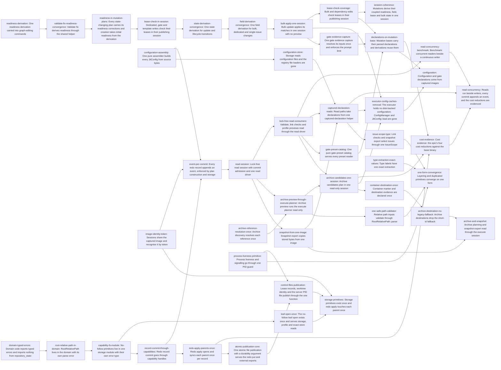

# Plan: Converge previews and coupled derivations on the mutation session (b697a3f7)

> Planning node: 0dc73711. Authoritative graph:
> [breakdown.json](breakdown.json).

## Outcome and criterion approach

Every preview and read runs the capture and derivation of the operation it describes, never publishes, and captures without the repository lock behind one admission check (`read-session-driver`, `@/charter/D-20`, `@/charter/D-22`); every redo record appends an event (`event-append-invariant`). Every mutation derives its coupled state, readiness, field events and lease checks inside its own plan and publishes one redo record (`@/charter/D-17`). Each duplicated loader, primitive or rule converges on one form (`@/charter/D-18`). Each issue body is written against the code as it stands after the entries and external tasks it follows, and cites current lines.

| Criterion | Approach | Evidence / open gap |
|---|---|---|
| REQ-01 | `readiness-derivation` adds the pure derivation (`readiness-corrections`) and the graph-edit intents (`readiness-correction-intents`). `readiness-in-mutation-plans` puts the corrections in the field, lifecycle, automatic-Done and creation plans. `validate-fix-readiness-convergence` moves the one-mutation `--fix` onto the intents (DEC-05, DEC-10). | Investigation, session §1 C1–C3, G1–G3, §5 REQ-01/02 |
| REQ-02 | Corrections ride in the primary plan, and `readiness-in-mutation-plans` deletes the post-commit publishers. | Session §1 REQ-02 |
| REQ-03 | `state-derivation-convergence` builds one state derivation with prechecks (DEC-11). `field-derivation-convergence` gives one field derivation, owned by a property test over the three paths. | Session §4 field divergences, G4 |
| REQ-04 | `lease-check-in-session` defines the foreign-lease refusal once (`foreign-lease-error`) and moves every existing check, template application included, into the publishing session under the claims-first lock order, keeping the lifecycle's preliminary refusal and refusing a strict automated pass on another agent's lease before its checker runs. `lease-check-coverage` extends the checked set to bulk and `dep add`/`dep rm` (`lease-checked-writes`, DEC-04, DEC-08). | Session C5, C6, G5, G6 |
| REQ-05 | `bulk-apply-one-session` deletes the uncalled preview (DEC-06) and folds the apply derivation over one session and one record. | Session C7, C7f, §5 REQ-05 B2 |
| REQ-06 | `archive-preview-through-execute-planner` moves the citation scan and inspector out of the planning module, runs the execute planner through `read-session-driver`, owns the preview-equals-execute test and deletes the storage-only planners. `archive-candidates-one-session` plans every candidate on one growing image (DEC-12, DEC-22). | Archive §1 C1–C3, §5.1–5.2 |
| REQ-07 | `container-destination-once` declares the marker once and extracts the one evidence request. | Archive C4, C5 |
| REQ-08 | `archive-reference-resolution-once` | Archive C6 |
| REQ-09 | `configuration-assembly` adds the public assembler (DEC-15), moves disk loading, image capture and the remaining assemblies onto it, and deletes the mirror fields. | Configuration C2, C3, §5 REQ-09 A |
| REQ-10 | `captured-declaration-reads` gives reads a captured bundle through `read-session-driver` and moves the CLI, server and command reads (1f24e3e9 removes the hierarchy fix pass). `executor-config-caches-removal` moves the remaining tests and reads, deletes the caches, the ConfigManager disk readers and `JitConfig::load`. `declarations-on-mutation-base` parses once per captured image (DEC-07). | Configuration C1, C4, C5 |
| REQ-11 | `gate-preset-catalog` adds the public catalog, moves apply, template apply, list and show onto it, and deletes the storage preset I/O. | Configuration C6 |
| REQ-12 | `gate-evidence-capture` (DEC-07) | Configuration C7–C9 |
| REQ-13 | `image-identity-token` (`image-identity`) | Configuration C10–C12, §5 REQ-13 A |
| REQ-14 | `redo-apply-parents-once` | Storage C1, C2 |
| REQ-15 | `redo-apply-parents-once` first proves replay from any subset of persisted operations under `redo-crash-model`, then coalesces syncs only if that proof passes, and otherwise documents why per-operation syncs stay (DEC-18). | Storage C3, §4 |
| REQ-16 | `capability-fs-module` moves the primitives into their own module, repoints every importer and gives the module its own error type, which ends the import cycle. Then `leaf-open-once` (with DEC-19's profile reads and the exact-store read) and `record-commit-through-capabilities`. | Storage C4–C7 |
| REQ-17 | `atomic-publication-core` (`atomic-publication`) adds the core with the redo put as first caller and moves the export writers. `control-files-publication` adds the path entry for `.git/jit` control files and moves the lease records and claims sequence onto it, publishes the data-root worktree identity and PID file through an entry that accepts only those two files, and owns the assertion that no other stage-and-rename remains (DEC-07, DEC-21). | Storage C8–C10, §5 D3–D4 |
| REQ-18 | `domain-typed-errors` gives the classifier its layout-violation type and one missing-evidence helper and types every domain error. `root-relative-path-in-domain` moves `RootRelativePath` into the domain, repoints every importer and owns the domain-purity assertion (DEC-13). | Archive C7–C10; storage REQ-18 row |
| REQ-19 | `snapshot-from-one-image` names the declaration set from the layout (DEC-14), writes stored bytes from one image and documents the contents. | Archive C11, C12, §5.4 |
| REQ-20 | The kept sub-items, grouped by module: process liveness (`process-liveness-primitive`, DEC-20); declaration modules (`configuration-store`, with `executor-config-caches-removal` deleting the last loader); safe paths (`one-safe-path-validator`); scopes (`issue-scope-type`); type extraction (`type-extraction-exact-values`, DEC-16); no-follow reads (`leaf-open-once`); archive destination (`archive-destination-no-legacy-fallback`). The rest are dropped (DEC-26). | Investigation part sweeps for each sub-item |
| REQ-21 | `read-session` adds the capture-only interface (`read-session`), the lock-free session with its admission on both backends (`optimistic-read-admission`) and `with_read_session` returning a typed retryable conflict after bounded refusals (`@/charter/D-25`) and the eight-reader barrier test (`read-session-driver`). `lock-free-read-consumers` moves validate, check-links and the profile previews (DEC-24) and states the read discipline in the storage-format reference; the archive, declaration and gate-preset tasks follow it, read through the driver and add their commands to that reference. `read-concurrency-benchmark` records the throughput ratios (DEC-25). | [Read concurrency](investigation-read-concurrency.md) §1–§6 |
| REQ-22 | `cost-evidence` builds the harness, measures the four claims on base `369d35a42` and on the tip after the four reductions land, and records the verdict (DEC-25). | Read concurrency §6; session C7b; archive C3; configuration C5; storage C1 |
| REQ-23 | `event-per-commit` gives plan construction its mutation context, adds the generic event and the plan's publication (`event-append-invariant`), and refuses a record over a present data root without an append on both backends; the publication that creates an absent data root is exempt (DEC-23). | Read concurrency §2 |

## Shared architectural contracts

### `read-session` [implementation-produced] — Capture-only session interface

`RepositoryReadSession` declares `layout`, `capture` and `extend`, and `RepositoryMutationSession` extends it with `recovery_report` and `apply`. Shared capture helpers and every preview's capture-and-derive function take `&mut dyn RepositoryReadSession`, so an operation and its preview run one function (`@/charter/D-20`). Producer: `read-session`.

### `optimistic-read-admission` [implementation-produced] — Lock-free capture admission

`RepositoryStateStore::open_read_session` takes no lock. Open probes the redo record by name and then reads the event-log tail; `admit` revalidates the roots, probes the record, then reads the tail. An attempt is admitted only when no record was present at either probe, the tail is unchanged, the data root's presence is unchanged and neither root was replaced; otherwise it is `Busy` (a record) or `Moved`. Both backends run one admission helper and one contract suite. Producer: `read-session`.

### `read-session-driver` [implementation-produced] — One read driver

`with_read_session` runs a read closure in up to four admitted lock-free attempts with jittered backoff and surfaces the closure's value or error only after admission. When every attempt is refused it returns a typed retryable conflict and never takes the repository lock; explicit recovery and the next mutation session complete a leftover redo record (`@/charter/D-25`, `@/charter/D-17`, `@/charter/D-27`). Every lock-free read in REQ-21 goes through it. Producer: `read-session`.

Superseded: this entry first specified a locked fallback through `with_mutation_session` and a `RecoveryFailedError` on reads. `@/charter/D-25` (2026-11-05) replaced that contract, and epic REQ-21 was amended to match (steward ruling, 2026-11-09).

### `event-append-invariant` [implementation-produced] — Every commit appends an event

`MaterializationPlan::new` takes the operation's context. `delta()` stays the derived delta for reports and previews; `publication()` adds one `files_published` event naming the written paths when the delta writes over a present data root and carries no append. Sessions publish `publication()`, and storage refuses a record over a present root without an append. Producer: `event-per-commit`.

### `lease-checked-writes` [plan-fixed] — Which writes check leases

Every user-requested write to an existing issue's record checks that issue's lease inside its publishing session against the claims evidence the guard captured. The guard is taken before the repository session (claims-first lock order). This covers field and state updates, assign, unassign, gate add, remove, pass and fail, automatic gate pass (`gate evaluate`, `evaluate-many`, `evaluate-all`), template application, bulk update for each changed match, and `dep add`/`dep rm` on the dependent issue. Two preliminary refusals stay ahead of external work: the lifecycle's refusal before prechecks run, and a strict automated pass on another agent's lease refused through a captured check before its checker runs. System-derived writes check nothing: readiness corrections of dependents, `validate --fix`, archive and recovery. Lease-enforcement mode resolution belongs to bedf0962 (done). Lease storage belongs to f8a6b298 (DEC-04, DEC-08).

### `redo-crash-model` [plan-fixed] — Crash model for directory syncs

File data is durable after `sync_all`. A directory entry is durable after its directory's fsync returns. Any subset of entries not yet synced may persist. The record is durable before the first live write and is removed only after every distinct parent the pass touched has been synced. Record operations are pairwise path-disjoint and idempotent (DEC-18; investigation storage §4).

### `readiness-corrections` [implementation-produced] — Pure readiness derivation

`readiness_corrections(base, projected, scope)` in the domain returns, in issue-id order, the Promote and Demote corrections that the projected issue set implies. The scope is `Affected` (changed or new dependency sets, plus direct dependents of issues whose effective terminality changed) or `All`. One pass is complete. Producer: `readiness-derivation`.

### `readiness-correction-intents` [implementation-produced] — Readiness intents in a plan

One command helper turns the corrections into plan intents. Promotion passes graph rules through `derive_state_transition` and records a blocked transition as today. Demotion is direct (DEC-10). Producer: `readiness-derivation`.

### `foreign-lease-error` [implementation-produced] — Foreign-lease refusal

`ForeignLeaseError` in `errors.rs` names each refused issue and the agent holding its lease, and its `Display` is the only definition of the refusal text. A write on an unleased issue checks nothing to refuse. Strict mode returns it; warn mode reports each finding's text. Producer: `lease-check-in-session`.

### `archive-planner-session` [implementation-produced] — Generic archive planner

The archive execute planner runs over any `IssueStore + RepositoryStateStore`, and preview and candidates call it in a read-only session. Producer: `archive-preview-through-execute-planner`.

### `declaration-file-set` [implementation-produced] — Declaration files from the layout

One repository-layout function names the declaration files and declaration directories the layout defines, including the gate-presets directory. Base capture and snapshot read through it. Producer: `snapshot-from-one-image`.

### `configuration-assembler` [implementation-produced] — One configuration assembly

A pure `declarations` function builds a `JitConfig` from optional config, template and invariant bytes. An absent config yields the empty config, and a malformed `[item_kinds]` is a structural error. Producer: `configuration-assembly`.

### `declaration-capture` [implementation-produced] — Captured declarations for reads

An executor helper captures the declaration set read-only and returns the parsed declarations with namespaces and a fallible `hierarchy()`. Producer: `captured-declaration-reads`.

### `mutation-base-declarations` [implementation-produced] — Declarations on the mutation base

The captured mutation base carries its declarations, parsed at most once per captured image on first use. Producer: `declarations-on-mutation-base`.

### `gate-preset-catalog` [implementation-produced] — One preset catalog

A pure catalog over the captured preset bytes keyed by the gate-presets path, with listing and lookup. Producer: `gate-preset-catalog`.

### `gate-evidence` [implementation-produced] — One gate evidence capture

One function captures gate evidence for evaluation and prechecks and enforces the prompt size limit at capture. Documents are captured only where the capture spec holds them (`@/issue/8454236c/decision/D-1`). Producer: `gate-evidence-capture`.

### `image-identity` [implementation-produced] — Shared image with a token

`RepositoryImage` shares its data behind an `Arc` and carries an identity token minted at close. Sessions recognise their image by the token, and equality compares data. Producer: `image-identity-token`.

### `capability-fs` [implementation-produced] — No-follow primitive module

`storage/capability_fs.rs` owns `CapabilityRoots`, the parent walks, the no-follow opens (including `inspect_capability_leaf`) and the repository-file readers. After `capability-fs-module` it has its own error type with conversions into the session and redo-apply errors, and redo apply imports nothing from the session. Producer: `capability-fs-module`.

### `leaf-open` [implementation-produced] — One leaf open

One non-blocking, no-follow leaf open with an fstat recheck serves every storage file reader. Producer: `leaf-open-once`.

### `redo-subset-proof` [implementation-produced] — Subset-replay verdict

The verdict on whether replaying a record after any subset of its operations persisted converges, on both backends, under `redo-crash-model`. If it converges, the verdict is a passing property test. If not, it is a deterministic test asserting that the recorded failing subset diverges. Either way, no failing or ignored test lands. Producer: `redo-apply-parents-once`, whose coalescing step the verdict decides.

### `atomic-publication` [implementation-produced] — One file publication

One storage-private capability-rooted publish in `storage/atomic_write.rs` with a uuid stage name and a `Durability` argument, whose stage writer also serves initialization's stage files, plus a storage-private path entry for `.git/jit` control files and one crate-visible entry over a closed type naming the two data-root control files (worktree identity, server PID file). Producer: `atomic-publication-core`; `control-files-publication` adds the two entries.

### `domain-root-relative-path` [implementation-produced] — Domain path type

`RootRelativePath` and its own parse error (with a conversion into the repository layout error) live in a pure domain module. Producer: `root-relative-path-in-domain`.

### `issue-scope` [implementation-produced] — One issue scope

A domain `IssueScope<I> { All, Issue(I), Label }` with one parser producing `IssueScope<IssueIdPrefix>`. The caller resolves it at CLI entry to `IssueScope<IssueId>`, over which one pure selection runs. Producer: `issue-scope-type`.

### `configuration-store` [implementation-produced] — Storage configuration loader

A storage module that reads the repository's configuration, template and invariant files and hands the bytes to `configuration-assembler`. Producer: `configuration-store`.

## Generated decomposition overview

<!-- jit:breakdown-overview:begin -->
| Key | Title | Type | Outcome | Contracts | Sources | Footprint | Landing | Depends on |
|---|---|---|---|---|---|---|---|---|
| readiness-derivation | One readiness derivation carried into graph-editing commands | task | One pure domain function derives readiness corrections, and graph edits apply them through one command helper. | — | REQ-01, DEC-10 | creates 1, touches 5 | — | — |
| readiness-in-mutation-plans | Every state-changing plan carries its readiness corrections and creation takes initial readiness from the derivation | task | Field, lifecycle, automatic-Done and creation plans carry their readiness corrections; no post-commit publisher remains. | readiness-correction-intents, readiness-corrections | REQ-01, REQ-02, REQ-20, DEC-10 | touches 8 | — | validate-fix-readiness-convergence |
| validate-fix-readiness-convergence | Validate fix derives readiness through the shared helper | task | validate --fix computes readiness repairs with the shared derivation over the whole projected set. | readiness-correction-intents | REQ-01, REQ-02, DEC-05 | touches 1 | — | readiness-derivation |
| state-derivation-convergence | One state derivation for update and lifecycle transitions | task | issue update --state and the lifecycle path share one state derivation with prechecks and one Done divert. | — | REQ-03, DEC-11 | touches 3 | — | lease-check-in-session |
| field-derivation-convergence | One field derivation for bulk, dedicated and single-issue changes | task | Bulk, dedicated and single-issue field changes share one field derivation, state and events. | — | REQ-03, DEC-11 | touches 5 | — | state-derivation-convergence |
| lease-check-in-session | Dedicated, gate and template writes check their leases in their publishing session | task | Assign, unassign, gate and template writes check the leases of the issues they target inside their publishing session through one typed foreign-lease error. | lease-checked-writes | REQ-04, DEC-04, DEC-08 | touches 7 | — | readiness-in-mutation-plans |
| bulk-apply-one-session | Bulk update applies its matches in one session with no preview | task | One session derives each matched issue's change for a bulk edit and commits one redo record, with the preview removed and the CLI reference updated. | — | REQ-05, DEC-06 | touches 5 | — | field-derivation-convergence |
| lease-check-coverage | Bulk and dependency edits check leases in their publishing session | task | Bulk edits and dependency edges check each targeted issue's lease inside their publishing session, and the docs state the rule. | foreign-lease-error, lease-checked-writes | REQ-04, DEC-08 | touches 6 | — | bulk-apply-one-session |
| session-coherence | Mutations derive their coupled readiness, field, lease and bulk state in one session | story | Readiness, field derivations, lease checks and bulk apply run inside the publishing mutation session. | — | REQ-01, REQ-02, REQ-03, REQ-04, REQ-05 | — | — | lease-check-coverage |
| event-per-commit | Every redo record appends an event, enforced by plan construction and storage | task | Every plan that writes repository state carries an event append, and both backends refuse a record over a present data root without one. | — | REQ-23, DEC-23 | touches 20 | — | configuration-assembly, image-identity-token, record-commit-through-capabilities |
| read-session | Lock-free read session with commit admission and one read driver | task | A capture-only session trait, a lock-free admitted session per backend, and with_read_session returning a retryable conflict after bounded refusals (D-25). | event-append-invariant | REQ-21, DEC-09 | touches 14 | — | event-per-commit |
| lock-free-read-consumers | Validate, link checks and profile previews read through the read driver | task | Validation reads, link checks and profile previews read through with_read_session, and the storage format reference states the read discipline. | read-session-driver | REQ-21, DEC-24 | touches 5 | — | read-session |
| read-concurrency-benchmark | Benchmark: concurrent readers beside a continuous writer | task | A benchmark records that eight readers beside a continuous writer reach 4x one reader's rate and keep 80% of writes. | — | REQ-21, DEC-25 | creates 5, touches 1 | — | lock-free-read-consumers |
| cost-evidence | Cost evidence: the epic's four cost reductions against the base binary | task | One harness measures the four REQ-22 cost claims against base 369d35a42 and the tip record passes each ratio threshold. | — | REQ-22, DEC-25 | creates 7 | — | archive-candidates-one-session, declarations-on-mutation-base, redo-apply-parents-once |
| read-concurrency | Reads run beside writers, every commit appends an event, and the cost reductions are evidenced | story | Reads capture lock-free behind one admission check, every commit appends an event, and cost reductions are measured. | — | REQ-21, REQ-22, REQ-23 | — | — | cost-evidence, read-concurrency-benchmark, captured-declaration-reads |
| configuration-assembly | One pure assembler builds every JitConfig from source bytes | task | One public pure function assembles JitConfig from source bytes; every assembly site calls it and the mirror fields are gone. | — | REQ-09, DEC-15 | touches 12 | — | — |
| configuration-store | Storage reads configuration files and the registry file loaders are gone | task | A storage loader reads the declaration files through the assembler; callers and tests use it and the registry loaders are gone. | configuration-assembler | REQ-20, DEC-15 | creates 1, touches 13 | — | configuration-assembly |
| captured-declaration-reads | Read paths take declarations from one captured-declaration helper | task | Command, CLI and server reads take hierarchy, namespaces, icons and rules from one captured-declaration helper. | declaration-file-set, configuration-assembler, configuration-store, read-session-driver | REQ-10, DEC-09, REQ-21, DEC-22 | touches 16 | — | configuration-store, snapshot-from-one-image, lock-free-read-consumers |
| executor-config-caches-removal | The executor holds no disk-backed configuration; ConfigManager and JitConfig::load are gone | task | The executor caches, their disk loaders, ConfigManager's disk readers and JitConfig::load are deleted. | declaration-capture, configuration-assembler, configuration-store | REQ-10, REQ-20 | touches 16 | — | archive-candidates-one-session, bulk-apply-one-session, captured-declaration-reads |
| declarations-on-mutation-base | Mutation bases carry their parsed declarations and derivations reuse them | task | The mutation base carries declarations parsed once per captured image, and every mutation derivation reuses them. | gate-preset-catalog | REQ-10, DEC-07 | touches 9 | — | gate-evidence-capture, gate-preset-catalog, lease-check-coverage |
| gate-preset-catalog | One pure gate-preset catalog serves every preset reader | task | One pure preset catalog over bytes keyed by the gate-presets path serves every reader; PresetManager is gone. | read-session-driver | REQ-11, REQ-21, DEC-22 | touches 11 | — | lock-free-read-consumers |
| gate-evidence-capture | One gate evidence capture resolves its inputs once and enforces the prompt limit | task | One evidence capture enforces the prompt limit once and resolves issue, registry and gate once per captured image. | — | REQ-12, DEC-07 | touches 2 | — | bulk-apply-one-session |
| configuration | Configuration and gate declarations come from captured images | story | Configuration is assembled once from bytes, read paths use captured declarations, and gate presets and evidence each have one path. | — | REQ-09, REQ-10, REQ-11, REQ-12, REQ-20 | — | — | declarations-on-mutation-base, executor-config-caches-removal |
| image-identity-token | Sessions share the captured image and recognise it by token | task | Capture rounds and materialization plans share the image without copying, and sessions recognise it by a token. | — | REQ-13 | touches 5 | — | — |
| capability-fs-module | No-follow primitives live in one storage module with their own error type | task | The no-follow capability primitives live in storage/capability_fs.rs, return their own error type, and redo apply no longer imports from the session module. | — | REQ-16 | creates 1, touches 12 | — | root-relative-path-in-domain |
| leaf-open-once | The no-follow leaf open exists once and serves storage, profile and exact-store reads | task | One non-blocking no-follow leaf open serves the storage repository file readers, the profile package reader and the JSON backend's exact-store read. | capability-fs | REQ-16, REQ-20, DEC-19 | touches 7 | — | capability-fs-module |
| record-commit-through-capabilities | Redo record commit goes through capability handles | task | Record commit writes through the data-root handle, and redo_record.rs only defines the record format. | capability-fs | REQ-16 | touches 13 | — | capability-fs-module |
| redo-apply-parents-once | Redo apply opens and syncs each parent once per record | task | Redo apply opens each parent once per record, and a subset-replay proof decides whether it also syncs each once. | capability-fs, redo-crash-model | DEC-18, REQ-14, REQ-15 | touches 6 | — | record-commit-through-capabilities |
| atomic-publication-core | One atomic file publication with a durability argument serves the redo put and external exports | task | One publish core with a durability argument and unique stage names serves the redo put and the external export writers. | capability-fs | REQ-17 | touches 5 | — | redo-apply-parents-once |
| control-files-publication | Lease records, worktree identity and the server PID file publish through the one function | task | Lease records, the claims sequence counter, worktree identity and the server PID file publish through the one function, and the PID file is synced. | atomic-publication | REQ-17, DEC-07, DEC-21 | touches 6, uncertain | — | atomic-publication-core, process-liveness-primitive |
| storage-primitives | Storage primitives exist once and redo apply touches each parent once | story | Images are shared by token, redo apply opens and syncs parents once per record, and no-follow and publication primitives exist once. | — | REQ-13, REQ-14, REQ-15, REQ-16, REQ-17, REQ-20 | — | — | control-files-publication, image-identity-token, leaf-open-once |
| archive-reference-resolution-once | Archive discovery resolves each reference once | task | Archive planning resolves each artifact reference once per plan and walks reachability once per distinct root. | — | REQ-08 | touches 1 | — | — |
| archive-preview-through-execute-planner | Archive preview runs the execute planner read-only | task | Archive preview runs capture_archive_plan through the read driver; the storage-only planners are deleted. | read-session-driver, capability-fs | REQ-06, DEC-09, DEC-12, REQ-21, REQ-16 | creates 1, touches 15 | — | archive-reference-resolution-once, read-session |
| archive-candidates-one-session | Archive candidates plan in one read-only session | task | Candidate listing derives its base once, plans each candidate on the one growing image, and the adopter reference states the shared budget. | archive-planner-session, image-identity, read-session-driver | REQ-06, DEC-09, DEC-12, DEC-22, REQ-21 | touches 4 | — | archive-preview-through-execute-planner, lock-free-read-consumers |
| container-destination-once | Container marker and destination evidence are declared once | task | One domain constant and path constructor name the container marker, and one function requests container-destination evidence for archive planning. | — | REQ-07 | touches 3 | — | archive-candidates-one-session |
| snapshot-from-one-image | Snapshot export copies stored bytes from one image | task | The layout names its declaration files once and snapshot export writes each issue's stored bytes and the declaration files from one captured image. | — | REQ-19, DEC-14, DEC-24 | touches 5 | — | read-session |
| archive-destination-no-legacy-fallback | Archive destinations drop the short-id fallback | task | Container destination resolution has no legacy short-id fallback (REQ-20 archive destination) and the adopter reference states the rule. | — | REQ-20 | touches 6 | — | container-destination-once |
| archive-and-snapshot | Archive planning and snapshot export read through the execute session | story | Archive preview, candidates and snapshot export read one captured image through the execute planner and stored bytes. | — | REQ-06, REQ-07, REQ-08, REQ-16, REQ-19 | — | — | archive-destination-no-legacy-fallback, snapshot-from-one-image |
| domain-typed-errors | Domain code reports typed errors and imports nothing from repository_state | task | Domain code returns typed errors, matches layout violations exhaustively and names nothing from repository_state. | — | REQ-18 | touches 9 | — | — |
| root-relative-path-in-domain | RootRelativePath lives in the domain with its own parse error | task | RootRelativePath and its own parse error live in a pure domain module that every importer names, with no re-export and no domain import of repository_state. | — | REQ-18, DEC-13 | creates 1, touches 21 | — | domain-typed-errors |
| one-safe-path-validator | Relative path inputs validate through RootRelativePath::parse | task | Every relative-path input validates with RootRelativePath::parse, and the other two validators are gone (REQ-20). | domain-root-relative-path | REQ-20, DEC-13 | touches 11 | — | archive-preview-through-execute-planner |
| issue-scope-type | Link checks and snapshot export select issues through one IssueScope | task | One domain IssueScope serves link checks and snapshot export, adding label scopes to link checks (REQ-20). | — | REQ-20 | creates 1, touches 13 | — | captured-declaration-reads |
| process-liveness-primitive | Process liveness and signalling go through one PID guard | task | One guarded liveness probe, EPERM and non-unix alive, serves every liveness check and signal site (REQ-20). | — | REQ-20, DEC-20 | creates 1, touches 4 | — | — |
| type-extraction-exact-values | Type labels have one exact extraction | task | Type checks read the exact type label value through type_value_of, and extract_type is gone (REQ-20 type extraction). | — | REQ-20, DEC-16 | touches 1 | — | — |
| one-form-convergence | Layering and duplicated primitives converge on one form | story | The domain stops importing repository_state, and process liveness, safe relative paths, issue scopes and type extraction each have one form. | — | REQ-18, REQ-20 | — | — | issue-scope-type, one-safe-path-validator, process-liveness-primitive, type-extraction-exact-values |

<!-- jit:breakdown-overview:end -->

## Material risks and owner decisions

| Risk / decision | Resolution and rationale |
|---|---|
| DEC-01 Upstream 2195c98f | Chosen: the epic-level b697a3f7 → 2195c98f edge stays. Each task waits on the specific 2195c98f tasks whose code it consumes, reduced so that no edge is implied by another. External dependency 7abcc22d → `readiness-derivation`. External dependency 3ee3a4d1 → `archive-reference-resolution-once`. External dependency 42bcaa6e → `configuration-assembly`, `domain-typed-errors`. External dependency bc1955a8, e1a6c8c2 → `configuration-assembly`; e1a6c8c2 reaches 945f65f3, and `gate-preset-catalog` and `snapshot-from-one-image` reach `configuration-assembly`. External dependency f8f80eea → `captured-declaration-reads`. External dependency 5491edd0 → `control-files-publication`. External dependency 1f6d3754, 182350ce → `domain-typed-errors`. External dependency 5c232305, 18dc6e3e, 855d027d → `root-relative-path-in-domain`. External dependency c1c86312 → `issue-scope-type`. External dependency 5fac48b8 → `readiness-in-mutation-plans`, whose creation step edits the drafts 5fac48b8 changes. These are reached transitively: 417be079 and e98ae5a4 (through `lease-check-in-session`'s external 6c0f8739), d72bf093, 804a8605, 75951558, cd8adfc1, 8e82fa49, c400730c, 62a0085a, 96bb0941, 2ac50581, 3f026bb1, 3e353abd, 488eb3c1, 79aa3aa7, a50e9be9, 8cfbf19d and 89e7a273. 179dcef9 gets no edge: the write-if-changed work it bordered is dropped. Rejected: one edge per root onto the whole epic, which would hold every task until 2195c98f closes. |
| DEC-02 Same-function neighbours | Chosen: our tasks wait wherever they edit a function that another epic's open task edits. 842b0ac6 (archived): fbb661f2, 2492ab29, 459bb995, 34361448 and 86d3625d are done, so they get no edge. f8a6b298: external dependency c3e3e2ff → `lease-check-in-session`. External dependency 5e1ba005 → `archive-preview-through-execute-planner`, reached through d9ba0029. External dependency 97f5f2b7 → `event-per-commit`: both edit `compose_event_action`. External dependency 6c0f8739 → `lease-check-in-session`, covering 0bd2c797: both edit `check_gate_with`; `gate-evidence-capture` reaches 6c0f8739 through `lease-check-in-session`. External dependency 7244ecb2 → `control-files-publication`, covering 2f563673 and 53d19851. External dependency 0851fae4 → `capability-fs-module`: 0851fae4 rewrites the gate-run readers that `capability-fs-module` edits and owns their lstat-then-open sequence; `leaf-open-once` follows it. f4d9502a: external dependency d9ba0029 → `archive-preview-through-execute-planner`. External dependency 7cd27db8 → `snapshot-from-one-image`. External dependency e6ec58f3 → `one-safe-path-validator`. 63de0883, ea4b7363, f6eaba42 and d7cce445 get no edge: the claims-opening and issue-loading work they bordered is dropped. 9876a23a: external dependency 1f24e3e9 → `validate-fix-readiness-convergence`, `lock-free-read-consumers`; the latter moves the `--fix --dry-run` derivation 1f24e3e9 introduces onto the read driver. External dependency 6ac41880 → `captured-declaration-reads`, covering 145b4d57 there; `executor-config-caches-removal` follows it. External dependency 145b4d57 → `declarations-on-mutation-base`. External dependency f22147ec → `executor-config-caches-removal`, covering 2c8c13b2, 208edf4c and 03bf6983. External dependency a106d1be → `gate-evidence-capture`. External dependency 5d5a1794 → `readiness-in-mutation-plans`. b3a768b3 and 2b5f452c are reached transitively. Lead-friction: external dependency d5966ba2 → `archive-reference-resolution-once`, which `archive-preview-through-execute-planner` follows. 39710b3b and 8673dc5e are done. v1-release: external dependency 4575a03d → `domain-typed-errors`. No edge onto 15009590, whose change leaves the `claims_mutation_guard` call shape alone, or onto 2f12d920 or b32a720e, which touch different structs. Rejected: the reverse edges, which would delay other epics. The steward may still choose c3e3e2ff after `lease-check-in-session`, 0bd2c797 after `gate-evidence-capture`, or 2f563673 after `atomic-publication-core`. |
| DEC-03 df129d9e facades | Chosen: no edge either way with df129d9e (a015dcbb, fd2073b7, a24b11aa, 0bc448fb, 1ac651c7, 24a982b7, f79d2510, 2e0f276b, 083c9a91, 8c46fc85, 3cf69ecf, 182f4c03). 27f0a575 is done: the issue lifecycle entries edit `IssueOps` methods in `commands/issue.rs`. d4373d07 is done: the liveness entry cites the rewritten `commands/serve.rs`. Rejected: ordering edges, which serialize two epics for mechanical moves. |
| Integration notes (DEC-03) | Whichever task lands second adapts. Where a facade or library handler exists when one of our entries lands, the entry edits the method in its facade location with the facade's bounds, and edits the handler module instead of the `main.rs` arm. That covers the archive and snapshot entries under a015dcbb, 3cf69ecf and 182f4c03; the preset and gate entries under fd2073b7, 1ac651c7 and a24b11aa; the status entry under 24a982b7; the issue, bulk and claims entries under f79d2510, 2e0f276b and 083c9a91; and liveness under 8c46fc85. If 0bc448fb lands first and exposes `rules`, `effective_rules` or `config_manager` publicly, `executor-config-caches-removal` deletes those exposures. If `executor-config-caches-removal` lands first, 0bc448fb no longer has them to expose. |
| DEC-04 Lease ownership | Chosen: this epic decides only where the check runs (`lease-checked-writes`). bedf0962 (done) owns mode resolution, and f8a6b298 owns lease storage and the LeaseLock sequence. Rejected: changing the mode or storage here. |
| DEC-05 One readiness derivation | Chosen: 1f24e3e9 ships with whatever readiness derivation exists when it lands. `validate-fix-readiness-convergence` waits for 1f24e3e9 and converges its loop onto `readiness-correction-intents` with scope `All`. Rejected: a second readiness derivation inside `--fix`. |
| DEC-06 REQ-05 amended | Chosen: delete the uncalled `preview_bulk_update`, and make bulk apply one session and one redo record. Rejected: a new `--dry-run` feature, a capability nobody requested. |
| DEC-07 REQ-10, REQ-12, REQ-17 amended | Chosen: "once per captured image", because preflight and record sessions capture separate images. For REQ-17, lease records and the claims sequence counter replace the deleted claims index. Rejected: once per attempt across images, which would need a cross-image parse cache. |
| DEC-08 Lease scope | Chosen: `lease-checked-writes`. Assign, unassign, gate add, remove, evaluate, evaluate-many, evaluate-all, pass and fail, template apply, `dep add` and `dep rm` are classified claims-first. The lifecycle's preliminary refusal before prechecks stays. A strict automated pass on another agent's lease is refused through a preliminary captured check before its checker runs. The behaviour change is stated and documented in `lease-check-in-session` and `lease-check-coverage`. Rejected: today's checked set, which fails "every issue mutation". |
| DEC-09 Read discipline | Chosen: reads capture lock-free behind `optimistic-read-admission`, through `read-session-driver`, falling back to the operation's mutation session after four refused attempts (`@/charter/D-22`). The preview and the operation share one capture-and-derive function over `read-session`, so D-20 holds without a shared lock. Rejected: reading through the mutation session, which serializes every reader behind every writer and every other reader; a shared/exclusive flock, which still blocks readers on writers and lets readers starve writers; and re-reading the read set, which inode reuse makes unsound. `bulk-apply-one-session` is a writer and keeps no read contract. |
| DEC-10 Readiness semantics | Chosen: promotion through graph rules, direct demotion, `Affected` scope, corrections in the primary record. The fixes for rejection promoting dependents and for leaving Done demoting Ready dependents are stated in `readiness-in-mutation-plans`. Rejected: direct promotion, which drops `transition_blocked` events, and scope `All` everywhere, which repairs unrelated drift silently. |
| DEC-11 One state derivation | Chosen: prechecks become a captured precondition of any transition into InProgress in the shared derivation, so `issue update --state in_progress` stops skipping them (`state-derivation-convergence`). Rejected: routing update through the lifecycle request, which keeps two derivations. |
| DEC-12 Candidates after image sharing | Chosen: `archive-candidates-one-session` follows `image-identity-token`. Risk: every candidate now shares one session's capture budget, so a repository whose candidates exceed it fails the listing. The worker records this repository's budget use as evidence. Rejected: one session per candidate, which contradicts REQ-06. |
| DEC-13 Paths in the domain | Chosen: `RootRelativePath` moves into the domain in one task (`root-relative-path-in-domain`) that repoints every importer and leaves no re-export, and one validator replaces three. Path rule after the change: `classify_repository_relative` keeps stripping one leading `./` for every caller, so gate prompt files such as this repository's `prompt_file = "./contrib/gates/..."`, materialization and profile targets resolve as today. Both backends' `read_repo_file` parse their argument with `RootRelativePath::parse` before classification, so only that entry point refuses `./a` (it already refuses `a//b` and `a:b`). Pinned git reads apply the full grammar: `./`, `a//b`, `a:b`, `.`, `\` and control characters are refused. A configured item-kind source or registry spelled `./x` is refused through `read_repo_file`; this repository declares none. Stated in `one-safe-path-validator`. Rejected: changing `classify_repository_relative`, which would break `./`-prefixed gate prompts; and a domain copy of the validator. |
| DEC-14 Snapshot declarations | Chosen: the declaration set derives from the layout, so the gate-presets directory is included because the layout declares it. Rejected: a hand list in snapshot. |
| DEC-15 Configuration assembly | Chosen: one strict assembler. A malformed `[item_kinds]` is a structural load failure, and an image with an absent `config.toml` assembles the empty config (stated in `configuration-assembler`). Configuration file I/O lives in storage (`configuration-store`), which supersedes 459bb995's note. The assembler builds on 459bb995's defaults and accessors. Rejected: keeping two pipelines, or keeping I/O in `config.rs`. |
| DEC-16 Type extraction | Chosen: exact label values. `extract_type` is deleted, and `type:Epic` stops passing the taxonomy check (stated in `type-extraction-exact-values`). No adopter doc claims case-insensitive types. Rejected: lowercasing everywhere. |
| DEC-17 Status summary | Chosen: no change. `backlog` already shipped in f7340f63f, and the relocation is dropped (DEC-26). |
| DEC-18 REQ-15 proof | Chosen: `redo-apply-parents-once` lands the subset-replay proof before any sync moves, and coalesces only if the proof passes; otherwise it documents the crash case in rustdoc. Rejected: coalescing on the existing interruption tests, which cannot observe a lost directory entry. |
| DEC-19 Profile opener | Chosen: profile imports the storage leaf open. No layer rule forbids profile from importing storage, so no bytes handoff is needed (`leaf-open-once`). Rejected: a cited exception. |
| DEC-20 Process liveness | Chosen: one guarded primitive in a crate-level process module, whose PID guard the signaling sites use (`process-liveness-primitive`). EPERM counts as alive, and the non-unix policy is "alive". Rejected: a tri-state result with a policy per caller. |
| DEC-21 Recover's claims-index write | Chosen: f8a6b298 53d19851 deletes `write_index_atomic`, including recover's unlocked `claims.index.tmp` write. `control-files-publication` then routes the lease writes that replace it through `atomic-publication`. Rejected: fixing a function that is about to be deleted. |
| DEC-22 Shared candidate budget | Chosen: accept that every archive candidate shares one session's capture budget (DEC-12), so an oversized repository fails the whole listing instead of degrading per candidate. `archive-candidates-one-session` states this behaviour and records this repository's budget use as evidence. Rejected: one session per candidate, which brings back the quadratic captures this epic removes. |
| DEC-23 REQ-23 amended | Chosen: every redo record over a present data root appends an event, so the log's length counts commits (`@/charter/D-22`, `@/inv/event-log`). An event-less plan's publication adds one generic `files_published` event naming the paths it writes; `delta()` stays the derived delta, so drift reports, repair messages and previews are unchanged. Storage refuses a record without an append over a present root. The absent-root publication is exempt, because a reader sees the root appear. Rejected: a generation counter in the lock file, which is a second version source; and composing the event in storage, which would publish an event that no plan or preview shows. |
| DEC-24 Read scope | Chosen, by user decision: archive preview and candidates, declaration reads, gate-preset reads, `jit validate` without `--fix` and with `--fix --dry-run`, `doc check-links`, and profile plans, difference reports and dry runs read through `read-session-driver`. `snapshot export` stays recovery-dispatched and keeps reading through the session dispatch retains (`snapshot-from-one-image`). `image_plan_content` and `validate_rule` move with the validation capture they share. Rejected: moving snapshot export, whose dispatch-level lock is out of scope. |
| DEC-25 Benchmarks | Chosen: both harnesses build base `369d35a42` (the commit that added REQ-21–REQ-23, before any entry lands) and the tip in one run, and judge medians of in-run ratios, so host speed cancels. REQ-21: tip R(8)/R(1) ≥ 4 and W(8)/W(0) ≥ 0.8 with `doc check-links` readers beside a back-to-back `issue update` writer, on a host with at least 16 logical CPUs. REQ-22: bulk per-match slope at 2000 over 500 issues ≤ 1.5; per-candidate slope ≤ 0.5 × base with constant `config.toml` opens; declaration-attributable `dep add` time ≤ 0.7 × base; redo directory opens ≤ 0.6 × base. Directory and file counts come from `strace`, which the harness requires. Risk: a long read (validation on a large repository) under a back-to-back writer mostly ends in a retryable conflict, because any commit inside its capture refuses it (D-25); REQ-21 measures short reads only. Rejected: absolute timings, which depend on the host. |
| DEC-26 Manifest size and task shape | Chosen, by user decision: the manifest has at most 50 issues, stories included. One coherent change within a module is one task: adding a form, moving its callers and deleting the old form land together, with their docs and tests. A task is split only when one worker genuinely cannot deliver and review it in one focused cycle. Merged tasks cite this decision under their sizing `warning_overrides`. Dropped REQ-20 sub-items, removed from the epic's criteria: status summary (relocation only, no behaviour or duplication risk); edit distance (two private copies of a small function with identical behaviour); claims-coordinator opening (call-site repetition in one module); issue loading (changes one not-found message); ancestor walking and present-or-create (internal duplication with no adopter-visible effect); write-if-changed (its only behaviour change is a file-mode nit on an executable `rules.toml`); creation stamping (the divergence is structural and cannot be observed); initialization errors (changes only an error source chain). Any of them can become a standalone issue. Rejected: one terminal per deliverable class, which produced 114 issues. |
| Investigation corrections | The background's bulk "runs no cascade" is stale: bulk runs one post-batch cascade, which is still a follow-up publisher. Label edits already check the lease. There are three safe-path validators, not two. A malformed `[item_kinds]` fails today's validation run rather than reporting a finding. |
| Behaviour changes | Each change is stated with its asserting test in the owning entry. Rejection promotes dependents, and leaving Done demotes them. Template edge promotion passes graph rules. `issue update --state in_progress` runs prechecks. Dedicated field commands run rules. Bulk is batch-atomic, and its prechecks run in one preflight before the publishing session. Bulk, `dep add`, `dep rm` and template apply check leases in session, and the reclassified commands, `gate evaluate-all` included, lock claims first. A strict automated pass on another agent's lease is refused before the checker runs. `--fix` promotions pass graph rules. An oversized precheck prompt fails at capture. A malformed `[item_kinds]` fails load, and an image without `config.toml` assembles the empty config. The linked-checkout refusal still takes no lock: it reads the stance through the storage loader. `read_repo_file` refuses `./a` while every other path input keeps stripping one leading `./`, and pinned reads apply the full path grammar (DEC-13). The server PID file is synced, and a stale `server.pid.pid.tmp` no longer blocks a start. EPERM and non-unix count as alive, so `cleanup_stale_locks` keeps a lock held by another user's live process. A template node blocked by an in-template edge is created Backlog, with no Ready→Backlog demotion event and no `first_ready_at`. `type:Epic` is unknown. Check-links accepts `label:` scopes. An unmarked short-id archive directory is no longer adopted. Snapshot exports stored bytes and every declaration file. The REQ-21 reads take no repository lock while uncontended. After bounded refusals they return a retryable conflict and never complete a leftover redo record themselves; recovery and the next mutation session do (D-25, superseding the locked fallback first planned here). Candidates fail as a whole over the shared budget (DEC-22). Every event-less write appends one `files_published` event, and such a write over an uncertified torn tail is refused like any event-bearing write (DEC-23). Each owning task documents its read behaviour, and `event-per-commit` documents the event rule. A cross-session plan over a byte-identical image is refused. Redo commit lands in the verified data root. |
| REQ-10 literal reading | `declarations-on-mutation-base` keeps the configuration parse inside discovery rounds (`capture_discovering`). Each round parses a different, extended image, so "once per captured image" holds. Removing that parse would change `capture_discovering`'s 13 callers. |
| Shared-file contention | `commands/mod.rs`, `issue.rs`, `gate.rs`, `gate_check.rs`, `bulk_update.rs`, `template.rs`, `commands/archive.rs`, `repository_state/mutation.rs` and the storage session module are edited by several tasks. Edits to the same function are ordered by edges; tasks that edit distinct functions in one file run in parallel and rebase. Where two former neighbours now sit in different tasks, the later task is written against the earlier one's result: the readiness follow-up removal precedes the field derivation (`derive_field_update`); configuration assembly precedes the read-session interface; typed domain errors precede the safe-path validator (`repository_inputs.rs`); the `RootRelativePath` move precedes capability-fs (memory backend `resolve`, `copy_jit_state`); `leaf-open-once` and `redo-apply-parents-once` both edit `storage/capability_fs.rs` (the leaf open behind the parent walks, and the parent-handle map) with no edge, so whichever lands second rebases; `validate-fix-readiness-convergence` (its readiness step) and `lock-free-read-consumers` (its session parameter) both edit the one-capture `--fix` derivation 1f24e3e9 introduces, with no edge, so whichever lands second rebases; the archive preview, with the citation scan, precedes candidates, whose base and per-target split of `capture_archive_plan` precedes the container destination extraction and the legacy-fallback removal; the read-discipline statement in `storage-format.md` precedes each command list addition to it; and the ConfigManager disk readers go before `JitConfig::load`. |
| Pre-executor write-policy read | `captured-declaration-reads` reads the linked-checkout write stance through the storage configuration loader, with no session and no lock. This is the stated exception to `read-session-driver`: the refusal must precede every lock and redo replay (`open_repository`'s contract in `commands/bootstrap.rs`). The existing refusal tests keep passing. |

## Investigation sources

- [Investigation](investigation.md): claim classification, consumer sweeps, primitive verification and option analyses for four parts: session coherence and bulk; archive and snapshot; configuration, caches, presets, evidence and images; and storage primitives, redo apply and publication.
- [Vision charter](../../vision/9db27a3a-charter.md): decisions D-17, D-18, D-20 and D-22.
- [Read concurrency](investigation-read-concurrency.md): option analysis, admission soundness, liveness, interface and benchmark design for D-22.
