# Plan: Give each test property one owning test on shared fixtures and contracts (c780514e)

> Planning node: 7c885165. Authoritative graph:
> [breakdown.json](breakdown.json).

## Outcome and criterion approach

Fixtures land first, then the per-target migrations onto them; owners gain missing cases before re-proofs are deleted. Each entry lands green. Per-test-bound relief (REQ-11 key, REQ-13 outliers) starts in the first wave with no upstream edge.

| Criterion | Approach | Evidence / open gap |
|---|---|---|
| REQ-01 | `exit-code-projection-ownership`: the projection suite derives its verified set from its binding cases and absorbs the two row-less parity cases. Unique `exit_code_tests` behaviour moves to owners, then both re-proof files are deleted. | Investigation §1 #1–#3, §4 |
| REQ-02 | `domain-query-ownership`: extract the `query available` composition and order, and the auto-transition decision, into pure domain functions; then cut CLI and harness re-proofs to one wiring case each, move six `harness_demo` cases and delete the suite. | §1 #4–#8, §5 |
| REQ-03 | Add missing finalization cases to `repository_state`, then delete the storage determinism section. | §1 #9 |
| REQ-04 | `list-envelope-coverage`: one schema-driven test replaces 19 per-command cases; per-command re-assertions then go. | §1 #10, §4 |
| REQ-05 | `cli-process-fixture` (wave 1), then one migration per target or coherent file family (eight), plus source-module git setup. Files whose properties move elsewhere are excluded from migration and handled by their owner entries. | §1 #11–#17, §C |
| REQ-06 | Wave-1 roots: shared `fixture_issue`, shared `TaxonomyRepo`, and one memory executor seeded by product init generalised over the store. | §1 #18, §4 |
| REQ-07 | `shipped-item-kinds-fixture` in test support (wave 1), then unit-test and suite consumers. | §1 #20–#21 |
| REQ-08 | `issue-store-conformance` (absorbs the three ad-hoc tests), then the in-memory path-read fix, then backend-test pruning. | §1 #22–#24 |
| REQ-09 | The receipt env lock goes with the runner hook; an audit puts unguarded environment readers under `EnvGuard`. | §1 #25, §4 |
| REQ-10 | `script-self-test-gates`: three self-tests become declared gates; the corpus setup's nested cargo test is replaced by an in-suite fixture; cargo skips fail. | §1 #26–#28, #32 |
| REQ-11 | `input-keyed-fixture-cache`, then removal of the hidden subcommand, receipts and setup scripts. | §1 #29–#32, §A |
| REQ-12 | Final footprint report under `suite-measurement-protocol`. | §1 #34, §C |
| REQ-13 | Early relief: input key, in-memory rule-warning tests, paused-clock server drain, doctest pruning. Final suite-clock report. | §A; D-01 |

## Shared architectural contracts

### `cli-process-fixture` [implementation-produced] — Shared CLI process fixture

A test-support module compiled under `cfg(any(test, feature = "test-support"))`. It owns a temporary repository: uninitialised, `jit init`-ed, or one from shared test support handed to it (for example a `TaxonomyRepo`). It locates the target's `jit` binary through one shared construction path, because `CARGO_BIN_EXE_jit` exists only while an integration target compiles. It yields a `std::process::Command` with every inherited `JIT_*` variable removed, and per-process overrides are set through the fixture. It initialises git on request through a test-support function that in-process tests also call, and it reads created ids from `--json` output. It adds no integration target (`@/inv/bounded-rust-build-footprint`).

### `shipped-item-kinds-fixture` [implementation-produced] — Shipped item kinds from the package

Test support reads the item-kinds contribution of `profiles/jit-default/manifest.toml` and exposes it in the shapes harness, unit and suite tests need. A deliberately custom kind is a minimal literal that says it is custom. Engine code gains nothing (`@/inv/domain-agnostic`).

### `input-keyed-fixture-cache` [implementation-produced] — Input-keyed fixture cache

The profiled-repository cache key is a digest of the captured package closure (path, bytes, mode), a digest of the `jit` crate source (`src/`, `Cargo.toml`, `build.rs`) and a setup-contract token. No executable's bytes or path are part of it. Entries are built in-process on first use under the existing no-replace publication, and publishing collects the profile's older entries. The recorded-failure corpus uses the same mechanism, keyed on the failure-lever registry and the crate source digest.

### `issue-store-conformance` [implementation-produced] — IssueStore conformance suite

One test module written against the `IssueStore` trait, with reader and writer cases run against each backend through one construction seam. It is the suite named by 89e7a273 REQ-04 (D-03).

### `exit-code-projection-ownership` [plan-fixed] — Projection suite owns exit codes

`CommandSchema::generate().command_exit_codes` is the binding source. Each row has exactly one binding case in both invocation forms, and the completeness check derives its verified set from those cases. Other subprocess tests assert exit codes only for paths without a row.

### `list-envelope-coverage` [plan-fixed] — One list-envelope test

The list-emitting commands are enumerated from the generated schema (output with `count` beside a collection). The test holds one invocation per command, fails naming any schema list command without one, and asserts `count == len` through the CLI process fixture. It is independent of whether a response uses `ListEnvelope` yet.

### `domain-query-ownership` [plan-fixed] — Domain owns query and transition semantics

Filter composition, priority order and the auto-transition decision are pure functions in `domain/`, with unit and property tests there. Cycle detection stays owned by `graph/`. Commands call these functions. CLI tests hold one wiring case per subcommand or flag, and the harness holds one cascade wiring case.

### `script-self-test-gates` [plan-fixed] — Script self-tests as gates

Each shell-script self-test is a `.jit/gates.toml` gate with `[gates.inputs]` covering the script and what it exercises. Any non-zero exit fails the gate, including exit 2 for a missing tool. No default-suite test wraps a script self-test, and no test passes by printing a skip notice. New gates carry `mode` and no deprecated `auto` key.

### `suite-measurement-protocol` [plan-fixed] — How suite cost is measured

`scripts/cargo-ci.sh` runs under the build turnstile. Warm-target and post-rebuild runs are recorded with commit, host load and command. Per-test timings come from `scripts/profile-test-suite.sh` on a warm target at load ≤ 10. Before-figures come from the investigation (§A, gate run `8e22dd96` at `0896fc29b`). Results go to `dev/benchmarks/test-topology-c780514e/README.md`.

## Generated decomposition overview

<!-- jit:breakdown-overview:begin -->
| Key | Title | Type | Outcome | Contracts | Sources | Footprint | Landing | Depends on |
|---|---|---|---|---|---|---|---|---|
| cli-process-fixture | Shared fixture for spawning jit in CLI tests | task | One shared test-support fixture spawns jit over a temporary repository it owns, with inherited JIT_* variables removed. | — | REQ-05, REQ-09, D-02 | creates 1, touches 3 | — | — |
| shared-taxonomy-repo | One shared taxonomy repository for CLI tests | task | The taxonomy-initialised CLI test repository has one definition in shared test support. | — | REQ-06, D-02 | touches 20 | — | — |
| shared-fixture-issue | One shared issue-construction fixture | task | Tests build fixture issues through one definition in shared test support. | — | REQ-06, D-02 | touches 42 | — | — |
| shared-memory-executor | Memory executor initialised through product initialisation | task | One memory executor in shared test support seeds configuration and index through product initialisation. | — | REQ-06, D-02 | touches 9 | — | — |
| harness-shipped-item-kinds | Shared test support derives shipped item kinds from the default package | task | Shared test support derives shipped item-kind declarations from the default profile package. | — | REQ-07, D-02 | touches 4 | — | — |
| unit-test-shipped-item-kinds | Command unit tests take shipped item kinds from the default package | task | Item, validate and domain item unit tests read shipped item kinds from the shared derivation. | shipped-item-kinds-fixture | REQ-07 | touches 3 | — | harness-shipped-item-kinds |
| suite-shipped-item-kinds | Integration suites take shipped item kinds from the default package | task | Decision-kind and projection-render suites read shipped item kinds from the shared derivation. | shipped-item-kinds-fixture | REQ-07 | touches 3 | — | harness-shipped-item-kinds, cli-item-validate-migration |
| cli-gate-migration | cli_gate tests spawn jit through the shared process fixture | task | The cli_gate suite spawns jit only through the shared CLI process fixture. | cli-process-fixture | REQ-05, D-02 | touches 16 | — | cli-process-fixture |
| cli-issue-command-migration | cli_issue command tests spawn jit through the shared process fixture | task | The cli_issue command test files spawn jit only through the shared CLI process fixture. | cli-process-fixture | REQ-05, REQ-06, D-02 | touches 17 | — | cli-process-fixture, shared-taxonomy-repo |
| cli-issue-envelope-migration | cli_issue envelope tests spawn jit through the shared process fixture | task | The cli_issue envelope and failure test files spawn jit only through the shared CLI process fixture. | cli-process-fixture | REQ-05, D-02 | touches 16 | — | cli-process-fixture |
| cli-item-validate-migration | cli_item_validate tests spawn jit through the shared process fixture | task | The cli_item_validate suite spawns jit only through the shared CLI process fixture. | cli-process-fixture | REQ-05, D-02 | touches 16 | — | cli-process-fixture |
| cli-query-graph-migration | cli_query_graph tests spawn jit through the shared process fixture | task | The cli_query_graph suite spawns jit only through the shared CLI process fixture. | cli-process-fixture | REQ-05, REQ-06, D-02 | touches 16 | — | cli-process-fixture, shared-taxonomy-repo |
| cli-repo-checkout-migration | Git-backed workflow tests spawn jit through the shared process fixture | task | The git-backed cli_repo_workflow test files spawn jit only through the shared CLI process fixture. | cli-process-fixture | REQ-05, D-02 | touches 13 | — | cli-process-fixture |
| cli-repo-profile-migration | Profile workflow tests spawn jit through the shared process fixture | task | The profile cli_repo_workflow test files spawn jit only through the shared CLI process fixture. | cli-process-fixture | REQ-05, D-02 | touches 9 | — | cli-process-fixture |
| cli-repo-workflow-migration | Remaining workflow tests spawn jit through the shared process fixture | task | The remaining cli_repo_workflow test files spawn jit only through the shared CLI process fixture. | cli-process-fixture | REQ-05, D-02 | touches 16 | — | cli-process-fixture |
| library-git-fixture-adoption | Library unit tests initialise git through the shared helper | task | Source-tree test modules initialise git repositories through one shared test-support helper. | cli-process-fixture | REQ-05 | touches 9 | — | cli-process-fixture |
| env-reading-tests-guarded | Tests read shared process environment only under the environment guard | task | Each test that reads a variable another test sets holds the shared environment guard. | — | REQ-09 | touches 1, uncertain | — | fixture-setup-hook-removal |
| exit-code-binding-completeness | Exit-code projection suite proves a binding behind each row | task | The projection suite fails when a projected exit-code row lacks a binding case in both invocation forms. | exit-code-projection-ownership | REQ-01, D-04 | touches 1, uncertain | — | cli-issue-envelope-migration |
| exit-code-unique-case-moves | Unique exit-code suite behaviour moves beside its owners | task | Claim, remediation, prefix and startup-envelope cases live beside their owners and assert only what they add. | exit-code-projection-ownership, cli-process-fixture | REQ-01, D-04 | touches 4, uncertain | — | cli-issue-envelope-migration, cli-repo-checkout-migration |
| exit-code-reproof-deletion | Exit-code re-proof suites are deleted | task | exit_code_tests.rs and the parity suite are gone; the projection suite alone binds exit codes. | exit-code-projection-ownership | REQ-01, D-04 | touches 3 | — | exit-code-binding-completeness, exit-code-unique-case-moves |
| list-envelope-coverage-test | One test proves the list-envelope count for each list-emitting command | task | A single schema-driven test checks count against collection length for each list-emitting command. | list-envelope-coverage, cli-process-fixture | REQ-04, D-04 | touches 2 | — | cli-process-fixture |
| list-envelope-reassertion-removal | Per-command count re-assertions leave the list-emitting suites | task | No per-command test re-asserts count against collection length. | list-envelope-coverage | REQ-04 | touches 5 | — | list-envelope-coverage-test, cli-query-graph-migration, cli-repo-workflow-migration, cli-repo-profile-migration, cli-repo-checkout-migration, cli-issue-command-migration |
| query-available-domain-order | Available-work filtering and priority order become a pure domain query | task | query available's filter composition and priority order are one pure domain function with unit and property tests. | domain-query-ownership | REQ-02 | touches 4 | — | — |
| auto-transition-domain-decision | Auto-transition readiness is decided by a pure domain function | task | A pure domain function decides which dependents a terminal transition makes ready. | domain-query-ownership | REQ-02 | touches 3 | — | query-available-domain-order |
| query-cli-wiring-reduction | Query CLI tests assert one wiring case per subcommand and flag | task | query_tests.rs keeps one wiring case per query subcommand or flag on the shared CLI process fixture. | domain-query-ownership, cli-process-fixture | REQ-02, REQ-05 | touches 4 | — | query-available-domain-order, cli-query-graph-migration |
| auto-transition-wiring-reduction | Workflow CLI tests keep one auto-transition wiring case | task | One CLI case shows completing a dependency readies its dependent; the domain owns the rules. | domain-query-ownership | REQ-02 | touches 2 | — | auto-transition-domain-decision, cli-repo-workflow-migration |
| auto-transition-harness-owner | One harness test owns the auto-transition cascade wiring | task | One in-process harness test owns the cascade wiring, and no other harness test re-proves its rules. | domain-query-ownership | REQ-02 | touches 2 | — | auto-transition-domain-decision |
| cycle-reproof-removal | Cycle detection is proven only in the graph module | task | Batch-create adapter and CLI cycle re-proofs are gone, and graph tests own cycle detection. | domain-query-ownership | REQ-02 | touches 2 | — | cli-repo-workflow-migration |
| harness-demo-case-moves | Unique harness demonstration cases move beside their owners | task | The six harness-demonstration cases with no other owner live beside the code they exercise. | shipped-item-kinds-fixture | REQ-02 | touches 1, uncertain | — | harness-shipped-item-kinds, shared-memory-executor |
| harness-demo-deletion | The harness demonstration suite is deleted | task | harness_demo.rs is gone, and contributor guidance cites owning tests instead. | — | REQ-02 | touches 3 | — | harness-demo-case-moves |
| finalization-owner-gaps | Repository-state tests own each finalization case | task | Each finalization case the storage determinism section covers has an owning repository_state test. | — | REQ-03 | touches 1 | — | — |
| finalization-reproof-deletion | Storage tests stop re-proving mutation finalization | task | The storage determinism section is gone, and storage tests cover only backend-added behaviour. | — | REQ-03 | touches 1 | — | finalization-owner-gaps |
| issue-store-conformance-suite | Shared IssueStore conformance suite runs against both backends | task | One reader and writer conformance suite runs unchanged against JsonFileStorage and InMemoryStorage. | — | REQ-08, D-03 | creates 1, touches 2 | — | finalization-reproof-deletion |
| memory-backend-path-reads | In-memory path reads serve the store's own commit-pinned state | task | InMemoryStorage path reads, decoding and commit-pinned reads pass the shared conformance suite. | issue-store-conformance | REQ-08 | touches 3, uncertain | — | issue-store-conformance-suite |
| backend-specific-test-pruning | Backend tests keep only backend-specific behaviour | task | JSON and in-memory storage tests assert only behaviour their own backend has. | issue-store-conformance | REQ-08 | touches 3 | — | memory-backend-path-reads |
| profiled-fixture-input-key | Profiled-repository fixture keyed only on its inputs | task | The profiled-repository fixture key derives from package bytes and crate source, and stale entries are collected. | — | REQ-11, REQ-13, D-01 | touches 8 | — | — |
| fixture-setup-hook-removal | Fixture setup runs inside the suite with no runner hook | task | The product binary has no hidden fixture subcommand, and the runner configuration has no profiled-fixture setup script. | input-keyed-fixture-cache | REQ-11, REQ-09 | touches 6 | — | profiled-fixture-input-key |
| failure-corpus-in-suite | Recorded-failure corpus built in the suite under an input key | task | The recorded-failure corpus comes from the input-keyed fixture cache, with no nested cargo test or setup script. | input-keyed-fixture-cache | REQ-10, REQ-11 | touches 8 | — | fixture-setup-hook-removal, cli-issue-envelope-migration |
| rule-warning-tests-down-a-layer | Create-time rule warnings proven in-process without a profiled repository | task | The four create-time warning cases run in memory against the workflow profile's rules. | suite-measurement-protocol | REQ-13, D-01 | touches 2, uncertain | — | — |
| server-shutdown-test-bound | Server shutdown force-close test stays under the per-test bound | task | Drain-entitlement timing is proven without the real five-second wait, and no server test exceeds 5 s. | suite-measurement-protocol | REQ-13, D-01 | touches 2 | — | — |
| doctest-substep-bound | Doctest substep fits within the per-test bound | task | The doctest substep takes under 5 s warm at load 10 or less, with each removed example's property owned by a unit test. | suite-measurement-protocol | REQ-13, D-01 | touches 8, uncertain | — | — |
| cargo-ci-selftest-gate | cargo-ci self-test runs as a declared gate | task | The cargo-ci self-test runs as its own gate over the script, outside the default suite. | script-self-test-gates | REQ-10 | touches 5 | — | — |
| profile-suite-selftest-gate | Suite-profiler self-test runs as a declared gate | task | The suite profiler self-test runs as its own gate over the script, outside the default suite. | script-self-test-gates | REQ-10 | touches 2 | — | — |
| build-budget-selftest-gate | Build-budget checker self-test runs as a declared gate | task | The build-budget checker's cases run as the script's own self-test under a declared gate. | script-self-test-gates | REQ-10 | touches 4 | — | — |
| dependency-policy-tool-failure | Dependency-feature policy tests fail when cargo is missing | task | The dependency-feature policy tests use the running toolchain's cargo and fail rather than skip. | script-self-test-gates | REQ-10 | touches 1 | — | — |
| build-footprint-report | Build-footprint figures before and after the epic are reported | task | A benchmark note records integration targets and active test-executable bytes before and after. | suite-measurement-protocol | REQ-12 | creates 1 | — | exit-code-envelope-ownership, query-graph-ownership, storage-contracts, shared-test-fixtures, failure-corpus-in-suite, rule-warning-tests-down-a-layer, server-shutdown-test-bound, doctest-substep-bound, cargo-ci-selftest-gate, profile-suite-selftest-gate, build-budget-selftest-gate, dependency-policy-tool-failure |
| suite-clock-report | Suite clock before and after the epic is reported | task | The benchmark note records the suite clock before and after, and a per-test profile with no test over 5 s. | suite-measurement-protocol | REQ-13, D-01 | touches 1 | — | build-footprint-report |
| exit-code-envelope-ownership | Exit codes and list envelopes each have one owning test | story | command exit codes and the list-envelope count each have one owning test | — | REQ-01, REQ-04 | — | — | exit-code-reproof-deletion, list-envelope-reassertion-removal |
| query-graph-ownership | Query, transition and cycle semantics are proven at the domain and graph layers | story | query filters, auto-transitions and cycle detection are owned by domain and graph tests, with CLI and harness tests reduced to wiring | — | REQ-02 | — | — | query-cli-wiring-reduction, auto-transition-wiring-reduction, auto-transition-harness-owner, cycle-reproof-removal, harness-demo-deletion |
| storage-contracts | Storage behaviour is proven once per contract | story | finalization is proven in repository state and every IssueStore backend runs one conformance suite | — | REQ-03, REQ-08 | — | — | backend-specific-test-pruning |
| shared-test-fixtures | Tests run on shared fixtures and guards | story | CLI and in-process tests use one definition of each fixture and reach process state only through the shared guards | — | REQ-05, REQ-06, REQ-07, REQ-09, D-02 | — | — | cli-gate-migration, cli-issue-command-migration, cli-issue-envelope-migration, cli-query-graph-migration, cli-repo-checkout-migration, cli-repo-profile-migration, cli-repo-workflow-migration, library-git-fixture-adoption, shared-fixture-issue, shared-memory-executor, unit-test-shipped-item-kinds, suite-shipped-item-kinds, env-reading-tests-guarded |
| suite-cost | The default suite runs within its time and footprint budgets | story | the default suite runs no nested cargo build or tool-skipping test, fixtures are keyed on inputs, and footprint and clock are reported | — | REQ-10, REQ-11, REQ-12, REQ-13, D-01 | — | — | suite-clock-report |

```mermaid
flowchart LR
    N0["cli-process-fixture: Shared fixture for spawning jit in CLI tests"]
    N1["shared-taxonomy-repo: One shared taxonomy repository for CLI tests"]
    N2["shared-fixture-issue: One shared issue-construction fixture"]
    N3["shared-memory-executor: Memory executor initialised through product initialisation"]
    N4["harness-shipped-item-kinds: Shared test support derives shipped item kinds from the default package"]
    N5["unit-test-shipped-item-kinds: Command unit tests take shipped item kinds from the default package"]
    N6["suite-shipped-item-kinds: Integration suites take shipped item kinds from the default package"]
    N7["cli-gate-migration: cli_gate tests spawn jit through the shared process fixture"]
    N8["cli-issue-command-migration: cli_issue command tests spawn jit through the shared process fixture"]
    N9["cli-issue-envelope-migration: cli_issue envelope tests spawn jit through the shared process fixture"]
    N10["cli-item-validate-migration: cli_item_validate tests spawn jit through the shared process fixture"]
    N11["cli-query-graph-migration: cli_query_graph tests spawn jit through the shared process fixture"]
    N12["cli-repo-checkout-migration: Git-backed workflow tests spawn jit through the shared process fixture"]
    N13["cli-repo-profile-migration: Profile workflow tests spawn jit through the shared process fixture"]
    N14["cli-repo-workflow-migration: Remaining workflow tests spawn jit through the shared process fixture"]
    N15["library-git-fixture-adoption: Library unit tests initialise git through the shared helper"]
    N16["env-reading-tests-guarded: Tests read shared process environment only under the environment guard"]
    N17["exit-code-binding-completeness: Exit-code projection suite proves a binding behind each row"]
    N18["exit-code-unique-case-moves: Unique exit-code suite behaviour moves beside its owners"]
    N19["exit-code-reproof-deletion: Exit-code re-proof suites are deleted"]
    N20["list-envelope-coverage-test: One test proves the list-envelope count for each list-emitting command"]
    N21["list-envelope-reassertion-removal: Per-command count re-assertions leave the list-emitting suites"]
    N22["query-available-domain-order: Available-work filtering and priority order become a pure domain query"]
    N23["auto-transition-domain-decision: Auto-transition readiness is decided by a pure domain function"]
    N24["query-cli-wiring-reduction: Query CLI tests assert one wiring case per subcommand and flag"]
    N25["auto-transition-wiring-reduction: Workflow CLI tests keep one auto-transition wiring case"]
    N26["auto-transition-harness-owner: One harness test owns the auto-transition cascade wiring"]
    N27["cycle-reproof-removal: Cycle detection is proven only in the graph module"]
    N28["harness-demo-case-moves: Unique harness demonstration cases move beside their owners"]
    N29["harness-demo-deletion: The harness demonstration suite is deleted"]
    N30["finalization-owner-gaps: Repository-state tests own each finalization case"]
    N31["finalization-reproof-deletion: Storage tests stop re-proving mutation finalization"]
    N32["issue-store-conformance-suite: Shared IssueStore conformance suite runs against both backends"]
    N33["memory-backend-path-reads: In-memory path reads serve the store's own commit-pinned state"]
    N34["backend-specific-test-pruning: Backend tests keep only backend-specific behaviour"]
    N35["profiled-fixture-input-key: Profiled-repository fixture keyed only on its inputs"]
    N36["fixture-setup-hook-removal: Fixture setup runs inside the suite with no runner hook"]
    N37["failure-corpus-in-suite: Recorded-failure corpus built in the suite under an input key"]
    N38["rule-warning-tests-down-a-layer: Create-time rule warnings proven in-process without a profiled repository"]
    N39["server-shutdown-test-bound: Server shutdown force-close test stays under the per-test bound"]
    N40["doctest-substep-bound: Doctest substep fits within the per-test bound"]
    N41["cargo-ci-selftest-gate: cargo-ci self-test runs as a declared gate"]
    N42["profile-suite-selftest-gate: Suite-profiler self-test runs as a declared gate"]
    N43["build-budget-selftest-gate: Build-budget checker self-test runs as a declared gate"]
    N44["dependency-policy-tool-failure: Dependency-feature policy tests fail when cargo is missing"]
    N45["build-footprint-report: Build-footprint figures before and after the epic are reported"]
    N46["suite-clock-report: Suite clock before and after the epic is reported"]
    N47["exit-code-envelope-ownership: Exit codes and list envelopes each have one owning test"]
    N48["query-graph-ownership: Query, transition and cycle semantics are proven at the domain and graph layers"]
    N49["storage-contracts: Storage behaviour is proven once per contract"]
    N50["shared-test-fixtures: Tests run on shared fixtures and guards"]
    N51["suite-cost: The default suite runs within its time and footprint budgets"]
    N4 --> N5
    N4 --> N6
    N10 --> N6
    N0 --> N7
    N0 --> N8
    N1 --> N8
    N0 --> N9
    N0 --> N10
    N0 --> N11
    N1 --> N11
    N0 --> N12
    N0 --> N13
    N0 --> N14
    N0 --> N15
    N36 --> N16
    N9 --> N17
    N9 --> N18
    N12 --> N18
    N17 --> N19
    N18 --> N19
    N0 --> N20
    N20 --> N21
    N11 --> N21
    N14 --> N21
    N13 --> N21
    N12 --> N21
    N8 --> N21
    N22 --> N23
    N22 --> N24
    N11 --> N24
    N23 --> N25
    N14 --> N25
    N23 --> N26
    N14 --> N27
    N4 --> N28
    N3 --> N28
    N28 --> N29
    N30 --> N31
    N31 --> N32
    N32 --> N33
    N33 --> N34
    N35 --> N36
    N36 --> N37
    N9 --> N37
    N47 --> N45
    N48 --> N45
    N49 --> N45
    N50 --> N45
    N37 --> N45
    N38 --> N45
    N39 --> N45
    N40 --> N45
    N41 --> N45
    N42 --> N45
    N43 --> N45
    N44 --> N45
    N45 --> N46
    N19 --> N47
    N21 --> N47
    N24 --> N48
    N25 --> N48
    N26 --> N48
    N27 --> N48
    N29 --> N48
    N34 --> N49
    N7 --> N50
    N8 --> N50
    N9 --> N50
    N11 --> N50
    N12 --> N50
    N13 --> N50
    N14 --> N50
    N15 --> N50
    N2 --> N50
    N3 --> N50
    N5 --> N50
    N6 --> N50
    N16 --> N50
    N46 --> N51
```

<!-- jit:breakdown-overview:end -->

## Material risks and owner decisions

| Risk / decision | Resolution and rationale |
|---|---|
| D-01 REQ-13 scope (steward) | Chosen: the server shutdown test and the doctest substep are in scope. Early-relief terminals with no upstream edge are `profiled-fixture-input-key`, `rule-warning-tests-down-a-layer`, `server-shutdown-test-bound` and `doctest-substep-bound`. The before figures are the investigation's §A. |
| D-02 Fixtures first (steward D1) | Chosen: the wave-1 fixture roots are `cli-process-fixture`, `shared-taxonomy-repo`, `shared-fixture-issue`, `shared-memory-executor` and `harness-shipped-item-kinds`. They have no edge at all. The per-target migrations depend only on `cli-process-fixture` and `shared-taxonomy-repo` (wave 2). No entry that 2195c98f consumes reaches 2195c98f, 842b0ac6 or df129d9e. Incoming edges to add at breakdown: 0af95f14 → `shared-fixture-issue`, `finalization-reproof-deletion`; b45a2865 → `shared-memory-executor`; 19d9bd7d → `cli-gate-migration`, `cli-item-validate-migration`, `cli-query-graph-migration`, `cli-repo-checkout-migration`, `cli-repo-workflow-migration`; c797b59b → `harness-shipped-item-kinds`. Implied, so no direct edge (a direct one would be transitively redundant): 13190465, b73b3e5a and 5fac48b8 reach `shared-fixture-issue` through 0af95f14; c797b59b reaches `shared-memory-executor` through b45a2865; cd8adfc1 reaches both through c797b59b. |
| D-03 Conformance suite owner (steward D2) | Chosen: `issue-store-conformance-suite` owns the suite. Incoming edge 89e7a273 → `issue-store-conformance-suite`. Rejected: waiting for the in-memory fix, because the suite already passes both backends on the cases it carries. |
| D-04 df129d9e ordering (steward D4) | Chosen: outgoing edge `list-envelope-coverage-test` → 650e6a56, whose REQ-02 pins `list_envelope_tests.rs` unchanged. REQ-01 entries have no df129d9e edge. The schema-driven test covers command-layer lists before the handler moves wrap them. |
| Other outgoing edges (all onto ready tasks) | `exit-code-binding-completeness` → af9a5509 (edits the projection suite at `:510`). `harness-demo-case-moves` → d125490a (edits `harness_demo.rs` and the harness gate helper; this key is outside every 2195c98f edge, so there is no cycle or D1 conflict). `query-available-domain-order` → 2492ab29 (deletes backfill tests in the same `domain/queries.rs` test module). `memory-backend-path-reads` → ec190bd5 (`memory.rs`). |
| Conflict-avoid, no edge | 5687e281 (`main.rs`/`schema.rs`; 25 handler moves, and waiting would stall REQ-01 and REQ-11). 0e3b69fc (`Cargo.toml` test-support comment; backlog). bc1955a8 and b4fe7887 (`D-[0-9]+` literals; rule-compilation chain). b4929342 and 63c11d08 (`domain::types::fixture_issue` paths, which `shared-fixture-issue` removes). 0af95f14 (`domain/queries.rs` ids and rustdoc examples, also touched by the query extraction and doctest pruning). fe761000 (`auto` keys in `.jit/gates.toml`; new gates carry none). f9977efd and fb2dc5c3 (budget script and re-measurement; backlog). e3d06f82 and 3625b18b (event matchers in moved cases). afc2b698 (a different `scratch_build` file). 81e7cdc3 (`test_utils.rs`; nearly done, and an edge would break D1). |
| Stale external citations | c400730c and 2ac50581 cite `exit_code_tests.rs`, `query_tests` and `harness_demo`, and cc6ef886 cites `tests/common/`. Their owners must re-point them once the deletions land. |
| Migration scope | Chosen: migrations skip files whose properties move to one owner (`exit_code_tests.rs`, the parity suite, `list_envelope_tests.rs`, `query_tests.rs`). Owner entries delete or rewrite those files on the fixture. Rejected: migrating then deleting them (about 3,600 lines of churn). |
| `TaxonomyRepo` vs. process fixture | Chosen: one shared `TaxonomyRepo` that the process fixture can own. Rejected: folding taxonomy setup into the fixture root, which would merge a 17-file caller migration into the wave-1 foundation. |
| Doctest bound | Chosen: prune rustdoc examples that restate unit-tested properties (`@/inv/essential-code-prose`) until the substep meets the bound. Rejected: an edition-2024 bump for merged doctests, a workspace-wide migration outside this epic. |
| Server drain test | Chosen: a paused-clock unit test owns the entitlement, and the process test uses the existing short-deadline seam. Rejected: shortening `GRACEFUL_DRAIN_TIMEOUT`, which changes product behaviour. |
| Measurement ordering | Chosen: `build-footprint-report` depends on the four other stories and the remaining suite-cost terminals, so "after" covers all changes. Risk: the stories' holistic reviews then sit on the critical path to the report. |
| Shared-file contention | `test_utils.rs`, `dev/TESTING.md`, `.jit/gates.toml`, `.config/nextest.toml`, `repository_state_store_tests.rs` and `commands/issue.rs` are edited by several entries. Edges serialise same-region rewrites: query extraction before the auto-transition decision, finalization deletion before the conformance suite, hook removal before the corpus fixture, and migrations before the re-assertion and wiring cuts in their files. Workers rebase over the remaining advisories. |

## Investigation sources

- [Investigation](investigation.md) holds the claim classification, file and consumer inventories (§1, §3), primitive checks (§4), suite-clock profile (§A), upstream mapping (§B) and test layout (§C).
