# Plan: Give each test property one owning test on shared fixtures and contracts (c780514e)

> Planning node: 7c885165. Authoritative graph:
> [breakdown.json](breakdown.json).

## Outcome and criterion approach

Fixtures land first, then the per-target migrations onto them; owners gain missing cases before re-proofs are deleted. Each entry lands green. Per-test-bound relief (REQ-11 key, REQ-13 outliers) starts in the first wave with no upstream edge.

| Criterion | Approach | Evidence / open gap |
|---|---|---|
| REQ-01 | `exit-code-projection-ownership`: the projection suite derives its verified set from its binding cases and absorbs the two row-less parity cases. The 25 unique `exit_code_tests` cases move in three families (envelopes, claim and delete, arguments) before the two re-proof files are deleted. One sweep per CLI target strips projected exit-code assertions in numeric, multi-line, symbolic and helper form, and keeps error-class evidence through the envelope code. | Investigation §1 #1–#3, §D.1, §D.2 |
| REQ-02 | `domain-query-ownership`: extract the `query available` composition and order, and the auto-transition decision, into pure domain functions. Then cut `query_tests`, the label and filter CLI files, and the executor label tests to wiring cases, cut cycle re-proofs, move six `harness_demo` cases and delete the suite. | §1 #4–#8, §5, §D.3 |
| REQ-03 | Add missing finalization cases to `repository_state`, then delete the storage determinism section. | §1 #9 |
| REQ-04 | `list-envelope-coverage`: sixteen list-emitting commands found from their emission sites, not the schema, gain typed `ListEnvelope` outputs (six inline bodies plus a schema key, then nine command-layer results). One schema-driven test then replaces the 19 per-command cases with a runtime guard against untyped list output, and the per-command re-assertions go. | §1 #10, §4, §D.4 |
| REQ-05 | `cli-process-fixture` (wave 1), then one migration per target or coherent file family (eight). Git setup adoptions are split per test boundary (library, server, `fast_docs_templates`). File-backed and memory-backed setups each get a shared-constructor foundation, then one adoption per integration target. Files whose properties move elsewhere are excluded from migration and handled by their owner entries. | §1 #11–#17, §C, §D.6 |
| REQ-06 | Wave-1 foundations: shared `fixture_issue`, shared `TaxonomyRepo`, and product initialisation over any store (followed by the shared memory executor built on it). One adoption per test boundary then retires each copy: library and four suites for `fixture_issue`, two CLI suites for `TaxonomyRepo`, and `fast_rules` for the executor. | §1 #18, §4 |
| REQ-07 | `shipped-item-kinds-fixture` derivation (wave 1), then one adoption each for the harness tables, command unit tests, `cli_item_validate` and `fast_rules`. | §1 #20–#21 |
| REQ-08 | `issue-store-conformance` (absorbs the three ad-hoc tests), then the in-memory path-read fix, then backend-test pruning. | §1 #22–#24 |
| REQ-09 | The receipt env lock goes with the runner hook; an audit puts unguarded environment readers under `EnvGuard`. | §1 #25, §4 |
| REQ-10 | `script-self-test-gates`: every repository shell-script self-test becomes a declared gate (investigation §D.7). The three that the default suite wraps leave it, and seven that ran nowhere or only in CI gain gates, including three skill-script suites under `.agents/`. The corpus setup's nested cargo test is replaced by an in-suite fixture, and every skip-and-pass path fails instead: the cargo and node skips, the root-only lock tests, and the read-bit and actionlint skips inside the docs-check and workflow-contract self-tests. | §1 #26–#28, #32, §D.5, §D.7 |
| REQ-11 | `input-keyed-fixture-cache`, then removal of the hidden subcommand, receipts and setup scripts. | §1 #29–#32, §A |
| REQ-12 | Final footprint report under `suite-measurement-protocol`. | §1 #34, §C |
| REQ-13 | Early relief: input key, in-memory rule-warning tests, short-deadline server drain, doctest pruning. Final suite-clock report. | §A; D-01 |

## Shared architectural contracts

### `cli-process-fixture` [implementation-produced] — Shared CLI process fixture

A test-support module compiled under `cfg(any(test, feature = "test-support"))`. It owns a temporary repository: uninitialised, `jit init`-ed, or one from shared test support handed to it (for example a `TaxonomyRepo`). It locates the target's `jit` binary through one shared construction path, because `CARGO_BIN_EXE_jit` exists only while an integration target compiles. It yields a `std::process::Command` with every inherited `JIT_*` variable removed, and per-process overrides are set through the fixture. It initialises git on request through a test-support function that in-process tests also call, and it reads created ids from `--json` output. It adds no integration target (`@/inv/bounded-rust-build-footprint`).

### `shipped-item-kinds-fixture` [implementation-produced] — Shipped item kinds from the package

Test support reads the item-kinds contribution of `profiles/jit-default/manifest.toml` and exposes it in the shapes harness, unit and suite tests need. A deliberately custom kind is a minimal literal that says it is custom. Engine code gains nothing (`@/inv/domain-agnostic`).

### `file-setup-constructors` [implementation-produced] — File-backed in-process setups

Shared test support constructs an initialised file-backed repository from caller-supplied configuration, an executor over a file-backed root with its discovered layout, and a temporary declaration directory from caller-supplied files. Suite adoptions replace private helpers with these.

### `memory-declaration-seeding` [implementation-produced] — Memory stores from declarations

Shared test support builds a memory store and executor from caller-supplied configuration, rules and templates, on top of the shared memory executor, which product initialisation sets up. Scenario declarations stay in tests as data.

### `input-keyed-fixture-cache` [implementation-produced] — Input-keyed fixture cache

The profiled-repository cache key is a digest of the captured package closure (path, bytes, mode), a digest of the `jit` crate source (`src/`, `Cargo.toml`, `build.rs`) and a setup-contract token. No executable's bytes or path are part of it. Entries are built in-process on first use under the existing no-replace publication, and publishing collects the profile's older entries. The recorded-failure corpus uses the same mechanism, keyed on the failure-lever registry and the crate source digest.

### `issue-store-conformance` [implementation-produced] — IssueStore conformance suite

One test module written against the `IssueStore` trait, with reader and writer cases run against each backend through one construction seam. It is the suite named by 89e7a273 REQ-04 (D-03).

### `exit-code-projection-ownership` [plan-fixed] — Projection suite owns exit codes

`CommandSchema::generate().command_exit_codes` is the binding source. Each row has exactly one binding case in both invocation forms, and the completeness check derives its verified set from those cases. The wildcard rows bind every command. Outside the suite, a subprocess test asserts success or failure and the property it adds (verdict, envelope code, remediation text, empty stdout). It names a numeric exit code only for a command and code pair with no row. Where a code was a test's only evidence of the error class on its path, the test asserts that class another way, such as the `--json` envelope's `error.code`. Recorded failure-corpus statuses are data, not assertions.

### `list-envelope-coverage` [plan-fixed] — One list-envelope test

List-emitting commands are derived from emission sites: every serialized struct with a numeric `count` field and every inline `json!` body with a `"count"` key (investigation §D.4). Each one that counts a sibling collection becomes a `ListEnvelope` instantiation, declared as its command's output schema in `schema.rs`. §D.4 names the counts that are not list envelopes. The test enumerates list commands from the generated schema. It holds one invocation per command, covering the commands of the 19 removed cases and the §D.4 inventory. It fails naming any schema list command without an invocation, and asserts `count == len` through the CLI process fixture. Independently of the schema, it also fails when an invocation's JSON carries `count` beside an array while that command's schema is the untyped fallback.

### `domain-query-ownership` [plan-fixed] — Domain owns query and transition semantics

Filter composition, priority order and the auto-transition decision are pure functions in `domain/`, with unit and property tests there. Cycle detection stays owned by `graph/`. Commands call these functions. CLI tests hold one wiring case per subcommand or flag, and the harness holds one cascade wiring case.

### `script-self-test-gates` [plan-fixed] — Script self-tests as gates

This covers every shell-script self-test in the repository (investigation §D.7):

- three that the default suite wraps today: `scripts/cargo-ci-selftest.sh`, `scripts/profile-test-suite.sh --self-test` and the `scripts/rust-build-budget.sh` cases, which move into the script;
- seven that ran nowhere or only in CI: `scripts/docs-check-selftest.sh`, `scripts/generate-shipped-policy-regions-selftest.sh`, `scripts/workflow-contract-selftest.sh`, `scripts/benchmark-session-cost-selftest.sh`, and the skill suites `test-standards-scan.sh`, `test-standards-fix.sh` (`.agents/skills/jit-project-lead/scripts/`) and `test-manifest-tool.sh` (`.agents/skills/jit-planning-lead/evals/`).

Shell files that test no script (CI replays, product walkthroughs, image smoke, the MCP test runner) are recorded as such in §D.7.

`scripts/setup-recorded-failure-corpus.sh --self-test` is deleted together with its script. Each self-test is a `.jit/gates.toml` gate with `[gates.inputs]` covering the script and what it exercises. Any non-zero exit fails the gate, including exit 2 for a missing tool. No default-suite test wraps a script self-test. No test or self-test passes by printing a skip notice, whether a tool is missing or a host precondition such as an enforced read bit is absent: it establishes the precondition or fails. Investigation §D.5 lists each skip-and-pass path and its owner, and the matches that are not test skips. New gates carry `mode` and no deprecated `auto` key.

### `suite-measurement-protocol` [plan-fixed] — How suite cost is measured

`scripts/cargo-ci.sh` runs under the build turnstile. Warm-target and post-rebuild runs are recorded with commit, host load and command. Per-test timings come from `scripts/profile-test-suite.sh` on a warm target at load ≤ 10. Before-figures come from the investigation (§A, gate run `8e22dd96` at `0896fc29b`). Results go to `dev/benchmarks/test-topology-c780514e/README.md`.

## Generated decomposition overview

<!-- jit:breakdown-overview:begin -->
| Key | Title | Type | Outcome | Contracts | Sources | Footprint | Landing | Depends on |
|---|---|---|---|---|---|---|---|---|
| cli-process-fixture | Shared fixture for spawning jit in CLI tests | task | One shared test-support fixture spawns jit over a temporary repository it owns, with inherited JIT_* variables removed. | — | REQ-05, REQ-09, D-02 | creates 1, touches 3 | — | — |
| cli-gate-migration | cli_gate tests spawn jit through the shared process fixture | task | The cli_gate suite spawns jit only through the shared CLI process fixture. | cli-process-fixture | REQ-05, D-02 | touches 16 | — | cli-process-fixture |
| cli-issue-command-migration | cli_issue command tests spawn jit through the shared process fixture | task | The cli_issue command test files spawn jit only through the shared CLI process fixture. | cli-process-fixture | REQ-05, REQ-06, D-02 | touches 18 | — | cli-process-fixture, shared-taxonomy-repo |
| cli-issue-envelope-migration | cli_issue envelope tests spawn jit through the shared process fixture | task | The cli_issue envelope and failure test files spawn jit only through the shared CLI process fixture. | cli-process-fixture | REQ-05, D-02 | touches 15 | — | cli-process-fixture |
| cli-item-validate-migration | cli_item_validate tests spawn jit through the shared process fixture | task | The cli_item_validate suite spawns jit only through the shared CLI process fixture. | cli-process-fixture | REQ-05, D-02 | touches 16 | — | cli-process-fixture |
| cli-query-graph-migration | cli_query_graph tests spawn jit through the shared process fixture | task | The cli_query_graph suite spawns jit only through the shared CLI process fixture. | cli-process-fixture | REQ-05, REQ-06, D-02 | touches 16 | — | cli-process-fixture, shared-taxonomy-repo, cli-query-graph-fixture-issue-adoption |
| cli-repo-checkout-migration | Git-backed workflow tests spawn jit through the shared process fixture | task | The git-backed cli_repo_workflow test files spawn jit only through the shared CLI process fixture. | cli-process-fixture | REQ-05, D-02 | touches 13 | — | cli-process-fixture |
| cli-repo-profile-migration | Profile workflow tests spawn jit through the shared process fixture | task | The profile cli_repo_workflow test files spawn jit only through the shared CLI process fixture. | cli-process-fixture | REQ-05, D-02 | touches 9 | — | cli-process-fixture |
| cli-repo-workflow-migration | Remaining workflow tests spawn jit through the shared process fixture | task | The remaining cli_repo_workflow test files spawn jit only through the shared CLI process fixture. | cli-process-fixture | REQ-05, D-02 | touches 16 | — | cli-process-fixture |
| env-reading-tests-guarded | Tests read shared process environment only under the environment guard | task | Each test that reads a variable another test sets holds the shared environment guard. | — | REQ-09 | touches 1, uncertain | — | fixture-setup-hook-removal |
| exit-code-binding-completeness | Exit-code projection suite proves a binding behind each row | task | The projection suite fails when a projected exit-code row lacks a binding case in both invocation forms. | exit-code-projection-ownership | REQ-01, D-04 | touches 1, uncertain | — | cli-issue-envelope-migration |
| exit-code-reproof-deletion | Exit-code re-proof suites are deleted | task | exit_code_tests.rs and the parity suite are gone; the projection suite alone binds exit codes. | exit-code-projection-ownership | REQ-01, D-04 | touches 3 | — | exit-code-envelope-case-moves, exit-code-claim-delete-case-moves, exit-code-issue-prefix-case-moves, exit-code-dependency-guard-case-moves, exit-code-gate-preset-case-move |
| query-available-domain-order | Available-work filtering and priority order become a pure domain query | task | query available's filter composition and priority order are one pure domain function with unit and property tests. | domain-query-ownership | REQ-02 | touches 3 | — | — |
| auto-transition-domain-decision | Auto-transition readiness is decided by a pure domain function | task | A pure domain function decides which dependents a terminal transition makes ready. | domain-query-ownership | REQ-02 | touches 3 | — | query-available-domain-order |
| harness-demo-case-moves | Unique harness demonstration cases move beside their owners | task | The six harness-demonstration cases with no other owner have owning tests in the library modules they exercise. | shipped-item-kinds-fixture | REQ-02 | touches 4 | — | harness-shipped-item-kinds, shared-memory-executor, unit-test-shipped-item-kinds |
| harness-demo-deletion | The harness demonstration suite is deleted | task | harness_demo.rs is gone, and contributor guidance cites owning tests instead. | — | REQ-02 | touches 3 | — | harness-demo-case-moves |
| finalization-owner-gaps | Repository-state tests own each finalization case | task | Each finalization case the storage determinism section covers has an owning repository_state test. | — | REQ-03 | touches 1 | — | — |
| finalization-reproof-deletion | Storage tests stop re-proving mutation finalization | task | The storage determinism section is gone, and storage tests cover only backend-added behaviour. | — | REQ-03 | touches 1 | — | finalization-owner-gaps |
| issue-store-conformance-suite | Shared IssueStore conformance suite runs against both backends | task | One reader and writer conformance suite runs unchanged against JsonFileStorage and InMemoryStorage. | — | REQ-08, D-03 | creates 1, touches 2 | — | finalization-reproof-deletion |
| memory-backend-path-reads | In-memory path reads serve the store's own commit-pinned state | task | InMemoryStorage path reads, decoding and commit-pinned reads pass the shared conformance suite. | issue-store-conformance | REQ-08 | touches 3, uncertain | — | issue-store-conformance-suite |
| backend-specific-test-pruning | Backend tests keep only backend-specific behaviour | task | JSON and in-memory storage tests assert only behaviour their own backend has. | issue-store-conformance | REQ-08 | touches 3 | — | memory-backend-path-reads |
| profiled-fixture-input-key | Profiled-repository fixture keyed only on its inputs | task | The profiled-repository fixture key derives from package bytes and crate source, and stale entries are collected. | — | REQ-11, REQ-13, D-01 | touches 8 | — | — |
| fixture-setup-hook-removal | Fixture setup runs inside the suite with no runner hook | task | The product binary has no hidden fixture subcommand, and the runner configuration has no profiled-fixture setup script. | input-keyed-fixture-cache | REQ-11, REQ-09 | touches 6 | — | profiled-fixture-input-key |
| failure-corpus-in-suite | Recorded-failure corpus built in the suite under an input key | task | The recorded-failure corpus comes from the input-keyed fixture cache, with no nested cargo test or setup script. | input-keyed-fixture-cache | REQ-10, REQ-11 | touches 8 | — | fixture-setup-hook-removal, cli-issue-envelope-migration |
| rule-warning-tests-down-a-layer | Create-time rule warnings proven in-process without a profiled repository | task | The four create-time warning cases run in memory against the workflow profile's rules. | suite-measurement-protocol | REQ-13, D-01 | touches 2, uncertain | — | — |
| doctest-substep-bound | Doctest substep fits within the per-test bound | task | The doctest substep takes under 5 s warm at load 10 or less, with each removed example's property owned by a unit test. | suite-measurement-protocol | REQ-13, D-01 | touches 8, uncertain | — | — |
| cargo-ci-selftest-gate | cargo-ci self-test runs as a declared gate | task | The cargo-ci self-test runs as its own gate over the script, outside the default suite. | script-self-test-gates | REQ-10 | touches 5 | — | — |
| profile-suite-selftest-gate | Suite-profiler self-test runs as a declared gate | task | The suite profiler self-test runs as its own gate over the script, outside the default suite. | script-self-test-gates | REQ-10 | touches 2 | — | — |
| build-budget-selftest-gate | Build-budget checker self-test runs as a declared gate | task | The build-budget checker's cases run as the script's own self-test under a declared gate. | script-self-test-gates | REQ-10 | touches 4 | — | — |
| dependency-policy-tool-failure | Dependency-feature policy tests fail when cargo is missing | task | The dependency-feature policy tests use the running toolchain's cargo and fail rather than skip. | script-self-test-gates | REQ-10 | touches 1 | — | — |
| build-footprint-report | Build-footprint figures before and after the epic are reported | task | A benchmark note records integration targets and active test-executable bytes before and after. | suite-measurement-protocol | REQ-12 | creates 1 | — | exit-code-envelope-ownership, query-graph-ownership, storage-contracts, shared-test-fixtures, failure-corpus-in-suite, server-shutdown-test-bound, doctest-substep-bound, cargo-ci-selftest-gate, profile-suite-selftest-gate, build-budget-selftest-gate, dependency-policy-tool-failure, mcp-parity-tool-failure, docs-check-selftest-gate, shipped-policy-regions-selftest-gate, workflow-contract-selftest-gate, session-cost-benchmark-selftest-gate, standards-scan-test-gate, standards-fix-test-gate, manifest-tool-test-gate, lock-tests-deterministic-precondition |
| suite-clock-report | Suite clock before and after the epic is reported | task | The benchmark note records the suite clock before and after, and a per-test profile with no test over 5 s. | suite-measurement-protocol | REQ-13, D-01 | touches 1 | — | build-footprint-report |
| exit-code-envelope-case-moves | Blocked-transition and startup envelope cases move beside their owners | task | Blocked-transition and startup-envelope cases live in the error-envelope suites with their non-exit assertions. | exit-code-projection-ownership, cli-process-fixture | REQ-01, D-04 | touches 2 | — | exit-code-binding-completeness |
| exit-code-claim-delete-case-moves | Claim and confirmed-delete cases move beside their owners | task | Claim and confirmed-delete cases live in the claim and lifecycle suites with their non-exit assertions. | exit-code-projection-ownership, cli-process-fixture | REQ-01, D-04 | touches 2 | — | exit-code-binding-completeness, cli-repo-checkout-migration, cli-repo-workflow-migration |
| exit-code-reassertion-cli-gate | cli_gate tests stop re-asserting projected exit codes | task | The cli_gate suite asserts only properties it adds, with no projected exit-code re-assertion. | exit-code-projection-ownership | REQ-01 | touches 9 | — | exit-code-binding-completeness, cli-gate-migration |
| exit-code-reassertion-cli-issue | cli_issue tests stop re-asserting projected exit codes | task | The cli_issue suite asserts only properties it adds, with no projected exit-code re-assertion. | exit-code-projection-ownership | REQ-01 | touches 13 | — | exit-code-envelope-case-moves, exit-code-issue-prefix-case-moves |
| exit-code-reassertion-cli-query-graph | cli_query_graph tests stop re-asserting projected exit codes | task | The cli_query_graph suite asserts only properties it adds, with no projected exit-code re-assertion. | exit-code-projection-ownership | REQ-01 | touches 5 | — | label-query-cli-wiring-reduction |
| exit-code-reassertion-cli-item-validate | cli_item_validate tests stop re-asserting projected exit codes | task | The cli_item_validate suite asserts only properties it adds, with no projected exit-code re-assertion. | exit-code-projection-ownership | REQ-01 | touches 5 | — | exit-code-binding-completeness, cli-item-validate-migration |
| exit-code-reassertion-cli-repo-workflow | cli_repo_workflow tests stop re-asserting projected exit codes | task | The cli_repo_workflow suite asserts only properties it adds, with no projected exit-code re-assertion. | exit-code-projection-ownership | REQ-01 | touches 13 | — | exit-code-claim-delete-case-moves, exit-code-gate-preset-case-move |
| inline-list-output-types | Inline list bodies in main.rs become typed list envelopes | task | Six inline list bodies emit typed list envelopes, and graph rdeps declares its schema. | list-envelope-coverage | REQ-04, D-04 | touches 3 | — | — |
| command-list-output-types | Command-layer list results become typed list envelopes | task | Command-layer list results for nine commands are list envelopes declared as their output schemas. | list-envelope-coverage | REQ-04, D-04 | touches 7 | — | inline-list-output-types |
| list-envelope-coverage-test | One test proves the list-envelope count for each list-emitting command | task | A single schema-driven test checks count against collection length for each list-emitting command. | list-envelope-coverage, cli-process-fixture | REQ-04, D-04 | touches 2 | — | cli-process-fixture, command-list-output-types |
| mcp-parity-tool-failure | MCP parity test fails when node is missing | task | The MCP parity test fails rather than skips when node is missing. | script-self-test-gates | REQ-10 | touches 1 | — | cli-item-validate-migration |
| server-shutdown-test-bound | Server shutdown force-close test stays under the per-test bound | task | Drain entitlement is proven with a short deadline, and no server test waits the real five-second drain. | suite-measurement-protocol | REQ-13, D-01 | touches 2 | — | — |
| shared-taxonomy-repo | Shared taxonomy repository type for CLI tests | task | Shared test support defines the taxonomy-initialised CLI test repository and its label helpers. | — | REQ-06, D-02 | touches 1 | — | — |
| shared-fixture-issue | Shared issue-construction fixture | task | crate::test_utils defines the one issue-construction fixture. | — | REQ-06, D-02 | touches 1 | — | — |
| library-fixture-issue-adoption | Library unit tests use the shared issue fixture | task | Library unit tests call the shared issue fixture, and domain/types.rs defines none. | — | REQ-06, D-02 | touches 37 | — | shared-fixture-issue |
| fast-issue-fixture-issue-adoption | fast_issue uses the shared issue fixture | task | The fast_issue suite calls the shared issue fixture and defines no copy. | — | REQ-06, D-02 | touches 1 | — | shared-fixture-issue |
| fast-docs-templates-fixture-issue-adoption | fast_docs_templates uses the shared issue fixture | task | The fast_docs_templates suite calls the shared issue fixture and defines no copy. | — | REQ-06, D-02 | touches 1 | — | shared-fixture-issue |
| fast-rules-fixture-issue-adoption | fast_rules uses the shared issue fixture | task | The fast_rules suite calls the shared issue fixture and defines no copy. | — | REQ-06, D-02 | touches 1 | — | shared-fixture-issue |
| cli-query-graph-fixture-issue-adoption | cli_query_graph uses the shared issue fixture | task | The cli_query_graph suite calls the shared issue fixture and defines no copy. | — | REQ-06, D-02 | touches 1 | — | shared-fixture-issue |
| store-generic-initialisation | Product initialisation runs over any repository-state store | task | Product initialisation runs over any repository-state store with unchanged file-backed behaviour. | — | REQ-06, D-02 | touches 1 | — | — |
| shared-memory-executor | Memory executor initialised through product initialisation | task | The shared memory executor is set up by product initialisation, and TestHarness builds on it. | — | REQ-06, D-02 | touches 2, uncertain | — | store-generic-initialisation |
| fast-rules-memory-executor-adoption | fast_rules uses the shared memory executor | task | The fast_rules suite uses the shared memory executor and defines no copy. | — | REQ-06, D-02 | touches 6 | — | shared-memory-executor |
| shipped-item-kinds-derivation | Shared test support derives shipped item kinds from the default package | task | Shared test support derives shipped item-kind declarations from the default profile package. | — | REQ-07, D-02 | touches 1 | — | — |
| harness-shipped-item-kinds | Harness and test taxonomy take shipped item kinds from the derivation | task | TestHarness and test_taxonomy take shipped item kinds from the package derivation. | shipped-item-kinds-fixture | REQ-07, D-02 | touches 3 | — | shipped-item-kinds-derivation |
| unit-test-shipped-item-kinds | Command unit tests take shipped item kinds from the default package | task | Item, validate and domain item unit tests read shipped item kinds from the shared derivation. | shipped-item-kinds-fixture | REQ-07 | touches 3 | — | shipped-item-kinds-derivation |
| cli-item-validate-shipped-item-kinds | Decision-kind CLI tests take shipped item kinds from the default package | task | Decision-kind CLI tests read shipped item kinds from the shared derivation. | shipped-item-kinds-fixture | REQ-07 | touches 2 | — | shipped-item-kinds-derivation, cli-item-validate-migration |
| fast-rules-shipped-item-kinds | Projection-render tests take shipped item kinds from the default package | task | Projection-render harness tests read shipped item kinds from the shared derivation. | shipped-item-kinds-fixture | REQ-07 | touches 1 | — | shipped-item-kinds-derivation, fast-rules-memory-setup-adoption |
| library-git-fixture-adoption | Library unit tests initialise git through the shared helper | task | Library unit-test modules initialise git repositories through the shared helper. | cli-process-fixture | REQ-05, D-02 | touches 8 | — | cli-process-fixture |
| server-git-fixture-adoption | Server unit tests initialise git through the shared helper | task | Server route tests initialise git repositories through the shared helper. | cli-process-fixture | REQ-05 | touches 1 | — | cli-process-fixture |
| fast-docs-templates-git-fixture-adoption | Git revision tests initialise git through the shared helper | task | Git-revision suite tests initialise git repositories through the shared helper. | cli-process-fixture | REQ-05, D-02 | touches 1 | — | cli-process-fixture |
| file-backed-setup-constructors | Shared constructors for file-backed in-process test repositories | task | Shared test support constructs file-backed repositories, executors and declaration directories. | — | REQ-05, D-02 | touches 1 | — | — |
| fast-rules-file-setup-adoption | fast_rules file-backed tests use the shared constructors | task | fast_rules file-backed tests build repositories and executors through the shared constructors. | file-setup-constructors | REQ-05, D-02 | touches 4 | — | file-backed-setup-constructors, rule-warning-tests-down-a-layer |
| fast-docs-templates-file-setup-adoption | fast_docs_templates file-backed tests use the shared constructors | task | fast_docs_templates file-backed tests use the shared constructors. | file-setup-constructors | REQ-05, D-02 | touches 2 | — | file-backed-setup-constructors |
| memory-declaration-seeding | Shared memory executor accepts declarations as data | task | Shared test support builds memory stores and executors from declarations passed as data. | — | REQ-05, REQ-06, D-02 | touches 1 | — | shared-memory-executor |
| fast-issue-memory-setup-adoption | fast_issue memory-backed tests use the shared seeding | task | fast_issue memory-backed tests build stores and executors through the shared seeding. | memory-declaration-seeding | REQ-05, REQ-06, D-02 | touches 5 | — | memory-declaration-seeding |
| fast-rules-memory-setup-adoption | fast_rules memory-backed tests use the shared seeding | task | fast_rules memory-backed tests build stores and executors through the shared seeding. | memory-declaration-seeding | REQ-05, REQ-06, D-02 | touches 5 | — | memory-declaration-seeding, fast-rules-memory-executor-adoption |
| fast-docs-templates-memory-setup-adoption | fast_docs_templates memory-backed tests use the shared seeding | task | fast_docs_templates memory-backed tests build stores and executors through the shared seeding. | memory-declaration-seeding | REQ-05, REQ-06, D-02 | touches 2 | — | memory-declaration-seeding |
| exit-code-issue-prefix-case-moves | Issue-show prefix cases move beside their owner | task | The issue-show prefix cases live in the status projection tests with their non-exit assertions. | exit-code-projection-ownership, cli-process-fixture | REQ-01, D-04 | touches 1 | — | exit-code-binding-completeness, cli-issue-command-migration |
| exit-code-dependency-guard-case-moves | Dependency and query argument-guard cases move beside their owners | task | Dependency and query argument-guard cases live beside the tests of those commands. | exit-code-projection-ownership, cli-process-fixture | REQ-01, D-04 | touches 2 | — | exit-code-binding-completeness, cli-query-graph-migration |
| exit-code-gate-preset-case-move | Gate preset registry case moves beside its owner | task | The gate preset registry case lives in the gate preset tests with its message assertion. | exit-code-projection-ownership, cli-process-fixture | REQ-01, D-04 | touches 1 | — | exit-code-binding-completeness, cli-repo-profile-migration |
| cli-issue-list-envelope-reassertion-removal | cli_issue tests stop re-asserting the list-envelope count | task | No cli_issue test re-asserts count against collection length. | list-envelope-coverage | REQ-04 | touches 2 | — | list-envelope-coverage-test, cli-issue-command-migration |
| cli-query-graph-list-envelope-reassertion-removal | cli_query_graph tests stop re-asserting the list-envelope count | task | No cli_query_graph test re-asserts count against collection length. | list-envelope-coverage | REQ-04 | touches 1 | — | list-envelope-coverage-test, cli-query-graph-migration |
| cli-repo-workflow-list-envelope-reassertion-removal | cli_repo_workflow tests stop re-asserting the list-envelope count | task | No cli_repo_workflow test re-asserts count against collection length. | list-envelope-coverage | REQ-04 | touches 3 | — | list-envelope-coverage-test, cli-repo-workflow-migration, cli-repo-profile-migration, cli-repo-checkout-migration |
| query-domain-owner-gaps | Domain query tests own each property the query re-proofs assert | task | domain/queries.rs owns each query property the CLI and executor re-proofs assert. | domain-query-ownership | REQ-02 | touches 1 | — | query-available-domain-order |
| query-cli-wiring-reduction | Query CLI tests assert one wiring case per subcommand and flag | task | query_tests.rs keeps one wiring case per query subcommand or flag on the shared CLI process fixture. | domain-query-ownership, cli-process-fixture | REQ-02, REQ-05 | touches 2 | — | query-domain-owner-gaps, cli-query-graph-migration |
| label-query-cli-wiring-reduction | Label and filter CLI tests assert one wiring case per subcommand and flag | task | Label and filter CLI tests keep one wiring case per subcommand or flag, and the domain owns label semantics. | domain-query-ownership | REQ-02 | touches 4 | — | query-domain-owner-gaps, exit-code-dependency-guard-case-moves |
| label-query-harness-reduction | Label and strategic executor tests keep one wiring case each | task | Executor label and strategic tests keep one wiring case per entry point, and the domain owns the semantics. | domain-query-ownership | REQ-02 | touches 2 | — | query-domain-owner-gaps, fast-rules-memory-setup-adoption |
| auto-transition-wiring-reduction | Workflow CLI tests keep one auto-transition wiring case | task | One CLI case shows completing a dependency readies its dependent; the domain owns the rules. | domain-query-ownership | REQ-02 | touches 1 | — | auto-transition-domain-decision, cli-repo-workflow-migration |
| auto-transition-harness-owner | Lifecycle harness tests stop re-proving the auto-transition cascade | task | Lifecycle harness tests assert timestamps only, and one harness test owns the cascade wiring. | domain-query-ownership | REQ-02 | touches 1 | — | auto-transition-domain-decision |
| batch-cycle-adapter-reproof-removal | Batch-create stops re-proving keyed cycle detection | task | Batch-create keeps at most one adapter wiring test, and graph tests own keyed cycle detection. | domain-query-ownership | REQ-02 | touches 1 | — | — |
| cli-cycle-reproof-removal | Workflow CLI tests stop re-proving dependency cycle rejection | task | integration_test.rs holds no dependency cycle re-proof. | domain-query-ownership | REQ-02 | touches 1 | — | cli-repo-workflow-migration |
| docs-check-selftest-gate | Documentation checker self-test runs as a declared gate | task | The documentation checker self-test runs as its own gate over the checkers. | script-self-test-gates | REQ-10 | touches 2, uncertain | — | — |
| shipped-policy-regions-selftest-gate | Shipped-policy region generator self-test runs as a declared gate | task | The shipped-policy region generator self-test runs as its own gate over the generator. | script-self-test-gates | REQ-10 | touches 1, uncertain | — | — |
| workflow-contract-selftest-gate | Workflow-contract harness self-test runs as a declared gate | task | The workflow-contract self-test runs as its own gate over the harness and its vectors. | script-self-test-gates | REQ-10 | touches 2, uncertain | — | — |
| session-cost-benchmark-selftest-gate | Session-cost benchmark self-test runs as a declared gate | task | The session-cost benchmark self-test runs as its own gate over the benchmark script. | script-self-test-gates | REQ-10 | touches 1, uncertain | — | — |
| standards-scan-test-gate | Standards-scan test suite runs as a declared gate | task | The standards-scan test suite runs as its own gate over the scanner. | script-self-test-gates | REQ-10 | touches 1, uncertain | — | — |
| standards-fix-test-gate | Standards-fix test suite runs as a declared gate | task | The standards-fix test suite runs as its own gate over the fixer. | script-self-test-gates | REQ-10 | touches 1, uncertain | — | — |
| manifest-tool-test-gate | Breakdown-manifest tool test suite runs as a declared gate | task | The breakdown-manifest tool test suite runs as its own gate over the tool and its fixtures. | script-self-test-gates | REQ-10 | touches 1, uncertain | — | — |
| lock-tests-deterministic-precondition | Read-only lock tests establish their precondition on any host | task | The four read-only lock tests run their assertions on any host and never pass by skipping. | — | REQ-10 | touches 1 | — | — |
| exit-code-envelope-ownership | Exit codes and list envelopes each have one owning test | story | command exit codes and the list-envelope count each have one owning test | — | REQ-01, REQ-04 | — | — | exit-code-reproof-deletion, cli-issue-list-envelope-reassertion-removal, cli-query-graph-list-envelope-reassertion-removal, cli-repo-workflow-list-envelope-reassertion-removal, exit-code-reassertion-cli-gate, exit-code-reassertion-cli-issue, exit-code-reassertion-cli-query-graph, exit-code-reassertion-cli-item-validate, exit-code-reassertion-cli-repo-workflow |
| query-graph-ownership | Query, transition and cycle semantics are proven at the domain and graph layers | story | query filters, auto-transitions and cycle detection are owned by domain and graph tests, with CLI and harness tests reduced to wiring | — | REQ-02 | — | — | query-cli-wiring-reduction, auto-transition-wiring-reduction, auto-transition-harness-owner, batch-cycle-adapter-reproof-removal, cli-cycle-reproof-removal, harness-demo-deletion, label-query-cli-wiring-reduction, label-query-harness-reduction |
| storage-contracts | Storage behaviour is proven once per contract | story | finalization is proven in repository state and every IssueStore backend runs one conformance suite | — | REQ-03, REQ-08 | — | — | backend-specific-test-pruning |
| shared-test-fixtures | Tests run on shared fixtures and guards | story | CLI and in-process tests use one definition of each fixture and reach process state only through the shared guards | — | REQ-05, REQ-06, REQ-07, REQ-09, D-02 | — | — | cli-gate-migration, cli-issue-command-migration, cli-issue-envelope-migration, cli-query-graph-migration, cli-repo-checkout-migration, cli-repo-profile-migration, cli-repo-workflow-migration, library-git-fixture-adoption, server-git-fixture-adoption, fast-docs-templates-git-fixture-adoption, library-fixture-issue-adoption, fast-issue-fixture-issue-adoption, fast-docs-templates-fixture-issue-adoption, fast-rules-fixture-issue-adoption, harness-shipped-item-kinds, unit-test-shipped-item-kinds, cli-item-validate-shipped-item-kinds, fast-rules-shipped-item-kinds, fast-rules-file-setup-adoption, fast-docs-templates-file-setup-adoption, fast-issue-memory-setup-adoption, fast-docs-templates-memory-setup-adoption, env-reading-tests-guarded |
| suite-cost | The default suite runs within its time and footprint budgets | story | the default suite runs no nested cargo build or tool-skipping test, fixtures are keyed on inputs, and footprint and clock are reported | — | REQ-10, REQ-11, REQ-12, REQ-13, D-01 | — | — | suite-clock-report |

```mermaid
flowchart LR
    N0["cli-process-fixture: Shared fixture for spawning jit in CLI tests"]
    N1["cli-gate-migration: cli_gate tests spawn jit through the shared process fixture"]
    N2["cli-issue-command-migration: cli_issue command tests spawn jit through the shared process fixture"]
    N3["cli-issue-envelope-migration: cli_issue envelope tests spawn jit through the shared process fixture"]
    N4["cli-item-validate-migration: cli_item_validate tests spawn jit through the shared process fixture"]
    N5["cli-query-graph-migration: cli_query_graph tests spawn jit through the shared process fixture"]
    N6["cli-repo-checkout-migration: Git-backed workflow tests spawn jit through the shared process fixture"]
    N7["cli-repo-profile-migration: Profile workflow tests spawn jit through the shared process fixture"]
    N8["cli-repo-workflow-migration: Remaining workflow tests spawn jit through the shared process fixture"]
    N9["env-reading-tests-guarded: Tests read shared process environment only under the environment guard"]
    N10["exit-code-binding-completeness: Exit-code projection suite proves a binding behind each row"]
    N11["exit-code-reproof-deletion: Exit-code re-proof suites are deleted"]
    N12["query-available-domain-order: Available-work filtering and priority order become a pure domain query"]
    N13["auto-transition-domain-decision: Auto-transition readiness is decided by a pure domain function"]
    N14["harness-demo-case-moves: Unique harness demonstration cases move beside their owners"]
    N15["harness-demo-deletion: The harness demonstration suite is deleted"]
    N16["finalization-owner-gaps: Repository-state tests own each finalization case"]
    N17["finalization-reproof-deletion: Storage tests stop re-proving mutation finalization"]
    N18["issue-store-conformance-suite: Shared IssueStore conformance suite runs against both backends"]
    N19["memory-backend-path-reads: In-memory path reads serve the store's own commit-pinned state"]
    N20["backend-specific-test-pruning: Backend tests keep only backend-specific behaviour"]
    N21["profiled-fixture-input-key: Profiled-repository fixture keyed only on its inputs"]
    N22["fixture-setup-hook-removal: Fixture setup runs inside the suite with no runner hook"]
    N23["failure-corpus-in-suite: Recorded-failure corpus built in the suite under an input key"]
    N24["rule-warning-tests-down-a-layer: Create-time rule warnings proven in-process without a profiled repository"]
    N25["doctest-substep-bound: Doctest substep fits within the per-test bound"]
    N26["cargo-ci-selftest-gate: cargo-ci self-test runs as a declared gate"]
    N27["profile-suite-selftest-gate: Suite-profiler self-test runs as a declared gate"]
    N28["build-budget-selftest-gate: Build-budget checker self-test runs as a declared gate"]
    N29["dependency-policy-tool-failure: Dependency-feature policy tests fail when cargo is missing"]
    N30["build-footprint-report: Build-footprint figures before and after the epic are reported"]
    N31["suite-clock-report: Suite clock before and after the epic is reported"]
    N32["exit-code-envelope-case-moves: Blocked-transition and startup envelope cases move beside their owners"]
    N33["exit-code-claim-delete-case-moves: Claim and confirmed-delete cases move beside their owners"]
    N34["exit-code-reassertion-cli-gate: cli_gate tests stop re-asserting projected exit codes"]
    N35["exit-code-reassertion-cli-issue: cli_issue tests stop re-asserting projected exit codes"]
    N36["exit-code-reassertion-cli-query-graph: cli_query_graph tests stop re-asserting projected exit codes"]
    N37["exit-code-reassertion-cli-item-validate: cli_item_validate tests stop re-asserting projected exit codes"]
    N38["exit-code-reassertion-cli-repo-workflow: cli_repo_workflow tests stop re-asserting projected exit codes"]
    N39["inline-list-output-types: Inline list bodies in main.rs become typed list envelopes"]
    N40["command-list-output-types: Command-layer list results become typed list envelopes"]
    N41["list-envelope-coverage-test: One test proves the list-envelope count for each list-emitting command"]
    N42["mcp-parity-tool-failure: MCP parity test fails when node is missing"]
    N43["server-shutdown-test-bound: Server shutdown force-close test stays under the per-test bound"]
    N44["shared-taxonomy-repo: Shared taxonomy repository type for CLI tests"]
    N45["shared-fixture-issue: Shared issue-construction fixture"]
    N46["library-fixture-issue-adoption: Library unit tests use the shared issue fixture"]
    N47["fast-issue-fixture-issue-adoption: fast_issue uses the shared issue fixture"]
    N48["fast-docs-templates-fixture-issue-adoption: fast_docs_templates uses the shared issue fixture"]
    N49["fast-rules-fixture-issue-adoption: fast_rules uses the shared issue fixture"]
    N50["cli-query-graph-fixture-issue-adoption: cli_query_graph uses the shared issue fixture"]
    N51["store-generic-initialisation: Product initialisation runs over any repository-state store"]
    N52["shared-memory-executor: Memory executor initialised through product initialisation"]
    N53["fast-rules-memory-executor-adoption: fast_rules uses the shared memory executor"]
    N54["shipped-item-kinds-derivation: Shared test support derives shipped item kinds from the default package"]
    N55["harness-shipped-item-kinds: Harness and test taxonomy take shipped item kinds from the derivation"]
    N56["unit-test-shipped-item-kinds: Command unit tests take shipped item kinds from the default package"]
    N57["cli-item-validate-shipped-item-kinds: Decision-kind CLI tests take shipped item kinds from the default package"]
    N58["fast-rules-shipped-item-kinds: Projection-render tests take shipped item kinds from the default package"]
    N59["library-git-fixture-adoption: Library unit tests initialise git through the shared helper"]
    N60["server-git-fixture-adoption: Server unit tests initialise git through the shared helper"]
    N61["fast-docs-templates-git-fixture-adoption: Git revision tests initialise git through the shared helper"]
    N62["file-backed-setup-constructors: Shared constructors for file-backed in-process test repositories"]
    N63["fast-rules-file-setup-adoption: fast_rules file-backed tests use the shared constructors"]
    N64["fast-docs-templates-file-setup-adoption: fast_docs_templates file-backed tests use the shared constructors"]
    N65["memory-declaration-seeding: Shared memory executor accepts declarations as data"]
    N66["fast-issue-memory-setup-adoption: fast_issue memory-backed tests use the shared seeding"]
    N67["fast-rules-memory-setup-adoption: fast_rules memory-backed tests use the shared seeding"]
    N68["fast-docs-templates-memory-setup-adoption: fast_docs_templates memory-backed tests use the shared seeding"]
    N69["exit-code-issue-prefix-case-moves: Issue-show prefix cases move beside their owner"]
    N70["exit-code-dependency-guard-case-moves: Dependency and query argument-guard cases move beside their owners"]
    N71["exit-code-gate-preset-case-move: Gate preset registry case moves beside its owner"]
    N72["cli-issue-list-envelope-reassertion-removal: cli_issue tests stop re-asserting the list-envelope count"]
    N73["cli-query-graph-list-envelope-reassertion-removal: cli_query_graph tests stop re-asserting the list-envelope count"]
    N74["cli-repo-workflow-list-envelope-reassertion-removal: cli_repo_workflow tests stop re-asserting the list-envelope count"]
    N75["query-domain-owner-gaps: Domain query tests own each property the query re-proofs assert"]
    N76["query-cli-wiring-reduction: Query CLI tests assert one wiring case per subcommand and flag"]
    N77["label-query-cli-wiring-reduction: Label and filter CLI tests assert one wiring case per subcommand and flag"]
    N78["label-query-harness-reduction: Label and strategic executor tests keep one wiring case each"]
    N79["auto-transition-wiring-reduction: Workflow CLI tests keep one auto-transition wiring case"]
    N80["auto-transition-harness-owner: Lifecycle harness tests stop re-proving the auto-transition cascade"]
    N81["batch-cycle-adapter-reproof-removal: Batch-create stops re-proving keyed cycle detection"]
    N82["cli-cycle-reproof-removal: Workflow CLI tests stop re-proving dependency cycle rejection"]
    N83["docs-check-selftest-gate: Documentation checker self-test runs as a declared gate"]
    N84["shipped-policy-regions-selftest-gate: Shipped-policy region generator self-test runs as a declared gate"]
    N85["workflow-contract-selftest-gate: Workflow-contract harness self-test runs as a declared gate"]
    N86["session-cost-benchmark-selftest-gate: Session-cost benchmark self-test runs as a declared gate"]
    N87["standards-scan-test-gate: Standards-scan test suite runs as a declared gate"]
    N88["standards-fix-test-gate: Standards-fix test suite runs as a declared gate"]
    N89["manifest-tool-test-gate: Breakdown-manifest tool test suite runs as a declared gate"]
    N90["lock-tests-deterministic-precondition: Read-only lock tests establish their precondition on any host"]
    N91["exit-code-envelope-ownership: Exit codes and list envelopes each have one owning test"]
    N92["query-graph-ownership: Query, transition and cycle semantics are proven at the domain and graph layers"]
    N93["storage-contracts: Storage behaviour is proven once per contract"]
    N94["shared-test-fixtures: Tests run on shared fixtures and guards"]
    N95["suite-cost: The default suite runs within its time and footprint budgets"]
    N0 --> N1
    N0 --> N2
    N44 --> N2
    N0 --> N3
    N0 --> N4
    N0 --> N5
    N44 --> N5
    N50 --> N5
    N0 --> N6
    N0 --> N7
    N0 --> N8
    N22 --> N9
    N3 --> N10
    N32 --> N11
    N33 --> N11
    N69 --> N11
    N70 --> N11
    N71 --> N11
    N12 --> N13
    N55 --> N14
    N52 --> N14
    N56 --> N14
    N14 --> N15
    N16 --> N17
    N17 --> N18
    N18 --> N19
    N19 --> N20
    N21 --> N22
    N22 --> N23
    N3 --> N23
    N91 --> N30
    N92 --> N30
    N93 --> N30
    N94 --> N30
    N23 --> N30
    N43 --> N30
    N25 --> N30
    N26 --> N30
    N27 --> N30
    N28 --> N30
    N29 --> N30
    N42 --> N30
    N83 --> N30
    N84 --> N30
    N85 --> N30
    N86 --> N30
    N87 --> N30
    N88 --> N30
    N89 --> N30
    N90 --> N30
    N30 --> N31
    N10 --> N32
    N10 --> N33
    N6 --> N33
    N8 --> N33
    N10 --> N34
    N1 --> N34
    N32 --> N35
    N69 --> N35
    N77 --> N36
    N10 --> N37
    N4 --> N37
    N33 --> N38
    N71 --> N38
    N39 --> N40
    N0 --> N41
    N40 --> N41
    N4 --> N42
    N45 --> N46
    N45 --> N47
    N45 --> N48
    N45 --> N49
    N45 --> N50
    N51 --> N52
    N52 --> N53
    N54 --> N55
    N54 --> N56
    N54 --> N57
    N4 --> N57
    N54 --> N58
    N67 --> N58
    N0 --> N59
    N0 --> N60
    N0 --> N61
    N62 --> N63
    N24 --> N63
    N62 --> N64
    N52 --> N65
    N65 --> N66
    N65 --> N67
    N53 --> N67
    N65 --> N68
    N10 --> N69
    N2 --> N69
    N10 --> N70
    N5 --> N70
    N10 --> N71
    N7 --> N71
    N41 --> N72
    N2 --> N72
    N41 --> N73
    N5 --> N73
    N41 --> N74
    N8 --> N74
    N7 --> N74
    N6 --> N74
    N12 --> N75
    N75 --> N76
    N5 --> N76
    N75 --> N77
    N70 --> N77
    N75 --> N78
    N67 --> N78
    N13 --> N79
    N8 --> N79
    N13 --> N80
    N8 --> N82
    N11 --> N91
    N72 --> N91
    N73 --> N91
    N74 --> N91
    N34 --> N91
    N35 --> N91
    N36 --> N91
    N37 --> N91
    N38 --> N91
    N76 --> N92
    N79 --> N92
    N80 --> N92
    N81 --> N92
    N82 --> N92
    N15 --> N92
    N77 --> N92
    N78 --> N92
    N20 --> N93
    N1 --> N94
    N2 --> N94
    N3 --> N94
    N5 --> N94
    N6 --> N94
    N7 --> N94
    N8 --> N94
    N59 --> N94
    N60 --> N94
    N61 --> N94
    N46 --> N94
    N47 --> N94
    N48 --> N94
    N49 --> N94
    N55 --> N94
    N56 --> N94
    N57 --> N94
    N58 --> N94
    N63 --> N94
    N64 --> N94
    N66 --> N94
    N68 --> N94
    N9 --> N94
    N31 --> N95
```

<!-- jit:breakdown-overview:end -->

## Material risks and owner decisions

| Risk / decision | Resolution and rationale |
|---|---|
| D-01 REQ-13 scope (steward) | Chosen: the server shutdown test and the doctest substep are in scope. Early-relief terminals with no upstream edge are `profiled-fixture-input-key`, `rule-warning-tests-down-a-layer`, `server-shutdown-test-bound` and `doctest-substep-bound`. The before figures are the investigation's §A. |
| D-02 Fixtures first (steward D1) | Chosen: each fixture is a foundation, and the foundations are wave-1 roots with no edge: `cli-process-fixture`, `shared-taxonomy-repo`, `shared-fixture-issue`, `store-generic-initialisation`, `shipped-item-kinds-derivation` and `file-backed-setup-constructors`. `shared-memory-executor` and `memory-declaration-seeding` follow `store-generic-initialisation`. Adoptions follow their foundation, one per test boundary. Every terminal a 2195c98f task depends on reaches no 2195c98f, 842b0ac6 or df129d9e task; a script checks this. Incoming edges are derived from footprint overlap: each 2195c98f retype task depends on every D1-clean entry here that edits a file it retypes, reduced transitively, including through the 2195c98f chain. Edges to add at breakdown: 0af95f14 → `library-fixture-issue-adoption`, `library-git-fixture-adoption`, `harness-demo-case-moves`, `file-backed-setup-constructors`, `env-reading-tests-guarded`, `issue-store-conformance-suite`, `command-list-output-types`, `doctest-substep-bound`; 13190465 → `fast-issue-fixture-issue-adoption`, `fast-issue-memory-setup-adoption`; b45a2865 → `fast-rules-fixture-issue-adoption`, `fast-rules-file-setup-adoption`, `fast-rules-shipped-item-kinds`; b73b3e5a → `fast-docs-templates-fixture-issue-adoption`, `fast-docs-templates-file-setup-adoption`, `fast-docs-templates-memory-setup-adoption`; 19d9bd7d → `cli-item-validate-migration`, `cli-query-graph-migration`, `exit-code-reassertion-cli-gate`, `exit-code-reassertion-cli-repo-workflow`; 5fac48b8 → `fast-issue-fixture-issue-adoption`, `fast-docs-templates-fixture-issue-adoption`, `fast-rules-fixture-issue-adoption`, `cli-query-graph-migration`, `fast-rules-memory-executor-adoption`, `rule-warning-tests-down-a-layer`, `batch-cycle-adapter-reproof-removal`, `server-git-fixture-adoption`. c797b59b, cd8adfc1 and 89e7a273 need no direct edge: their overlaps are reached through 0af95f14 (whose `harness-demo-case-moves` edge reaches `harness-shipped-item-kinds` and `unit-test-shipped-item-kinds`), c797b59b and 5fac48b8. That includes 89e7a273 → `issue-store-conformance-suite` (D-03) through 0af95f14. Overlaps with entries that carry an external edge stay conflict-avoid, because D1 forbids them as 2195c98f dependencies: 0af95f14 and 5fac48b8 with `query-available-domain-order` and `query-domain-owner-gaps` (`domain/queries.rs`); 0af95f14 and 89e7a273 with `backend-specific-test-pruning` and `memory-backend-path-reads`; 13190465 with `auto-transition-harness-owner`; b45a2865 with `label-query-harness-reduction`; b73b3e5a and 5fac48b8 with `harness-demo-deletion`; 19d9bd7d with `label-query-cli-wiring-reduction` and `exit-code-reassertion-cli-query-graph`; cd8adfc1 and 5fac48b8 with `auto-transition-domain-decision`. |
| D-03 Conformance suite owner (steward D2) | Chosen: `issue-store-conformance-suite` owns the suite. 89e7a273 reaches it through 0af95f14 → `issue-store-conformance-suite`, so no direct edge is added. Rejected: waiting for the in-memory fix, because the suite already passes both backends on the cases it carries. |
| D-04 df129d9e ordering (steward D4) | 650e6a56 (count structs as `ListEnvelope`) is done, so REQ-01 and REQ-04 both already follow it, and no edge is needed. Neither waits for the handler moves. `inline-list-output-types` and `command-list-output-types` type the sixteen fallback lists now, so the handler-move tasks find those lists already wrapped. |
| Outgoing edges (onto ready tasks) | `harness-demo-deletion` → d125490a (d125490a edits `harness_demo.rs` and the harness gate helper, and the deletion is the only entry that edits `harness_demo.rs`. No 2195c98f task depends on the deletion, so there is no cycle or D1 conflict). `query-available-domain-order` → 2492ab29 (deletes backfill tests in the same `domain/queries.rs` test module). `memory-backend-path-reads` → ec190bd5 (`memory.rs`). |
| Conflict-avoid, no edge | 5687e281 (`main.rs`/`schema.rs`, also edited by `inline-list-output-types`, `command-list-output-types`, `fixture-setup-hook-removal` and `exit-code-binding-completeness`; 25 handler moves, and waiting would stall REQ-01, REQ-04 and REQ-11). b73b3e5a (`harness_demo.rs`). b45a2865 (`cli_warnings_integration_tests.rs` and the executor label tests). 13190465 (`domain_queries_tests.rs`, `lifecycle_timestamps_tests.rs`). d125490a against `harness-shipped-item-kinds`, `shared-memory-executor` (`test_harness.rs:209-220`) and `fixture-setup-hook-removal` (`template_apply_tests.rs`); those are D1 foundations and D1 forbids the edge. 0e3b69fc (`Cargo.toml` test-support comment; backlog). bc1955a8 and b4fe7887 (`D-[0-9]+` literals; rule-compilation chain). b4929342 and 63c11d08 (`domain::types::fixture_issue` paths, which `shared-fixture-issue` removes). 0af95f14 (`domain/queries.rs` ids and rustdoc examples, also touched by the query extraction and doctest pruning). fe761000 (`auto` keys in `.jit/gates.toml`; new gates carry none). f9977efd and fb2dc5c3 (budget script and re-measurement; backlog). e3d06f82 and 3625b18b (event matchers in moved cases). afc2b698 (a different `scratch_build` file). |
| Stale external citations | c400730c and 2ac50581 cite `exit_code_tests.rs`, `query_tests` and `harness_demo`, and cc6ef886 cites `tests/common/`. Their owners must re-point them once the deletions land. |
| Migration scope | Chosen: migrations skip files whose properties move to one owner (`exit_code_tests.rs`, the parity suite, `list_envelope_tests.rs`, `query_tests.rs`). Owner entries delete or rewrite those files on the fixture. Rejected: migrating then deleting them (about 3,600 lines of churn). |
| `TaxonomyRepo` vs. process fixture | Chosen: one shared `TaxonomyRepo` that the process fixture can own. Rejected: folding taxonomy setup into the fixture root, which would merge a 17-file caller migration into the wave-1 foundation. |
| Doctest bound | Chosen: prune rustdoc examples that restate unit-tested properties (`@/inv/essential-code-prose`) until the substep meets the bound. Rejected: an edition-2024 bump for merged doctests, a workspace-wide migration outside this epic. |
| Server drain test | Chosen: a unit test of `run_shutdown_sequence` passes a short deadline (its existing parameter) to own the entitlement, and the process test uses the existing short-deadline seam. Rejected: a paused tokio clock, which needs the `test-util` dependency feature (`@/inv/bounded-rust-build-footprint`); shortening `GRACEFUL_DRAIN_TIMEOUT`, which changes product behaviour. |
| A test over 5 s at report time | `suite-clock-report`'s criterion fails if any test exceeds 5 s, so the report cannot pass over a regression. The execution lead adds a remediation terminal under `suite-cost` for each named test (owning the move down a layer, like the rule-warning and server cases), makes the report depend on it, and re-runs the report. The likeliest candidates are the two `profile_cli_tests` cases (3.66 s quiet). |
| Steward ruling: execution order | Waves 1–2 are on 2195c98f's critical path: the IssueId retype chain (0af95f14 onward) depends on the overlap-derived c780514e terminals in the external-edge table; the steward assigns c780514e execution with waves 1–2 first. |
| Measurement ordering | Chosen: `build-footprint-report` depends on the four other stories and the remaining suite-cost terminals, so "after" covers all changes. Risk: the stories' holistic reviews then sit on the critical path to the report. |
| Same-file ordering | `exit-code-dependency-guard-case-moves` → `label-query-cli-wiring-reduction` → `exit-code-reassertion-cli-query-graph` serialises `query_json_tests.rs` and `label_query_json_tests.rs`; the wiring cut keeps the moved parent-filter guard. `fast-rules-memory-executor-adoption` → `fast-rules-memory-setup-adoption` → `label-query-harness-reduction` and `fast-rules-shipped-item-kinds` serialise the `fast_rules` executor files. The rule-warning move precedes `fast-rules-file-setup-adoption`, and `cli-query-graph-fixture-issue-adoption` precedes `cli-query-graph-migration` (`main.rs`). Query reductions depend on `query-domain-owner-gaps`, so each cut lands with its domain owner already present. |
| Shared-file contention | `test_utils.rs`, `dev/TESTING.md`, `.jit/gates.toml`, `.config/nextest.toml`, `repository_state_store_tests.rs` and `commands/issue.rs` are edited by several entries. Edges serialise same-region rewrites: query extraction before the auto-transition decision, finalization deletion before the conformance suite, hook removal before the corpus fixture, and migrations before the re-assertion and wiring cuts in their files. Workers rebase over the remaining advisories. |

## Investigation sources

- [Investigation](investigation.md) holds the claim classification, file and consumer inventories (§1, §3), primitive checks (§4), suite-clock profile (§A), upstream mapping (§B) and test layout (§C).
