# Plan: Dispatch layering, executor surface, and build hygiene in crates/jit (df129d9e)

> Planning node: 0ba00a6f. Authoritative graph:
> [breakdown.json](breakdown.json).

## Outcome and criterion approach

`main.rs` becomes a thin entry: parse, open the repository through a library bootstrap, dispatch one command group to a library-side handler, render one outcome, and exit once. Handlers return typed command or domain results that output renders and the schema derives from, and failures as values that one library classifier turns into the envelope, the exit code and the server's HTTP status. The executor is reached through per-family facades. Build hygiene closes the work: lints in the manifests, one shared harness, a `main.rs` ceiling, and a measured completion report.

| Criterion | Approach | Evidence / open gap |
|---|---|---|
| REQ-01 | Handlers return typed command or domain results; output owns rendering and envelopes (`handler-response-ownership`). | Inline bodies: investigation area 2 §1 |
| REQ-02 | `run()` parses, opens the repository, dispatches and renders propagated failures; `main()` performs the sole process exit. | `run()` spans 6,428 lines: area 1 claim 1d |
| REQ-03 | Per-family facades borrowed from the executor (D-1); the shared kernel becomes crate-private. | 195 methods, 28 blocks, 25 files: area 3 §1 |
| REQ-04 | The eight per-query structs are dead and are deleted; every live list response becomes a `list-envelope` instantiation. | area 2 §2 |
| REQ-05 | `generate()` stays the authority; `get_output_schema_for_command` survives as a lookup into the handler registry; `builtin_global_flags()` remains; MCP-only `hidden_commands()` is removed under charter D-23. | area 2 §4 |
| REQ-06 | `[workspace.lints]` denies `warnings` and `unsafe_code`; members inherit it (D-14). | area 3 Lints |
| REQ-07 | The harness moves into `jit`'s `test-support` surface (D-15); the completion report re-measures the budgets. | Included in 4 of 10 targets: area 3 Harness |
| REQ-08 | A fourth budget in `rust-build-budget.sh`, calibrated after consolidation (D-20), reported as a field of the existing success line. | area 3 Budget script |
| REQ-09 | Each deliberate change is decided in a decision row below or in the task that makes it, and gets a test that states the new contract; changed exit codes also update the schema's exit-code projection; `cli-contract-docs` states the contract once. | Suites: area 1 Prior art, area 2 Consumer sweep |
| REQ-10 | `production-line-count` counts before and after with one committed counter, in the Background's described method; `completion-report` verifies the epic-attributed whole-crate net increase is at most 375 production lines (D-54). | area 3 REQ-10 counting method |
| REQ-11 | `failure-classification` moves the classifier into output, then absorbs the details and suggestions call sites build today. | 15 emitters: area 1 §A |
| REQ-12 | Handlers return `Outcome` values (`handler-contract`); findings render through `findings-envelope`; `main()` holds the one `std::process::exit`. | 75 exits, 14 findings sites: area 1 claim 3, §D |
| REQ-13 | `type-only-error-codes`: a call site that needs a distinct code gets a typed error; codes nothing produces any more retire. | 50+ fallback sites: area 1 §B, §C |
| REQ-14 | Document path-read failures first get correct codes; the server then derives its status from `failure-classification` through one exhaustive code-to-status projection (D-10). | area 1 §E |
| REQ-15 | `output-mode`: one global `--json`; `run()` passes its parsed mode to dispatch and failure rendering, and returns `RunStatus`; no raw-argv mode inference remains. | area 2 §5 |
| REQ-16 | `issue-filter-args`: one flattened group with one conversion at the CLI boundary (D-8). | about 14 parse sites: area 2 §6 |
| REQ-17 | `handler-contract` registers each leaf's response type, including the pre-bootstrap `version` leaf; the hand table is deleted once every group has migrated. | 74 of 120 leaves untyped: area 2 §4 |
| REQ-18 | `list-envelope` replaces the 33 `count` structs and the inline count bodies; bare prints go through the one success emitter. | area 2 §2, §3 |
| REQ-19 | Mutations return the updated `Issue`; search, claims, foreground serve and repository bootstrap move behind the executor or `commands/` (D-11). | 20 bypass groups: area 3 REQ-19 table |
| REQ-20 | The 13 verb stubs are deleted; schema extraction skips everything clap marks hidden (D-7). | area 2 §7 |
| REQ-21 | Four shared renderers in output: issue list, validation report, gate run status, archive execution. | area 2 §8 |

## Shared architectural contracts

### `failure-classification` [implementation-produced] — One library error classifier

`jit::output::failure::classify(&anyhow::Error) -> JsonError` returns the code, message, details and suggestions for any error; the exit code is `ErrorCode::exit_code` of that code. It lives in `crates/jit/src/output/failure.rs`, a submodule declared from `output.rs`, which stays the module root (D-4). Classification preserves the semantic downcast order; its owning unit tests live with the classifier.

### `type-only-error-codes` [plan-fixed] — An error's code depends only on its type

Ordinary command errors derive codes and exit statuses through canonical typed classification, without call-site fallback substitution. A distinct ordinary-error code requires a typed error. Registered findings use the shared `Outcome` and emitter. Worktree execution passes through the child status, using exit 1 when no numeric status exists; foreground serve reports a typed failure. A code the vocabulary still declares but nothing produces is retired from `ErrorCode`, the generated error-code page and the failure-lever registry. Each code change a user can observe gets a test stating the new code and exit status.

### `output-mode` [implementation-produced] — One global output mode

`Cli` declares `--json` once with `global = true`, beside `--quiet`. `OutputMode { json, quiet }` is built once from the parsed `Cli` and is the only source of the flag for handlers and for failure rendering. `run()` passes that mode to dispatch and failure rendering, then returns `RunStatus` to `main()`; no code recovers the output mode from raw argv.

### `json-mode-streams` [plan-fixed] — One rendering per invocation

After argument parsing, ordinary command errors write one JSON envelope to stdout and nothing to stderr, or one `Error:` diagnostic to stderr in human mode (D-6). Registered findings use the shared JSON envelope; in human mode their report goes to stdout and an unprefixed summary to stderr (epic D-03). Worktree execution forwards the child streams and status; wrapper errors remain typed command errors. Parse failures follow `parser-diagnostics-outside-envelope`. Warnings appear in the top-level `warnings` array under `--json` and on stderr in human, non-quiet mode (epic D-04).

### `parser-diagnostics-outside-envelope` [plan-fixed] — Parse failures stay clap's

Clap parse failures, including a wrong-verb guess, remain outside the failure envelope, as container a2546471 decided. A wrong verb prints its hint and clap's diagnostic to stderr and exits 2, with or without `--json` (D-7).

### `findings-envelope` [plan-fixed] — Findings are failures with a report

A command whose findings make it exit non-zero returns them as a value through the shared findings outcome. Under `--json` the shared emitter renders the failure envelope with the registered error code and the report in `error.details`. In human mode it writes the report to stdout and an unprefixed summary to stderr. The registered error code determines the process exit status in either mode (D-5; epic D-03).

### `handler-response-ownership` [plan-fixed] — Results stay with their owner; output renders them

Handlers return typed command or domain results. Output owns rendering and envelope construction and may depend on those result types; commands never depend on output. Result types provide the registered schema without parallel response types or conversion layers created solely to relocate ownership (D-59; epic D-05).

### `list-envelope` [implementation-produced] — One generic list envelope

`ListEnvelope<K: CollectionKey, T, E = ()>` lives in the pure module `domain/list_envelope.rs`, so domain list types can use it, and consumers import it through `domain::list_envelope::ListEnvelope`. It serializes `count` (derived from the collection), the collection under `K::KEY`, and the flattened fields of `E`. Deserialization rejects a stored `count` that differs from the collection's length. A matching manual `JsonSchema` implementation names the same keys. `CollectionKey` is a marker trait carrying `const KEY: &'static str`. A key belongs to the response rather than the item type, since `MinimalIssue` appears under several keys. `ProfileCollection<T>` converges onto it. A "count struct" is a struct whose `count` states the length of a sibling collection. Tallies such as `StateCount` and `ProjectionRenderReport.count` are not list envelopes (D-9).

### `issue-filter-args` [implementation-produced] — One issue-filter argument group

`cli::IssueFilterArgs` is a `#[derive(Args)]` group of `--state`, `--assignee`, `--priority` and repeatable `--label`, flattened into each issue-filtering command. One conversion method turns it into the executor's existing query filter at the CLI boundary. A bad state or priority reports `INVALID_ARGUMENT`, and a bad label pattern reports `INVALID_LABEL_PATTERN`. Label values are patterns, and an exact label is a pattern that matches only itself (D-8).

### `handler-contract` [implementation-produced] — Library-side command handlers

`crates/jit/src/dispatch/` holds one module per command group. A handler takes its parsed arguments and a `CommandContext` carrying the executor and the `output-mode`, and returns `anyhow::Result<Outcome<R>>`, where `R` is its registered response type. `Outcome` carries a success, findings with an `ErrorCode` (`findings-envelope`), or a child-process passthrough status. One registration per group generates both the group's dispatch and the schema's per-leaf response lookup, so they cannot drift. The generated group dispatch renders the outcome through one output emitter. `run()` renders propagated failures through `failure-classification` and returns `RunStatus` to `main()` for the sole process exit. Schema generation consults only the handler registry; no legacy table or generic leaf fallback remains.

### `executor-family-facades` [implementation-produced] — Narrow executor capabilities

`CommandExecutor` exposes one accessor per command family, such as `issues()` returning `IssueOps<'_, S>`. The families follow the command groups that consume them: issues, queries, graph, gates, documents, validation, profiles, templates, archive, config, items and claims. Each family's methods live on its facade, and their storage bounds move with them. A consumer that needs one family accepts that facade. The kernel (sessions, rule and config caches, the validation `capture_*` helpers) stays on `CommandExecutor` (D-1).

### `repository-bootstrap` [implementation-produced] — One library repository opener

One library function performs today's `run()` prelude: discover the data root, construct `JsonFileStorage`, configure worktree paths and layout, open or retain the mutation session, validate the store, and return the executor with the retained-session guard. `main.rs` calls it and makes no storage call of its own. 0f8efc37 REQ-01 adopts the same function for the server (D-11).

### `production-line-count` [plan-fixed] — Production line counting

Production lines are counted by `python3 scripts/production-lines.py <rev>`, committed by the baseline task from the investigation's [prodlines.py](prodlines.py). Its default mode is the method the epic's Background describes: it excludes `#[cfg(test)]` items, test-only sibling modules and test-named files, doc comments, and blank lines. That mode is the REQ-10 evidence, and the budget script counts `main.rs` with it through a working-tree single-file mode. The survey's figure of about 63,100 is reproduced only by `--strip-line-comments --test-support-as-test` (63,118 at 21f9e563, against 66,372 in the default mode), so the reports give the flagged figures beside the authoritative ones (D-13).

## Generated decomposition overview

<!-- jit:breakdown-overview:begin -->
| Key | Title | Type | Outcome | Contracts | Sources | Footprint | Landing | Depends on |
|---|---|---|---|---|---|---|---|---|
| workspace-lints | Encode the zero-warning bar in workspace lints | task | [workspace.lints] denies warnings and unsafe_code, both crates inherit it, and the per-root #![deny(unsafe_code)] attributes are gone | — | D-14, F-LINTS, REQ-06 | touches 9 | — | — |
| shared-test-harness | Compile the integration harness once in jit's test-support surface | task | The in-process test harness lives in jit's test-support surface and no integration target #[path]-includes it | — | D-15, F-HARNESS, REQ-07 | touches 8 | — | — |
| production-line-baseline | Record the production-line baseline for crates/jit/src | task | A committed counter and a recorded per-module baseline of crates/jit/src production lines, pinned to a named commit | production-line-count | D-13, F-PRODLINES, REQ-10 | creates 2 | — | — |
| failure-classifier-library | Move the error classifier into output::failure | task | jit::output::failure::classify replaces main.rs's error_to_error_code and error_to_exit_code with unchanged behaviour | — | A3, D-4, F-CLASSIFIER, REQ-11 | creates 1, touches 7 | — | — |
| mcp-global-json-injection | MCP bridge injects --json from the schema's global options | task | The MCP bridge adds --json when the schema declares it per leaf or globally, without exposing a global json tool property | — | A24, F-MCP-JSON, REQ-15 | touches 3 | — | — |
| verb-hint-stub-removal | Wrong-verb hints come only from the parser-level path | task | The 13 hidden verb stubs are gone and COMMAND_HINTS is served by unknown_subcommand_hint on stderr with exit 2 | parser-diagnostics-outside-envelope | D-7, F-HIDDEN, REQ-09, REQ-15, REQ-20, S13 | touches 4 | — | — |
| global-json-flag | One global --json flag carried as OutputMode | task | --json is declared once on Cli and threaded as OutputMode from parse to failure rendering, with no per-command json field or argv scan | — | A24, F-JSON-FIELDS, REQ-09, REQ-15 | touches 6 | — | mcp-global-json-injection, verb-hint-stub-removal |
| executor-facade-issues | Issue lifecycle methods behind an issues facade | task | CommandExecutor::issues() returns IssueOps carrying the issue-lifecycle methods, establishing the facade shape the other families reuse | — | D-1, F-EXECUTOR-SURFACE, REQ-03 | touches 18 | — | global-json-flag |
| executor-facade-items | Item, invariant and projection methods behind an items facade | task | The addressable-item, invariant-check and projection methods live on ItemOps reached through CommandExecutor::items() | executor-family-facades | D-1, F-EXECUTOR-SURFACE, REQ-03 | touches 10 | — | executor-facade-issues |
| executor-facade-validation | Validation methods behind a validation facade | task | The validation methods live on `ValidationOps<'_, S>` reached through `CommandExecutor::validation()`, with behaviour unchanged. | executor-family-facades | D-1, F-EXECUTOR-SURFACE, REQ-03 | touches 10 | — | executor-facade-issues |
| executor-facade-profiles | Profile and init methods behind a profiles facade | task | The profile and repository-initialization methods live on ProfileOps reached through CommandExecutor::profiles() | executor-family-facades | D-1, F-EXECUTOR-SURFACE, REQ-03 | touches 8 | — | executor-facade-issues |
| classifier-derives-details | Derive failure details and suggestions from the error type | task | classify returns the details and suggestions call sites build today, derived only from the error value | failure-classification, type-only-error-codes | A3, F-CALLSITE-DETAILS, F-FALLBACK-SITES, REQ-11, REQ-13 | touches 7 | — | failure-classifier-library, executor-facade-items, executor-facade-validation, executor-facade-profiles |
| list-envelope-type | Introduce the generic ListEnvelope type | task | ListEnvelope<K, T, E> and CollectionKey exist with serialization and schema tests, ProfileCollection uses it, dead query structs are gone | — | A25, D-17, D-9, F-COUNT-STRUCTS, REQ-04, REQ-18 | creates 1, touches 4 | — | — |
| list-envelope-adoption | Express output-module count structs as ListEnvelope instantiations | task | The live count structs in the output module are ListEnvelope instantiations with unchanged wire shapes | list-envelope | A25, D-9, F-COUNT-STRUCTS, REQ-04, REQ-18 | touches 3 | — | list-envelope-type |
| handler-contract | Library-side command handler contract | task | dispatch/ provides CommandContext, Outcome, per-group registration feeding dispatch and schema, and one Outcome emitter in output | failure-classification, output-mode, list-envelope, handler-response-ownership, findings-envelope | D-2, D-3, D-5, F-HANDLER-SHAPE, REQ-02, REQ-05, REQ-12, REQ-17 | creates 1, touches 4 | — | classifier-derives-details, list-envelope-adoption |
| executor-facade-queries | Query, search and event methods behind a queries facade | task | The query, search and event-log methods live on QueryOps reached through CommandExecutor::queries() | executor-family-facades | D-1, F-EXECUTOR-SURFACE, REQ-03 | touches 12 | — | executor-facade-issues |
| issue-filter-args | Shared IssueFilterArgs group for issue filters | task | The issue-filtering commands flatten one IssueFilterArgs group whose single conversion parses state, priority, assignee and label patterns | — | A24, D-8, F-FILTERS, REQ-09, REQ-16 | touches 6 | — | executor-facade-queries |
| issue-list-renderer | Render issue lists through one output renderer | task | One output-module renderer prints the human issue list for each listing command, with deliberate format changes tested | — | D-18, F-RENDER-DUP, REQ-09, REQ-21, S14 | touches 2 | — | global-json-flag |
| executor-facade-gates | Gate definition and attachment methods behind a gates facade | task | The gate definition, attachment and run-lookup methods of gate.rs live on GateOps reached through CommandExecutor::gates() | executor-family-facades | D-1, F-EXECUTOR-SURFACE, REQ-03 | touches 10 | — | executor-facade-issues |
| handlers-issue-reads | Issue read commands move to library handlers | task | Issue read leaves and the list alias run as dispatch handlers returning their registered typed responses, with no fallback error codes | handler-contract, handler-response-ownership, failure-classification, type-only-error-codes, findings-envelope, list-envelope, output-mode, issue-filter-args | A25, D-3, F-GROUP-ARMS, REQ-01, REQ-02, REQ-12, REQ-13, REQ-17, REQ-18 | creates 2, touches 6 | — | handler-contract, issue-filter-args, issue-list-renderer, executor-facade-gates |
| executor-facade-graph | Graph and dependency methods behind a graph facade | task | The graph and dependency methods live on GraphOps reached through CommandExecutor::graph() | executor-family-facades | D-1, F-EXECUTOR-SURFACE, REQ-03 | touches 12 | — | executor-facade-issues |
| create-returns-issue | Issue creation returns the created issue | task | create_issue returns the new Issue with its warnings, so the CLI reports it without a storage reload | executor-family-facades | A26, F-BYPASS, REQ-19 | touches 9 | — | executor-facade-queries, executor-facade-graph |
| mutations-return-issue | Issue mutations return the updated issue | task | Issue update, assignment, claim, reject and release methods return the updated Issue, so those CLI paths make no storage call | executor-family-facades | A26, F-BYPASS, REQ-19 | touches 4 | — | create-returns-issue |
| executor-facade-issue-batches | Label and batch issue methods onto the issues facade | task | The label, bulk and batch methods of the issue family live on IssueOps instead of CommandExecutor | executor-family-facades | D-1, F-EXECUTOR-SURFACE, REQ-03 | touches 8 | — | executor-facade-issues |
| handlers-issue-writes | Issue write commands move to library handlers | task | Issue mutation leaves run as dispatch handlers that report the Issue the executor returns, with no storage call in main.rs | handler-contract, handler-response-ownership, failure-classification, type-only-error-codes, findings-envelope, list-envelope, output-mode | A25, D-3, F-GROUP-ARMS, REQ-01, REQ-02, REQ-12, REQ-13, REQ-17, REQ-18, REQ-19 | touches 8 | — | handlers-issue-reads, mutations-return-issue, executor-facade-issue-batches |
| handlers-dep | Dependency commands move to library handlers | task | dep add and dep rm run as dispatch handlers with typed responses and classifier-only error codes | handler-contract, handler-response-ownership, failure-classification, type-only-error-codes, findings-envelope, list-envelope, output-mode | A25, D-3, F-GROUP-ARMS, REQ-01, REQ-02, REQ-12, REQ-13, REQ-17, REQ-18 | creates 1, touches 6 | — | handler-contract, executor-facade-graph |
| handlers-graph | Graph commands move to library handlers | task | graph leaves and the rdeps alias run as dispatch handlers with typed responses and list envelopes | handler-contract, handler-response-ownership, failure-classification, type-only-error-codes, findings-envelope, list-envelope, output-mode | A25, D-3, F-GROUP-ARMS, REQ-01, REQ-02, REQ-12, REQ-13, REQ-17, REQ-18 | creates 2, touches 6 | — | handler-contract, issue-list-renderer, executor-facade-graph |
| handlers-gate-definitions | Gate definition and preset commands move to library handlers | task | Gate definition and preset leaves run as dispatch handlers with typed responses, classifier-only codes and a findings envelope for preset apply | handler-contract, handler-response-ownership, failure-classification, type-only-error-codes, findings-envelope, list-envelope, output-mode | A25, D-3, F-GROUP-ARMS, REQ-01, REQ-02, REQ-12, REQ-13, REQ-17, REQ-18 | creates 2, touches 7 | — | handler-contract, executor-facade-gates |
| gate-run-status-renderer | Render gate run status lines through one output renderer | task | One output-module renderer prints the not-run and passed gate run lines for gate status and the evaluate commands | — | D-18, F-RENDER-DUP, REQ-09, REQ-21, S14 | touches 2 | — | global-json-flag |
| executor-facade-gate-checks | Gate check methods onto the gates facade | task | The gate check and run-status methods of gate_check.rs live on GateOps instead of CommandExecutor | executor-family-facades | D-1, F-EXECUTOR-SURFACE, REQ-03 | touches 7 | — | executor-facade-issues |
| handlers-gate-status | Gate status commands move to library handlers | task | gate status and status-all run as dispatch handlers with typed responses, a findings envelope for status-all and no storage call | handler-contract, handler-response-ownership, failure-classification, type-only-error-codes, findings-envelope, list-envelope, output-mode | A25, D-3, F-GROUP-ARMS, REQ-01, REQ-02, REQ-12, REQ-13, REQ-17, REQ-18, REQ-19 | touches 9 | — | handlers-gate-definitions, gate-run-status-renderer, executor-facade-gate-checks |
| handlers-gate-evaluation | Gate evaluation commands move to library handlers | task | The gate evaluation leaves run as dispatch handlers with typed responses and evaluate-many findings as the failure envelope | handler-contract, handler-response-ownership, failure-classification, type-only-error-codes, findings-envelope, list-envelope, output-mode | A25, D-3, F-GROUP-ARMS, REQ-01, REQ-02, REQ-12, REQ-13, REQ-17, REQ-18 | touches 8 | — | handlers-gate-status |
| executor-facade-documents | Document methods behind a documents facade | task | The document methods live on DocumentOps reached through CommandExecutor::documents(), with behaviour unchanged | executor-family-facades | D-1, F-EXECUTOR-SURFACE, REQ-03 | touches 7 | — | executor-facade-issues |
| handlers-doc | Document commands move to library handlers | task | doc, doc assets and check-links run as dispatch handlers with typed responses and check-links findings as the failure envelope | handler-contract, handler-response-ownership, failure-classification, type-only-error-codes, findings-envelope, list-envelope, output-mode | A25, D-3, F-GROUP-ARMS, REQ-01, REQ-02, REQ-12, REQ-13, REQ-17, REQ-18 | creates 2, touches 8 | — | handler-contract, executor-facade-documents |
| handlers-query-status | Query and status commands move to library handlers | task | query subcommands, bare query and jit status run as dispatch handlers returning typed list envelopes | handler-contract, handler-response-ownership, failure-classification, type-only-error-codes, findings-envelope, list-envelope, output-mode, issue-filter-args | A25, D-3, F-GROUP-ARMS, REQ-01, REQ-02, REQ-12, REQ-13, REQ-17, REQ-18 | creates 2, touches 7 | — | handlers-issue-reads |
| validation-report-renderer | One output renderer for validation findings | task | One output-module function prints the findings block of each validation command | — | D-18, F-RENDER-DUP, REQ-09, REQ-21, S14 | touches 2 | — | global-json-flag |
| handlers-validate | Validate command moves to a library handler | task | The jit validate modes run through one dispatch handler that returns findings as VALIDATION_FAILED outcomes | handler-contract, handler-response-ownership, failure-classification, type-only-error-codes, findings-envelope, list-envelope, output-mode | A25, D-3, F-GROUP-ARMS, REQ-01, REQ-02, REQ-12, REQ-13, REQ-17, REQ-18 | creates 2, touches 7 | — | handler-contract, validation-report-renderer |
| executor-facade-config | Config methods behind a config facade | task | The configuration methods live on ConfigOps reached through CommandExecutor::config() | executor-family-facades | D-1, F-EXECUTOR-SURFACE, REQ-03 | touches 7 | — | executor-facade-issues |
| handlers-config | Config commands move to library handlers | task | config leaves run as dispatch handlers with typed responses and the config check in the commands layer | handler-contract, handler-response-ownership, failure-classification, type-only-error-codes, findings-envelope, list-envelope, output-mode | A25, D-3, F-GROUP-ARMS, REQ-01, REQ-02, REQ-12, REQ-13, REQ-17, REQ-18 | creates 2, touches 7 | — | handler-contract, validation-report-renderer, executor-facade-config |
| handlers-hooks | Hooks command moves to a library handler | task | hooks install runs as a dispatch handler with a typed response and its classified failure code | handler-contract, handler-response-ownership, failure-classification, type-only-error-codes, findings-envelope, list-envelope, output-mode | A25, D-3, F-GROUP-ARMS, REQ-01, REQ-02, REQ-12, REQ-13, REQ-17, REQ-18 | creates 2, touches 6 | — | handler-contract |
| claims-executor-family | Claim and recover operations behind a claims facade | task | Claim and recover operations are methods of a `claims()` facade, and the CLI passes no storage handle to them. | executor-family-facades | A26, D-11, F-BYPASS, REQ-03, REQ-19 | touches 5 | — | executor-facade-issues |
| handlers-claim-recover | Claim and recover commands move to library handlers | task | claim and recover leaves run as dispatch handlers through executor claim methods with typed responses and classifier-only codes | handler-contract, handler-response-ownership, failure-classification, type-only-error-codes, findings-envelope, list-envelope, output-mode | A25, D-3, F-GROUP-ARMS, REQ-01, REQ-02, REQ-12, REQ-13, REQ-17, REQ-18, REQ-19 | creates 2, touches 6 | — | handler-contract, claims-executor-family |
| serve-foreground-command | Foreground serve as a commands-layer operation | task | `commands::serve::run_foreground` owns the foreground server lifecycle and returns its outcome; the CLI no longer exits from the serve arm. | — | A26, F-BYPASS, REQ-19 | touches 4 | — | global-json-flag |
| handlers-serve | Serve command moves to a library handler | task | jit serve runs as a dispatch handler over commands/serve with typed responses and no process calls in main.rs | handler-contract, handler-response-ownership, failure-classification, type-only-error-codes, findings-envelope, list-envelope, output-mode | A25, D-3, F-GROUP-ARMS, REQ-01, REQ-02, REQ-09, REQ-12, REQ-13, REQ-17, REQ-18, REQ-19 | creates 2, touches 8 | — | handler-contract, serve-foreground-command |
| handlers-profile | Profile commands move to library handlers | task | profile leaves run as dispatch handlers with typed responses, findings outcomes and classified codes | handler-contract, handler-response-ownership, failure-classification, type-only-error-codes, findings-envelope, list-envelope, output-mode | A25, D-3, F-GROUP-ARMS, REQ-01, REQ-02, REQ-12, REQ-13, REQ-17, REQ-18 | creates 2, touches 7 | — | handler-contract |
| executor-facade-templates | Template methods behind a templates facade | task | The template-application methods live on TemplateOps reached through CommandExecutor::templates() | executor-family-facades | D-1, F-EXECUTOR-SURFACE, REQ-03 | touches 7 | — | executor-facade-issues |
| apply-returns-created-issues | Template application returns the created issues | task | `apply_template` returns the created issues by role, and `jit apply` reporting makes no storage call. | executor-family-facades | A26, F-BYPASS, REQ-19 | touches 4 | — | executor-facade-templates |
| handlers-init-apply | Init and apply commands move to library handlers | task | init and apply run as dispatch handlers with typed responses, and apply reports created issues without a storage reload | handler-contract, handler-response-ownership, failure-classification, type-only-error-codes, findings-envelope, list-envelope, output-mode | A25, D-3, F-GROUP-ARMS, REQ-01, REQ-02, REQ-12, REQ-13, REQ-17, REQ-18, REQ-19 | creates 2, touches 6 | — | handler-contract, apply-returns-created-issues |
| handlers-label | Label commands move to library handlers | task | label namespaces and label values run as dispatch handlers returning list envelopes | handler-contract, handler-response-ownership, failure-classification, type-only-error-codes, findings-envelope, list-envelope, output-mode | A25, D-3, F-GROUP-ARMS, REQ-01, REQ-02, REQ-12, REQ-13, REQ-17, REQ-18 | creates 1, touches 6 | — | handler-contract, executor-facade-issue-batches |
| handlers-events | Events commands move to library handlers | task | events tail and events query run as dispatch handlers returning list envelopes | handler-contract, handler-response-ownership, failure-classification, type-only-error-codes, findings-envelope, list-envelope, output-mode | A25, D-3, F-GROUP-ARMS, REQ-01, REQ-02, REQ-12, REQ-13, REQ-17, REQ-18 | creates 1, touches 5 | — | handler-contract, executor-facade-queries |
| executor-facade-archive | Archive and snapshot methods behind an archive facade | task | The archive and snapshot-export methods live on ArchiveOps reached through CommandExecutor::archive() | executor-family-facades | D-1, F-EXECUTOR-SURFACE, REQ-03 | touches 7 | — | executor-facade-issues |
| handlers-snapshot-migrate | Snapshot and migrate commands move to library handlers | task | snapshot export and any remaining migrate leaf run as dispatch handlers with typed responses | handler-contract, handler-response-ownership, failure-classification, type-only-error-codes, findings-envelope, list-envelope, output-mode | A25, D-3, F-GROUP-ARMS, REQ-01, REQ-02, REQ-12, REQ-13, REQ-17, REQ-18 | creates 1, touches 7 | — | handler-contract, executor-facade-archive, executor-facade-config |
| archive-execution-renderer | One output renderer for archive execution summaries | task | The archive execution summary prints through one output-module function for both archive commands | — | F-RENDER-DUP, REQ-21, S14 | touches 2 | — | global-json-flag |
| handlers-archive | Archive commands move to library handlers | task | archive leaves run as dispatch handlers whose payloads go through the success envelope as typed responses | handler-contract, handler-response-ownership, failure-classification, type-only-error-codes, findings-envelope, list-envelope, output-mode | A25, D-3, F-GROUP-ARMS, REQ-01, REQ-02, REQ-12, REQ-13, REQ-17, REQ-18 | creates 2, touches 7 | — | handler-contract, archive-execution-renderer, executor-facade-archive |
| handlers-worktree | Worktree commands move to library handlers | task | worktree leaves run as dispatch handlers with list envelopes and classified failure codes | handler-contract, handler-response-ownership, failure-classification, type-only-error-codes, findings-envelope, list-envelope, output-mode | A25, D-3, F-GROUP-ARMS, REQ-01, REQ-02, REQ-12, REQ-13, REQ-17, REQ-18 | creates 1, touches 6 | — | handler-contract |
| handlers-item | Item commands move to library handlers | task | item leaves run as dispatch handlers returning typed responses and classified failure codes | handler-contract, handler-response-ownership, failure-classification, type-only-error-codes, findings-envelope, list-envelope, output-mode | A25, D-3, F-GROUP-ARMS, REQ-01, REQ-02, REQ-12, REQ-13, REQ-17, REQ-18 | creates 2, touches 7 | — | handler-contract |
| handlers-invariant | Invariant command moves to a library handler | task | invariant check runs as a dispatch handler whose drift is a findings outcome | handler-contract, handler-response-ownership, failure-classification, type-only-error-codes, findings-envelope, list-envelope, output-mode | A25, D-3, F-GROUP-ARMS, REQ-01, REQ-02, REQ-12, REQ-13, REQ-17, REQ-18 | creates 1, touches 7 | — | handler-contract |
| handlers-project | Project command moves to a library handler | task | project render runs as a dispatch handler with a typed list response and classified failure codes | handler-contract, handler-response-ownership, failure-classification, type-only-error-codes, findings-envelope, list-envelope, output-mode | A25, D-3, F-GROUP-ARMS, REQ-01, REQ-02, REQ-12, REQ-13, REQ-17, REQ-18 | creates 1, touches 6 | — | handler-contract |
| search-through-executor | CLI search runs through the executor | task | One executor method serves `jit search` and returns matches with issue titles, so the search path calls neither `jit::search` nor storage. | executor-family-facades | A26, D-11, F-BYPASS, REQ-19 | touches 5 | — | executor-facade-queries |
| handlers-search | Top-level search command moves to a library handler | task | jit search runs as a dispatch handler over the executor search with a typed list envelope and one classification on both paths | handler-contract, handler-response-ownership, failure-classification, type-only-error-codes, findings-envelope, list-envelope, output-mode | A25, D-3, F-GROUP-ARMS, REQ-01, REQ-02, REQ-12, REQ-13, REQ-17, REQ-18, REQ-19 | creates 1, touches 6 | — | handler-contract, search-through-executor |
| handlers-version | Version command moves to a library handler | task | jit version runs as a registered pre-bootstrap handler with a typed response | handler-contract, handler-response-ownership, failure-classification, type-only-error-codes, findings-envelope, list-envelope, output-mode | A25, D-3, F-GROUP-ARMS, REQ-01, REQ-02, REQ-12, REQ-13, REQ-17, REQ-18 | creates 1, touches 5 | — | handler-contract |
| repository-bootstrap-constructor | Library repository bootstrap for the CLI | task | One library function opens the repository and returns the executor with its retained session; `main.rs` calls only it. | — | A26, D-11, F-BYPASS, REQ-19 | touches 5 | — | global-json-flag |
| json-silent-stderr | Keep stderr empty for --json failures | task | An ordinary command error writes one JSON envelope to stdout and nothing to stderr; human mode prints one Error: line | json-mode-streams, output-mode | D-6, F-STDERR-DUP, REQ-09, REQ-12 | touches 3 | — | global-json-flag, failure-classifier-library |
| main-entry-consolidation | Reduce main.rs to parse, bootstrap, dispatch, render and exit | task | main.rs only parses, bootstraps, dispatches, renders and exits, with the crate's single std::process::exit call | handler-contract, failure-classification, repository-bootstrap, json-mode-streams | A26, A3, F-DROP-SKIPPED, F-EXIT-SITES, REQ-02, REQ-11, REQ-12, REQ-19 | touches 6 | — | handlers-issue-writes, handlers-dep, handlers-graph, handlers-gate-evaluation, handlers-doc, handlers-query-status, handlers-validate, handlers-config, handlers-hooks, handlers-claim-recover, handlers-serve, handlers-profile, handlers-init-apply, handlers-label, handlers-events, handlers-snapshot-migrate, handlers-archive, handlers-worktree, handlers-item, handlers-invariant, handlers-project, handlers-search, handlers-version, repository-bootstrap-constructor, json-silent-stderr |
| main-rs-line-ceiling | Enforce a main.rs production-line ceiling in the budget script | task | rust-build-budget.sh fails when main.rs exceeds MAX_MAIN_RS_CODE_LINES and reports the value on its success line | production-line-count | D-20, F-BUDGET-SCRIPT, REQ-08 | touches 6 | — | main-entry-consolidation, production-line-baseline |
| path-read-error-codes | Classify document path-read failures by variant | task | PathReadError variants classify to INVALID_ARGUMENT or a document-not-found code instead of generic or repository-not-found codes | failure-classification, type-only-error-codes | D-10, F-SERVER-STATUS, REQ-09, REQ-13, REQ-14 | touches 4 | — | classifier-derives-details |
| server-status-from-classification | Derive server HTTP statuses from the library classification | task | Server routes map failures through classify and one exhaustive ErrorCode-to-StatusCode match | failure-classification | A3, D-10, F-SERVER-STATUS, REQ-14 | touches 1 | — | path-read-error-codes |
| executor-kernel-closure | Crate-private executor kernel | task | `CommandExecutor`'s public surface is its constructors and family accessors; the kernel and `config_manager` are crate-private. | executor-family-facades | D-1, F-EXECUTOR-SURFACE, REQ-03 | creates 1, touches 6 | — | handlers-issue-writes, handlers-dep, handlers-graph, handlers-gate-evaluation, handlers-doc, handlers-query-status, handlers-validate, handlers-config, handlers-hooks, handlers-claim-recover, handlers-serve, handlers-profile, handlers-init-apply, handlers-label, handlers-events, handlers-snapshot-migrate, handlers-archive, handlers-worktree, handlers-item, handlers-invariant, handlers-project, handlers-search, handlers-version, server-status-from-classification |
| retire-unproduced-error-codes | Retire error codes that nothing produces | task | ErrorCode, the generated error-code page and the failure-lever registry list only codes produced by typed classification or registered findings | type-only-error-codes | A3, F-FALLBACK-SITES, REQ-09, REQ-13 | touches 5 | — | handlers-issue-writes, handlers-dep, handlers-graph, handlers-gate-evaluation, handlers-doc, handlers-query-status, handlers-validate, handlers-config, handlers-hooks, handlers-claim-recover, handlers-serve, handlers-profile, handlers-init-apply, handlers-label, handlers-events, handlers-snapshot-migrate, handlers-archive, handlers-worktree, handlers-item, handlers-invariant, handlers-project, handlers-search, handlers-version |
| schema-omits-hidden | Omit clap-hidden commands and flags from the generated schema | task | CommandSchema::generate() skips the commands and flags clap marks hidden | — | F-HIDDEN, REQ-05, REQ-20, S13 | touches 1 | — | verb-hint-stub-removal |
| schema-registry-derivation | Derive output schemas from the handler registry | task | get_output_schema_for_command looks up the handler registry, the hand table and CommandResponse leaf fallback are gone | handler-contract | A25, D-2, F-SCHEMA-TABLE, REQ-05, REQ-17 | touches 2 | — | handlers-issue-writes, handlers-dep, handlers-graph, handlers-gate-evaluation, handlers-doc, handlers-query-status, handlers-validate, handlers-config, handlers-hooks, handlers-claim-recover, handlers-serve, handlers-profile, handlers-init-apply, handlers-label, handlers-events, handlers-snapshot-migrate, handlers-archive, handlers-worktree, handlers-item, handlers-invariant, handlers-project, handlers-search, handlers-version, schema-omits-hidden |
| cli-contract-docs | State the CLI output contract once in the command reference | task | cli-commands.md states the list envelope, global --json, stream rule, findings envelope and wrong-verb hints once | list-envelope, json-mode-streams, findings-envelope, parser-diagnostics-outside-envelope, output-mode | D-5, D-6, D-7, D-8, F-CONTRACT-DOCS, REQ-09 | touches 3 | — | main-entry-consolidation, retire-unproduced-error-codes, schema-registry-derivation |
| completion-report | Write the df129d9e completion report | task | completion-report.md records per-module production lines before and after plus the re-measured build-footprint budget line | production-line-count | D-13, F-BUDGET-SCRIPT, F-PRODLINES, REQ-07, REQ-10 | creates 1 | — | main-rs-line-ceiling, shared-test-harness, workspace-lints, executor-kernel-closure, cli-contract-docs |
| build-hygiene | Build hygiene and measured completion for crates/jit | story | Lints live in the manifests, the harness compiles once, main.rs has a ceiling, and line counts are reported before and after | — | REQ-06, REQ-07, REQ-08, REQ-10 | — | — | completion-report |
| error-boundary | One library error boundary for the CLI and the server | story | Ordinary errors share one classifier, findings share one emitter, the server projects the classified status, and main.rs holds the only exit | — | REQ-02, REQ-09, REQ-11, REQ-12, REQ-13, REQ-14, REQ-19 | — | — | server-status-from-classification, retire-unproduced-error-codes, main-entry-consolidation |
| output-contract | One stated output and schema contract for the CLI | story | List payloads share one domain-owned envelope type, shared human views have one renderer, and the schema derives every leaf's type | — | REQ-04, REQ-05, REQ-09, REQ-17, REQ-18, REQ-20, REQ-21 | — | — | cli-contract-docs |
| command-dispatch | Library-side command dispatch for crates/jit | story | Every command group dispatches from a thin run() to a typed library handler over one global --json and shared filter args | — | REQ-01, REQ-02, REQ-05, REQ-09, REQ-12, REQ-13, REQ-15, REQ-16, REQ-17, REQ-18, REQ-19, REQ-20 | — | — | handlers-issue-writes, handlers-dep, handlers-graph, handlers-gate-evaluation, handlers-doc, handlers-query-status, handlers-validate, handlers-config, handlers-hooks, handlers-claim-recover, handlers-serve, handlers-profile, handlers-init-apply, handlers-label, handlers-events, handlers-snapshot-migrate, handlers-archive, handlers-worktree, handlers-item, handlers-invariant, handlers-project, handlers-search, handlers-version |
| executor-surface | Narrow executor surface and storage-free CLI entry | story | CommandExecutor is reached through per-family facades, and the CLI path makes no direct storage or library-bypass call. | — | REQ-03, REQ-19 | — | — | repository-bootstrap-constructor, executor-kernel-closure |

```mermaid
flowchart LR
    N0["workspace-lints: Encode the zero-warning bar in workspace lints"]
    N1["shared-test-harness: Compile the integration harness once in jit's test-support surface"]
    N2["production-line-baseline: Record the production-line baseline for crates/jit/src"]
    N3["failure-classifier-library: Move the error classifier into output::failure"]
    N4["mcp-global-json-injection: MCP bridge injects --json from the schema's global options"]
    N5["verb-hint-stub-removal: Wrong-verb hints come only from the parser-level path"]
    N6["global-json-flag: One global --json flag carried as OutputMode"]
    N7["executor-facade-issues: Issue lifecycle methods behind an issues facade"]
    N8["executor-facade-items: Item, invariant and projection methods behind an items facade"]
    N9["executor-facade-validation: Validation methods behind a validation facade"]
    N10["executor-facade-profiles: Profile and init methods behind a profiles facade"]
    N11["classifier-derives-details: Derive failure details and suggestions from the error type"]
    N12["list-envelope-type: Introduce the generic ListEnvelope type"]
    N13["list-envelope-adoption: Express output-module count structs as ListEnvelope instantiations"]
    N14["handler-contract: Library-side command handler contract"]
    N15["executor-facade-queries: Query, search and event methods behind a queries facade"]
    N16["issue-filter-args: Shared IssueFilterArgs group for issue filters"]
    N17["issue-list-renderer: Render issue lists through one output renderer"]
    N18["executor-facade-gates: Gate definition and attachment methods behind a gates facade"]
    N19["handlers-issue-reads: Issue read commands move to library handlers"]
    N20["executor-facade-graph: Graph and dependency methods behind a graph facade"]
    N21["create-returns-issue: Issue creation returns the created issue"]
    N22["mutations-return-issue: Issue mutations return the updated issue"]
    N23["executor-facade-issue-batches: Label and batch issue methods onto the issues facade"]
    N24["handlers-issue-writes: Issue write commands move to library handlers"]
    N25["handlers-dep: Dependency commands move to library handlers"]
    N26["handlers-graph: Graph commands move to library handlers"]
    N27["handlers-gate-definitions: Gate definition and preset commands move to library handlers"]
    N28["gate-run-status-renderer: Render gate run status lines through one output renderer"]
    N29["executor-facade-gate-checks: Gate check methods onto the gates facade"]
    N30["handlers-gate-status: Gate status commands move to library handlers"]
    N31["handlers-gate-evaluation: Gate evaluation commands move to library handlers"]
    N32["executor-facade-documents: Document methods behind a documents facade"]
    N33["handlers-doc: Document commands move to library handlers"]
    N34["handlers-query-status: Query and status commands move to library handlers"]
    N35["validation-report-renderer: One output renderer for validation findings"]
    N36["handlers-validate: Validate command moves to a library handler"]
    N37["executor-facade-config: Config methods behind a config facade"]
    N38["handlers-config: Config commands move to library handlers"]
    N39["handlers-hooks: Hooks command moves to a library handler"]
    N40["claims-executor-family: Claim and recover operations behind a claims facade"]
    N41["handlers-claim-recover: Claim and recover commands move to library handlers"]
    N42["serve-foreground-command: Foreground serve as a commands-layer operation"]
    N43["handlers-serve: Serve command moves to a library handler"]
    N44["handlers-profile: Profile commands move to library handlers"]
    N45["executor-facade-templates: Template methods behind a templates facade"]
    N46["apply-returns-created-issues: Template application returns the created issues"]
    N47["handlers-init-apply: Init and apply commands move to library handlers"]
    N48["handlers-label: Label commands move to library handlers"]
    N49["handlers-events: Events commands move to library handlers"]
    N50["executor-facade-archive: Archive and snapshot methods behind an archive facade"]
    N51["handlers-snapshot-migrate: Snapshot and migrate commands move to library handlers"]
    N52["archive-execution-renderer: One output renderer for archive execution summaries"]
    N53["handlers-archive: Archive commands move to library handlers"]
    N54["handlers-worktree: Worktree commands move to library handlers"]
    N55["handlers-item: Item commands move to library handlers"]
    N56["handlers-invariant: Invariant command moves to a library handler"]
    N57["handlers-project: Project command moves to a library handler"]
    N58["search-through-executor: CLI search runs through the executor"]
    N59["handlers-search: Top-level search command moves to a library handler"]
    N60["handlers-version: Version command moves to a library handler"]
    N61["repository-bootstrap-constructor: Library repository bootstrap for the CLI"]
    N62["json-silent-stderr: Keep stderr empty for --json failures"]
    N63["main-entry-consolidation: Reduce main.rs to parse, bootstrap, dispatch, render and exit"]
    N64["main-rs-line-ceiling: Enforce a main.rs production-line ceiling in the budget script"]
    N65["path-read-error-codes: Classify document path-read failures by variant"]
    N66["server-status-from-classification: Derive server HTTP statuses from the library classification"]
    N67["executor-kernel-closure: Crate-private executor kernel"]
    N68["retire-unproduced-error-codes: Retire error codes that nothing produces"]
    N69["schema-omits-hidden: Omit clap-hidden commands and flags from the generated schema"]
    N70["schema-registry-derivation: Derive output schemas from the handler registry"]
    N71["cli-contract-docs: State the CLI output contract once in the command reference"]
    N72["completion-report: Write the df129d9e completion report"]
    N73["build-hygiene: Build hygiene and measured completion for crates/jit"]
    N74["error-boundary: One library error boundary for the CLI and the server"]
    N75["output-contract: One stated output and schema contract for the CLI"]
    N76["command-dispatch: Library-side command dispatch for crates/jit"]
    N77["executor-surface: Narrow executor surface and storage-free CLI entry"]
    N4 --> N6
    N5 --> N6
    N6 --> N7
    N7 --> N8
    N7 --> N9
    N7 --> N10
    N3 --> N11
    N8 --> N11
    N9 --> N11
    N10 --> N11
    N12 --> N13
    N11 --> N14
    N13 --> N14
    N7 --> N15
    N15 --> N16
    N6 --> N17
    N7 --> N18
    N14 --> N19
    N16 --> N19
    N17 --> N19
    N18 --> N19
    N7 --> N20
    N15 --> N21
    N20 --> N21
    N21 --> N22
    N7 --> N23
    N19 --> N24
    N22 --> N24
    N23 --> N24
    N14 --> N25
    N20 --> N25
    N14 --> N26
    N17 --> N26
    N20 --> N26
    N14 --> N27
    N18 --> N27
    N6 --> N28
    N7 --> N29
    N27 --> N30
    N28 --> N30
    N29 --> N30
    N30 --> N31
    N7 --> N32
    N14 --> N33
    N32 --> N33
    N19 --> N34
    N6 --> N35
    N14 --> N36
    N35 --> N36
    N7 --> N37
    N14 --> N38
    N35 --> N38
    N37 --> N38
    N14 --> N39
    N7 --> N40
    N14 --> N41
    N40 --> N41
    N6 --> N42
    N14 --> N43
    N42 --> N43
    N14 --> N44
    N7 --> N45
    N45 --> N46
    N14 --> N47
    N46 --> N47
    N14 --> N48
    N23 --> N48
    N14 --> N49
    N15 --> N49
    N7 --> N50
    N14 --> N51
    N50 --> N51
    N37 --> N51
    N6 --> N52
    N14 --> N53
    N52 --> N53
    N50 --> N53
    N14 --> N54
    N14 --> N55
    N14 --> N56
    N14 --> N57
    N15 --> N58
    N14 --> N59
    N58 --> N59
    N14 --> N60
    N6 --> N61
    N6 --> N62
    N3 --> N62
    N24 --> N63
    N25 --> N63
    N26 --> N63
    N31 --> N63
    N33 --> N63
    N34 --> N63
    N36 --> N63
    N38 --> N63
    N39 --> N63
    N41 --> N63
    N43 --> N63
    N44 --> N63
    N47 --> N63
    N48 --> N63
    N49 --> N63
    N51 --> N63
    N53 --> N63
    N54 --> N63
    N55 --> N63
    N56 --> N63
    N57 --> N63
    N59 --> N63
    N60 --> N63
    N61 --> N63
    N62 --> N63
    N63 --> N64
    N2 --> N64
    N11 --> N65
    N65 --> N66
    N24 --> N67
    N25 --> N67
    N26 --> N67
    N31 --> N67
    N33 --> N67
    N34 --> N67
    N36 --> N67
    N38 --> N67
    N39 --> N67
    N41 --> N67
    N43 --> N67
    N44 --> N67
    N47 --> N67
    N48 --> N67
    N49 --> N67
    N51 --> N67
    N53 --> N67
    N54 --> N67
    N55 --> N67
    N56 --> N67
    N57 --> N67
    N59 --> N67
    N60 --> N67
    N66 --> N67
    N24 --> N68
    N25 --> N68
    N26 --> N68
    N31 --> N68
    N33 --> N68
    N34 --> N68
    N36 --> N68
    N38 --> N68
    N39 --> N68
    N41 --> N68
    N43 --> N68
    N44 --> N68
    N47 --> N68
    N48 --> N68
    N49 --> N68
    N51 --> N68
    N53 --> N68
    N54 --> N68
    N55 --> N68
    N56 --> N68
    N57 --> N68
    N59 --> N68
    N60 --> N68
    N5 --> N69
    N24 --> N70
    N25 --> N70
    N26 --> N70
    N31 --> N70
    N33 --> N70
    N34 --> N70
    N36 --> N70
    N38 --> N70
    N39 --> N70
    N41 --> N70
    N43 --> N70
    N44 --> N70
    N47 --> N70
    N48 --> N70
    N49 --> N70
    N51 --> N70
    N53 --> N70
    N54 --> N70
    N55 --> N70
    N56 --> N70
    N57 --> N70
    N59 --> N70
    N60 --> N70
    N69 --> N70
    N63 --> N71
    N68 --> N71
    N70 --> N71
    N64 --> N72
    N1 --> N72
    N0 --> N72
    N67 --> N72
    N71 --> N72
    N72 --> N73
    N66 --> N74
    N68 --> N74
    N63 --> N74
    N71 --> N75
    N24 --> N76
    N25 --> N76
    N26 --> N76
    N31 --> N76
    N33 --> N76
    N34 --> N76
    N36 --> N76
    N38 --> N76
    N39 --> N76
    N41 --> N76
    N43 --> N76
    N44 --> N76
    N47 --> N76
    N48 --> N76
    N49 --> N76
    N51 --> N76
    N53 --> N76
    N54 --> N76
    N55 --> N76
    N56 --> N76
    N57 --> N76
    N59 --> N76
    N60 --> N76
    N61 --> N77
    N67 --> N77
```

<!-- jit:breakdown-overview:end -->

## Material risks and owner decisions

All decisions were taken autonomously under the session's no-question rule. Each records the rejected option.

| Risk / decision | Resolution and rationale |
|---|---|
| D-1 REQ-03 shape | Chosen: per-family facade structs. Rejected: extension traits, which spread storage bounds into trait where-clauses, need separate traits for the `JsonFileStorage`-only blocks, and add a parallel abstraction. The measured coupling (families call the kernel and rarely each other) fits facades: area 3 §1. |
| D-2 Handler location | Chosen: handlers in a library `dispatch/` module, because schema generation lives in the library and must reach every handler's response type. Rejected: binary-only modules, which the schema cannot see. |
| D-3 Response ownership (superseded by D-59 and epic D-05) | Chosen: output owns handler response types and wraps command-layer results through constructors; command-layer results stay where they are. `commands/` already imports output types in six files, and this epic adds no new import from `commands/` or `domain/` into output: the shared list shape lives in `domain/`. Rejected: moving `ItemListResult` and similar results into output, which would only relocate types without narrowing any dependency. |
| D-4 Classifier home | Chosen: `output/failure.rs`, with `output.rs` kept as the module root in the crate's non-`mod.rs` layout. That keeps the epic's literal `output.rs` criteria true and avoids a rename racing the other `output.rs` editors. Rejected: `errors.rs`, which `domain/` imports, so a classifier there would make a pure layer depend outward. |
| D-5 Findings commands | Chosen: `findings-envelope` for every findings command. Rejected: keeping a success envelope with a non-zero exit, where the exit code equals no envelope code. Deliberate change for `gate status-all`, `gate evaluate-many` and `doc check-links`. |
| D-6 stderr under `--json` | Chosen: no stderr diagnostic. This rewrites the assertion at `top_level_failure_envelope_tests.rs:58` and the statement at `cli-commands.md:506`. Rejected: keeping the `Error:` line, which renders one failure twice and contradicts the handler-owned paths' empty stderr. |
| D-7 Wrong-verb hints | Chosen: the parser-level hint only, on stderr with exit 2, which is a deliberate change from the JSON hint envelope that `verb_hint_tests.rs` asserts. Rejected: an argv scan to recover `--json` after a failed parse, which REQ-15 forbids. clap cannot yield partial matches: area 2 Primitive verification. |
| D-8 Filter parsing | Chosen: `IssueFilterArgs` holds the raw values and exposes one conversion at the CLI boundary over the existing `FromStr` types. A bad value keeps its `INVALID_ARGUMENT` envelope. Label filters are patterns everywhere: `issue search` gains pattern matching and reports `INVALID_LABEL_PATTERN`. Repeated `--label` stays the only multi-value form. Rejected: clap `value_parser`s, which semantic-types epic 2195c98f owns and which would turn a bad value into a clap diagnostic. |
| D-9 Count structs | Chosen: every struct whose `count` is the length of a sibling collection becomes a `list-envelope` instantiation. That includes `GateCheckAllResponse` (gates, with `results` as an extra) and `StateRollup` (by_state). Inline count bodies are replaced by their group's handler. Command-layer list results (`DocumentListResult`, `AssetListResult`, `ItemListResult`, `InvariantCheckResult`, `ProjectRenderResult`) lose their `count` field and are wrapped by their group's handler. `ProfileAgreement`, the snapshot manifest's `IssuesInfo` and `DocumentsInfo`, and the domain's `ArchiveCandidates` and `ArtifactPlan` derive their counts through the envelope. |
| D-10 Server status | Chosen: `crates/server` keeps one exhaustive `ErrorCode` → `StatusCode` match applied to `classify`'s code; `http` types stay out of `jit`. Rejected: putting HTTP statuses in the library. The current disagreements between the CLI and the server resolve to the classification. Before the server switches, a separate deliberate change classifies `PathReadError` by variant: `OutsideRepoRoot` joins `InvalidPath` as `INVALID_ARGUMENT`, and `NotFound` and `CommitNotFound` become a new document-not-found code. Without this, the server's 400 and 404 statuses would regress to 500 and to repository-not-found. |
| D-11 REQ-19 scope | Chosen: storage construction, session bootstrap, the claims free functions, search and foreground serve all count as calls `main.rs` must not make. This epic produces `repository-bootstrap` and the executor search entry point. 0f8efc37 then adopts the bootstrap for the server (its REQ-01) and replaces what the search entry point computes (its REQ-08). Rejected: waiting on 0f8efc37, which is unplanned. |
| D-12 `hidden_commands()` | Chosen: keep it, since REQ-05 pins it. It encodes MCP tool-listing policy that duplicates `mcp-server/curated-tools.json`, a D-18 candidate reported to the steward. |
| D-13 Line counting | Chosen: the Background's described method is authoritative, as REQ-10 requires, and the flagged figures are reported beside it. Rejected: making the flagged mode authoritative because it reproduces 63,100, which would contradict REQ-10's wording. The "before" figure is taken before this epic first changes `crates/jit/src`, because concurrent epics move it. |
| D-14 Lint encoding | Chosen: `[workspace.lints.rust] warnings = "deny"`, `unsafe_code = "deny"`, with `lints.workspace = true` in both members, replacing the four `#![deny(unsafe_code)]` roots. Plain builds then fail on warnings, which is the bar. GitHub CI's `--all-features` clippy differs from the gate; aligning them is reported, not in scope. |
| D-15 Harness home | Chosen: `jit`'s existing `test-support` surface, compiled once in the library build every target links. Rejected: a new `jit-test-support` crate, which adds a unit without adding a capability. |
| D-16 External sequencing | Implementation-consumed edges re-homed to manifest keys. `global-json-flag`, the one sweep across every `main.rs` arm and the ancestor of every arm-moving task, waits for every open bug that edits those arms: 2d10f1dd, 3754095f, 16d63038, 8673dc5e and f37d228e. 34999aad, which changes the search invocation, is already done. The tasks that consume a specific fix also wait on it directly: `mutations-return-issue` on 2d10f1dd and 16d63038; `gate-run-status-renderer` on 8673dc5e; `validation-report-renderer` on 3754095f; `handlers-doc` on f37d228e. Edges already implied through `global-json-flag` are dropped as redundant when wired. The planning node keeps only its archived predecessor a2546471. |
| D-17 Dead output API | Chosen: `list-envelope-type` deletes the eight dead per-query structs (REQ-04). The other dead macros, constructors and `OutputContext` methods belong to 842b0ac6 REQ-15. Its plan records the shared files and adds no edge; whichever lands second resolves `output_macros.rs`. |
| D-18 Renderer differences | Chosen: each shared renderer adopts the form most of its current sites print, and each command whose human output changes gets a test stating the new output. The copies differ in indent, footer, stream and exit: area 2 §8. |
| D-19 Concurrent `main.rs` edits | Risk: 842b0ac6 removes `main.rs` regions (`migrate`, inert config display) while this epic moves them. Mitigation: each handler task migrates whatever its group holds when it starts; the two plans share files without edges. |
| D-20 Ceiling calibration | Chosen: after `main-entry-consolidation`, set the ceiling to that file's measured code lines plus at most 10% headroom. The derivation goes in `dev/benchmarks/rust-build-budgets/README.md`. |
| D-21 Overlap with 2195c98f | Risk: semantic types retypes `IssueStore`, executor signatures and CLI id parsing, and adds closed-vocabulary types, while this epic moves the same arms and methods. Chosen boundary: 2195c98f owns every new type and value parser; this epic owns where code lives. Recommended order, escalated to the steward: 2195c98f's storage and domain stages proceed independently, and its CLI-dispatch and command-id stages land after this epic's handler migrations, so ids are typed once in `dispatch/`. Its error-code vocabulary stage lands before `retire-unproduced-error-codes`; the steward wires that edge when 2195c98f's breakdown creates the stage. `path-read-error-codes` and `handlers-serve` each add an `ErrorCode` member before then. |
| D-22 Overlap with 842b0ac6 claims | Risk: 842b0ac6's removal of the unused claim storage type parameter rewrites the `commands/claim.rs` functions that `claims-executor-family` turns into facade methods. Chosen: that 842b0ac6 task lands first, and the steward adds the edge to `claims-executor-family` once 842b0ac6's breakdown creates it. |
| D-23 Foreground serve exit | Chosen: a foreground server whose child exits non-zero returns a typed `ForegroundServerExited` error carrying the child's status. It classifies to a new `SERVER_EXITED` code with exit 1, with the status in `error.details`, and the `serve --fg` pass-through exception leaves the exit-code projection. Rejected: an `Outcome` variant carrying an arbitrary exit status, which would reopen the per-site exit codes that REQ-13 removes. |
| D-24 Run-status lines after 72d89161 | Steward ruling: 72d89161 (merged 203c67fd2) removed the commit-based "already passed at HEAD" skip, the `already_passed` field and `tree_dirty`. `gate-run-status-renderer` renders the never-run and passed lines that remain, with no already-passed suffix; its REQ-01 and REQ-03 were narrowed accordingly. |
| D-25 ProfileAgreement removed | Steward ruling: 24268b05 (44722add8) deleted `ProfileAgreement` and `profile/agreement.rs`, so `list-envelope-type` REQ-04 is void; no hand-written count remains there. Retargeting it was rejected because `list-envelope-adoption` owns the output-module count structs. |
| D-26 Combined line target (superseded by D-51) | User decision relayed by just-in-time-05 (2026-10-24): default-mode production lines of `main.rs` + `dispatch/` + `output` (with `output/` submodules; `output_macros` excluded) end below 8,700, against 9,804 at dc2ea8706 (main 7,965 + output 1,839). Margin 1,104 = about 600 from this epic's duplication removal (33 count structs and 13 verb stubs, measured at -118; about 75 exits and 50 fallback sites, about -500; about 14 filter parse sites, about -80; per-arm JSON branches, about -100; less about 200 of handler boilerplate) plus 511 that concurrent epics deleted from these modules between dc2ea8706 and e649c1d67. At e649c1d67 the modules hold 9,178, of which this epic's merges account for -115 (renderer tasks netted +115). Rejected: a 600 margin, which HEAD already meets through other epics' deletions. Lines concurrent epics add later are attributed in the report, not excused. |
| D-27 Facade inventories reconciled | User decision relayed by just-in-time-6a (2026-11-03): the method lists in 5962427b, 6f49f3b3, fd2073b7, f79d2510, a24b11aa, 985c2b15, dbd05242 and 1002524a are reconciled against the code at 804acc4d6. Removed from those lists: `validate_integrity_silent`, `list_recorded_profiles`, `validate_recorded_profiles`, `resolve_profile_closure`, `validate_profile_selection`, `add_gate_definition`, `add_label`, `run_postchecks`, `get_linked_document_paths`, `backfill_lifecycle_timestamps`, `template_roles`, `bracket_breakdown` and `bracket_breakdown_with_template`, plus 6f49f3b3's other glob entries with no current method. Family moves added: `pack_profile_package`, `plan_profile_pack`, `add_profile_package`, `plan_profile_add`, `select_profiles`, `plan_profiles`, `apply_profiles`, `diff_profiles` and `initialize_worktree_identity` (6f49f3b3); `issue_documents`, `with_reported_documents` and `get_issue_document_paths` (985c2b15); `effective_config_snapshot` (dbd05242); `repair_derived_state` (5962427b). Named as kernel staying on `CommandExecutor`: the five `capture_*` helpers (5962427b) and `require_worktree_paths`, `require_layout`, `publish_repository_export`, `plan_repository_export`, `refuse_foreign_leases` and `refuse_foreign_lease` (0bc448fb). Each list is rechecked against the code at dispatch. No success criterion text changed. |
| D-28 Claims facade lands before the lease chain | User decision relayed by just-in-time-6a (2026-11-03): the 083c9a91 → 614a6f97 dependency is reversed, so 614a6f97 depends on 083c9a91 and df129d9e's final waves do not wait on f8a6b298's lease chain. 083c9a91 is a mechanical move that keeps `recover`'s session ordering. It lands before f8a6b298 dispatches any claim task, or else merges over whichever claim tasks have landed. |
| D-29 a3a99cf8 Background corrected to the search path on main | Directed by just-in-time-6a (2026-11-03) as a factual fix: since 86583a988 (jit:c0d0c8bf), `issue search --label` validates through `validate_label_pattern`, matches by pattern and reports `INVALID_LABEL_PATTERN`. The Background now says so; the criteria are unchanged, and REQ-04 is met by keeping that behaviour with a test owning the pattern match. |
| D-30 Wave 6 Backgrounds corrected to main | Factual fixes under the D-29 rule (just-in-time-6a, 2026-11-03): abe555e9 names `dispatch()`, called from `run()`, as the command match, since `run()` is now the parse-and-dispatch entry; 2e0f276b's `Create` bullet records that `create_issue` returns the created issue since 8b7f2973. Criteria unchanged. |
| D-31 2e0f276b Notes corrected; mutations take `IssueIdPrefix` | Factual fix under D-29: `Update` still resolves early through `resolve_issue_arg` in `main.rs`, which REQ-02 removes. Lead decision within REQ-01: the listed mutations take the user-supplied id as `&IssueIdPrefix` (the canonical type for user input) and resolve it through the storage resolver; internal callers pass `IssueIdPrefix::from(&id)`. Criteria unchanged. |
| D-32 Per-test speed limits replace the suite budget | User direction relayed by just-in-time-6a (2026-11-03): test speed is enforced per test, and slow tests are refactored, never excused. Four tasks were added under story:build-hygiene, chained 1eb949a5 (measure and derive per-layer limits) → 4a01ccba (refactor offenders) → f487aeef (enforce the limits and retire `MAX_TEST_SUITE_SECONDS`) → fba8d478 (concurrent cargo-ci trials; drop the host lock if clean). f487aeef lands before f9977efd, since both edit `rust-build-budget.sh`; a08c4b38 depends on fba8d478. No epic criterion was added. User rulings are recorded as `## Decisions` items in f487aeef and fba8d478. |
| D-33 `run()` criteria wording kept | User decision relayed by just-in-time-6a (2026-11-03), option 2: the 26 hard criteria that name `run()` as the command match stay worded as they are. Each of those issues, plus f930acf2, 5687e281 and f35c86de, gains one Background sentence: `run()` parses the arguments and calls `dispatch()` in `main.rs`, which holds the command match. A reviewer finding on this point goes to the user via just-in-time-6a; it is not rerun. |
| D-34 Wave 7 Backgrounds corrected to main | Factual fixes under D-29: 0fe46027 cites `output::failure::dependency_batch_json_error` (moved by 1539da29); 66790c84 cites the claims facade instead of the removed `execute_claim_*` functions (083c9a91); cc4ea8a9 cites `run_profile_apply` and drops the removed `run_profile_lifecycle` and `render_profile_agreement`; 182f4c03 records that the `migrate` group was removed by bd8d1b775, which its REQ-01 already allows for. Criteria unchanged. |
| D-35 Standalone task 8c67b21a (dispatch guard) | Filed at the steward's request under `@/inv/convention-convergence`; hangs under milestone 9db27a3a, outside this epic. Steward ruling (option a): the task also adds the resolved data root as one read-only field to `jit worktree info` (JSON, human line, `--schema`), with the cargo-ci gate, so the script obtains the data root from jit instead of embedding a path. Implemented after gf2's window. |
| D-36 b23faa59 mcp-ci held for 26307dfd | Since format 4 (55438f664) a HEAD-built jit cannot read this repository's format-3 tracker, and the mcp-ci digest excludes the binary, so the failed run f6e8d243 is reused (78a7a267). Steward ruling (c): no `--force`, because a pass from the installed binary never exercises b23faa59's code. 26307dfd gains REQ-03 (the integration suite runs over a fixture repository it owns) and runs next after 1eb949a5, ahead of 8c67b21a; its change alters the gate inputs, so b23faa59's next mcp-ci evaluation runs fresh. b23faa59 stays gated until then; wave 7 fans out once b23faa59's code-review passes. |
| D-37 Executor-free handler registration (superseded by D-38) | Steward ruling: `command_group!` gains one executor-free form at its source. First placed in f930acf2; moved to 12c0f3fb by D-38. |
| D-38 Handler contract covers every arm shape (12c0f3fb) | Wave 7 workers found arm shapes the pathfinder never exercised: pre-bootstrap leaves (version, init), top-level `Commands` variants (search, version, init, apply, validate, serve, recover, status, list, rdeps), quiet-sensitive human lines, and union (`oneOf`) responses. Steward ruling: one task under the command-dispatch story extends `command_group!` and the emitter at their source (executor-free form, single-leaf form, `render_human(&self, mode)`, union schemas), with its own criteria and review, like abe555e9. f930acf2, 8f297e60, 98cc2097, 06ee9b67, 8c46fc85, 66790c84, 20fc3b92 and 24a982b7 depend on it; f930acf2 is trimmed back to the version handler. Rejected: hand-written dispatch, optional executor, non-exhaustive `Commands` match, and an emitter side channel (under `--json` no human line reaches either stream; `graph export --output` reports its path in the JSON response, a graph-handler fix). Workers migrate what does not depend on these forms and stop before their final commit. Lead decisions: per-response `CollectionKey`s carry `SCHEMA_NAME`; the shared row renderer is generalized rather than copied. |
| D-39 Form task amendments | Steward rulings before 12c0f3fb dispatch: the form owns per-leaf ceremony (`Outcome` constructors, success warnings rendered by the emitter, one issue-id resolver); a concrete-store form (archive execution exists only on `JsonFileStorage`) moves from 3cf69ecf into 12c0f3fb. In human mode the emitter prints every findings outcome's message on stderr (no per-outcome flag); c9103fcf D-01 records the resulting `doc check-links` summary line. Serve: one error printer with context in a typed error's `Display` (8c46fc85 D-01), and the `serve --fg` banner is a named exception until a second leaf needs progress output (8c46fc85 D-02). 153c9851, 3cf69ecf and c9103fcf also depend on 12c0f3fb. |
| D-40 Sorted JSON keys | Emitter-routed JSON has sorted object keys (`JsonOutput` serializes through `serde_json::Value`, as it did before this epic for every arm using it); key order is not part of any payload contract. Arms that serialized directly and kept struct order change order on migration; this is recorded once here, not per issue (steward, 2026-11-04). |
| D-41 Transitional pass-through for split groups | Groups migrated by several issues (`IssueCommands`, gate commands) need a form whose `dispatch` returns variants it does not own yet. Steward ruling: 12c0f3fb adds it as an explicitly transitional form (REQ-06), and 5687e281 REQ-08 removes the form itself so the macro ends with no interim arm. 10751360 D-01: `issue show --field/--fields` under `--json` emits JSON through the success path (stream rule). |
| D-42 Codex wave 7 rulings | cc4ea8a9 criteria amended: 24268b05 (44722add8) removed the record-reading profile subcommands and the agreement check, so REQ-01 drops `render_profile_agreement` and REQ-03 covers `profile diff` conflicts only. 1ac651c7 D-01: `gate preset apply`'s per-gate error list moves from stderr to the findings report on stdout (uniform emitter). Success warnings were dropped under `--json` for every command, so 9529b9ac adds one optional top-level `warnings` array to every success response and schema; 182f4c03 and cd8e04cc depend on it and drop their own fields, and cd8e04cc REQ-02 relies on the shared field. Lead decisions: `resolve_gate_key_for` moves into `dispatch/` as the shared gate-key resolver; cd8e04cc's Exec stays in `main.rs` through the pass-through form. |
| D-43 Profile code and findings warnings | cc4ea8a9 REQ-04 amended: 4587b9eb6 (9a3a9f1e) removed the unreachable `PROFILE_NOT_FOUND` code, so a missing profile reports the code `classify` assigns `ProfileNotFoundError`; no scope added. 9529b9ac REQ-04 added: warnings attach to either outcome variant through one mechanism (findings envelopes carry `warnings` beside `error`), because `gate preset apply` (1ac651c7) produces findings and lease warnings together. f487aeef must not tighten per-test limits until the host's `cargo-pool-run` runner stops waiting for jobserver tokens inside nextest's timer, which the steward has put to the user. |
| D-44 Warnings owned once | 20fc3b92 D-01: the batch-export boundary-edge block becomes one outcome warning (`Warning: ` prefix, suppressed under `-q`, in `warnings` under `--json`). No success schema declares its own `warnings`: c9103fcf depends on 9529b9ac and drops `AssetListScope.warnings` for `with_warnings`, as 182f4c03 and cd8e04cc drop theirs. c9103fcf and cd8e04cc each gain a criterion that the schema test's interim exemption list holds no entry for their leaves, so the list empties and is deleted once both land. Codex briefs forbid every writing git command; the lead merges main into Codex branches before landing (steward, 2026-11-04). |
| D-45 Tests run on the default /tmp (partly superseded: after /tmp ran out of inodes, the steward moved authoritative runs to `/dev/shm/jit-ci/<lead>`, cleaned per run, and workers' advisory runs to `/mnt/nvme/jit/tmp/<lead>-workers`; see handoff-11) | Steward ruling (2026-11-04): CI and workers keep `CARGO_INCREMENTAL=0` and the default `/tmp` TMPDIR. With TMPDIR on `/mnt/nvme`, a4 reproduced the drift test failing deterministically (ext4 hashed directory order vs tmpfs creation order) and four sync-heavy tests (the re-application proptest, `test_strict_lease_every_cli_leaf…`, two `test_profile_*` package tests) timing out at 20 s (fsync cost). ENOSPC under `/tmp` is a host fault to rerun. 4a01ccba also measures its listed tests on a disk-backed TMPDIR, since a test fast only because `/tmp` is RAM is still slow. |
| D-46 Retry limits in the lead's landing queue | A host-fault branch CI or cargo-ci gate run (exit 75, TIMEOUT-only failures, ENOSPC under `/tmp`) is retried at most once per landing; a second failure is a verdict and is reported. The known-flaky `test_check_gate_classifies_named_run_drift_but_not_unrelated_run` is dropped from the retry list as soon as 3e's fix (944edb32, selection by run id) is on main (steward, 2026-11-04); dropped once the fix landed at 76a60eb2f. |
| D-47 Forced re-evaluation and ENOSPC | Shared steward rule (2026-11-04): a gate may be re-evaluated with `--force` only when the run it reused failed for a host fault (ENOSPC, TIMEOUT-only, or the known drift flake) and the code and binary under evaluation are the ones it should test; the reused run's id is named here; never to get past a content failure. Root cause: `cargo-ci.sh` classified ENOSPC as a content verdict; 8a14e8e9 makes it environment-sensitive (exit 75), lands after the wave 7 landings and before f487aeef. Forced re-evaluations: none yet. |
| D-48 Wave 7 batch landing (one-off) | After the format 4 hold, every queued wave 7 handler branch conflicted with main on additive registration lines (`pub mod`, `REGISTERED_GROUPS`, `main.rs` arms, `output.rs` modules). Steward ruling: batch them once. A Claude integrator merges the 14 ready branches (f930acf2, 8f297e60, b25c2e54, 1a4f2ebd, 8c46fc85, 66790c84, 98cc2097, 10751360, 3cf69ecf, 0fe46027, 71f5296c, 8e91126b, 52110fb4, 06ee9b67, then 20fc3b92 once it resolved its own merge) into a short-lived staging branch, one `merge(jit:<id>)` commit per branch, never rewriting worker commits, checking build, clippy and tests after each and dropping a branch with a semantic conflict back to the serial queue. One authoritative cargo-ci on the staging tree (`/dev/shm` TMPDIR, full-CI lock), then land and evaluate each issue's gates; if staging CI fails, bisect by merge before landing. 9529b9ac (semantic conflict) lands singly. Later waves: consider one sorted entry per line in its own block for the registration lists, so parallel additions stop colliding, if that is simpler. |
| D-49 Last payload warnings dropped by 9529b9ac | 9529b9ac's code-review (F1) held REQ-02 literally: an exempted `doc assets list` schema kept its own required `warnings`, while c9103fcf, assigned that drop by D-44, depended on 9529b9ac. Steward ruling: 9529b9ac's rework drops `AssetListScope.warnings`, routes it through `with_warnings` and deletes the exemption list (9529b9ac D-01); c9103fcf REQ-07 holds as written and c9103fcf only merges main. Supersedes D-44's assignment and its exemption-list notes. `doc check-links`' structured link findings were a second payload `warnings`; steward ruling: rename to `link_warnings` (c9103fcf D-02). |
| D-50 Host-fault landings and advisory runs | Steward ruling (just-in-time-6a, 2026-11-04): d952d057's landing failed twice for host reasons (exit 75, then TIMEOUT-only on the first nextest batch: the pool token wait counted inside nextest's timer). That is not a verdict; one fresh landing is a new landing under D-46, not a third try. A further host failure goes to the steward before any other attempt; a content failure is a verdict. The lead runs no advisory test suite (its own, an integrator's or a worker's) while one of its authoritative runs holds the full-CI lock, since both draw from the same token pool. |
| D-51 Net reduction replaces the combined-module target (target superseded by D-54) | User decision relayed by just-in-time-6a (2026-11-04), superseding D-26: REQ-10 measures the epic's whole-crate net production lines, the sum of the first-parent deltas of df129d9e's merges on `main` against dc2ea8706 in `scripts/production-lines.py` default mode, and requires it at or below zero. At the ruling it stood at +1,011 over 76 merges ([ledger-2026-11-04.txt](ledger-2026-11-04.txt)). Reductions beyond the plan are commissioned as tasks with measured line targets: the 2026-11-04 survey's cuts, the unproduced ErrorCode variants, and a simplification pass over the `command_group!` forms that changes no command's contract. The lead reports the whole-crate net per merge. Epic D-01 and a08c4b38 REQ-04 restate it. |
| D-52 Net-reduction plan | Steward ruling (just-in-time-6a, 2026-11-04) on the measured plan: approved the planned tasks with each handler move deleting its own legacy schema-table rows, 0eca332a absorbing the five unconstructed ErrorCode variants, and new tasks N1 ae3f4f8b (one `command_group!` entry rule, ≥10), N4 9be5b0de (renderers once, ≥25) and N5 f82a2e4a (dependency batch codes and checker text from one source, ≥50). N2 8fbf8c43 (handler aliases, ≥30) is approved without renaming `CommandContext`: shortening a name simplifies nothing, and the issue is rejected if real repetition does not yield the target. Order: N4 and N5 now; N2; f87f9b00, b23b1bf3, 3f816619, 24a982b7; 5687e281 with N1; da30b92a and 0eca332a. Also approved: a scoping task deriving the exit-code reference from the classifier and handler registry (single-source rule, sent to the steward before dispatch), and a read-only duplication survey of commands/, storage and repository_state. Projected net after the plan: +135…+816 (central about +480). Whether ≤ 0 is reachable goes back to the user once those two have numbers; no cosmetic edits to reach it. |
| D-53 Survey follow-ups | Steward ruling (just-in-time-6a, 2026-11-04) on the exit-code scoping and the commands/storage/repository_state survey: N6 8b3cce62 (per-command exit-code rows derived from the handler registry, ≥90, single-source merit; its content changes accepted as its D-01) is approved, ordered after the handler moves, 5687e281 and da30b92a, and before 0eca332a. N7 10fdad38 (library functions only tests call, ≥50) is approved. The dead bulk-update preview chain and one archive plan computation are held: they are planned scope of epic b697a3f7 (693a2fdd, 65aafaba, c0775a83, 19404174), and whether they move here or count toward REQ-10 is the user's decision. N9 is dropped: coordinator typing overlaps b697a3f7's d3c94dc5, and the shared document prologue overlaps 1acfa592 and f4d9502a. |
| D-54 Net-line ceiling and b697a3f7 work | User decisions relayed by just-in-time-6a (2026-11-04), superseding D-51's at-or-below-zero target: REQ-10's ceiling is +375 net production lines (measured projection +1…+736 of the epic's own approved work without cosmetic renames). The lead also executes b697a3f7's bulk and archive issues as b697a3f7 issues on their own ledger: Track A 945f9181 → b674382e → 635f23c7 → c2b3cefa → d2acb105 → fe9147fa → 693a2fdd; Track B 1ade3e6f, f7a59f5f, f56bad8d, then 4575a03d (v1-release bug, taken on) → ceaaf0ab → 5d09e74b → d58f80c9 → 01a88d32 → c517b88b → eaca3f52 → 578ed10d. The archive tail (65aafaba, c0775a83, 4e2bed35, e73ad8bc, 30334066, 19404174) is blocked on epic git-cli-module (no live lead). Paced alongside df129d9e, with its handler moves taking priority; c2b3cefa is sequenced against the gate moves; each issue's criteria are checked against current code before dispatch. |
| D-55 Line targets come from measurement | Steward ruling (just-in-time-6a, 2026-11-04) on 9be5b0de: survey estimates are not measured requirements. 9be5b0de's REQ-05 is amended to at least 20 (measured -23, structural criteria met). Any line target still to be set on the remaining reduction tasks is set from a measurement of the actual change, not from a survey estimate; no cosmetic edits to reach a number. |
| D-56 Cold doctest overruns are host faults until f487aeef | Steward ruling (just-in-time-6a, 2026-11-04): ceaaf0ab's landing failed only the suite-duration budget (38.9 s vs 30 s), its doctest step compiling cold (25 s; 3 s warm). Until f487aeef retires the suite budget, a landing whose only failure is a suite-clock overrun with a doctest step above 15 s is a host fault under D-46's one-retry limit. No warm-up task is filed; f487aeef's Background notes the case. |
| D-57 5d09e74b REQ-04 trimmed | Steward ruling (just-in-time-6a, 2026-11-04) on b697a3f7's 5d09e74b, executed by this lead: ceaaf0ab (6d721625c) already removed `domain/types.rs`'s `repository_state` import, so REQ-04 now reads "`domain/types.rs` carries no comment defending a `repository_state` dependency it no longer has"; REQ-05's structural scan owns the import boundary. Importers the issue's list omits are in scope under REQ-02 as written. Recorded as the issue's D-01. |
| D-58 Uniform output rules recorded once | Steward ruling (just-in-time-6a, 2026-11-04): the uniform findings-stderr rule and the uniform warnings rule, ruled issue by issue (c9103fcf, 1ac651c7, 06ee9b67, f87f9b00; 20fc3b92, 3f816619, 9529b9ac), are recorded once as epic decisions D-03 and D-04. The "unchanged output" criteria of the issues not yet reviewed that these rules touch (b23b1bf3 REQ-06, 6acd7a05 REQ-03) now read "unchanged except as the epic's uniform findings and warnings rules require", citing D-03 and D-04. Pure refactors (fb38bf1f, ae3f4f8b) keep their strict unchanged-output criteria. |
| D-59 Response types stay where their result is defined | Steward ruling (just-in-time-6a, 2026-11-04), superseding the same day's ruling that output-owned success responses are the project convention: under `@/inv/architecture-dependency-direction` the output layer depending on command-defined result types is the inward direction, and the only violation is `commands/` importing `crate::output`. fb38bf1f is rescoped to that direction alone (no `crate::output` under `commands/`, with its structural test, and unchanged output), retitled, and its relocation criteria are dropped, not deferred: the survey estimated +120…+500 (central +280) production lines of churn without simplification. The D-01s of 1a4f2ebd and 8e91126b now state that command-owned response types are the intended design. |
| D-60 Independent entry-point ceiling and current test owner | Steward ruling (2026-11-05): remove only the sequencing edge from f9977efd to deferred timing task f487aeef; the consolidated entry point and canonical counter remain prerequisites. This supersedes D-32's ordering for their shared budget-script footprint. Existing timing and host-sharing policies remain unchanged. The budget checker's shell self-test owns the under/over fixtures after the former Rust suite was removed; REQ-04 and the manifest name that owner without changing the asserted behavior or gates.  The build-budget self-test input footprint includes the counter it invokes, as approved by the steward. |
| Wide `main.rs` fan-out | Risk: about forty tasks edit `main.rs`. Mitigation: `global-json-flag` lands first as the only sweep across every arm. A facade task rewrites every arm that calls its family. Any task that changes a family's method signatures or rewrites its call sites therefore waits for that family's facade, and a handler task waits for every facade its arms call, not only its own family's. Handler migrations then delete arms rather than editing them. |

## External dependency re-homes

The manifest cannot name issues outside it, so breakdown wires these edges after creation, exactly as listed (D-16). Each row makes the manifest key depend on the external issue.

| Manifest key | External issue | Reason |
|---|---|---|
| `global-json-flag` | 2d10f1dd | Update and reject arms |
| `global-json-flag` | 3754095f | Emoji markers across human output arms |
| `global-json-flag` | 16d63038 | Id resolution in issue and gate arms |
| `global-json-flag` | 8673dc5e | Gate status arm |
| `global-json-flag` | f37d228e | Link-check exit in the doc arm |
| `mutations-return-issue` | 2d10f1dd | The single reject operation |
| `mutations-return-issue` | 16d63038 | The shared id resolver |
| `gate-run-status-renderer` | 8673dc5e | Manual attestation in the not-run view |
| `validation-report-renderer` | 3754095f | Words instead of emoji in findings |
| `handlers-doc` | f37d228e | Link-check findings exit |

A row whose edge is already implied through `global-json-flag` is dropped as redundant when `jit dep add` rejects it; the implication still holds. Cross-epic edges to 2195c98f and 842b0ac6 stages are wired by the steward once those breakdowns exist (D-21, D-22).

## Investigation sources

- [Investigation](investigation.md) owns the inventories. Finding ids used as manifest sources:
  - F-CLASSIFIER, F-CALLSITE-DETAILS, F-FALLBACK-SITES, F-EXIT-SITES, F-DROP-SKIPPED, F-STDERR-DUP and F-SERVER-STATUS: area 1, from the classifier through the server mappings.
  - F-JSON-FIELDS, F-MCP-JSON, F-FILTERS, F-HIDDEN, F-COUNT-STRUCTS, F-SCHEMA-TABLE, F-RENDER-DUP, F-HANDLER-SHAPE, F-GROUP-ARMS and F-CONTRACT-DOCS: area 2 §1 to §8 and its Consumer sweep.
  - F-EXECUTOR-SURFACE, F-BYPASS, F-LINTS, F-HARNESS, F-BUDGET-SCRIPT and F-PRODLINES: area 3.
- Audit rows A3, A24, A25, A26, S13 and S14 are defined in the investigation's [Audit findings folded into this epic](investigation.md#audit-findings-folded-into-this-epic) section.
- [prodlines.py](prodlines.py) is the investigation's production-line counter, which becomes `scripts/production-lines.py`.

## Canonical ownership amendment (2026-10-22)

The steward superseded the output re-export location decision under `@/issue/63c11d08/requirement/REQ-03`: `ListEnvelope` and `CollectionKey` have only their owning `domain::list_envelope` paths. The wire format, schema, and behavior contracts are unchanged. The manifest and the descriptions of f7f01654 and 650e6a56 reflect this location amendment; their completed delivery history remains intact.
