# Plan: Dispatch layering, executor surface, and build hygiene in crates/jit (df129d9e)

> Planning node: 0ba00a6f. Authoritative graph:
> [breakdown.json](breakdown.json).

## Outcome and criterion approach

`main.rs` becomes a thin entry: parse, open the repository through a library bootstrap, dispatch one command group to a library-side handler, render one outcome, and exit once. Handlers return typed responses that output owns and the schema derives from, and failures as values that one library classifier turns into the envelope, the exit code and the server's HTTP status. The executor is reached through per-family facades. Build hygiene closes the work: lints in the manifests, one shared harness, a `main.rs` ceiling, and a measured completion report.

| Criterion | Approach | Evidence / open gap |
|---|---|---|
| REQ-01 | Each command group moves into a handler whose response type is owned by the output module (`handler-response-ownership`). | Inline bodies: investigation area 2 §1 |
| REQ-02 | `run()` shrinks to group dispatch as groups migrate; a final consolidation leaves `main()` as parse, bootstrap, dispatch, render, exit. | `run()` spans 6,428 lines: area 1 claim 1d |
| REQ-03 | Per-family facades borrowed from the executor (D-1); the shared kernel becomes crate-private. | 195 methods, 28 blocks, 25 files: area 3 §1 |
| REQ-04 | The eight per-query structs are dead and are deleted; every live list response becomes a `list-envelope` instantiation. | area 2 §2 |
| REQ-05 | `generate()` stays the authority; `get_output_schema_for_command` survives as a lookup into the handler registry; `hidden_commands()` and `builtin_global_flags()` stay where they are (D-12). | area 2 §4 |
| REQ-06 | `[workspace.lints]` denies `warnings` and `unsafe_code`; members inherit it (D-14). | area 3 Lints |
| REQ-07 | The harness moves into `jit`'s `test-support` surface (D-15); the completion report re-measures the budgets. | Included in 4 of 10 targets: area 3 Harness |
| REQ-08 | A fourth budget in `rust-build-budget.sh`, calibrated after consolidation (D-20), reported as a field of the existing success line. | area 3 Budget script |
| REQ-09 | Every deliberate change is listed in the decisions below and gets a test that states the new contract; `cli-contract-docs` states the contract once. | Suites: area 1 Prior art, area 2 Consumer sweep |
| REQ-10 | `production-line-count` counts before and after with one committed counter. | area 3 REQ-10 counting method |
| REQ-11 | `failure-classification` moves the classifier into output, then absorbs the details and suggestions call sites build today. | 15 emitters: area 1 §A |
| REQ-12 | Handlers return `Outcome` values (`handler-contract`); findings render through `findings-envelope`; `main()` holds the one `std::process::exit`. | 75 exits, 14 findings sites: area 1 claim 3, §D |
| REQ-13 | `type-only-error-codes`: a call site that needs a distinct code gets a typed error; codes nothing produces any more retire. | 50+ fallback sites: area 1 §B, §C |
| REQ-14 | The server derives its status from `failure-classification` through one exhaustive code-to-status projection (D-10). | area 1 §E |
| REQ-15 | `output-mode`: one global `--json`; both argv scans disappear with the stubs and with threading the parsed mode out of `run()`. | area 2 §5 |
| REQ-16 | `issue-filter-args`: one flattened group with one conversion at the CLI boundary (D-8). | about 14 parse sites: area 2 §6 |
| REQ-17 | `handler-contract` registers each leaf's response type; the hand table is deleted once every group has migrated. | 74 of 120 leaves untyped: area 2 §4 |
| REQ-18 | `list-envelope` replaces the 33 `count` structs and the inline count bodies; bare prints go through the one success emitter. | area 2 §2, §3 |
| REQ-19 | Mutations return the updated `Issue`; search, claims, foreground serve and repository bootstrap move behind the executor or `commands/` (D-11). | 20 bypass groups: area 3 REQ-19 table |
| REQ-20 | The 13 verb stubs are deleted; schema extraction skips everything clap marks hidden (D-7). | area 2 §7 |
| REQ-21 | Four shared renderers in output: issue list, validation report, gate run status, archive execution. | area 2 §8 |

## Shared architectural contracts

### `failure-classification` [implementation-produced] — One library error classifier

`jit::output::failure::classify(&anyhow::Error) -> JsonError` returns the code, message, details and suggestions for any error; the exit code is `ErrorCode::exit_code` of that code. It lives in `crates/jit/src/output/failure.rs`, and `output.rs` becomes `output/mod.rs` in the same move (D-4). The downcast order of today's `error_to_error_code` is semantic and is preserved. The in-binary classifier test modules move with it and remain its owning tests.

### `type-only-error-codes` [plan-fixed] — An error's code depends only on its type

No call site chooses or substitutes a code. Where a call site needs a code its error type does not carry, the work introduces a typed error and classifies that type. A code the vocabulary still declares but nothing produces is retired from `ErrorCode`, the generated error-code page and the failure-lever registry. Each code change a user can observe gets a test stating the new code and exit status.

### `output-mode` [implementation-produced] — One global output mode

`Cli` declares `--json` once with `global = true`, beside `--quiet`. `OutputMode { json, quiet }` is built once from the parsed `Cli` and is the only source of the flag for handlers and for failure rendering. `run()` hands the mode back to `main()` with its result, so no code reads raw argv.

### `json-mode-streams` [plan-fixed] — One rendering per invocation

Under `--json`, stdout carries exactly one document and stderr carries no diagnostic. In human mode a failure prints one `Error:` diagnostic to stderr. This retires the propagated-failure `Error:` line that is printed today alongside the envelope (D-6).

### `parser-diagnostics-outside-envelope` [plan-fixed] — Parse failures stay clap's

Clap parse failures, including a wrong-verb guess, remain outside the failure envelope, as container a2546471 decided. A wrong verb prints its hint and clap's diagnostic to stderr and exits 2, with or without `--json` (D-7).

### `findings-envelope` [plan-fixed] — Findings are failures with a report

A command whose findings make it exit non-zero returns them as a value. Under `--json` it renders the failure envelope: the registered code is the exit code, and the command's report is `error.details`. In human mode it prints the report and exits with the same code. This is the shape `render_validation_json` already produces for validation. `gate status-all`, `gate evaluate-many` and `doc check-links` move to it from a success envelope with a non-zero exit (D-5).

### `handler-response-ownership` [plan-fixed] — Output owns every success payload

Every success response a handler returns is a type defined in the output module (`crates/jit/src/output/`, one submodule per command group as needed) or is built by an output constructor that wraps a command-layer result. Command-layer result types stay in `commands/` so that dependencies keep pointing inward (D-3). Every response derives or implements `JsonSchema` and a human rendering.

### `list-envelope` [implementation-produced] — One generic list envelope

`output::ListEnvelope<K: CollectionKey, T, E = ()>` serializes `count` (derived from the collection), the collection under `K::KEY`, and the flattened fields of `E`. A matching manual `JsonSchema` implementation names the same keys. `CollectionKey` is a marker trait carrying `const KEY: &'static str`. A key belongs to the response rather than the item type, since `MinimalIssue` appears under several keys. `ProfileCollection<T>` converges onto it. A "count struct" is a struct whose `count` states the length of a sibling collection. Tallies such as `StateCount` and `ProjectionRenderReport.count` are not list envelopes (D-9).

### `issue-filter-args` [implementation-produced] — One issue-filter argument group

`cli::IssueFilterArgs` is a `#[derive(Args)]` group of `--state`, `--assignee`, `--priority` and repeatable `--label`, flattened into each issue-filtering command. One conversion method turns it into the executor's existing query filter at the CLI boundary. A bad state or priority reports `INVALID_ARGUMENT`, and a bad label pattern reports `INVALID_LABEL_PATTERN`. Label values are patterns, and an exact label is a pattern that matches only itself (D-8).

### `handler-contract` [implementation-produced] — Library-side command handlers

`crates/jit/src/dispatch/` holds one module per command group. A handler takes its parsed arguments and a `CommandContext` carrying the executor and the `output-mode`, and returns `anyhow::Result<Outcome<R>>`, where `R` is its registered response type. `Outcome` is either a success or a findings result carrying an `ErrorCode` (`findings-envelope`). One registration per group generates both the group's dispatch and the schema's per-leaf response lookup, so they cannot drift. `main()` renders an `Outcome` through one output emitter and a failure through `failure-classification`. Until every group has migrated, schema generation consults the registry first and the legacy table second (D-2).

### `executor-family-facades` [implementation-produced] — Narrow executor capabilities

`CommandExecutor` exposes one accessor per command family, such as `issues()` returning `IssueOps<'_, S>`. Each family's methods live on its facade, and their storage bounds move with them. A consumer that needs one family accepts that facade. The kernel (sessions, rule and config caches, the validation `capture_*` helpers) stays on `CommandExecutor` (D-1).

### `repository-bootstrap` [implementation-produced] — One library repository opener

One library function performs today's `run()` prelude: discover the data root, construct `JsonFileStorage`, configure worktree paths and layout, open or retain the mutation session, validate the store, and return the executor with the retained-session guard. `main.rs` calls it and makes no storage call of its own. 0f8efc37 REQ-01 adopts the same function for the server (D-11).

### `production-line-count` [plan-fixed] — Production line counting

Production lines are counted by `python3 scripts/production-lines.py <rev> --strip-line-comments --test-support-as-test`, committed from the investigation's [prodlines.py](prodlines.py) by the baseline task. The budget script counts `main.rs` through the same counter's working-tree single-file mode. It excludes blank lines, all comment lines, items and files gated on `test` or `test-support`, and test-named files. At 21f9e563 it yields 63,118, which reproduces the survey's figure of about 63,100. The `main.rs` ceiling counts that file by the same definition (D-13).

## Generated decomposition overview

<!-- jit:breakdown-overview:begin -->
| Key | Title | Type | Outcome | Contracts | Sources | Footprint | Landing | Depends on |
|---|---|---|---|---|---|---|---|---|
| workspace-lints | Encode the zero-warning bar in workspace lints | task | [workspace.lints] denies warnings and unsafe_code, both crates inherit it, and the per-root #![deny(unsafe_code)] attributes are gone | — | D-14, F-LINTS, REQ-06 | touches 9 | — | — |
| shared-test-harness | Compile the integration harness once in jit's test-support surface | task | The in-process test harness lives in jit's test-support surface and no integration target #[path]-includes it | — | D-15, F-HARNESS, REQ-07 | touches 8 | — | — |
| production-line-baseline | Record the production-line baseline for crates/jit/src | task | A committed baseline records per-module production lines of crates/jit/src and the commit they were measured at | production-line-count | D-13, F-PRODLINES, REQ-10 | creates 2, touches 1 | — | — |
| mcp-global-json-injection | MCP bridge injects --json from the schema's global options | task | The MCP bridge adds --json when the schema declares it per leaf or globally, without exposing a global json tool property | — | A24, F-MCP-JSON, REQ-15 | touches 3 | — | — |
| verb-hint-stub-removal | Wrong-verb hints come only from the parser-level path | task | The 13 hidden verb stubs are gone and COMMAND_HINTS is served by unknown_subcommand_hint on stderr with exit 2 | parser-diagnostics-outside-envelope | D-7, F-HIDDEN, REQ-09, REQ-15, REQ-20, S13 | touches 4 | — | — |
| global-json-flag | One global --json flag carried as OutputMode | task | --json is declared once on Cli and threaded as OutputMode from parse to failure rendering, with no per-command json field or argv scan | — | A24, F-JSON-FIELDS, REQ-09, REQ-15 | touches 6 | — | mcp-global-json-injection, verb-hint-stub-removal |
| failure-classifier-library | Move the error classifier into output::failure | task | jit::output::failure::classify replaces main.rs's error_to_error_code and error_to_exit_code with unchanged behaviour | — | A3, D-4, F-CLASSIFIER, REQ-11 | creates 2, touches 2 | — | — |
| classifier-derives-details | Derive failure details and suggestions from the error type | task | classify returns the details and suggestions call sites build today, derived only from the error value | failure-classification, type-only-error-codes | A3, F-CALLSITE-DETAILS, F-FALLBACK-SITES, REQ-11, REQ-13 | touches 5 | — | failure-classifier-library |
| list-envelope-type | Introduce the generic ListEnvelope type | task | ListEnvelope<K, T, E> and CollectionKey exist with serialization and schema tests, ProfileCollection uses it, dead query structs are gone | — | A25, D-17, D-9, F-COUNT-STRUCTS, REQ-04, REQ-18 | touches 3 | — | — |
| list-envelope-adoption | Express output-module count structs as ListEnvelope instantiations | task | The live count structs in the output module are ListEnvelope instantiations with unchanged wire shapes | list-envelope | A25, D-9, F-COUNT-STRUCTS, REQ-04, REQ-18 | touches 3 | — | list-envelope-type |
| handler-contract | Library-side command handler contract | task | dispatch/ provides CommandContext, Outcome, per-group registration feeding dispatch and schema, and one Outcome emitter in output | failure-classification, output-mode, list-envelope, handler-response-ownership, findings-envelope | D-2, D-3, D-5, F-HANDLER-SHAPE, REQ-02, REQ-05, REQ-12, REQ-17 | creates 1, touches 3 | — | global-json-flag, classifier-derives-details, list-envelope-adoption |
| issue-filter-args | Shared IssueFilterArgs group for issue filters | task | The issue-filtering commands flatten one IssueFilterArgs group whose single conversion parses state, priority, assignee and label patterns | — | A24, D-8, F-FILTERS, REQ-09, REQ-16 | touches 6 | — | global-json-flag |
| issue-list-renderer | Render issue lists through one output renderer | task | One output-module renderer prints the human issue list for each listing command, with deliberate format changes tested | — | D-18, F-RENDER-DUP, REQ-09, REQ-21, S14 | touches 2 | — | global-json-flag |
| executor-facade-issues | Issue methods behind an issues facade | task | `CommandExecutor::issues()` returns `IssueOps<'_, S>` carrying the issue-lifecycle methods, establishing the facade shape other families reuse. | — | D-1, F-EXECUTOR-SURFACE, REQ-03 | touches 13 | — | global-json-flag |
| handlers-issue-reads | Issue read commands move to library handlers | task | Issue read leaves and the list alias run as dispatch handlers returning typed output-owned responses, with no fallback error codes | handler-contract, handler-response-ownership, failure-classification, type-only-error-codes, findings-envelope, list-envelope, output-mode, issue-filter-args | A25, D-3, F-GROUP-ARMS, REQ-01, REQ-02, REQ-12, REQ-13, REQ-17, REQ-18 | creates 2, touches 4 | — | handler-contract, issue-filter-args, issue-list-renderer, executor-facade-issues |
| mutations-return-issue | Issue mutations return the updated issue | task | Issue mutation methods resolve ids and return the updated `Issue`, so the CLI issue paths make no storage call to report a result. | executor-family-facades | A26, F-BYPASS, REQ-19 | touches 4 | — | executor-facade-issues |
| handlers-issue-writes | Issue write commands move to library handlers | task | Issue mutation leaves run as dispatch handlers that report the Issue the executor returns, with no storage call in main.rs | handler-contract, handler-response-ownership, failure-classification, type-only-error-codes, findings-envelope, list-envelope, output-mode | A25, D-3, F-GROUP-ARMS, REQ-01, REQ-02, REQ-12, REQ-13, REQ-17, REQ-18, REQ-19 | touches 6 | — | handlers-issue-reads, mutations-return-issue |
| executor-facade-queries | Query, search, event, graph and dependency methods behind a queries facade | task | The query and graph methods live on `QueryOps<'_, S>` reached through `CommandExecutor::queries()`, with behaviour unchanged. | executor-family-facades | D-1, F-EXECUTOR-SURFACE, REQ-03 | touches 12 | — | executor-facade-issues |
| handlers-dep | Dependency commands move to library handlers | task | dep add and dep rm run as dispatch handlers with typed responses and classifier-only error codes | handler-contract, handler-response-ownership, failure-classification, type-only-error-codes, findings-envelope, list-envelope, output-mode | A25, D-3, F-GROUP-ARMS, REQ-01, REQ-02, REQ-12, REQ-13, REQ-17, REQ-18 | creates 1, touches 4 | — | handler-contract, executor-facade-queries |
| handlers-graph | Graph commands move to library handlers | task | graph leaves and the rdeps alias run as dispatch handlers with typed responses and list envelopes | handler-contract, handler-response-ownership, failure-classification, type-only-error-codes, findings-envelope, list-envelope, output-mode | A25, D-3, F-GROUP-ARMS, REQ-01, REQ-02, REQ-12, REQ-13, REQ-17, REQ-18 | creates 2, touches 4 | — | handler-contract, issue-list-renderer, executor-facade-queries |
| executor-facade-gates | Gate methods behind a gates facade | task | The gate methods live on `GateOps<'_, S>` reached through `CommandExecutor::gates()`, with behaviour unchanged. | executor-family-facades | D-1, F-EXECUTOR-SURFACE, REQ-03 | touches 10 | — | executor-facade-issues |
| handlers-gate-definitions | Gate definition and preset commands move to library handlers | task | Gate definition and preset leaves run as dispatch handlers with typed responses, classifier-only codes and a findings envelope for preset apply | handler-contract, handler-response-ownership, failure-classification, type-only-error-codes, findings-envelope, list-envelope, output-mode | A25, D-3, F-GROUP-ARMS, REQ-01, REQ-02, REQ-12, REQ-13, REQ-17, REQ-18 | creates 2, touches 5 | — | handler-contract, executor-facade-gates |
| gate-run-status-renderer | Render gate run status lines through one output renderer | task | One output-module renderer prints the not-run and passed gate run lines for gate status and the evaluate commands | — | D-18, F-RENDER-DUP, REQ-09, REQ-21, S14 | touches 2 | — | global-json-flag |
| handlers-gate-status | Gate status commands move to library handlers | task | gate status and status-all run as dispatch handlers with typed responses, a findings envelope for status-all and no storage call | handler-contract, handler-response-ownership, failure-classification, type-only-error-codes, findings-envelope, list-envelope, output-mode | A25, D-3, F-GROUP-ARMS, REQ-01, REQ-02, REQ-12, REQ-13, REQ-17, REQ-18, REQ-19 | touches 6 | — | handlers-gate-definitions, gate-run-status-renderer |
| handlers-gate-evaluation | Gate evaluation commands move to library handlers | task | The gate evaluation leaves run as dispatch handlers with typed responses and evaluate-many findings as the failure envelope | handler-contract, handler-response-ownership, failure-classification, type-only-error-codes, findings-envelope, list-envelope, output-mode | A25, D-3, F-GROUP-ARMS, REQ-01, REQ-02, REQ-12, REQ-13, REQ-17, REQ-18 | touches 6 | — | handlers-gate-status |
| executor-facade-documents | Document methods behind a documents facade | task | The document methods live on DocumentOps reached through CommandExecutor::documents(), with behaviour unchanged | executor-family-facades | D-1, F-EXECUTOR-SURFACE, REQ-03 | touches 7 | — | executor-facade-issues |
| handlers-doc | Document commands move to library handlers | task | doc, doc assets and check-links run as dispatch handlers with typed responses and check-links findings as the failure envelope | handler-contract, handler-response-ownership, failure-classification, type-only-error-codes, findings-envelope, list-envelope, output-mode | A25, D-3, F-GROUP-ARMS, REQ-01, REQ-02, REQ-12, REQ-13, REQ-17, REQ-18 | creates 2, touches 5 | — | handler-contract, executor-facade-documents |
| executor-facade-validation | Validation methods behind a validation facade | task | The validation methods live on `ValidationOps<'_, S>` reached through `CommandExecutor::validation()`, with behaviour unchanged. | executor-family-facades | D-1, F-EXECUTOR-SURFACE, REQ-03 | touches 10 | — | executor-facade-issues |
| handlers-query-status | Query and status commands move to library handlers | task | query subcommands, bare query and jit status run as dispatch handlers returning typed list envelopes | handler-contract, handler-response-ownership, failure-classification, type-only-error-codes, findings-envelope, list-envelope, output-mode, issue-filter-args | A25, D-3, F-GROUP-ARMS, REQ-01, REQ-02, REQ-12, REQ-13, REQ-17, REQ-18 | creates 2, touches 5 | — | handler-contract, issue-filter-args, issue-list-renderer, executor-facade-queries, executor-facade-validation |
| validation-report-renderer | One output renderer for validation findings | task | One output-module function prints the findings block of each validation command | — | D-18, F-RENDER-DUP, REQ-09, REQ-21, S14 | touches 2 | — | global-json-flag |
| handlers-validate | Validate command moves to a library handler | task | The jit validate modes run through one dispatch handler that returns findings as VALIDATION_FAILED outcomes | handler-contract, handler-response-ownership, failure-classification, type-only-error-codes, findings-envelope, list-envelope, output-mode | A25, D-3, F-GROUP-ARMS, REQ-01, REQ-02, REQ-12, REQ-13, REQ-17, REQ-18 | creates 2, touches 5 | — | handler-contract, validation-report-renderer, executor-facade-validation |
| executor-facade-admin | Archive, snapshot, config, item, invariant and project methods behind an admin facade | task | The repository administration methods live on `AdminOps<'_, S>` reached through `CommandExecutor::admin()`, with behaviour unchanged. | executor-family-facades | D-1, F-EXECUTOR-SURFACE, REQ-03 | touches 13 | — | executor-facade-issues |
| handlers-config | Config commands move to library handlers | task | config leaves run as dispatch handlers with typed responses and the config check in the commands layer | handler-contract, handler-response-ownership, failure-classification, type-only-error-codes, findings-envelope, list-envelope, output-mode | A25, D-3, F-GROUP-ARMS, REQ-01, REQ-02, REQ-12, REQ-13, REQ-17, REQ-18 | creates 2, touches 4 | — | handler-contract, validation-report-renderer, executor-facade-admin |
| handlers-hooks | Hooks command moves to a library handler | task | hooks install runs as a dispatch handler with a typed response and its classified failure code | handler-contract, handler-response-ownership, failure-classification, type-only-error-codes, findings-envelope, list-envelope, output-mode | A25, D-3, F-GROUP-ARMS, REQ-01, REQ-02, REQ-12, REQ-13, REQ-17, REQ-18 | creates 1, touches 4 | — | handler-contract |
| claims-executor-family | Claim and recover operations behind a claims facade | task | Claim and recover operations are methods of a `claims()` facade, and the CLI passes no storage handle to them. | executor-family-facades | A26, D-11, F-BYPASS, REQ-03, REQ-19 | touches 5 | — | executor-facade-issues |
| handlers-claim-recover | Claim and recover commands move to library handlers | task | claim and recover leaves run as dispatch handlers through executor claim methods with typed responses and classifier-only codes | handler-contract, handler-response-ownership, failure-classification, type-only-error-codes, findings-envelope, list-envelope, output-mode | A25, D-3, F-GROUP-ARMS, REQ-01, REQ-02, REQ-12, REQ-13, REQ-17, REQ-18, REQ-19 | creates 2, touches 4 | — | handler-contract, claims-executor-family |
| serve-foreground-command | Foreground serve as a commands-layer operation | task | `commands::serve::run_foreground` owns the foreground server lifecycle and returns its outcome; the CLI no longer exits from the serve arm. | — | A26, F-BYPASS, REQ-19 | touches 4 | — | global-json-flag |
| handlers-serve | Serve command moves to a library handler | task | jit serve runs as a dispatch handler over commands/serve with typed responses and no process calls in main.rs | handler-contract, handler-response-ownership, failure-classification, type-only-error-codes, findings-envelope, list-envelope, output-mode | A25, D-3, F-GROUP-ARMS, REQ-01, REQ-02, REQ-12, REQ-13, REQ-17, REQ-18, REQ-19 | creates 2, touches 4 | — | handler-contract, serve-foreground-command |
| executor-facade-profiles | Profile, init, template and breakdown methods behind a profiles facade | task | The profile and template methods live on `ProfileOps<'_, S>` reached through `CommandExecutor::profiles()`, with behaviour unchanged. | executor-family-facades | D-1, F-EXECUTOR-SURFACE, REQ-03 | touches 10 | — | executor-facade-issues |
| handlers-profile | Profile commands move to library handlers | task | profile leaves run as dispatch handlers with typed responses, findings outcomes and classified codes | handler-contract, handler-response-ownership, failure-classification, type-only-error-codes, findings-envelope, list-envelope, output-mode | A25, D-3, F-GROUP-ARMS, REQ-01, REQ-02, REQ-12, REQ-13, REQ-17, REQ-18 | creates 2, touches 5 | — | handler-contract, executor-facade-profiles |
| apply-returns-created-issues | Template application returns the created issues | task | `apply_template` returns the created issues by role, and `jit apply` reporting makes no storage call. | executor-family-facades | A26, F-BYPASS, REQ-19 | touches 4 | — | executor-facade-profiles |
| handlers-init-apply | Init and apply commands move to library handlers | task | init and apply run as dispatch handlers with typed responses, and apply reports created issues without a storage reload | handler-contract, handler-response-ownership, failure-classification, type-only-error-codes, findings-envelope, list-envelope, output-mode | A25, D-3, F-GROUP-ARMS, REQ-01, REQ-02, REQ-12, REQ-13, REQ-17, REQ-18, REQ-19 | creates 2, touches 4 | — | handler-contract, apply-returns-created-issues |
| handlers-label | Label commands move to library handlers | task | label namespaces and label values run as dispatch handlers returning list envelopes | handler-contract, handler-response-ownership, failure-classification, type-only-error-codes, findings-envelope, list-envelope, output-mode | A25, D-3, F-GROUP-ARMS, REQ-01, REQ-02, REQ-12, REQ-13, REQ-17, REQ-18 | creates 1, touches 4 | — | handler-contract, executor-facade-issues |
| handlers-events | Events commands move to library handlers | task | events tail and events query run as dispatch handlers returning list envelopes | handler-contract, handler-response-ownership, failure-classification, type-only-error-codes, findings-envelope, list-envelope, output-mode | A25, D-3, F-GROUP-ARMS, REQ-01, REQ-02, REQ-12, REQ-13, REQ-17, REQ-18 | creates 1, touches 4 | — | handler-contract, executor-facade-queries |
| handlers-snapshot-migrate | Snapshot and migrate commands move to library handlers | task | snapshot export and any remaining migrate leaf run as dispatch handlers with typed responses | handler-contract, handler-response-ownership, failure-classification, type-only-error-codes, findings-envelope, list-envelope, output-mode | A25, D-3, F-GROUP-ARMS, REQ-01, REQ-02, REQ-12, REQ-13, REQ-17, REQ-18 | creates 1, touches 4 | — | handler-contract, executor-facade-admin |
| archive-execution-renderer | One output renderer for archive execution summaries | task | The archive execution summary prints through one output-module function for both archive commands | — | F-RENDER-DUP, REQ-21, S14 | touches 2 | — | global-json-flag |
| handlers-archive | Archive commands move to library handlers | task | archive leaves run as dispatch handlers whose payloads go through the success envelope as typed responses | handler-contract, handler-response-ownership, failure-classification, type-only-error-codes, findings-envelope, list-envelope, output-mode | A25, D-3, F-GROUP-ARMS, REQ-01, REQ-02, REQ-12, REQ-13, REQ-17, REQ-18 | creates 2, touches 4 | — | handler-contract, archive-execution-renderer, executor-facade-admin |
| handlers-worktree | Worktree commands move to library handlers | task | worktree leaves run as dispatch handlers with list envelopes and classified failure codes | handler-contract, handler-response-ownership, failure-classification, type-only-error-codes, findings-envelope, list-envelope, output-mode | A25, D-3, F-GROUP-ARMS, REQ-01, REQ-02, REQ-12, REQ-13, REQ-17, REQ-18 | creates 1, touches 4 | — | handler-contract |
| handlers-item-invariant-project | Item, invariant and project commands move to library handlers | task | item, invariant and project leaves run as dispatch handlers with typed list envelopes and classifier-only codes | handler-contract, handler-response-ownership, failure-classification, type-only-error-codes, findings-envelope, list-envelope, output-mode | A25, D-3, F-GROUP-ARMS, REQ-01, REQ-02, REQ-12, REQ-13, REQ-17, REQ-18 | creates 2, touches 4 | — | handler-contract, executor-facade-admin |
| search-through-executor | CLI search runs through the executor | task | One executor method serves `jit search` and returns matches with issue titles, so the search path calls neither `jit::search` nor storage. | executor-family-facades | A26, D-11, F-BYPASS, REQ-19 | touches 5 | — | executor-facade-queries |
| handlers-search | Top-level search command moves to a library handler | task | jit search runs as a dispatch handler over the executor search with a typed list envelope and one classification on both paths | handler-contract, handler-response-ownership, failure-classification, type-only-error-codes, findings-envelope, list-envelope, output-mode | A25, D-3, F-GROUP-ARMS, REQ-01, REQ-02, REQ-12, REQ-13, REQ-17, REQ-18, REQ-19 | creates 1, touches 5 | — | handler-contract, search-through-executor |
| repository-bootstrap-constructor | Library repository bootstrap for the CLI | task | One library function opens the repository and returns the executor with its retained session; `main.rs` calls only it. | — | A26, D-11, F-BYPASS, REQ-19 | touches 5 | — | global-json-flag |
| json-silent-stderr | Keep stderr empty for --json failures | task | A failing --json invocation writes one envelope to stdout and nothing to stderr; human mode prints one Error: line | json-mode-streams, output-mode | D-6, F-STDERR-DUP, REQ-09, REQ-12 | touches 3 | — | global-json-flag, failure-classifier-library |
| main-entry-consolidation | Reduce main.rs to parse, bootstrap, dispatch, render and exit | task | main.rs only parses, bootstraps, dispatches, renders and exits, with the crate's single std::process::exit call | handler-contract, failure-classification, repository-bootstrap, json-mode-streams | A26, A3, F-DROP-SKIPPED, F-EXIT-SITES, REQ-02, REQ-11, REQ-12, REQ-19 | touches 4 | — | handlers-issue-writes, handlers-dep, handlers-graph, handlers-gate-evaluation, handlers-doc, handlers-query-status, handlers-validate, handlers-config, handlers-hooks, handlers-claim-recover, handlers-serve, handlers-profile, handlers-init-apply, handlers-label, handlers-events, handlers-snapshot-migrate, handlers-archive, handlers-worktree, handlers-item-invariant-project, handlers-search, repository-bootstrap-constructor, json-silent-stderr |
| main-rs-line-ceiling | Enforce a main.rs production-line ceiling in the budget script | task | rust-build-budget.sh fails when main.rs exceeds MAX_MAIN_RS_CODE_LINES and reports the value on its success line | production-line-count | D-20, F-BUDGET-SCRIPT, REQ-08 | touches 4 | — | main-entry-consolidation |
| server-status-from-classification | Derive server HTTP statuses from the library classification | task | Server routes map failures through classify and one exhaustive ErrorCode-to-StatusCode match | failure-classification | A3, D-10, F-SERVER-STATUS, REQ-14 | touches 1 | — | classifier-derives-details |
| executor-kernel-closure | Crate-private executor kernel | task | `CommandExecutor`'s public surface is its constructors and family accessors; the kernel and `config_manager` are crate-private. | executor-family-facades | D-1, F-EXECUTOR-SURFACE, REQ-03 | creates 1, touches 6 | — | handlers-issue-writes, handlers-dep, handlers-graph, handlers-gate-evaluation, handlers-doc, handlers-query-status, handlers-validate, handlers-config, handlers-hooks, handlers-claim-recover, handlers-serve, handlers-profile, handlers-init-apply, handlers-label, handlers-events, handlers-snapshot-migrate, handlers-archive, handlers-worktree, handlers-item-invariant-project, handlers-search, server-status-from-classification |
| retire-unproduced-error-codes | Retire error codes that nothing produces | task | ErrorCode, the generated error-code page and the failure-lever registry list only codes some error type classifies to | type-only-error-codes | A3, F-FALLBACK-SITES, REQ-09, REQ-13 | touches 5 | — | handlers-issue-writes, handlers-dep, handlers-graph, handlers-gate-evaluation, handlers-doc, handlers-query-status, handlers-validate, handlers-config, handlers-hooks, handlers-claim-recover, handlers-serve, handlers-profile, handlers-init-apply, handlers-label, handlers-events, handlers-snapshot-migrate, handlers-archive, handlers-worktree, handlers-item-invariant-project, handlers-search |
| schema-omits-hidden | Omit clap-hidden commands and flags from the generated schema | task | CommandSchema::generate() skips the commands and flags clap marks hidden | — | F-HIDDEN, REQ-05, REQ-20, S13 | touches 2 | — | — |
| schema-registry-derivation | Derive output schemas from the handler registry | task | get_output_schema_for_command looks up the handler registry, the hand table and CommandResponse leaf fallback are gone | handler-contract | A25, D-2, F-SCHEMA-TABLE, REQ-05, REQ-17 | touches 2 | — | handlers-issue-writes, handlers-dep, handlers-graph, handlers-gate-evaluation, handlers-doc, handlers-query-status, handlers-validate, handlers-config, handlers-hooks, handlers-claim-recover, handlers-serve, handlers-profile, handlers-init-apply, handlers-label, handlers-events, handlers-snapshot-migrate, handlers-archive, handlers-worktree, handlers-item-invariant-project, handlers-search, schema-omits-hidden |
| cli-contract-docs | State the CLI output contract once in the command reference | task | cli-commands.md states the list envelope, global --json, stream rule, findings envelope and wrong-verb hints once | list-envelope, json-mode-streams, findings-envelope, parser-diagnostics-outside-envelope, output-mode | D-5, D-6, D-7, D-8, F-CONTRACT-DOCS, REQ-09 | touches 3 | — | main-entry-consolidation, retire-unproduced-error-codes, schema-registry-derivation |
| completion-report | Write the df129d9e completion report | task | completion-report.md records per-module production lines before and after and the re-measured build-footprint budget line | production-line-count | D-13, F-BUDGET-SCRIPT, F-PRODLINES, REQ-07, REQ-10 | creates 1 | — | main-rs-line-ceiling, shared-test-harness, workspace-lints, production-line-baseline, executor-kernel-closure, cli-contract-docs |
| build-hygiene | Build hygiene and measured completion for crates/jit | story | Lints live in the manifests, the harness compiles once, main.rs has a ceiling, and line counts are reported before and after | — | REQ-06, REQ-07, REQ-08, REQ-10 | — | — | completion-report |
| error-boundary | One library error boundary for the CLI and the server | story | One library classifier owns every failure's code, exit code, details and HTTP status, and main.rs holds the only exit | — | REQ-02, REQ-09, REQ-11, REQ-12, REQ-13, REQ-14, REQ-19 | — | — | server-status-from-classification, retire-unproduced-error-codes, main-entry-consolidation |
| output-contract | One stated output and schema contract for the CLI | story | List payloads share one envelope type, shared human views have one renderer, and the schema derives every leaf's type | — | REQ-04, REQ-05, REQ-09, REQ-17, REQ-18, REQ-20, REQ-21 | — | — | cli-contract-docs |
| command-dispatch | Library-side command dispatch for crates/jit | story | Every command group dispatches from a thin run() to a typed library handler over one global --json and shared filter args | — | REQ-01, REQ-02, REQ-05, REQ-09, REQ-12, REQ-13, REQ-15, REQ-16, REQ-17, REQ-18, REQ-19, REQ-20 | — | — | handlers-issue-writes, handlers-dep, handlers-graph, handlers-gate-evaluation, handlers-doc, handlers-query-status, handlers-validate, handlers-config, handlers-hooks, handlers-claim-recover, handlers-serve, handlers-profile, handlers-init-apply, handlers-label, handlers-events, handlers-snapshot-migrate, handlers-archive, handlers-worktree, handlers-item-invariant-project, handlers-search |
| executor-surface | Narrow executor surface and storage-free CLI entry | story | CommandExecutor is reached through per-family facades, and the CLI path makes no direct storage or library-bypass call. | — | REQ-03, REQ-19 | — | — | repository-bootstrap-constructor, executor-kernel-closure |

```mermaid
flowchart LR
    N0["workspace-lints: Encode the zero-warning bar in workspace lints"]
    N1["shared-test-harness: Compile the integration harness once in jit's test-support surface"]
    N2["production-line-baseline: Record the production-line baseline for crates/jit/src"]
    N3["mcp-global-json-injection: MCP bridge injects --json from the schema's global options"]
    N4["verb-hint-stub-removal: Wrong-verb hints come only from the parser-level path"]
    N5["global-json-flag: One global --json flag carried as OutputMode"]
    N6["failure-classifier-library: Move the error classifier into output::failure"]
    N7["classifier-derives-details: Derive failure details and suggestions from the error type"]
    N8["list-envelope-type: Introduce the generic ListEnvelope type"]
    N9["list-envelope-adoption: Express output-module count structs as ListEnvelope instantiations"]
    N10["handler-contract: Library-side command handler contract"]
    N11["issue-filter-args: Shared IssueFilterArgs group for issue filters"]
    N12["issue-list-renderer: Render issue lists through one output renderer"]
    N13["executor-facade-issues: Issue methods behind an issues facade"]
    N14["handlers-issue-reads: Issue read commands move to library handlers"]
    N15["mutations-return-issue: Issue mutations return the updated issue"]
    N16["handlers-issue-writes: Issue write commands move to library handlers"]
    N17["executor-facade-queries: Query, search, event, graph and dependency methods behind a queries facade"]
    N18["handlers-dep: Dependency commands move to library handlers"]
    N19["handlers-graph: Graph commands move to library handlers"]
    N20["executor-facade-gates: Gate methods behind a gates facade"]
    N21["handlers-gate-definitions: Gate definition and preset commands move to library handlers"]
    N22["gate-run-status-renderer: Render gate run status lines through one output renderer"]
    N23["handlers-gate-status: Gate status commands move to library handlers"]
    N24["handlers-gate-evaluation: Gate evaluation commands move to library handlers"]
    N25["executor-facade-documents: Document methods behind a documents facade"]
    N26["handlers-doc: Document commands move to library handlers"]
    N27["executor-facade-validation: Validation methods behind a validation facade"]
    N28["handlers-query-status: Query and status commands move to library handlers"]
    N29["validation-report-renderer: One output renderer for validation findings"]
    N30["handlers-validate: Validate command moves to a library handler"]
    N31["executor-facade-admin: Archive, snapshot, config, item, invariant and project methods behind an admin facade"]
    N32["handlers-config: Config commands move to library handlers"]
    N33["handlers-hooks: Hooks command moves to a library handler"]
    N34["claims-executor-family: Claim and recover operations behind a claims facade"]
    N35["handlers-claim-recover: Claim and recover commands move to library handlers"]
    N36["serve-foreground-command: Foreground serve as a commands-layer operation"]
    N37["handlers-serve: Serve command moves to a library handler"]
    N38["executor-facade-profiles: Profile, init, template and breakdown methods behind a profiles facade"]
    N39["handlers-profile: Profile commands move to library handlers"]
    N40["apply-returns-created-issues: Template application returns the created issues"]
    N41["handlers-init-apply: Init and apply commands move to library handlers"]
    N42["handlers-label: Label commands move to library handlers"]
    N43["handlers-events: Events commands move to library handlers"]
    N44["handlers-snapshot-migrate: Snapshot and migrate commands move to library handlers"]
    N45["archive-execution-renderer: One output renderer for archive execution summaries"]
    N46["handlers-archive: Archive commands move to library handlers"]
    N47["handlers-worktree: Worktree commands move to library handlers"]
    N48["handlers-item-invariant-project: Item, invariant and project commands move to library handlers"]
    N49["search-through-executor: CLI search runs through the executor"]
    N50["handlers-search: Top-level search command moves to a library handler"]
    N51["repository-bootstrap-constructor: Library repository bootstrap for the CLI"]
    N52["json-silent-stderr: Keep stderr empty for --json failures"]
    N53["main-entry-consolidation: Reduce main.rs to parse, bootstrap, dispatch, render and exit"]
    N54["main-rs-line-ceiling: Enforce a main.rs production-line ceiling in the budget script"]
    N55["server-status-from-classification: Derive server HTTP statuses from the library classification"]
    N56["executor-kernel-closure: Crate-private executor kernel"]
    N57["retire-unproduced-error-codes: Retire error codes that nothing produces"]
    N58["schema-omits-hidden: Omit clap-hidden commands and flags from the generated schema"]
    N59["schema-registry-derivation: Derive output schemas from the handler registry"]
    N60["cli-contract-docs: State the CLI output contract once in the command reference"]
    N61["completion-report: Write the df129d9e completion report"]
    N62["build-hygiene: Build hygiene and measured completion for crates/jit"]
    N63["error-boundary: One library error boundary for the CLI and the server"]
    N64["output-contract: One stated output and schema contract for the CLI"]
    N65["command-dispatch: Library-side command dispatch for crates/jit"]
    N66["executor-surface: Narrow executor surface and storage-free CLI entry"]
    N3 --> N5
    N4 --> N5
    N6 --> N7
    N8 --> N9
    N5 --> N10
    N7 --> N10
    N9 --> N10
    N5 --> N11
    N5 --> N12
    N5 --> N13
    N10 --> N14
    N11 --> N14
    N12 --> N14
    N13 --> N14
    N13 --> N15
    N14 --> N16
    N15 --> N16
    N13 --> N17
    N10 --> N18
    N17 --> N18
    N10 --> N19
    N12 --> N19
    N17 --> N19
    N13 --> N20
    N10 --> N21
    N20 --> N21
    N5 --> N22
    N21 --> N23
    N22 --> N23
    N23 --> N24
    N13 --> N25
    N10 --> N26
    N25 --> N26
    N13 --> N27
    N10 --> N28
    N11 --> N28
    N12 --> N28
    N17 --> N28
    N27 --> N28
    N5 --> N29
    N10 --> N30
    N29 --> N30
    N27 --> N30
    N13 --> N31
    N10 --> N32
    N29 --> N32
    N31 --> N32
    N10 --> N33
    N13 --> N34
    N10 --> N35
    N34 --> N35
    N5 --> N36
    N10 --> N37
    N36 --> N37
    N13 --> N38
    N10 --> N39
    N38 --> N39
    N38 --> N40
    N10 --> N41
    N40 --> N41
    N10 --> N42
    N13 --> N42
    N10 --> N43
    N17 --> N43
    N10 --> N44
    N31 --> N44
    N5 --> N45
    N10 --> N46
    N45 --> N46
    N31 --> N46
    N10 --> N47
    N10 --> N48
    N31 --> N48
    N17 --> N49
    N10 --> N50
    N49 --> N50
    N5 --> N51
    N5 --> N52
    N6 --> N52
    N16 --> N53
    N18 --> N53
    N19 --> N53
    N24 --> N53
    N26 --> N53
    N28 --> N53
    N30 --> N53
    N32 --> N53
    N33 --> N53
    N35 --> N53
    N37 --> N53
    N39 --> N53
    N41 --> N53
    N42 --> N53
    N43 --> N53
    N44 --> N53
    N46 --> N53
    N47 --> N53
    N48 --> N53
    N50 --> N53
    N51 --> N53
    N52 --> N53
    N53 --> N54
    N7 --> N55
    N16 --> N56
    N18 --> N56
    N19 --> N56
    N24 --> N56
    N26 --> N56
    N28 --> N56
    N30 --> N56
    N32 --> N56
    N33 --> N56
    N35 --> N56
    N37 --> N56
    N39 --> N56
    N41 --> N56
    N42 --> N56
    N43 --> N56
    N44 --> N56
    N46 --> N56
    N47 --> N56
    N48 --> N56
    N50 --> N56
    N55 --> N56
    N16 --> N57
    N18 --> N57
    N19 --> N57
    N24 --> N57
    N26 --> N57
    N28 --> N57
    N30 --> N57
    N32 --> N57
    N33 --> N57
    N35 --> N57
    N37 --> N57
    N39 --> N57
    N41 --> N57
    N42 --> N57
    N43 --> N57
    N44 --> N57
    N46 --> N57
    N47 --> N57
    N48 --> N57
    N50 --> N57
    N16 --> N59
    N18 --> N59
    N19 --> N59
    N24 --> N59
    N26 --> N59
    N28 --> N59
    N30 --> N59
    N32 --> N59
    N33 --> N59
    N35 --> N59
    N37 --> N59
    N39 --> N59
    N41 --> N59
    N42 --> N59
    N43 --> N59
    N44 --> N59
    N46 --> N59
    N47 --> N59
    N48 --> N59
    N50 --> N59
    N58 --> N59
    N53 --> N60
    N57 --> N60
    N59 --> N60
    N54 --> N61
    N1 --> N61
    N0 --> N61
    N2 --> N61
    N56 --> N61
    N60 --> N61
    N61 --> N62
    N55 --> N63
    N57 --> N63
    N53 --> N63
    N60 --> N64
    N16 --> N65
    N18 --> N65
    N19 --> N65
    N24 --> N65
    N26 --> N65
    N28 --> N65
    N30 --> N65
    N32 --> N65
    N33 --> N65
    N35 --> N65
    N37 --> N65
    N39 --> N65
    N41 --> N65
    N42 --> N65
    N43 --> N65
    N44 --> N65
    N46 --> N65
    N47 --> N65
    N48 --> N65
    N50 --> N65
    N51 --> N66
    N56 --> N66
```

<!-- jit:breakdown-overview:end -->

## Material risks and owner decisions

All decisions were taken autonomously under the session's no-question rule. Each records the rejected option.

| Risk / decision | Resolution and rationale |
|---|---|
| D-1 REQ-03 shape | Chosen: per-family facade structs. Rejected: extension traits, which spread storage bounds into trait where-clauses, need separate traits for the `JsonFileStorage`-only blocks, and add a parallel abstraction. The measured coupling (families call the kernel and rarely each other) fits facades: area 3 §1. |
| D-2 Handler location | Chosen: handlers in a library `dispatch/` module, because schema generation lives in the library and must reach every handler's response type. Rejected: binary-only modules, which the schema cannot see. |
| D-3 Response ownership | Chosen: output owns response types and wraps command results through constructors. Rejected: moving `ItemListResult` and similar types into output, which would make `commands/` depend on output. |
| D-4 Classifier home | Chosen: `output/failure.rs`. Rejected: `errors.rs`, which `domain/` imports, so a classifier there would make a pure layer depend outward. |
| D-5 Findings commands | Chosen: `findings-envelope` for every findings command. Rejected: keeping a success envelope with a non-zero exit, where the exit code equals no envelope code. Deliberate change for `gate status-all`, `gate evaluate-many` and `doc check-links`. |
| D-6 stderr under `--json` | Chosen: no stderr diagnostic. This rewrites the assertion at `top_level_failure_envelope_tests.rs:58` and the statement at `cli-commands.md:506`. Rejected: keeping the `Error:` line, which renders one failure twice and contradicts the handler-owned paths' empty stderr. |
| D-7 Wrong-verb hints | Chosen: the parser-level hint only, on stderr with exit 2, which is a deliberate change from the JSON hint envelope that `verb_hint_tests.rs` asserts. Rejected: an argv scan to recover `--json` after a failed parse, which REQ-15 forbids. clap cannot yield partial matches: area 2 Primitive verification. |
| D-8 Filter parsing | Chosen: `IssueFilterArgs` holds the raw values and exposes one conversion at the CLI boundary over the existing `FromStr` types. A bad value keeps its `INVALID_ARGUMENT` envelope. Label filters are patterns everywhere: `issue search` gains pattern matching and reports `INVALID_LABEL_PATTERN`. Repeated `--label` stays the only multi-value form. Rejected: clap `value_parser`s, which semantic-types epic 2195c98f owns and which would turn a bad value into a clap diagnostic. |
| D-9 Count structs | Chosen: every struct whose `count` is the length of a sibling collection becomes a `list-envelope` instantiation. That includes `GateCheckAllResponse` (gates, with `results` as an extra) and `StateRollup` (by_state). Inline count bodies and the command-layer list results are wrapped by their group's handler. |
| D-10 Server status | Chosen: `crates/server` keeps one exhaustive `ErrorCode` → `StatusCode` match applied to `classify`'s code; `http` types stay out of `jit`. Rejected: putting HTTP statuses in the library. The current disagreements between the CLI and the server resolve to the classification. `PathReadError` is first classified by variant: `InvalidPath` and `OutsideRepoRoot` become `INVALID_ARGUMENT`, and `NotFound` and `CommitNotFound` become a document-not-found code. Without this, the server's 400 and 404 statuses would regress to 500 and to repository-not-found. |
| D-11 REQ-19 scope | Chosen: storage construction, session bootstrap, the claims free functions, search and foreground serve all count as calls `main.rs` must not make. This epic produces `repository-bootstrap` and the executor search entry point. 0f8efc37 then adopts the bootstrap for the server (its REQ-01) and replaces what the search entry point computes (its REQ-08). Rejected: waiting on 0f8efc37, which is unplanned. |
| D-12 `hidden_commands()` | Chosen: keep it, since REQ-05 pins it. It encodes MCP tool-listing policy that duplicates `mcp-server/curated-tools.json`, a D-18 candidate reported to the steward. |
| D-13 Line counting | Chosen: `production-line-count`. The survey method was not recorded, and the documented wording does not reproduce 63,100. The "before" figure is taken at this epic's first implementation commit, because concurrent epics move it. |
| D-14 Lint encoding | Chosen: `[workspace.lints.rust] warnings = "deny"`, `unsafe_code = "deny"`, with `lints.workspace = true` in both members, replacing the four `#![deny(unsafe_code)]` roots. Plain builds then fail on warnings, which is the bar. GitHub CI's `--all-features` clippy differs from the gate; aligning them is reported, not in scope. |
| D-15 Harness home | Chosen: `jit`'s existing `test-support` surface, compiled once in the library build every target links. Rejected: a new `jit-test-support` crate, which adds a unit without adding a capability. |
| D-16 External sequencing | Implementation-consumed edges re-homed to manifest keys: `global-json-flag` after 2d10f1dd and 34999aad; `mutations-return-issue` after 2d10f1dd and 16d63038; `search-through-executor` after 34999aad; `gate-run-status-renderer` after 8673dc5e; `validation-report-renderer` after 3754095f; `handlers-doc` after f37d228e. The planning node keeps only its archived predecessor a2546471. |
| D-17 Dead output API | Chosen: `list-envelope-type` deletes the eight dead per-query structs (REQ-04). The other dead macros, constructors and `OutputContext` methods belong to 842b0ac6 REQ-15. Its plan records the shared files and adds no edge; whichever lands second resolves `output_macros.rs`. |
| D-18 Renderer differences | Chosen: each shared renderer adopts the form most of its current sites print, and each command whose human output changes gets a test stating the new output. The copies differ in indent, footer, stream and exit: area 2 §8. |
| D-19 Concurrent `main.rs` edits | Risk: 842b0ac6 removes `main.rs` regions (`migrate`, inert config display) while this epic moves them. Mitigation: each handler task migrates whatever its group holds when it starts; the two plans share files without edges. |
| D-20 Ceiling calibration | Chosen: after `main-entry-consolidation`, set the ceiling to that file's measured code lines plus at most 10% headroom. The derivation goes in `dev/benchmarks/rust-build-budgets/README.md`. |
| Wide `main.rs` fan-out | Risk: about thirty tasks edit `main.rs`. Mitigation: `global-json-flag` lands first as the only sweep across every arm. Later tasks each touch disjoint arms, and the handler migrations delete arms rather than editing them. |

## Investigation sources

- [Investigation](investigation.md) owns the inventories. Finding ids used as manifest sources:
  - F-CLASSIFIER, F-CALLSITE-DETAILS, F-FALLBACK-SITES, F-EXIT-SITES, F-DROP-SKIPPED, F-STDERR-DUP and F-SERVER-STATUS: area 1, from the classifier through the server mappings.
  - F-JSON-FIELDS, F-MCP-JSON, F-FILTERS, F-HIDDEN, F-COUNT-STRUCTS, F-SCHEMA-TABLE, F-RENDER-DUP, F-HANDLER-SHAPE, F-GROUP-ARMS and F-CONTRACT-DOCS: area 2 §1 to §8 and its Consumer sweep.
  - F-EXECUTOR-SURFACE, F-BYPASS, F-LINTS, F-HARNESS, F-BUDGET-SCRIPT and F-PRODLINES: area 3.
- Audit rows A3, A24, A25, A26, S13 and S14 are the findings this epic folds in.
- [prodlines.py](prodlines.py) is the investigation's production-line counter, which becomes `scripts/production-lines.py`.
