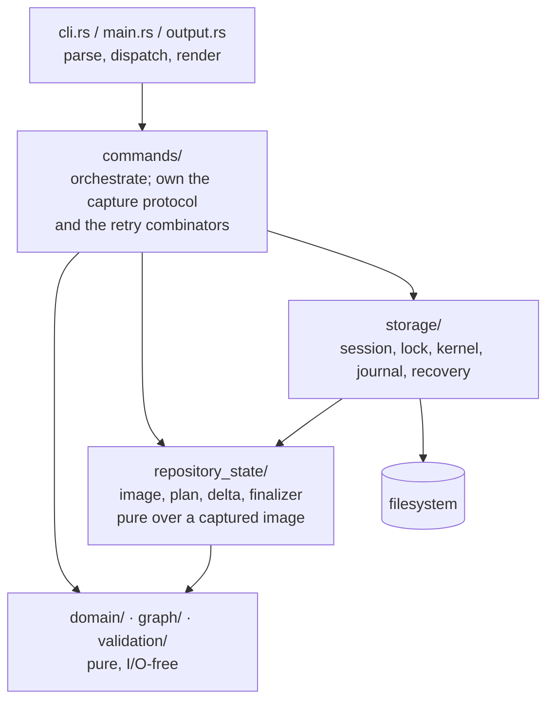

# Investigation: redo-record mutations (`f1dc843a`)

Code baseline: HEAD `3d5e0e802`. Every `file:line` below was checked against the
working tree at that commit. Line counts are `wc -l`. This document owns the
inventories the plan cites; the plan restates none of them.

Governing decision `@/charter/D-17` (`dev/vision/9db27a3a-charter.md:310-352`).
Epic criteria REQ-01..REQ-07, all `[hard]`. Intake brief
`dev/active/f1dc843a-redo-mutations/intake.md`, harness
`dev/active/f1dc843a-redo-mutations/bench.sh`.

Citations corrected against the code while consolidating: `.gitignore:15-16` (not
`:19-20`); `compose_events` at `mutation.rs:659` (not `:656`); `SemanticEntry` at
`repository_state_store_tests.rs:1736` (not `:1735`); `MutationIntent` has **10**
variants, not 9; the `AGENTS.md` invariants region now ends at `:147` (the two
invariants added in `bbd53719e` and `ffac40f80` shifted it), while the three statements
this epic touches remain at `:130`, `:131`, `:132`.

---

## 1. Claim classification

| # | Claim | Verdict |
|---|---|---|
| 1 | Every mutation locks, captures a closed image, derives, publishes through the journaled kernel | **valid-and-open**, with two stated exceptions |
| 2 | Every mutation rewrites the whole event log as a file replacement | **valid-and-open** |
| 3 | Capture reads registries, event log, every issue, hashing each, repeated per round, plus apply-time whole-read-set revalidation | **valid-and-open**, with a round-count correction |
| 4 | Intake line-count table | **valid-and-open** — all ten rows reproduce exactly |
| 5 | Intake consumer list | **valid-and-open** — accurate but incomplete |
| 6 | `jit init`'s absent-root publication is separable from the kernel | **invalid-as-stated** |
| 7 | The data root has a gitignored `tmp/` | **invalid-as-stated** for shipped behaviour |
| 8 | The repository lock serializes all jit writers | **invalid-as-stated** |
| 9 | Each REQ-05 construct exists under the name REQ-05 uses | **invalid-as-stated** for five of ten terms |
| 10 | The intake's known flake is unrelated | **valid-and-open** |

### Claim 1 — lock, capture, derive, publish through the kernel

The pipeline exists exactly as described. `RepositoryStateStore::open_mutation_session`
(`crates/jit/src/storage/repository_state_store.rs:202`; JSON impl `:314`, in-memory
impl `:448`) takes the guard chain, runs recovery, and hands back a session.
`JsonMutationSession::apply` (`:507`) revalidates and calls
`FileTransactionKernel::execute_repository_delta`
(`crates/jit/src/storage/repository_state_store.rs:558` →
`crates/jit/src/storage/file_transaction.rs:218`).

Two qualifications the plan must carry:

- The repository write lock is taken **only when the data root already exists**.
  `crates/jit/src/storage/repository_state_store.rs:403-404` acquires it inside
  `if roots.data.is_some()`; an absent-root session (fresh `jit init`) holds only the
  worktree-bootstrap guard (`:356-357`) and the bootstrap guard (`:362`). The session
  stores `_repository_guard: Option<RepoWriteGuard>`
  (`repository_state_store.rs:296`) and `apply` falls back to `_bootstrap_guard`
  (`:547-549`).
- `commands/breakdown.rs` publishes N+E **separate** transactions, calling `create_issue`
  (`crates/jit/src/commands/breakdown.rs:406`) and `add_dependency` (`:424`, `:432`,
  `:450`) in a loop, with ambient `storage.load_issue` reads outside any session
  (`:303`, `:348`, `:356`, `:487`). It has no CLI arm.

### Claim 2 — the whole event log is rewritten as a file replacement

Confirmed. `compose_event_action` (doc `crates/jit/src/repository_state/mutation.rs:1199-1207`,
`fn` at `:1208`) reads the captured prefix at `:1225`, composes prefix++lines through
`compose_events` (`fn` at `:659`), and emits one
`RepositoryAction::WriteFile { path: events.jsonl, bytes: <whole file> }` at `:1270-1276`.
`finalize_audit_append` (`pub(crate) fn`, `:1291`) reaches the same composer and emits
its own whole-file `WriteFile` at `:1325`.

There is **no append action in the vocabulary**: `RepositoryAction`
(`crates/jit/src/repository_state/image.rs:1334-1364`) has exactly four variants —
`CreateDirectory`, `WriteFile`, `SetMode`, `DeleteFile`.

There is also **no second writer of `events.jsonl`**. `crates/jit/src/storage/json.rs`
names `EVENTS_FILE` (`:36`) only on read paths (`:139-151`, `:1338-1356`, all under a
shared `.events.lock`). Every byte of the log reaches disk through the kernel.

*Corrected from the prior-art sweep*: `compose_events` is at `mutation.rs:659`, not
`:656-669`.

### Claim 3 — capture rounds

Confirmed, with the round count stated precisely. `capture_proposed_base_inner`
(`crates/jit/src/commands/validate.rs:335`, body through `:548`) issues three
`session.capture(...)` calls:

| Round | Site | Reads |
|---|---|---|
| 1 | `validate.rs:388` | `CaptureSpec::phase_one(planning_registries(), budget)` — `config.toml`, `invariants.toml`, `rules.toml`, `gates.toml`, `templates.toml`, `index.json` |
| 2 | `validate.rs:423` | round 1 plus `events.jsonl`, every indexed issue file, the `issues` listing, referenced schemas, projection sources, a `profiles` listing |
| 3 | `validate.rs:538` (`phase_three`, cloned from round 2's spec at `:422`) | round 2 re-read in full, plus per-profile records (`:428`), working-tree document paths (`:481`), precheck prompts (`:513`), gate-run path and listing (`:527-528`), caller `extra_paths` (`:531`) / `extra_listings` (`:533`), pinned requests (`:536`) |

Each round is gated by `has_stable_overlap` (`image.rs:978`) at `validate.rs:424` and
`:539`. An optional fourth round runs through `capture_gate_run_results`
(`crates/jit/src/commands/mod.rs:1907`), itself up to three further captures.
`capture_mutation_preflight` (`validate.rs:244`) is a separate **two**-round capture
(`:253` config+index; `:276` plus only the candidate issue files, `:269-275`).

Apply-time whole-read-set revalidation is confirmed at
`crates/jit/src/storage/repository_state_store.rs:516-535`: the injection point
`RepositoryBeforeReadSetRevalidation` (`:517`), a fresh
`capture_capability_image` over `image.capture_spec().clone()` — the complete
phase-three spec — at `:524-530`, and whole-image comparison at `:531-535` returning
`RetryableConflict`. The memory backend mirrors it at `:615-621`.

So a changing mutation performs **six** capture rounds: 2 preflight + 3 attempt +
1 revalidation. The intake says "three phases" (`intake.md:66-68`); that counts the
attempt rounds only and understates total I/O. See §2 for four mutually contradictory
counts in live `dev/active/` prose.

### Claim 4 — the line-count table

All ten rows reproduce exactly at HEAD: `file_transaction.rs` 3525,
`transaction_journal.rs` 179, `transaction_recovery.rs` 172, `transaction_staging.rs`
16, `guard_order.rs` 96, `repository_state_store.rs` 1973,
`repository_state_store_tests.rs` 5051, `memory.rs` 1080, `repository_state/image.rs`
2597, `repository_state/mutation.rs` 2539. Total 17,228.

### Claim 5 — the consumer list

Accurate but not exhaustive; §3 is the full inventory. The intake omits
`crates/server/src/lib.rs:73` (the server's only session open),
`crates/jit/src/commands/breakdown.rs` (indirect, via `create_issue`/`add_dependency`),
and the six integration-test suites plus two external re-implementers of
`RepositoryMutationSession`.

### Claim 6 — `jit init`'s absent-root publication is separable — **invalid as stated**

The epic's Notes say init's publication "is governed by `@/inv/atomic-writes` and stays
out of scope". Init has **no publication code of its own**. `crates/jit/src/commands/init.rs`
and `crates/jit/src/repository_state/initialize.rs` contain zero `fs::` calls in
production. Init builds a `MaterializationPlan` and hands it to `with_mutation_session`
(`crates/jit/src/commands/init.rs:181`).

Every mechanism init depends on lives in `crates/jit/src/storage/file_transaction.rs`:

| Step | Site |
|---|---|
| Stage allocation `jit-stage-<txid>` in the data root's **parent** | `:808` |
| Stage creation + identity journaling before anything is staged | `:1038-1063` |
| Staged writes via `transaction_staging::stage_bytes` (`create_new` + `write_all` + `sync_all`) | `prepare_staged_data_action` `:1345`; `crates/jit/src/storage/transaction_staging.rs:6-12` |
| Pre-rename re-verification of every staged Data action against its recorded `final_identity` | `:1425-1440` (`ensure_repository_final` at `:1440`) |
| Parent re-binding to the live ambient name | `:1444` |
| `renameat2 RENAME_NOREPLACE` publication; `AlreadyExists` → `OccupiedDataRoot` | `:1452`, `:1460`; primitive `crates/jit/src/storage/atomic_write.rs:45` |
| Post-publication identity verification | `:1473-1480` |
| External `.jit-bootstrap/transactions/` journal making an interrupted init recoverable | `:477-481`, `TransactionControlLocation::ExternalBootstrap` `:52` |
| Orphan stage reclamation | `data_stage_was_published` `:2072`, `remove_data_stage_if_owned` `:2113` |

**What removing `file_transaction.rs` would break for init**: all nine rows. The
`renameat2` primitive itself (`atomic_write.rs:45`) survives independently, but stage
allocation, `create_new` staging, the two identity verifications, the `OccupiedDataRoot`
semantics, the external journal, and `.gitattributes` publication as a Worktree action in
the same delta do not. The redo record either reproduces them or `@/inv/atomic-writes`'s
clause "new-file publication uses verified staging plus atomic no-replace publication"
loses its implementation.

The Q1 sweep's finding stands: init **shares** the kernel's publication, it does not have
a separable one.

### Claim 7 — a gitignored `tmp/` under the data root — **invalid as stated for shipped behaviour**

| Fact | Evidence |
|---|---|
| No path constant | `"tmp"` is a bare string literal at `crates/jit/src/storage/file_transaction.rs:392, 395, 443, 446, 463, 492, 704`. The worktree analogue has one: `const BOOTSTRAP_DIR: &str = ".jit-bootstrap"` (`:34`). |
| One named declaration, and it is a *reservation* | `crates/jit/src/repository_state/path.rs:203` — `RepositoryRootClass::Data => path == "tmp" \|\| path.starts_with("tmp/")` inside `RootRelativePath::checked` (`:197-209`), making any `VirtualPath::data("tmp/...")` fail with `ReservedTransactionPath`. |
| Created by | `open_or_create_dir(data, "tmp")` at `file_transaction.rs:492`, inside `create_repository_control` for `TransactionControlLocation::InternalRepository`, then `open_or_create_dir(&tmp, "transactions")` at `:493`. |
| Removed by | `cleanup_empty_repository_control` `file_transaction.rs:455-464`. |
| Gitignored in **this** repository | `.gitignore:15-16` — comment `# Jit scratch directory (ephemeral, machine-specific)` then `.jit/tmp/`. Hand-maintained. |
| Written by `jit init` | **Nothing.** No production Rust code in the workspace writes a `.gitignore`. The only `fs::write(".gitignore")` in the tree is a test fixture at `crates/jit/src/gate_execution.rs:833`. `jit init` writes `.gitattributes` (`crates/jit/src/repository_state/initialize.rs:51-52`, `206`), never `.gitignore`. |

**An adopter running `jit init` gets no `.jit/tmp/` ignore entry.** The only statement of
the rule is adopter prose at `docs/reference/storage-format.md:44-46, 70`. The epic moves
the commit point into `tmp/`; it becomes a correctness matter that `tmp/` is not
committed, and today nothing makes that true outside this repository.

*Corrected from the docs sweep*: the gitignore entry is at `.gitignore:15-16`, not
`:19-20`.

### Claim 8 — the repository lock serializes all jit writers — **invalid as stated**

The lock is a reentrant, thread-owner-tracking wrapper over `flock(2)`
(`crates/jit/src/storage/repo_lock.rs:1-31` module doc; `REPO_WRITE_LOCK_FILE` const
`:80`; `LockState` `:84-92`; process-wide registry `:48`, key normalization
`canonical_lock_key` `:55`). It is taken **inside** `open_mutation_session`
(`repository_state_store.rs:404`), so every kernel publisher takes it by construction —
including read-only sessions.

Writers that bypass it:

| Bypasser | Target | Site |
|---|---|---|
| Claims/leases control plane, every operation | `.git/jit/claims.jsonl`, `claims.index.json`, `locks/` | `crates/jit/src/storage/claim_coordinator.rs:884-963`, `:407-410` |
| Worktree identity | **`.jit/worktree.json`** and `create_dir_all(.jit)` | `crates/jit/src/storage/worktree_identity.rs:145`, `:197`, `write_identity_atomic` `:231` |
| Server launcher | `.jit/server.pid.json`, `.jit/server.log` | `crates/jit/src/commands/serve.rs:85`, `:95`, `:568-571` |
| `profile pack --output` outside both roots | arbitrary external path | `crates/jit/src/commands/profile.rs:1122-1130` → `crates/jit/src/storage/external_publish.rs:107` |
| `graph export` / `snapshot export` outside both roots | arbitrary external path | `crates/jit/src/commands/graph.rs:97`, `crates/jit/src/commands/snapshot.rs:713`, `:739` |
| `config set --global` | `~/.config/jit/config.toml` | `crates/jit/src/storage/user_config_store.rs:56`, `:62` |
| `jit hooks install` | `<git_dir>/hooks/{pre-commit,pre-push}` — non-atomic `fs::write` | `crates/jit/src/commands/hooks.rs:37, 48, 58, 144` |
| Stale-lock sweep | `.git/jit/locks/*` | `crates/jit/src/storage/lock_cleanup.rs:104-105`, `:118-119` |
| Orphan temp sweep | `.jit/**/*.tmp` | `crates/jit/src/storage/temp_cleanup.rs:46` |
| Orphan sidecar sweep **on a read path** | `.jit/issues/<uuid>.lock` | `crates/jit/src/storage/lock.rs:488`, called from `json.rs:1313` inside `list_issues` |
| `examples/regenerate.rs` | `docs/reference/*.md` **and `.jit/templates.toml`** | `crates/jit/examples/regenerate.rs:106-124` |
| `crates/server/build.rs:8` | `web/dist/` (build time) | — |

Four of these write **inside the data root** the redo record will own:
`.jit/worktree.json`, `.jit/server.pid.json`, `.jit/server.log`, and the `*.tmp` sweep.

D-17's premise "the repository lock serializes jit writers"
(`dev/vision/9db27a3a-charter.md:313-314`) holds for *repository-state* writers. It does
not hold for the control plane, worktree identity, or the server launcher.

### Claim 9 — REQ-05 construct mapping

REQ-05 names ten things. Five have no construct by that name.

| REQ-05 term | Real construct(s) | `file:line` | Kind | Size |
|---|---|---|---|---|
| rollback kernel | `FileTransactionKernel` | `crates/jit/src/storage/file_transaction.rs:68` | `pub(in crate::storage) struct` | module 3525 lines (2939 prod + 586 test from `:2940`) |
| | `rollback_repository_actions` | `file_transaction.rs:1669` | `fn` | 1669-1697 (29) |
| | `rollback_repository_action` | `file_transaction.rs:1699` | `fn` | 1699-1777 (79) |
| transaction backup — **no construct by that name** | `prepare_repository_backup` | `file_transaction.rs:1302` | `fn` | ~42 |
| | `restore_verified_backup` | `file_transaction.rs:1779` | `fn` | ~20 |
| | `remove_redundant_backup` | `file_transaction.rs:1800` | `fn` | ~23 |
| | `backup_authority` | `file_transaction.rs:285` | `fn` | 6 |
| | `"backups"` control subdirectory | `file_transaction.rs:190, 529, 590, 2699` | string literal | — |
| | `backup: ControlName` journal fields | `crates/jit/src/storage/transaction_journal.rs:121, 126, 129` | struct fields | 3 |
| staging directory — **no construct by that name** | `storage/transaction_staging.rs` (`stage_bytes` `:6`, `sync_directory` `:14`) | module | 16 |
| | `stage_authority` | `file_transaction.rs:277` | `fn` | 7 |
| | `prepare_staged_data_action` | `file_transaction.rs:1345` | `fn` | ~50 |
| | `create_directory_stage_name` | `file_transaction.rs:1229` | `fn` | ~15 |
| | `"stages"` control subdirectory | `file_transaction.rs:189, 528, 589, 2698` | string literal | — |
| | `data_stage`, `data_stage_identity` journal fields | `transaction_journal.rs:175, 176` | struct fields | 2 |
| reverse action — **no construct by that name** | `FailurePoint::RepositoryBeforeReverseAction { action }` / `RepositoryAfterReverseAction { action }` | `crates/jit/src/storage/transaction_recovery.rs:90`, `:93` | enum variants | 6 |
| | the work itself is `rollback_repository_action(s)` (above) | — | — | — |
| | prose only | `file_transaction.rs:5`, `:1665`, `:3198` | comments | — |
| | *not* `ReverseAcquisitionError` (`crates/jit/src/storage/guard_order.rs:28`) — a different concept: reverse **lock-acquisition** order | — | — | — |
| worktree companion — **no construct spelled `worktree_companion`** | `COMPANION_MARKER` | `file_transaction.rs:41` (doc `:36-40`) | **`const &str = "companion"`** | 1 + 5 doc |
| | `CompanionDirs` | `file_transaction.rs:269` | `struct`, 3 fields | 5 |
| | `create_companion_control` | `file_transaction.rs:512` | `fn` | ~32 |
| | `open_companion_control` | `file_transaction.rs:562` | `fn` | ~35 |
| | `remove_companion_control_if_identity` | `file_transaction.rs:598` | `fn` | ~27 |
| | `sweep_orphan_companions` (free) | `file_transaction.rs:640` | `fn` | ~47 |
| | `FileTransactionKernel::sweep_orphan_companions` | `file_transaction.rs:128` | `pub(crate) fn` | 4 |
| | `needs_worktree_companion` — the only literal spelling | `file_transaction.rs:475` (field), `:943` (local), `:500` (use) | field + local | 3 sites |
| apply-time revalidation of the whole read set | the block in `JsonMutationSession::apply` | `crates/jit/src/storage/repository_state_store.rs:516-535` | inline | 20 |
| | mirror in `MemoryMutationSession::apply` | `repository_state_store.rs:613-621` | inline | 9 |
| | `FailurePoint::RepositoryBeforeReadSetRevalidation` | `transaction_recovery.rs:41` (doc `:40`) | enum variant | 1 + 1 doc |
| plan hash over captured entries | `plan_hash` — **free `pub fn`**, not a method | `crates/jit/src/repository_state/image.rs:1581` (doc `:1580`) | `pub fn` | 22 |
| | `PlanHashError` | `image.rs:1715` | `pub struct` | 2 |
| | `MaterializationPlan.hash` field / `hash()` | `crates/jit/src/repository_state/mod.rs:589` / `:705`ff | field / `pub fn` | — |
| | `FileTransactionOutcome.plan_hash` | `file_transaction.rs:47` | struct field | 1 |
| | `RepositoryTransactionJournal.plan_hash` | `transaction_journal.rs:173` | struct field | 1 |
| phased capture — **no construct by that name** | `CaptureSpec::phase_one` | `image.rs:628` | `pub fn` | 27 call sites |
| | the phasing is an ad-hoc protocol with locals `image_one` / `image_two` / `phase_three` inside `capture_proposed_base_inner` | `crates/jit/src/commands/validate.rs:335-548` | private `fn` | 214 |
| | `RepositoryImage::has_stable_overlap` — the phase-to-phase coherence check | `image.rs:978` | `pub(crate) fn` | 4 files, 13 sites |
| listing fingerprint | `ListingFingerprint` | `image.rs:226` (doc `:224`) | `pub struct` | impl block `:239-350`, ≈127 lines with the type |
| | `RepositoryImage::listing_fingerprints()` | `image.rs:933` | `pub fn` | 3; 17 files, 32 call sites |
| | `RepositoryImage.listings` field; `CaptureSpec::discover_listing` `:684`, `discover_listings` `:696`, `listings()` `:738` | `image.rs:817` et al. | field / `pub fn` | — |
| mutation document closure — **no construct by that name** | `document_capture_closure` | `crates/jit/src/commands/validate.rs:1300` (doc `:1290-1299`) | private `fn` | 53 (1300-1352); one caller, `validate.rs:480` |
| | `DocumentClosure` | `validate.rs:1247` | `type` alias | 1 |
| | `DocumentCapture` (`All`, `PlanOnly`, `None`) | `validate.rs:1280` | private `enum` | — |
| | *not* `validate_capture_closure` / `ValidationCaptureClosure` (`crates/jit/src/repository_state/materialize.rs`, re-exported `test-support`-gated at `repository_state/mod.rs:86`/`:89`) — that is the **whole-repository validation** closure and stays | — | — | — |
| second publication path | see §7 Q1 and claim 8 | — | — | — |

Consequence: REQ-05's completion check cannot be a name grep. It needs the mapping above,
or the criterion reads as satisfied while `rollback_repository_action`,
`prepare_repository_backup` and `document_capture_closure` remain.

### Claim 10 — the known flake is unrelated

Confirmed. The six affected tests are
`crates/jit/tests/fast_rules/cli_warnings_integration_tests.rs:88, 116, 140, 165` (each
via `setup_test_repo()` `:24-59`, whose first statement is
`jit::test_utils::profiled_repository_fixture("jit-dogfood", ...)` `:26-30`) and
`crates/jit/src/test_utils.rs:1548`, `:1577`.

Mechanism: the fixture baseline is cached per key and
`crates/jit/src/test_utils.rs:165` states "source or executable changes select a new
key", so a rebuild forces one cold build. That build is serialized cross-process by
`FileLocker::new(Duration::from_secs(120))` in `ensure_profiled_repository_fixture`
(`test_utils.rs:632-645`), against a 20 s per-test bound from `.config/nextest.toml`
(`slow-timeout = { period = "10s", terminate-after = 2 }`, `retries = 0`). The
setup-script filters in `.config/nextest.toml` cover `cli_item_validate`,
`fast_rules & derived_state_repair_tests` and a named `binary(jit)` list — none of the
six — so they pay the cold build inline.

The production kernel is involved only incidentally (the fixture builds a repository by
applying a profile through it). The redo record will not fix it; the cost is one profile
application, not a mutation's publication. Two structural fixes exist — widen the setup
filters, or reconcile the 120 s lock budget with the 20 s test bound — neither in scope.

---

## 2. Prior-art sweep

The archived plan is
`dev/archive/cdc840ad-repository-materialization/cdc840ad-plan.md`, `## Decisions` at
`:186`.

### D11 — transaction guarantee (`cdc840ad-plan.md:198`)

> chosen **recoverable rollback/journal convergence to a complete old/new state with
> planner-expected preimages**. Rejected: filesystem-wide instantaneous atomicity claim,
> independent atomic writes, unchecked publication preimage.

| Guarantee | Under a redo record |
|---|---|
| **G11-a** coupled-state convergence — after any crash the repository is at the complete old or complete new state | **DELIVERED.** The synced record is the single commit point; before it nothing was written, after it session open replays forward (`9db27a3a-charter.md:344-348`). |
| **G11-b** rollback reachability — a failure after some actions published is undone in reverse through verified synced backups (`cdc840ad-plan.md:38-39`) | **DROPPED, deliberately.** Redo-only: no backup, staging directory, reverse-action list, or companion journal. A half-applied record is finished forward, never undone. Consequence: the record must be durable and self-sufficient **before the first live write**, and replay must be idempotent under repeated partial application. |
| **G11-c** planner-expected preimage rechecked immediately before the irreversible mutation (`cdc840ad-plan.md:31`) | **DELIVERED, NARROWED.** D-17 keeps a live-bytes comparison scoped to the files the mutation *writes*, plus the event log's length and tail (`9db27a3a-charter.md:317-321`). Dropped: detection of an external edit to a file the mutation read but does not write — named as an accepted cost (`:355-358`); and the per-action second preimage recheck inside publication. |
| **G11-d** honest vocabulary — recoverable convergence, not filesystem-wide atomicity (`cdc840ad-plan.md:39`; audited at `cdc840ad-investigation.md:300`) | **DELIVERED and strengthened.** But `@/inv/atomic-writes` names only temp+rename and no-replace publication; the positioned append needs new wording (intake Q5). |

### D14 — capture closure (`cdc840ad-plan.md:201`)

| Guarantee | Under a redo record |
|---|---|
| **G14-a** purity — pure producers read only the closed image; an uncaptured read fails typed (`UndiscoveredRepositoryPath`) | **DELIVERED.** Keep the typed failure. |
| **G14-b** completeness of the discovered read set | **NARROWED.** Issue-linked documents leave the mutation read set and stay with validation (`9db27a3a-charter.md:315-317`); `9750b151` already did the document half. Open: whether "the issues its derivation consults" stays *every* issue (intake Q2). |
| **G14-c** boundedness — budget-bounded, never whole-worktree recursion | **DELIVERED**, strictly more so. |
| **G14-d** pinned / linked-worktree evidence resolved only at the boundary | **DELIVERED for validation, REMOVED from mutations.** |
| **G14-e** directory-entry race detection via complete listing fingerprints | **DROPPED** (`9db27a3a-charter.md:331-334`). A mutation no longer detects a sibling issue file appearing or vanishing between capture and commit. The repository lock is what makes this acceptable — see claim 8 for who is outside that lock. |
| **G14-f** plan hash over every captured entry plus **full** pre-journal revalidation | **DROPPED, both.** Live code to delete: `plan_hash` (`image.rs:1581-1602`) and the re-capture-and-compare (`repository_state_store.rs:516-535`). |
| **G14-g** no mixed snapshot — a closure change discards and recaptures | **DELIVERED, cheaper.** |

### Other archived decisions touching this area

| # | Line | Subject | Verdict |
|---|---|---|---|
| D2 | `:189` | module ownership: `declarations` + `repository_state`, storage only at capture/publication boundaries | Valid; layer boundary unchanged. |
| D3 | `:190` | canonical layout and image, virtual→physical injectivity | Valid; the record still needs canonical paths. |
| D4 | `:191` | one recovered `open_mutation_session(layout)`, native on JSON and memory | Valid in shape; "recovery" becomes redo replay. Memory modelling is intake Q3. |
| D5 | `:192` | guard order coordinator → bootstrap → repository → events; recovery precedes capture | Mostly valid. The separate events guard may collapse: the record covers the append and D-17 leans on the one repository lock. |
| **D6** | `:193` | **deletion protocol** — journaled `DeleteFile` with synced backup, no-follow publication, no-replace rollback restore, prepared/committed recovery arms | **Invalidated in mechanism, live in requirement.** Backups and rollback go with D11, but `DeleteFile` is still emitted (`crates/jit/src/repository_state/materialize.rs:1279-1281`) and is load-bearing for `validate --fix` obsolete-schema removal, profile-apply departing assets (`crates/jit/src/repository_state/initialize.rs:1019-1026`, decided `profile_apply.rs:2116`) and archive source removal (`crates/jit/src/repository_state/archive.rs:258`). **The plan must decide explicitly.** |
| D7 | `:194` | semantic authority and repair | Valid; independent of the commit mechanism. |
| D12 | `:199` | one internal delta, command-specific public envelopes | Valid; the delta stays the vocabulary the record is built from. |
| D15 | `:202` | one `MutationContext` before the retry loop, deterministic `IdAuthority`, canonical serializers, **exact-prefix torn-tail finalization** | Valid **except the append shape**. The finalizer composes the whole next `events.jsonl`; under D-17 it emits offset+bytes. Torn-tail certification (`crates/jit/src/repository_state/mutation.rs:1227-1237`, `prefix_has_torn_tail` `:645`) must survive into the offset model (intake Q4). |
| D17 | `:204` | command dispositions — init attributes, migrations, archive/presets, repository-contained exports join the same captured recoverable delta | Valid as scope, open as mechanism: exactly intake Q1. |
| D19 | `:206` | claim acquire's repository-side sync through the shared recovered session | Valid. Idempotent convergence over the captured issue **and event tail** must keep working when only a tail window is read. |
| **D20** | `:207` | **absent-root publication** — verified sibling staging + atomic no-replace rename as the irreversible commit point | **Partly at risk.** This is the one place staging is not rollback machinery but the creation protocol for a root that does not exist yet. `tmp/` cannot hold the record before the root exists. **Decide explicitly**: keep staged no-replace publication for fresh init as a named exception (which collides with REQ-05's "no second publication path"), or replace it. See claim 6. |

Not touching this area: D1, D8, D9, D10, D13, D16, D18.

### Known inaccuracies in live documents

1. **"Two-phase capture" (archive and architecture doc) vs "three phases" (intake) — both
   partly wrong.** `cdc840ad-research.md:88-98`, `cdc840ad-plan.md:26` and
   `dev/architecture/repository-state-materialization.md:78-84` say two-phase; the intake
   says three. The code has a two-*phase* `CaptureSpec` **type** (`phase_one` plus
   `discover_paths`/`discover_listing`) driven by the command layer in **three capture
   rounds**, optionally four, plus a fifth at apply and up to two more in
   `capture_gate_run_results`. "Phase" names two different things. The plan should say
   "capture rounds" and state the count.
2. **Captures-per-mutation is contradicted four ways.**
   `dev/active/9c9ac88e/baseline.md:69-72` says 2; `9c9ac88e/benchmark.md:28` computes a
   git budget for 2; `dev/active/b5bb1ccd/benchmark.md:25, 29` says "about seven";
   `9750b151`'s own description says "about seven times: three phases in a preflight
   session; three phases again in the attempt session; one read-set revalidation".
   HEAD is **six**. None is qualified as point-in-time. Quoting any of them is a defect.
3. **`9750b151`'s description claims a three-capture preflight.** At HEAD
   `capture_mutation_preflight` (`validate.rs:244-291`) captures twice and reads no issue
   closure — commit `73aee4376` landed inside `9750b151` after the description was
   written. `intake.md:59` is the accurate statement.
4. **`dev/studies/perf/session-cost-27ffbd2d.md:32, 41-42` is three fix-generations
   stale** — 3720.6 ms attributed to "base two-full-capture materialization". Current is
   110/119 ms (`intake.md:45`). The shape of the finding (system-time and page-fault
   dominated, capture-bound not lock-bound) still holds; the numbers do not.
5. **`dev/TESTING.md:464-470`'s durable-publication numbers are pinned to a stale
   artifact** — `profile add` median 249 ms / 1,046 directory fsync calls, profiled `init`
   median 419 ms, recorded against
   `dev/benchmarks/test-suite-performance-4b7c06d0.json` under the
   `transaction-benchmark-evidence` contract. They describe the kernel this epic deletes.
   The **contract**, not just the numbers, needs a disposition.
6. **D-17's record shape omits three of the four delta action kinds** (not an inaccuracy
   in a prior document — a hole between the charter's prose and the code it governs).
   `9db27a3a-charter.md:321-324` describes the record as new bytes per written file plus
   the event append. The live vocabulary is `CreateDirectory | WriteFile | SetMode |
   DeleteFile` (`image.rs:1334-1364`), all four dispatched at
   `materialize.rs:1251-1281`. Archived handoff `-9:47` additionally records that both
   backends **verify parent directories**, so a delta omitting `CreateDirectory` ancestors
   fails apply.
7. **`dev/architecture/repository-state-materialization.md` is wholly accurate today and
   wholly obsolete after the epic** — 439 lines with no staleness marker. It is the single
   largest doc rewrite the epic owes; `@/inv/single-source-prose` makes leaving it stale a
   defect.

### Standing API constraints from the archive

- No generic byte/action/delta callback and no "bytes-in-delta" / `plan_from_overlay`
  seam (`cdc840ad-handoff-11.md:125-127`, `-9:45-47`).
- One `MutationContext` created before the retry loop and reused across attempts, retry
  8× (`-10:90`).
- Retries must stay cheap and **must never re-run a gate checker**
  (`dev/active/25b2d530/plan.md:9-11, 22-33`; `GateEvaluationStability::{Stable,InputsMoved}`
  at `:29-33`).

---

## 3. Consumer sweep

`web/`, `mcp-server/` and `contrib/` have **zero** hits for every symbol below.
`dev/benchmarks/**` and `dev/archive/**` hold hundreds of matches that are captured
benchmark output and archived plans, not consumers. Production vs test is determined per
file by its first `#[cfg(test)] mod` line.

### 3.1 Session and capture API

`RepositoryStateStore::open_mutation_session` — trait method
`crates/jit/src/storage/repository_state_store.rs:202`; impls `:314` (`JsonFileStorage`),
`:448` (`InMemoryStorage`). 191 lines across 27 files.

| File | Sites | Production sites | Test sites |
|---|---:|---|---|
| `crates/jit/src/storage/repository_state_store_tests.rs` | 132 | — | all (5051-line file) |
| `crates/jit/src/commands/mod.rs` | 14 (13 calls + doc `:2020`) | 363, 2485, 2653, 2762 | 3526, 3677, 3698, 3787, 3812, 3839, 3948, 3970, 4358 |
| `crates/jit/src/commands/gate.rs` | 8 | 1405, 1420 | 1918, 1950, 2006, 2043, 2320, 2349 |
| `crates/jit/src/storage/repository_state_store_contention_tests.rs` | 7 | — | all |
| `crates/jit/src/commands/profile.rs` | 6 | — | 4205, 5281, 5313, 5371, 5401, 5610 |
| `crates/jit/src/storage/json.rs` | 6 | 592, 1127 | 1641, 1740, 1769, 1801 |
| `crates/jit/src/commands/validate.rs` | 4 | — | 3600, 3652, 4537, 4576 |
| `crates/jit/src/commands/dependency.rs` | 3 | 267, 356 | 1105 |
| `crates/jit/src/commands/issue.rs` | 3 | 585, 602 | 2097 |
| `crates/jit/src/commands/gate_check.rs` | 3 | 912, 975 | 2653 |
| `crates/jit/tests/fast_docs_templates/template_apply_atomicity_tests.rs` | 3 | — | incl. trait impl `:292` |
| `crates/jit/src/commands/template.rs` | 2 | 178, 207 | — |
| `crates/jit/src/commands/document.rs` | 2 | — | 2007, 2046 |
| `crates/jit/tests/fast_rules/local_rule_enforcement_tests.rs` | 2 | — | incl. trait impl `:818` |
| `crates/jit/tests/fast_rules/derived_state_repair_tests.rs` | 2 | — | all |
| `crates/jit/src/commands/batch_create.rs` | 1 | 521 | — |
| `crates/jit/src/commands/init.rs` | 1 | — | 1429 |
| `crates/jit/src/commands/claim.rs` | 1 | — | 1975 |
| `crates/jit/src/main.rs` | 1 | 2479 | — |
| `crates/jit/src/storage/gate_runs.rs` | 1 | — | 46 |
| `crates/jit/src/storage/file_transaction.rs` | 1 | doc comment only | — |
| `crates/server/src/lib.rs` | 1 | 73 (`prepare_server_storage`) | — |
| `crates/jit/tests/cli_gate/gate_evaluation_durability_test.rs` | 1 | — | all |
| `crates/jit/tests/cli_issue/recover_command_tests.rs` | 1 | — | all |
| `crates/jit/tests/cli_repo_workflow/linked_checkout_write_policy_tests.rs` | 1 | — | all |
| `crates/jit/tests/cli_repo_workflow/profile_interruption_tests.rs` | 1 | — | all |

**Two external re-implementers of `RepositoryMutationSession`** (would need rewriting):
`crates/jit/tests/fast_docs_templates/template_apply_atomicity_tests.rs:292` and
`crates/jit/tests/fast_rules/local_rule_enforcement_tests.rs:818`. **Two in-tree
decorators**: `crates/jit/src/commands/profile.rs:3173` and `:3202`.

**Retained-session variant**: `JsonFileStorage::open_and_retain_mutation_session`
(`crates/jit/src/storage/json.rs:580`), `RetainedMutationSessionGuard` (`json.rs:189`),
`RetainedSessionSuspendedError`. Consumers: `json.rs` ×13, `storage/mod.rs` ×2
(re-export), `main.rs:2487`, `commands/init.rs` ×1, `repository_state_store_tests.rs` ×1.

Capture entry points, all defined in `crates/jit/src/commands/validate.rs`:

| Function | Def | Callers | Split |
|---|---|---|---|
| `capture_proposed_base` | `:192` | `validate.rs:172`, `profile.rs:2099/2128/2151`, `config.rs:331`, `gate_check.rs:807`, `init.rs:212/223/252` (prod); `validate.rs:3603/4540`, `init.rs:1431` (test) | 9 prod + 3 test |
| `capture_mutation_base` | `:220` | `dependency.rs:269/358`, `issue.rs:604`, `batch_create.rs:296`, `bulk_update.rs:361`, `mod.rs:2257/2487/2664/2764` (prod); `batch_create.rs:523`, `validate.rs:4549`, `mod.rs:3529` (test) | 9 prod + 3 test |
| `capture_mutation_preflight` | `:244` | `issue.rs:586`, `gate.rs:1406`, `mod.rs:2655` (prod); `validate.rs:4579` (test) | 3 prod + 1 test |
| `capture_proposed_base_without_documents` | `:293` | `archive.rs:644` | 1 prod |
| `capture_proposed_base_with_listings` | `:316` (private) | `validate.rs:752` | 1 prod |
| `capture_proposed_base_inner` | `:335`-`:548` (214 lines, private) | the five above | — |
| `capture_validation_image_with` | `:158` | `validate.rs:143` (prod); `gate_check.rs:2800/2835/2897` (test) | 1 prod + 3 test |

Shared session-protocol helpers, all in `crates/jit/src/commands/`:
`with_mutation_session` (14 files, 39 sites), `SessionStep` (14 files, 109 sites),
`capture_or_retry` (12 files, 49 sites).

### 3.2 `RepositoryImage`

Definition `crates/jit/src/repository_state/image.rs:813` (private fields `layout`,
`spec`, `entries`, `listings`, `pinned`, `linked_worktree`); `impl` `:822`-`:997`.

| Method | Line | Visibility |
|---|---|---|
| `close` | `:824` | `pub` associated constructor, ~91 lines |
| `layout` | `:918` | `pub` |
| `capture_spec` | `:923` | `pub` |
| `entries` | `:928` | `pub` |
| `listing_fingerprints` | `:933` | `pub` |
| `entry` | `:938` | `pub` |
| `file_bytes` | `:949` | `pub` |
| `pinned_evidence` | `:961` | `pub` |
| `linked_worktree_evidence` | `:967` | `pub` |
| `has_stable_overlap` | `:978` | `pub(crate)` |

There is **no** `plan_hash` method and **no** document-closure method on
`RepositoryImage`. Type-name consumers: 297 sites in `crates/jit/src` + 8 in
`crates/jit/tests`.

| File | Sites |
|---|---:|
| `repository_state/profile_apply.rs` | 33 |
| `commands/validate.rs` | 27 |
| `repository_state/initialize.rs` | 24 |
| `repository_state/mod.rs` | 22 |
| `repository_state/mutation.rs` | 17 |
| `repository_state/image.rs` | 16 |
| `repository_state/materialize.rs` | 15 |
| `commands/gate_check.rs` | 14 |
| `storage/repository_state_store.rs` | 14 |
| `commands/template.rs` | 13 |
| `commands/mod.rs` | 13 |
| `repository_state/archive.rs` | 11 |
| `commands/profile.rs` | 10 |
| `validation/repository.rs` | 10 |
| `commands/archive.rs` | 9 |
| `commands/document.rs` | 9 |
| `repository_state/overlay.rs` | 8 |
| `commands/gate.rs` | 6 |
| `repository_state/export.rs` | 6 |
| `tests/fast_docs_templates/template_apply_atomicity_tests.rs` | 6 |
| `document/reference.rs` | 5 |
| `storage/repository_state_store_tests.rs` | 4 |
| `repository_state/package_tree.rs` | 3 |
| `profile/agreement.rs`, `repository_state/managed_document.rs`, `repository_state/image_plan_hash_property_tests.rs` | 2 each |
| `commands/issue.rs`, `document/assets.rs`, `tests/fast_rules/derived_state_repair_tests.rs`, `tests/fast_rules/local_rule_enforcement_tests.rs` | 1 each |

`RepositoryImage::close` explicit call sites — 23 total: `image.rs` ×11,
`repository_state/mod.rs` ×4, `profile_apply.rs` ×4, `export.rs` ×2, `materialize.rs`
×2, `overlay.rs` ×2, `storage/repository_state_store.rs` ×2 (the two real capture paths:
`capture_capability_image` `:872`, `capture_memory_image` `:987`), `archive.rs` ×1,
`initialize.rs` ×1, `mutation.rs` ×1, `document/reference.rs` ×1,
`image_plan_hash_property_tests.rs` ×1.

`listing_fingerprints()` — 17 files, 32 sites; heaviest `commands/archive.rs` 5,
`commands/mod.rs` 4, `repository_state_store_tests.rs` 4, and a **source-text policy
assertion** at `crates/jit/tests/scratch_build/repository_state_cutover_tests.rs:128,
837, 838`.

`has_stable_overlap()` — 4 files, 13 sites: `image.rs` 6, `commands/archive.rs` 3,
`commands/validate.rs` 3, `commands/init.rs` 1. This is the entire phased-capture
coherence mechanism.

### 3.3 `repository_state/mutation.rs` public surface (2539 lines)

Re-exported at `crates/jit/src/repository_state/mod.rs:101-105`.

| Item | Kind | Line | Consumers (files × sites) |
|---|---|---|---|
| `MutationClock` | `pub trait` | 38 | 3 × 22 |
| `SystemMutationClock` | `pub struct` | 45 | 2 × 5 |
| `FixedMutationClock` | `pub(crate) struct` | 55 | 1 × 5 (self) |
| `IdAuthority` | `pub struct` | 80 | 3 × 33 |
| `MutationContext` | `pub struct` | 177 | 14 × 87 |
| `MutationContextAnnotation` | `pub enum` | 196 | 5 × 24 |
| `MutationContextFactory` | `pub(crate) struct` | 217 | 3 × 5 |
| `MutationIntent` | `pub enum`, 10 variants (`CreateIssue`, `CreateIssueBatch`, `ClaimIssue`, `UpdateIssue`, `RepairIssueLifecycle`, `EditGateRegistry`, `CreateGatePreset`, `DeleteIssue`, `RecordGateRun`, `RecordEvent`) | 364 | 15 × 147 |
| `MutationError` | `pub enum` | 476 | 4 × 39 |
| `gate_run_result_relative_path` | `pub fn` | 551 | 8 × 24 |
| `captured_gate_run_result_paths` | `pub(crate) fn` | 563 | 4 × 5 |
| `serialize_issue` | `pub fn` | 589 | 11 × 35 |
| `serialize_gate_run` | `pub fn` | 594 | 3 × 5 |
| `fresh_index_bytes` | `pub fn` | 603 | 4 × 5 |
| `serialize_event` | `pub fn` | 610 | 5 × 13 |
| `prefix_has_torn_tail` | `pub fn` | 645 | 2 × 7 |
| `finalize` | `pub fn` | 741 | `commands/{batch_create,bulk_update,claim,dependency,document,gate,gate_check,issue,migrate,mod,template}.rs` |
| `finalize_delta` | `pub(super) fn` | 758 | `repository_state/archive.rs` ×2 |
| `finalize_audit_append` | `pub(crate) fn` | 1291 | `repository_state/initialize.rs` ×2 |

Plan and delta types are **not** in `mutation.rs`:

- `MaterializationPlan` — `pub struct` `crates/jit/src/repository_state/mod.rs:583`,
  impl `:705` (`image()`, `delta()`, `hash()`, `projection_count()`,
  `profile_targets()`, `profile_contributions()`, `applied_profiles()`, `new()`).
  19 files, 56 sites; heaviest `repository_state/mod.rs` 11, `profile/difference.rs` 7,
  `commands/profile.rs` 6, `export.rs` 4, `storage/repository_state_store.rs` 4.
- `RepositoryDelta`, `RepositoryAction`, `ExpectedPreimage`, `RepositoryEntry`,
  `RepositorySeed`, `MaterializationIntent`, `TargetClaim`, `CaptureSpec`,
  `CaptureBudget`, `ListingFingerprint`, `PinnedDocumentEvidence`,
  `LinkedWorktreeEvidence`, `CaptureError`, `DeltaError`, `SeedError`, `PlanHashError`
  — all in `crates/jit/src/repository_state/image.rs`.
- `RepositoryApplyOutcome` — `pub struct` `storage/repository_state_store.rs:29`;
  6 files, 14 sites.

### 3.4 Kernel modules

**`crates/jit/src/storage/file_transaction.rs`** — 3525 lines (2940 prod +
`#[cfg(test)] mod tests` from `:2941`). Declared `pub(crate) mod file_transaction;`
(`storage/mod.rs:22`); sole re-export
`pub(in crate::storage) use file_transaction::{FileTransactionKernel, TransactionControlLocation};`
(`storage/mod.rs:60`).

| Item | Kind | Line | Callers |
|---|---|---|---|
| `FileTransactionOutcome` | `pub(crate) struct` (1 field `plan_hash`) | 45 | file-internal, 9 sites |
| `TransactionControlLocation` | `pub(in crate::storage) enum` (`ExternalBootstrap`, `InternalRepository`) | 52 | `file_transaction.rs` 29, `repository_state_store.rs` 4, `storage/mod.rs` 1 |
| `FileTransactionKernel` | `pub(in crate::storage) struct` | 68 | `file_transaction.rs` 4, `repository_state_store.rs` 6, `storage/mod.rs` 1 |
| `…::for_repository_layout` | `pub(crate) fn` | 85 | `repository_state_store.rs:374`, `:395` |
| `…::pending_repository_transactions` | `pub(crate) fn` | 109 | `repository_state_store.rs:785` (`recover_location`) |
| `…::cleanup_empty_repository_control` | `pub(crate) fn` | 119 | `repository_state_store.rs` |
| `…::sweep_orphan_companions` | `pub(crate) fn` | 128 | `repository_state_store.rs:411` |
| `…::recover_repository_transaction` | `pub(crate) fn` | 133 | `repository_state_store.rs:793` |
| `…::execute_repository_delta` | `pub(crate) fn` | 218 | `repository_state_store.rs:558` |
| `RepositoryRecoveryDisposition` | `pub(crate) enum` (`Recovered`, `SkippedCompanion`, `SkippedForeignOwner`) | 242 | `file_transaction.rs` 6, `repository_state_store.rs` 4 |
| **`open_regular_file_nofollow`** | `pub(crate) fn` | 2744 | **the one kernel export with consumers outside the transaction path** |

`open_regular_file_nofollow` consumers outside `file_transaction.rs`:
`crates/jit/src/storage/json.rs:123, 150, 1010, 1444, 2088` (the last is test) and
`crates/jit/src/storage/artifact_planning.rs:16` (import), `:338`. Note `json.rs:150` is
the **event-log read path** — this function must survive the kernel's removal or those
six call sites need a replacement.

Private internals a removal must account for (36 free functions; the load-bearing ones):
`create_repository_control` (471), `create_companion_control` (512),
`sweep_orphan_companions` (640), `initial_repository_journal` (718),
`execute_repository_delta` (921), `prepare_repository_actions` (1030),
`prepare_repository_backup` (1302), `prepare_staged_data_action` (1345),
`publish_repository_actions` (1396), `rollback_repository_actions` (1669),
`rollback_repository_action` (1699), `restore_verified_backup` (1779),
`recover_repository_journal` (1824), `validate_repository_journal` (1872),
`cleanup_repository_control` (2190), plus `BarrierDirectory` / `DirectoryBarrier`
(823 / 847).

**`crates/jit/src/storage/transaction_journal.rs`** — 179 lines, private `mod` at
`storage/mod.rs:39`. All items `pub(crate)`, consumed **only** by `file_transaction.rs`
(single `use` at `:9-13`) and `transaction_recovery.rs` (`ActionTag`, `:3`). No test
module.

| Item | Kind | Line |
|---|---|---|
| `REPOSITORY_JOURNAL_VERSION` | `pub(crate) const u32 = 3` | 11 |
| `JOURNAL_FILE` | `pub(crate) const &str = "journal.json"` | 12 |
| `TransactionDecision` | `pub(crate) enum` (`Prepared`/`Committed`/`RolledBack`) | 19 |
| `ControlName` | `pub(crate) struct` newtype + `new`, `as_str`, `TryFrom<String>`, `From` | 28 |
| `RepositoryJournalPath` | `pub(crate) struct` | 65 |
| `RepositoryFinalIdentity` | `pub(crate) enum` (`Absent`/`Directory`/`File`) | 74 |
| `ActionTag` | `pub(crate) enum` (4 variants) + `Display` | 92 |
| `RepositoryJournalActionKind` | `pub(crate) enum` (`CreateDirectory`/`WriteFile`/`SetMode`/`DeleteFile`) + `tag()` | 113, `tag` 135 |
| `RepositoryJournalAction` | `pub(crate) struct` | 151 |
| `RepositoryTransactionJournal` | `pub(crate) struct` (`layout_digest`, `owner_digest`, `plan_hash`, `data_root_was_absent`, `data_stage`, `data_stage_identity`, `decision`, `actions`) | 163 |

**`crates/jit/src/storage/transaction_recovery.rs`** — 172 lines, private `mod` at
`storage/mod.rs:40`.

| Item | Kind | Line | Exposure |
|---|---|---|---|
| `RecoveryState` | `pub(crate) enum` (`Prepared`, `Committed`) | 7 | internal; 4 sites in `file_transaction.rs` |
| `FailurePoint` | `pub enum`, 36 variants | 37 | re-exported as `TransactionFailurePoint`, `pub` under `test-support` (`storage/mod.rs:87`), `pub(crate)` otherwise (`:91`) |
| `TransactionFailureInjector` | `pub trait` (`check(&FailurePoint) -> io::Result<()>`) | 104 | same dual re-export |
| `NoTransactionFailures` | `pub struct` + impl | 111 | same dual re-export |
| `RecoveryRequiredError` | `pub(crate) struct` (thiserror) | 122 | `file_transaction.rs` 5 |
| `FileTransactionError` | `pub(crate) enum`, 13 variants | 134 | `storage/mod.rs:76`; `file_transaction.rs` 104, `repository_state_store.rs` 2, `external_publish.rs` 1 |

**`crates/jit/src/storage/transaction_staging.rs`** — 16 lines, private `mod` at
`storage/mod.rs:41`. `stage_bytes` (`:6`), `sync_directory` (`:14`), both
`pub(crate) fn`, consumed exclusively by `file_transaction.rs` (44 sites).

**`crates/jit/src/storage/guard_order.rs`** — 96 lines (65 prod + `#[cfg(test)] mod
tests` `:66`-`:96`, 4 tests), `pub mod` at `storage/mod.rs:26`.
`ReverseAcquisitionError` (`pub struct`, `:28`), `RepositoryOrderGuard` (`pub struct`
`:33`, `enter()` `:37`), `CoordinationOrderGuard` (`pub struct` `:54`, `enter()` `:58`).
Consumers: `repository_state_store.rs` ×4 (`:347`, `:454` are the `enter()` calls),
`claim_coordinator.rs` ×3, `json.rs` ×2, `storage/mod.rs` ×1. **Orthogonal to the
journal**: it enforces coordinator→bootstrap→repository→events acquisition order as a
thread-local depth counter, not transaction durability.

### 3.5 Failure-point enum and its two injection mirrors

Type: `FailurePoint` (`crates/jit/src/storage/transaction_recovery.rs:37`, carrying
`#[allow(clippy::enum_variant_names)]` at `:35`), re-exported crate-wide as
`TransactionFailurePoint`. **36 variants**, verified by count. There is no second
failure or interruption enum in the workspace.

Two parallel injection mirrors:

- **Real kernel** — `crates/jit/src/storage/file_transaction.rs`, through
  `repository_check(injector, point)` at `:315`; 17 injection sites.
- **In-memory emulation** — `crates/jit/src/storage/repository_state_store.rs`:
  `open_mutation_session` (`:448`), `JsonMutationSession::apply` (`:507`),
  `MemoryMutationSession::apply` (`:599`-`:783`) plus rollback edges (`:1102`-`:1115`);
  42 injection sites. The memory session re-checks every point so `InMemoryStorage` tests
  see the same boundaries; the comment at `:698` marks a deliberate skip "to keep the
  failure-point set identical across backends". The residue is modelled as
  `MemoryRecoveryResidue::Prepared { original, final_state, rollback_actions, _plan_hash }`
  (`repository_state_store.rs:646-651`) — an in-memory journal.

| # | Variant | Kernel site | Memory site | Named by a test |
|---:|---|---|---|---|
| 1 | `RepositoryRecoveryExternal` | — | 380, 461 | `commands/issue.rs`, `commands/bulk_update.rs`, `commands/test_helpers.rs:128` |
| 2 | `RepositoryRecoveryInternal` | — | 406, 465 | none |
| 3 | `RepositoryBeforeReadSetRevalidation` | — | 517, 615 | `commands/test_helpers.rs:142` |
| 4 | `RepositoryBeforeControlCreation` | 947 | 653 | `commands/init.rs`, `commands/profile.rs`, `profile_interruption_tests.rs:184`, `profile_concurrency_tests.rs` |
| 5 | `RepositoryCreateControl` | 950 | 654 | none |
| 6 | `RepositoryBeforeInitialJournal` | 964 | 655 | none |
| 7 | `RepositoryBeforeDataStageJournal` | 1055 | 674 | `repository_state_store_tests.rs` |
| 8 | `RepositoryBeforePreparedJournal` | 1181 | 692 | none |
| 9 | `RepositorySyncInitialJournal` | 966 | 656 | none |
| 10 | `RepositoryCreateCompanion` | 501 | 666 | `repository_state_store_tests.rs` |
| 11 | `RepositorySweepCompanions` | 129 | 470 | none |
| 12 | `RepositoryPrepareIntent` | 967 | 657 | `repository_state_store_tests.rs` ×2 |
| 13 | `RepositoryPrepareAction { action }` | 1071 | 680 | `repository_state_store_tests.rs` |
| 14 | `RepositoryStageAction { action }` | 1075 | 681 | none |
| 15 | `RepositorySyncStage { action }` | 1177 | 688 | none |
| 16 | `RepositorySyncBackup { action }` | 1340 | 686 | `repository_state_store_tests.rs` |
| 17 | `RepositorySyncPreparedJournal` | 1183 | 693 | `repository_state_store_tests.rs` |
| 18 | `RepositoryBeforeAction { action }` | 1411 | 703 | `repository_state_store_tests.rs` ×5 |
| 19 | `RepositoryBeforeTargetMutation { action }` | 1523 (test obs. 3091, 3152) | 704 | `repository_state_store_tests.rs` ×5 |
| 20 | `RepositoryAfterRootBindingCheck { action }` | 1532 | 707 | `repository_state_store_tests.rs` |
| 21 | `RepositoryBeforeDeleteRename { action }` | 1640 | 711 | `repository_state_store_tests.rs` |
| 22 | `RepositoryAfterTargetMutation { action }` | 1578 | 721 | none |
| 23 | `RepositoryVerifyFinalIdentity { action }` | 1583 | 724 | none |
| 24 | `RepositoryAfterAction { action }` | 1416 | 728 | `repository_state_store_tests.rs` ×9, `commands/{issue,profile,dependency,gate}.rs` test mods |
| 25 | `RepositoryBeforeDataRootPublication` | 1441 (test obs. 3156) | 733 | `repository_state_store_tests.rs` ×3, `tests/cli_issue/recover_command_tests.rs` |
| 26 | `RepositoryAfterDataParentBindingCheck` | 1450 | 734 | `repository_state_store_tests.rs` |
| 27 | `RepositoryAfterDataRootPublication` | 1500 | 756 | `repository_state_store_tests.rs` |
| 28 | `RepositoryBeforeCommitDecision` | 985, 1848 | 758 | `repository_state_store_tests.rs` ×3, `commands/gate.rs`, `commands/gate_check.rs`, `tests/cli_gate/gate_evaluation_durability_test.rs`, `tests/cli_repo_workflow/linked_checkout_write_policy_tests.rs` |
| 29 | `RepositoryAfterCommit` | 1006 | 765 | `repository_state_store_tests.rs` ×5, `crates/server/src/lib.rs:99` (`FailAfterCommit`) |
| 30 | `RepositoryBeforeReverseAction { action }` | 1683 | 1110 | `repository_state_store_tests.rs` ×4 |
| 31 | `RepositoryAfterReverseAction { action }` | 1688 | 1112 | `repository_state_store_tests.rs` ×4 |
| 32 | `RepositoryBeforeRollbackDecision` | 1693 | 1115 | `repository_state_store_tests.rs` ×4 |
| 33 | `RepositoryBeforeStageCleanup` | 1691, 2199 | 770, 1114 | `repository_state_store_tests.rs` ×3 |
| 34 | `RepositoryBeforeCompanionCleanup` | 2232 | 773 | none |
| 35 | `RepositoryBeforeControlCleanup` | 164, 2237 | 775 | none |
| 36 | `RepositoryCleanup` | 1014, 1861 | 768 | `repository_state_store_tests.rs` ×4 |

Twelve variants are named by no test directly, but all 36 are named exhaustively by
`stage_name()` at
`crates/jit/tests/cli_repo_workflow/profile_interruption_tests.rs:194-238` — a
compile-enforced `match` (comment `:191`: "This match is exhaustive so a new shared
failure point forces this lifecycle coverage to classify it"). Any variant change breaks
that file.

Injector plumbing to remove: `JsonFileStorage.repository_state_failures`
(`storage/json.rs:383`, ctors `:450` `pub` under `test-support` and `:469`
`pub(crate)`, accessor `:523`), `InMemoryStorage.repository_state_failures`
(`storage/memory.rs:41`, ctors `:139`/`:172`,
`inject_repository_state_apply_conflicts` `:186`, accessor `:210`),
`NoTransactionFailures` defaults at `json.rs:434` / `memory.rs:110`.

Injection-site counts:

| File | Sites |
|---|---:|
| `crates/jit/src/storage/repository_state_store_tests.rs` | 132 |
| `crates/jit/src/storage/repository_state_store.rs` | 42 |
| `crates/jit/src/storage/file_transaction.rs` | 17 |
| `crates/jit/tests/cli_repo_workflow/profile_interruption_tests.rs` | 17 |
| `crates/jit/src/commands/profile.rs` | 14 |
| `crates/jit/src/commands/test_helpers.rs` | 10 |
| `crates/jit/src/commands/gate.rs`, `commands/issue.rs` | 8 each |
| `crates/jit/tests/cli_issue/recover_command_tests.rs` | 7 |
| `crates/jit/src/storage/json.rs`, `storage/memory.rs`, `tests/cli_gate/gate_evaluation_durability_test.rs`, `tests/cli_repo_workflow/linked_checkout_write_policy_tests.rs` | 6 each |
| `crates/jit/src/commands/dependency.rs`, `crates/server/src/lib.rs` | 5 each |
| `crates/jit/src/commands/bulk_update.rs`, `commands/init.rs`, `tests/cli_repo_workflow/profile_concurrency_tests.rs` | 4 each |
| `crates/jit/src/storage/mod.rs`, `commands/gate_check.rs` | 3 each |
| `crates/jit/src/storage/transaction_recovery.rs` | 2 |
| `crates/jit/src/commands/mod.rs` | 1 |

Totals: `TransactionFailurePoint` 17 files / 186 sites; `TransactionFailureInjector` 23
files / 70 sites, including `crates/server/Cargo.toml` (the `test-support` dev-dependency
that widens the surface from `pub(crate)` to `pub`).

`crates/jit/tests/cli_issue/failure_lever_registry.toml` is **unrelated** — it enumerates
CLI error arms, not `FailurePoint` variants.

### 3.6 Recovery entry points

1. **CLI variant** — `Commands::Recover { json: bool }` `crates/jit/src/cli.rs:429`;
   classified at `cli.rs:3264` and `:3334`.
2. **CLI dispatch** — `crates/jit/src/main.rs:7796` (body 7796-7877) and the early-return
   arm at `main.rs:2589`.
3. **Command implementation** — `jit::commands::claim::execute_recover`
   (`crates/jit/src/commands/claim.rs:772`), invoked at `main.rs:7826`. It cleans stale
   locks, rebuilds the claims index, evicts leases, removes temp files and repairs derived
   state; it does **not** drive the journal kernel.
4. **Session-open replay — the real recovery path** — `crates/jit/src/main.rs:2474-2494`.
   Every command whose `Commands::requires_recovery_dispatch()` (`cli.rs:3262`, 20
   dispatch impls) is true opens a session at startup: `main.rs:2479` (claims-first,
   unretained) or `main.rs:2487` (`open_and_retain_mutation_session`).
   `transactions_recovered` comes from `RecoveryDispatchReport::recovered_count()`
   (`storage/repository_state_store.rs:47`).
5. **Server startup** — `jit_server::prepare_server_storage`
   (`crates/server/src/lib.rs:67`, session open `:72-74`); reported at
   `crates/server/src/main.rs:79-82`, **dropped at `:88`**.
6. **Storage-level driver** — `JsonFileStorage::open_mutation_session`
   (`repository_state_store.rs:314`); dispatch body `:380-432`:
   `recover_location(&kernel, ExternalBootstrap)` `:381`,
   `recover_location(&kernel, InternalRepository)` `:408`,
   `kernel.sweep_orphan_companions(&repository_guard)` `:411`, report built `:430`.
   `recover_location` at `:785` calls `kernel.recover_repository_transaction` at `:793`.
   In-memory twin `recover_memory_state` at `:1100`, called `:467`.
7. **Kernel-level** — `FileTransactionKernel::recover_repository_transaction`
   (`file_transaction.rs:133-214`), `recover_repository_journal` (`:1824`),
   `validate_repository_journal` (`:1872`), `cleanup_incomplete_repository_control`
   (`:1985`), `verify_repository_final_actions` (`:2027`),
   `verify_repository_restored_actions` (`:2042`).
8. **Retained-session wrapper** — `open_and_retain_mutation_session`
   (`storage/json.rs:580`), report captured `:593`, stored `:611`.

### 3.7 Non-Rust consumers

| File | Sites | Content |
|---|---|---|
| `docs/reference/cli-commands.md` | `:802`, `:811` | **`plan_hash` documented in `jit profile apply` / `upgrade` JSON output — removing it is an adopter-facing CLI contract change** |
| `docs/reference/profiles.md` | `:515-549` | "Publication, rollback, and recovery", `.jit-bootstrap/` external control `:530`, "verified sibling staging directory" `:535` |
| `docs/reference/storage-format.md` | `:49, 53, 70, 75, 77` | `.jit-bootstrap.lock`, `.jit/tmp/transactions/`, control directory, "transaction, rollback, and mandatory-recovery contract" |
| `docs/concepts/guarantees.md` | `:115-128` | "Recoverable Profile Publication" |
| `scripts/benchmark-transaction.sh` | 999 lines, ~59 hits | entirely about journal shape; asserts `.jit-bootstrap` presence/absence at `:393`, `:698`, `:925` |
| `dev/architecture/repository-state-materialization.md` | 439 lines | names `FileTransactionKernel`, `RepositoryTransactionJournal`, `transaction_recovery`, `CaptureSpec::phase_one`, `RepositoryImage::close`, `open_mutation_session`, `with_mutation_session`, `capture_or_retry` |
| `profiles/jit-dogfood/manifest.toml` | `:350` | hand-copied `atomic-writes` statement |
| `.agents/skills/*`, `docs/how-to/*` | 15+ | reference the **`jit recover` command**, not kernel symbols — the CLI surface must survive |
| `mcp-server/curated-tools.json:72`, `mcp-server/index.js:65` | 2 | describe `jit_recover` — CLI surface only |

---

## 4. Primitive verification

Each row below was read in the source at HEAD.

### 4.1 The repository lock serializes writers and is held across read→commit

**Confirmed, conditionally.** `RepoWriteLock`
(`crates/jit/src/storage/repo_lock.rs:103`) wraps `flock(2)` on
`<data_root>/.repo-write.lock` (`REPO_WRITE_LOCK_FILE` const `:80`). It is reentrant by
hand because `flock` is per-open-file-description and a second exclusive acquisition from
the same process on a fresh descriptor would block forever (module doc `:14-24`): the
outermost acquisition takes the file lock, inner ones bump `LockState.depth` (`:84-92`),
and a process-wide registry keyed by `canonical_lock_key` (`:48`, `:55`) shares one
instance per path so clones do not self-deadlock. Threads serialize on the in-process
state; separate processes serialize on the file lock.

The guard is acquired inside `open_mutation_session`
(`crates/jit/src/storage/repository_state_store.rs:404`), stored on the session as
`_repository_guard: Option<RepoWriteGuard>` (`:296`, assigned `:438`), and used by
`apply` (`:547-549`). Capture, derivation and commit therefore all run under one
acquisition.

**Conditions**: the guard is `Option` and is `None` when the data root is absent
(`:403`, `if roots.data.is_some()`); `apply` then falls back to `_bootstrap_guard`
(`:549`). Lock order is bootstrap → repo-write → `.events.lock`
(`repo_lock.rs:26-30`), with the outer coordinator→bootstrap→repository→events order
enforced thread-locally by `guard_order.rs`. The bypassers in claim 8 are outside all of
it.

### 4.2 The temp-file + rename helper is **not** durable

**Contradicted.** `crates/jit/src/storage/atomic_write.rs`:

- `write_file_atomic_bytes_with_permissions` (`:81`) does `fs::write(&tmp, content)`
  (`:100`), optional `set_permissions` (`:105`), then `fs::rename(&tmp, path)` (`:111`).
- **The temp file is never `sync_all`'d.**
- **The parent directory is never fsynced.**
- The temp name is `.{file_name}.{pid}.{seq}.tmp` (`:92`) in the target's own directory,
  so the rename is same-filesystem.

So the shared "atomic write" primitive gives **reader-visibility atomicity, not
crash durability**. Durability today comes from the kernel's own staging, not from this
helper: `transaction_staging::stage_bytes`
(`crates/jit/src/storage/transaction_staging.rs:6-12`) uses `create_new` + `write_all` +
**`sync_all`**, and `sync_directory` (`:14-16`) fsyncs a directory capability, batched
per directory by `DirectoryBarrier` (`file_transaction.rs:847`, `barrier.sync(...)` at
`:1420`).

D-17 says "applying the record replaces each file by temp-file and rename". If replay
uses `write_file_atomic_bytes` as-is, the applied state is not durable and a second crash
loses it. The record's own durability is what makes replay safe (the record is re-read and
re-applied), so this is survivable — but the record itself must be `sync_all`'d **and its
directory fsynced** before the first live write, or a crash can lose the record while the
first live write has landed. `atomic_write.rs` has no directory-fsync capability today.

### 4.3 A positioned write at a recorded offset is idempotent under replay

**Confirmed as feasible; no such code exists today.**

`events.jsonl` is never opened for writing outside the kernel. The only write path is a
whole-file `RepositoryAction::WriteFile`
(`crates/jit/src/repository_state/mutation.rs:1270`, `:1325`), staged and renamed like any
other file. The read path opens it with
`open_regular_file_nofollow(&data, EVENTS_FILE)`
(`crates/jit/src/storage/json.rs:150`) after a `symlink_metadata` ordinary-file check
(`:140-148`) and reads the whole file to a `String` (`:154`), parsed by
`parse_known_events` (`:158`). Readers take a shared `.events.lock` (`json.rs:1344`,
`:1356`).

Idempotency of a positioned write holds under three conditions the design must state:

1. The offset is the **captured file length**, and the pre-commit check verifies the live
   length equals it. A replay that re-writes the same bytes at the same offset produces
   byte-identical content. A torn partial write from the first attempt is overwritten.
2. The file is opened **without `O_APPEND`** (`O_APPEND` ignores the offset and would
   double-append on replay). No existing code opens the log for writing, so nothing
   constrains this.
3. Replay truncates to `offset + len` after writing, so a crash that somehow left the file
   longer converges. Under the repository lock nothing else extends the log, so this is
   defence in depth.

`compose_events` (`mutation.rs:659-670`) inserts one separator newline when a non-empty
prefix lacks a trailing one, so the appended bytes may legitimately begin with `\n`; the
offset stays the captured length, not the last complete line boundary. Torn-tail
certification (`prefix_has_torn_tail` `:645-655`, enforced at `:1227-1237`) preserves every
prefix byte and places the `ProfileLifecycle` certifier as the line immediately after the
torn partial (`:1255-1263`) — the offset model reproduces this unchanged, because the
certifier is simply the first line of the appended bytes.

### 4.4 The session-open choke point where replay would run

| Backend / process | Site | What recovery does today |
|---|---|---|
| **JSON, CLI** | `JsonFileStorage::open_mutation_session` `crates/jit/src/storage/repository_state_store.rs:314`; dispatch body `:380-432` | `recover_location(ExternalBootstrap)` `:381` (before the repo lock, on a pre-recovery capability view `:373-379`); rediscover capabilities `:394`; `recover_location(InternalRepository)` `:408` under the repo lock `:404` and the events lock `:405`; `sweep_orphan_companions` `:411`; `RecoveryDispatchReport` built `:430`. Each `recover_location` (`:785`) lists pending transactions and calls `kernel.recover_repository_transaction` (`:793` → `file_transaction.rs:133`), which validates the journal and either rolls a `Prepared` transaction back or completes a `Committed` one forward. |
| **Memory** | `InMemoryStorage::open_mutation_session` `:448` | `recover_memory_state` `:1100`, called at `:467`, replays `MemoryRecoveryResidue::Prepared` in-memory: rollback of the recorded `rollback_actions` or completion to `final_state`. |
| **CLI dispatch (the real entry)** | `crates/jit/src/main.rs:2474-2494` | Every command with `requires_recovery_dispatch()` (`cli.rs:3262`) opens a session at startup — unretained at `main.rs:2479` for claims-first commands, retained at `:2487` otherwise. `transactions_recovered` = `recovery_report().recovered_count()`. |
| **Server, long-lived process** | `prepare_server_storage` `crates/server/src/lib.rs:67`, session open `:72-74` | One session at startup only: `storage.validate()` runs under it (`lib.rs:75-82`), the executor is built under it (`crates/server/src/main.rs:78`), then **`drop(recovery_session)` at `crates/server/src/main.rs:88`**. From that point to process exit the server holds no session and no repository lock. Every route is `axum::routing::get` (`crates/server/src/routes.rs:38-68`); there is no per-request recovery. The explicit invariant comment is at `crates/server/src/main.rs:85-87`. |
| **`jit recover`** | `crates/jit/src/commands/claim.rs:772` (`execute_recover`), invoked `main.rs:7826` | It does **not** drive the journal. It runs under the retained startup session (`main.rs:2487`) — so the replay already happened before it started — and then cleans stale locks, rebuilds the claims index, evicts leases, sweeps `*.tmp`, and re-enters the kernel through `executor.repair_derived_state(false)` (`claim.rs:790` → `validate.rs:648-686`, reentry admitted at `repository_state_store.rs:341-343`). The `Transactions recovered:` count it prints (`main.rs:7847-7848`) comes from the startup session. |

Consequence for the plan: **the choke point already exists and is uniform**. Replay
replaces the body of `recover_location` / `recover_memory_state`; `jit recover`'s CLI
contract is unaffected, but its documented promise that it is "the single recovery entry
point" (`docs/reference/runtime-defaults.md:13`) is already false and gets further from
true.

One structural hazard: the server holds the lock only at startup. A redo record written
by a CLI process while the server is running is replayed by the **next** CLI session, not
by the server; the server's file watcher (`crates/server/src/watcher.rs:24-56`, in-memory
state) may observe an un-replayed intermediate state. That is true of the journal today
too, so it is a pre-existing property, not a regression.

### 4.5 Other primitives, confirmed

| Primitive | Site | Finding |
|---|---|---|
| `renameat2 RENAME_NOREPLACE` | `crates/jit/src/storage/atomic_write.rs:45` (Linux), `:63` (stub returning `Unsupported`) | Confirmed. Survives kernel removal on its own. |
| `open_regular_file_nofollow` | `crates/jit/src/storage/file_transaction.rs:2744` | Confirmed `pub(crate)`. **Six consumers outside the transaction path** — `json.rs:123, 150, 1010, 1444, 2088`, `artifact_planning.rs:338`. Must be re-homed, not deleted. |
| `guard_order` thread-local depth | `crates/jit/src/storage/guard_order.rs:17-20`, `RepositoryOrderGuard::enter` `:37`, `CoordinationOrderGuard::enter` `:58` | Confirmed pure, 65 prod lines, no I/O. Independent of the journal. |
| Contention harness | `crates/jit/src/storage/contention_probe.rs` (478 lines, `#[cfg(test)]` module at `storage/mod.rs:16-17`) | Confirmed. Decides lock tests on **admission order**, never elapsed time (`:1-8`). Used by `lock.rs:497`, `repo_lock.rs:354`, `repository_state_store_tests.rs:3423`. |

---

## 5. Architecture fit

### 5.1 Primitives to reuse

| Primitive | Site | Fit |
|---|---|---|
| Atomic write helper | `crates/jit/src/storage/atomic_write.rs:35`, `:40`, `:81` | Reuse for replay's per-file replacement. **Needs a durability upgrade** (§4.2): `sync_all` on the temp file and a parent-directory fsync, or an explicit statement that replay durability rests on the record. |
| No-replace publication | `atomic_write.rs:45` | Reuse unchanged for the absent-root creation protocol (D20 / claim 6). |
| Synced staging | `crates/jit/src/storage/transaction_staging.rs:6`, `:14` | 16 lines; the only synced-write primitive in the tree. The redo record needs exactly these two operations. Keep the module or fold it into `atomic_write.rs`. |
| Reentrant lock guard | `crates/jit/src/storage/repo_lock.rs:103`, `RepoWriteGuard` | Reuse unchanged. The reentrancy is load-bearing for the retained startup session and for `jit recover`'s re-entry. |
| Guard-order enforcement | `crates/jit/src/storage/guard_order.rs` | Reuse unchanged; orthogonal to the commit mechanism. The plan may collapse the separate `.events.lock` (the record covers the append) but should not collapse `guard_order`. |
| Event serialization | `serialize_event` `crates/jit/src/repository_state/mutation.rs:610`; `serialize_issue` `:589`; `serialize_gate_run` `:594`; `fresh_index_bytes` `:603` | Reuse unchanged — these are the canonical byte authorities, and `fresh_index_bytes` is what lets init render its empty index through the same writer (doc `:598-602`). |
| Torn-tail finalizer | `prefix_has_torn_tail` `:645`; enforcement `:1227-1237`; certifier placement `:1255-1263` | Reuse; the finalizer must stay the sole torn-tail authority under the offset model (intake Q4). |
| Failure-injection seam | `TransactionFailureInjector` `crates/jit/src/storage/transaction_recovery.rs:104`, `NoTransactionFailures` `:111`, plumbing `json.rs:383/450/469/523`, `memory.rs:41/139/172/210` | Reuse the **shape** (a `check(&Point) -> io::Result<()>` trait behind an `Arc`, plumbed identically into both backends). Replace the 36-variant enum with the redo record's interruption points. This is what makes REQ-03's "interruption injected at every step, on both backends" testable at unit cost. |
| Cross-backend test drivers | generic `fn`s over `S: RepositoryStateStore` — `apply_all_action_kinds` `repository_state_store_tests.rs:1849`, `apply_once` `:2054`, `drive_edge` `:2902`, `finalize_apply` `:4610`; identity-independent projection `SemanticEntry` `:1736`, `semantic_entry` `:1744`, `semantic_view` `:1756` | Reuse the pattern. **There is no macro and no conformance-suite generator in the workspace** (`macro_rules!` appears 6 times, none test-related). Introducing one would *add* lines; REQ-06's removal comes from deleting the failure-edge half. |
| Contention harness | `crates/jit/src/storage/contention_probe.rs` | Reuse for any new contention test; the project's stated position (`:1-8`) is that elapsed time is the wrong thing to decide a lock test on. |
| Repository index derivation | `index_membership_action` `crates/jit/src/repository_state/mutation.rs:1342-1377` | Reuse unchanged — it already reads exactly one file (the prior `index.json` in the captured image) and never scans issues. |

### 5.2 Layer boundaries

Constraints the redo record must respect:

- `@/inv/architecture-dependency-direction` — the record is a **storage-layer commit
  mechanism**. `repository_state/` stays pure over a captured image; `commands/`
  orchestrates. Archived D2 (`cdc840ad-plan.md:189`) fixed this boundary and the epic does
  not move it.
- The capture protocol currently lives in `commands/validate.rs` (`capture_proposed_base*`,
  214-line `capture_proposed_base_inner`), not in storage. Simplifying it to one read pass
  can move it inward, but the retry combinators (`with_mutation_session`
  `commands/mod.rs:354`, `with_mutation_attempts` `:311`, `capture_or_retry`,
  `SessionStep`) are command-layer orchestration and stay there.
- Archived handoff `-11:125-127` bans a generic byte/action/delta callback seam; the
  record's API must be typed, not a callback.
- `@/inv/convention-convergence` — the session trait
  (`RepositoryMutationSession` `repository_state_store.rs:185`) is the one abstraction.
  Every backend and every test re-implementer goes through it; a parallel redo-record
  entry point beside it would be a defect.

---

## 6. Architectural-invariant check

### 6.1 Invariant-by-invariant

| Invariant | Registry line | Against a redo-record design |
|---|---|---|
| **`atomic-writes`** | `.jit/invariants.toml:42-44` (advisory) | **Must be rewritten.** The current statement names two mechanisms: temp-file+rename for replacements, and verified staging + no-replace publication for new files. Replay's per-file replacement still uses temp+rename, so clause one survives. Clause two survives **only if** the absent-root creation protocol stays (claim 6 / D20). Nothing in the statement covers a **positioned append** or a **redo record replayed at session open** — both new. Intake Q5. |
| **`derived-state-coherence`** | `.jit/invariants.toml:46-48` (advisory) | **Must be rewritten**, per owner decision. The owner's earlier judgement that "publishes the resulting state recoverably" already covers the record is right for the second clause. The first clause — "derives its coupled materializations from **one final repository view**" — is strained once phased capture goes: a mutation derives from one read pass and then revalidates only the files it writes, so the view it derives from is no longer certified final at commit. |
| **`event-log`** | `.jit/invariants.toml:36-38` (advisory) | **Unaffected in wording**, but the owner should note the implementation change: "appends an event to events.jsonl" becomes literally true (a positioned append) where today it is a whole-file rewrite that ends in the same bytes. |
| `single-source-prose` | `:67-70`, `enforced-by = "@/gate/code-review"` | **Binds hardest.** It is the only one of the relevant invariants that is gate-enforced, which is what makes a stale prose copy a review-blocking defect. REQ-07's scope is this invariant applied to the kernel's prose. |
| `canonical-cutover` | `:100-101` | Binds REQ-05: superseded representations are removed after cutover, and compatibility code is allowed only in a named, versioned migration boundary with a tracked removal condition. A "keep the journal reader for one release" shim needs that named boundary or it is a defect. |
| `semantic-types` | `:95-96` | The record's offset, length, transaction id and interruption points each need a canonical semantic type; raw `usize`/`String` at anything but a serialization boundary is a defect. Note `"tmp"` is a bare literal today (claim 7) — the epic should give it a const. |
| `shared-test-contracts` | `:78-79` | REQ-03 restates it: one conformance suite runs on both backends. The generic-driver pattern (§5.1) already satisfies it. |
| **`orthogonal-tests`** | `:121-122` (new, `3d5e0e802`) | **Newly binding and consequential.** "A mechanism's behavior matrix (failure points, backends, edge cases) is proven once against the mechanism; each consumer proves only that it goes through the mechanism." Today the failure-point matrix is re-proven through consumers — see §7 Q6. It also requires every test to pass alone, in any order and in parallel, reaching process-wide state only through a scoped guard. |
| **`essential-code-prose`** | `:115-116` (new, `bbd53719e`) | **Newly binding.** `file_transaction.rs` carries multi-paragraph module and function doc comments explaining the protocol; whatever replaces it gets one short module paragraph plus contract/invariant/reason notes. It also bears on this investigation's consumers: the deleted code's prose does not migrate wholesale into the redo record's. |
| `architecture-dependency-direction` | `:105-106` | See §5.2. |
| `convention-convergence` | `:110-111` | See §5.2; also binds claim 8's bypassers — each is a parallel write mechanism and needs either convergence or a named, cited exception. |
| `bounded-rust-build-footprint` | `:83-84` | The epic must not add a new `crates/jit/tests/<dir>/main.rs`. Deleting test files is free and helps. §7 Q6 has the budgets. |
| `no-ignored-tests` | `:89-90` | No test may be parked while the redo record is built. §7 Q6 has the enforcement site. |
| `domain-agnostic` | `:62-63` | Unaffected: the record is mechanism, and its contents derive from the delta. |
| `pid-safety`, `label-format`, `namespace-registry`, `dag-acyclic`, `gate-semantics`, `assignee-format`, `semantic-test-assertions` | — | Unaffected. |

### 6.2 Physical copies of an invariant statement

There are exactly **three**, and only the first is authoritative.

| Copy | Location | Kind |
|---|---|---|
| Registry | `.jit/invariants.toml` — `event-log` `:36-39`, `atomic-writes` `:42-44`, `derived-state-coherence` `:46-49` | **authoritative, hand-written** |
| AGENTS.md projection | `AGENTS.md:130` (`event-log`), `:131` (`atomic-writes`), `:132` (`derived-state-coherence`), inside region `<!-- jit:invariants:begin -->` at `AGENTS.md:125` … `<!-- jit:invariants:end -->` at `AGENTS.md:147`, itself nested in `<!-- jit:dogfood-guidance:begin -->` `:122` … `:157` | **GENERATED** by `jit project render` (projection declared `.jit/config.toml:255-262`, style `id-anchor`) |
| Shipped profile duplicate | `profiles/jit-dogfood/manifest.toml:333-341` (`event-log`, statement `:340`), `:343-351` (`atomic-writes`, statement **`:350`**), `:353-361` (`derived-state-coherence`, statement `:360`) | **hand-written duplicate**, `kind = "keyed-array"`, `target = "invariants"`, no markers — diverges silently if only the registry is edited |

`CLAUDE.md` is a symlink to `AGENTS.md`, so it is not a fourth copy.
`profiles/jit-dogfood/assets/regions/agents-jit-guidance.md:3-5` ships an **empty
placeholder** region (`_No invariants declared._`) with no statement text.
`profiles/jit-default/manifest.toml` declares none of the three.

**Procedure for changing `atomic-writes`**: edit `.jit/invariants.toml:43` → run
`jit project render` (updates `AGENTS.md:131`) → hand-edit
`profiles/jit-dogfood/manifest.toml:350`. Same for `derived-state-coherence`
(`:48` → `AGENTS.md:132` → `manifest.toml:360`).

*Re-derived at HEAD*: the two new invariants shifted the generated region. `AGENTS.md`
`essential-code-prose` is at `:145`, `orthogonal-tests` at `:146`, and the region now ends
at `:147` (was `:145` before `bbd53719e`/`ffac40f80`). The three statements this epic
touches did not move.

Elsewhere the three statements appear only as **citations**, never restated:
`docs/concepts/guarantees.md:63, 133`; `docs/reference/storage-records.md:98`;
`docs/how-to/custom-gates.md:357`; `docs/how-to/multi-agent-coordination.md:397`;
`.jit/config.toml:253`; `README.md:176`; plus ~25 Rust doc comments.

### 6.3 Domain-literal risk

Low. The redo record is mechanism: its contents derive from a `RepositoryDelta`, whose
paths come from `VirtualPath` and whose targets come from repository configuration.
Two things to watch:

- `"tmp"` as a bare string literal (`file_transaction.rs:392, 395, 443, 446, 463, 492,
  704`) with only a reservation in `path.rs:203`. It is mechanism vocabulary, not a domain
  literal, but `@/inv/semantic-types` wants it named once.
- The gitignore gap (claim 7): if the epic makes the engine write an ignore entry for its
  own scratch directory, that is mechanism (the engine ignoring its own projection path);
  if it hard-codes a domain assumption about where adopters keep ignore rules, it is not.

---

## 7. Facts for the open questions

### Q1 — publisher scope

There is **one** repository publication kernel and a set of writers outside it. The
kernel path:

| Layer | Site |
|---|---|
| Trait `RepositoryStateStore::open_mutation_session` | `crates/jit/src/storage/repository_state_store.rs:202` (JSON `:314`, memory `:448`) |
| Retry driver `with_mutation_session` | `crates/jit/src/commands/mod.rs:354`; opens `:363`, single `session.apply` `:367` |
| Self-managed variant `with_mutation_attempts` | `crates/jit/src/commands/mod.rs:311` (callers call `apply` themselves) |
| `JsonMutationSession::apply` → revalidation → kernel | `repository_state_store.rs:507`, revalidation `:516-535`, kernel call `:558` |
| `FileTransactionKernel::execute_repository_delta` | `crates/jit/src/storage/file_transaction.rs:218` |
| Journal record | `crates/jit/src/storage/transaction_journal.rs:163-177` |
| Staging primitive | `crates/jit/src/storage/transaction_staging.rs:6` |
| No-replace commit primitive | `crates/jit/src/storage/atomic_write.rs:45` |

`MutationIntent` is a closed 10-variant enum
(`crates/jit/src/repository_state/mutation.rs:364`) with **no "write arbitrary file"
variant**. Worktree bytes (AGENTS.md, `docs/**`) enter a plan only through the composer
families `compose_complete` (`crates/jit/src/repository_state/mod.rs:1093`) →
`compose_configured_projections`
(`crates/jit/src/repository_state/materialize.rs:303`) / `compose_default_ruleset`
(`materialize.rs:403`) / `profile_apply::compose_profile_targets`
(`repository_state/mod.rs:1108`), and through `RepositoryAction`s built directly by the
profile, archive and package-tree finalizers.

#### Publisher table

| Publisher | Entry point | Reads | Writes | Outside `.jit/`? | Kernel? | Deletes / moves? |
|---|---|---|---|---|---|---|
| `issue create` | `cli.rs:654` → `main.rs:2961` → `commands/issue.rs:157` → `publish_issue_creation` `commands/mod.rs:2241` | `capture_mutation_base` `validate.rs:220` | `.jit/issues/<id>.json` (`mutation.rs:543`), `.jit/index.json` (`:1348`), `.jit/events.jsonl` (`:696`, `:1224`) | no | **yes** (driver `mod.rs:367`) | no |
| `issue batch-create` | `cli.rs:756` → `main.rs:3056` → `commands/batch_create.rs:270` | same | same | no | **yes** (plan `batch_create.rs:338`) | no |
| `issue update` (single) | `cli.rs:974` → `main.rs:3468` → `issue.rs:447`/`:483` → `publish_captured_field_update` `mod.rs:2466` | same | issue + events | no | **yes** (self-managed apply `mod.rs:2537`) | no |
| `issue update --filter` (bulk) | `main.rs:3690` → `commands/bulk_update.rs:232` → `mod.rs:2551` | same, per issue | issue + events per issue | no | **yes**, plus an **empty-plan verification session** `bulk_update.rs:353`/`:408` | no |
| state transitions (`--state`, `reject`, `release`, `claim`, `claim-next`) | `cli.rs:974/1167/1183/1139/1195` → `main.rs:3468/3914/3950/3824/3967` → `issue.rs:648/728/696/736` → `publish_captured_lifecycle_mutation` `mod.rs:2630` | preflight session `mod.rs:2653`, real session `:2762` | issue + events | no | **yes** (apply `mod.rs:3099`) | no |
| `issue assign` / `unassign` | `main.rs:3800/3897` → `issue.rs:669/710` → `publish_captured_issue_mutation` `mod.rs:2159` | narrow read set `mod.rs:2168-2175` | issue + events | no | **yes** | no |
| `issue delete` | `cli.rs:1075` → `main.rs:3742` → `issue.rs:575` | preflight `:585`, session `:602` | issue, index, events | no | **yes** (apply `issue.rs:622`) | **yes** — `DeleteFile` of the issue record |
| `dep add` / `dep rm` | `cli.rs:1249/1271` → `main.rs:4054/4131` → `commands/dependency.rs:201`/`:435` | sessions `:267`, `:356` | issues + events | no | **yes** (applies `:329`, `:413`) | no |
| `jit apply <template>` | `cli.rs:124` → `main.rs:4021` → `commands/template.rs:121`/`:163` | lease preflight session `:178`, real session `:207` | issues, index, events — **plus**, when the plan holds `EditGateRegistry` (`template.rs:243-249`), `.jit/rules.toml`, `.jit/schemas/default-*.json` and **every configured projection target** via `finalize_gate_registry_edit` (`repository_state/mod.rs:114`) → `compose_complete` (`:140`) | **conditionally yes** (`AGENTS.md`, `docs/reference/rules-and-gates.md`) | **yes** (apply `template.rs:256`) | no |
| `jit validate` (plain) | `cli.rs:365` → `main.rs:7236` → `commands/validate.rs:43`; `capture_validation_report` `:586` | full validation image | **nothing** — every branch returns `SessionStep::Done` (`:609`, `:627`) | — | opens a session (`:593`), so it takes the whole lock chain and **runs crash recovery** (`repository_state_store.rs:381`, `:408`) | no |
| `jit validate --fix` | `main.rs:7604` | four passes | pass 1 `apply_type_fix` `validate.rs:1606` → `mod.rs:2537`; pass 2 `fix_all_transitive_reductions` `:2673` → `dependency.rs:329`; pass 3 `check_pending_transitions` `:2700` → `mod.rs:3099` (up to 10 cascades, `:2712`); pass 4 **`repair_derived_state` `validate.rs:643`** (session `:648`, plan `:780`, apply `:684`) writes `.jit/rules.toml`, `.jit/schemas/default-*.json`, **every `[projection.*] target`**, and every installed profile's claimed target | **yes** (pass 4) | **yes**, four separate transaction sets | **yes** — obsolete-schema `DeleteFile` |
| `profile list / show / validate / diff` | `main.rs:2631/2658/2700/2709` → `profile.rs:614/1137/654/1394` | full planner (diff runs the identical planner as apply) | nothing (`Done` at `profile.rs:1987`) | — | opens a session and takes the repo lock | no |
| **`profile apply` / `reconfigure` / `upgrade`** | `main.rs:2734/2914/2934` → `profile.rs:1348/1433/1483` → `:1836` → `:1863` | session `:1872` | repo-root profile assets (`profile.rs:2071-2075`, bytes `profile_apply.rs:1824-1827`, action `initialize.rs:1341-1355`); managed regions in arbitrary docs (`profile_apply.rs:1831-1845`, delimiters `:1341`); configured projection targets (`:1888-1897`); `.jit/{config,rules,invariants,gates}.toml` (`:2272`, rendered `:1816`); `.jit/schemas/*.json` (`initialize.rs:1027-1033`); `.jit/profiles/<id>.json` (`profile.rs:2487`, write `initialize.rs:1038-1059`); `.jit/events.jsonl` (`initialize.rs:1141-1145`) | **yes** — arbitrary worktree paths | **yes** (`SessionStep::Apply` `profile.rs:1926`) | **yes** — departing assets `RepositoryAction::DeleteFile` `initialize.rs:1019-1026`, decided `profile_apply.rs:2116`; **and new directories** `initialize.rs:1291-1295` |
| `profile capture` / `add` | `main.rs:2754/2861` → `profile.rs:744`/`:940` → `publish_package_tree` `:1004` | session `:1027` | package-tree actions `repository_state/package_tree.rs:271/307/333`; `add` extracts its tar **in memory only** (`profile/package_archive.rs:540`) | yes | **yes** | **yes** — tree replacement deletes departing files |
| **`profile pack --output`** | `main.rs:2806` → `profile.rs:855`/`:874`, split at `classify_repository_export` `:1083` | — | inside a repo root → kernel (`:1085`, `:1105` → `mod.rs:2106/2123` → `repository_state/export.rs:166`); **outside both roots → NOT the kernel**: staging `tempfile::NamedTempFile::new()` in **system temp** `profile.rs:1122-1124`, commit `:1126-1130` → `storage/external_publish.rs:107` (cap-std `hard_link` no-replace `:130`, unlink `:152`) | yes | **split** — the external branch **takes no repo lock** | no |
| `jit archive … --execute` | `cli.rs:2125/2139` → `main.rs:6293/6326` → `commands/archive.rs:955`/`:964` | session `:971`, replan `:639` | archived copies `archive.rs:83` (`ExpectedPreimage::Absent`), container marker `<dest>/.jit-container` `:121`/`:129`, ancestor dirs `:397`, updated issues `:281-291`, events `:294-308` | **yes — entirely.** In this repository `archive_root = "dev/archive"` (`.jit/config.toml:12-13`) | **yes** (finalizer `:1001` → `repository_state/archive.rs:20`, apply `:1006`) | **yes — deletes sources in the same delta**, `DeleteFile` `repository_state/archive.rs:258` (loop `:245-276`), guarded by content-identity recheck `:252`, downgraded to `WarningCode::DeletionFailed` `:265-268` on mismatch. **Also creates directories.** Effectively a MOVE. |
| `jit archive` preview | `main.rs:6314/6345` → `archive.rs:168`/`:173` | shared `.index.lock` (`json.rs:1301`), `.events.lock` (`json.rs:1356`), read-only `git cat-file` (`storage/git_revision.rs:563`, `:632`) | nothing | — | **no session, no repo lock** (`requires_recovery_dispatch` is `*execute` only, `cli.rs:3458`) | no |
| `config set` (repo) | `cli.rs:2625` → `main.rs:6913/6923` → `commands/config.rs:241`/`set_repo_config` `:287` | session `:308` | `.jit/config.toml` (`repository_state/mod.rs:967-973`) **plus** `compose_complete` (`:979`) → `.jit/rules.toml`, `.jit/schemas/default-*.json`, **every `[projection.*] target`** — in this repository `AGENTS.md` twice (`.jit/config.toml:255-262`, `:273-279`) and `docs/reference/rules-and-gates.md` (`:264-271`) | **yes** | **yes** (`finalize_config_edit` `config.rs:341` → `repository_state/mod.rs:947`, apply `:350`) | no |
| `config set --global` | `config.rs:245-260` | — | `$HOME/.config/jit/config.toml` (`storage/user_config_store.rs:22`, `:29`) via `save_user_config_document` `:252` → `:56` `create_dir_all` + `:62` `write_file_atomic` → `atomic_write.rs:100`, `:111` | **yes** | **NO** | no |
| `gate evaluate` | `cli.rs:1587` → `main.rs:5049` → `commands/gate.rs:819`; auto branch `commands/gate_check.rs:885` | **two sessions**: inputs `gate_check.rs:912` (closed `:942`), checker runs with **no session held** `:960-968`, record session `:975` with stability recheck `:995-999` | one plan, three intents (`gate_check.rs:1008-1022`): `UpdateIssue` → issue file, `RecordGateRun` → `.jit/gate-runs/<run_id>/result.json` (`mutation.rs:551-559`, root const `repository_state/path.rs:268`), `RecordEvent` → events | no | **yes** (`finalize` `:1023`, apply `:1024`) | **yes — creates directories** per gate run |
| gate checker subprocess | `gate_execution.rs:195-209` | — | `GateContext` JSON in **system temp** via `tempfile::NamedTempFile::new()`, exposed as `JIT_CONTEXT_FILE` (`gate_execution.rs:115-125`); stdout/stderr piped to memory (`:224-225`) | yes | **no** | **undeterminable** — arbitrary `sh -c` |
| `gate define / update / remove`, `gate preset apply / create` | `gate.rs:1094-1183`, `:1387-1467`, `:1494-1565` | sessions `:1130`, `:1148`, `:1405`, `:1420`, `:1512` | registries + projections via `finalize_gate_registry_edit` `:1169` | **yes** (projections) | **yes** | no |
| `jit project render` | `cli.rs:611`/`:624` → `main.rs:7108` → `main.rs:1913`/`:1951` → `commands/project.rs:134` | **two-round hand-rolled capture**: `project.rs:166`-`:185`; phase one `.jit/{config,invariants,rules,gates}.toml` (`:148-155`), phase two `render_capture_closure` (`materialize.rs:116`, targets `:142`, sources `:154`, schemas `:159`), re-checked `:204` | exactly the selected `[projection.<name>] target` files — in this repository `AGENTS.md` (two regions) and `docs/reference/rules-and-gates.md`. Path construction `materialize.rs:241`; region composition `materialize.rs:339-371` via `managed_document.rs` | **yes** | **yes** (plan `:215`, apply `:238`) | no |
| `doc add` / `doc remove` / `doc assets list --rescan` | `main.rs:5808/5885/6083` → `commands/document.rs:93`/`:260`/`:946` | sessions `:307`, `:377`, `:963` | `.jit/issues/<id>.json`, `.jit/index.json`, `.jit/events.jsonl` only. **The referenced document file is read, never written** (`VirtualPath::worktree` at `:296`, `:956` is a *capture* path) | no | **yes** | no |
| `doc check-links` | `document.rs:1365` | session | nothing (`Done` on every branch) | — | session only | no |
| **`jit init`** | `cli.rs:41-43` → `main.rs:2509` → `commands/init.rs:81`/`:159`, session `:181` | `capture_proposed_base` `init.rs:212/223/252` | scaffold `repository_state/initialize.rs:~228-260`, desired files `:355+` (`config.toml`, `index.json` `:366`, `gates.toml`, `invariants.toml`, `rules.toml`, schemas, **`.gitattributes`** `path.rs:281`), empty index via `fresh_index_bytes` (`mutation.rs:603`, used `initialize.rs:244`, `WritePolicy::IfAbsent` `:363-369`) | **yes** (`.gitattributes`) | **yes**, and **no independent publication** — see claim 6 | **creates the data root itself** via staged `renameat2 RENAME_NOREPLACE`; **creates directories** |
| claims / leases | `crates/jit/src/storage/claim_coordinator.rs` | `.git/jit/` (`storage/worktree_paths.rs:80` non-git, `:129` git) | `.git/jit/locks/` (`create_dir_all` `:408`), `claims.lock` (+ `.meta`, `storage/lock.rs:346-407`, `:365-372`), `claims.index.json` (`fs::write(tmp)` `:889` + optional `sync_all` `:892-895` + `fs::rename` `:899`), `claims.jsonl` (`OpenOptions create+append` `:953-959`) | **yes** (`.git/jit/`) | **NO** — one bridge only: `acquire_claim_synchronized` `:666-804` appends `:771-776`, rewrites the index `:719`, **then** calls `repository_sync` `:802` → `commands/claim.rs:167-213`, which opens its own session `:202` and publishes `MutationIntent::ClaimIssue` `:181-184` | **yes** — `force_evict_lease` `:1149`, `evict_expired` `:905` rewrite the index; `.meta` removed on drop `lock.rs:159-161` |
| worktree identity | `crates/jit/src/storage/worktree_identity.rs` | — | **`.jit/worktree.json`** — `fs::remove_file` `:145`, `fs::create_dir_all` **creating `.jit/` itself** `:197`, `write_identity_atomic` `:231-262` (`NamedTempFile::new_in` `:240`, `persist` `:255`, **parent fsync** `:259-262`). Triggered even by read-only `jit worktree info`/`list` (`commands/worktree.rs:174`, `:271`) | inside the data root | **NO**; called deliberate at `commands/mod.rs:3158-3161` | **yes** (`remove_file`) |
| `jit recover` | `cli.rs:429` → `main.rs:7796` → `commands/claim.rs:772` | runs under the retained startup session (`main.rs:2487`) | **re-enters the kernel**: `repair_derived_state(false)` `claim.rs:790` → `validate.rs:648-686` opens another session (reentry admitted `repository_state_store.rs:341-343`). Its other writes bypass the kernel **while the kernel's locks are held**: `.jit/worktree.json` `claim.rs:701-703`; `.git/jit/locks` create `:710`; stale-lock deletion `storage/lock_cleanup.rs:104-105`/`:118-119`; claims-index rebuild `:741-749`; expired-lease eviction `:752-755` (**appends `AutoEvict` to `claims.jsonl`**, `claim_coordinator.rs:918-925`); orphan temp sweep `:806-809` → `storage/temp_cleanup.rs:46` | yes | **mixed** | **yes** — `remove_file` on locks and `*.tmp` |
| HTTP server endpoints | `crates/server/src/routes.rs:38-68` | one session at startup (`crates/server/src/lib.rs:73`), dropped `crates/server/src/main.rs:88` | **nothing.** Every route is `axum::routing::get`; `post`/`put`/`patch`/`delete` appear nowhere in `crates/server/src/`. 22 GET routes. Zero production disk writers in `crates/server/src/` | — | startup only | no |
| server launcher (`jit serve`) | `crates/jit/src/commands/serve.rs` | — | `.jit/server.pid.json` (`fs::write(tmp)` + `fs::rename` `:85-92`, path `:69-71`; `fs::remove_file` `:95-100`), `.jit/server.log` (`OpenOptions create+append` `:568-571`, wired `:597`). **Releases** the retained startup session before spawning the child (`main.rs:8008-8013`, rationale `:7999-8007`) | inside the data root | **NO** | **yes** (`remove_file` on the pid file) |
| `graph export` / `snapshot export` outside both roots | `commands/graph.rs:97`, `commands/snapshot.rs:713`, `:739` | — | arbitrary external path via `external_publish.rs:41`, `:107`, `:171` | yes | **NO**, no repo lock | no |
| `jit hooks install` | `main.rs:7054` → `commands/hooks.rs:37, 48, 58, 144` | — | `<git_dir>/hooks/{pre-commit,pre-push}` — **non-atomic `fs::write`** + chmod | yes | **NO** | no |
| `examples/regenerate.rs` | `crates/jit/examples/regenerate.rs:106-124` | — | `docs/reference/*.md` **and `.jit/templates.toml`** via `NamedTempFile` + `persist` | yes | **NO** | no |
| `jit item *` | `cli.rs:491` → `main.rs:7102`/`:1787` → `commands/item.rs:118/171/327` | — | **nothing**; all 24 `fs::write` greps are ≥ `#[cfg(test)]` at `item.rs:552` | — | — | no |
| `commands/breakdown.rs` (no CLI arm) | `bracket_breakdown` `:125` | ambient `storage.load_issue` outside any session `:303`, `:348`, `:356`, `:487` | N+E **separate** transactions via `create_issue` `:406` and `add_dependency` `:424/:432/:450` | no | **yes**, N+E times | no |

#### Semantics the D-17 record shape lacks

D-17 describes the record as "the complete new bytes of each written file and the event
append as an offset and its bytes" (`9db27a3a-charter.md:321-324`). The publishers above
need three more:

| Missing semantic | Who needs it |
|---|---|
| **Delete** | `issue delete`; `validate --fix` obsolete-schema removal; `profile apply` departing assets (`initialize.rs:1019-1026`); `profile capture`/`add` tree replacement; **archive source removal** (`repository_state/archive.rs:258`) |
| **New directory** | `jit init` (the data root and its subdirectories); archive ancestor dirs (`commands/archive.rs:397`); profile apply ancestor dirs (`initialize.rs:1291-1295`); `gate evaluate` per-run directory. Archived handoff `-9:47` records that **both backends verify parent directories**, so a delta omitting ancestors fails apply. |
| **Mode change** | `SetMode` (`image.rs:1352`) — profile assets carrying an executable bit |

There is no **rename** action in the vocabulary, but `jit archive --execute` is
semantically a move (copy + `DeleteFile` in one delta), and the kernel internally uses
`move_repository_file_aside_if_identity` (`file_transaction.rs:1589-1614`) as a rollback
primitive that the record does not need.

#### Other findings the plan should absorb

1. **The checker-suspension seam.** `run_external_process`
   (`crates/jit/src/storage/json.rs:1072-1160`) **drops** the retained session before a
   gate checker runs (`:1113-1116`) and reopens it after, ignoring lock timeouts
   (`:1125-1131`), so a checker that re-enters `jit` does not deadlock. Default no-op at
   `storage/mod.rs:152`. A redo-record session that cannot be suspended mid-command would
   deadlock every such checker.
2. **Claims are a separate two-phase-commit-less system.** `acquire_claim_synchronized`
   makes the claims-log append durable **before** the repository plan exists. Absorbing it
   into one record means inverting `guard_order.rs`'s coordinator→repository order, or
   giving the record a control-plane section.
3. **`.jit/worktree.json` needs an explicit ruling** — data plane or control plane. It sits
   in the kernel-owned data root, is written by its own `NamedTempFile::persist`, and is
   reached from read-only commands.
4. **Read-only commands take the exclusive repo lock and run recovery.** `profile list`,
   `profile diff`, `profile validate`, plain `jit validate`, `doc check-links`. That cost
   stays unless the plan changes it deliberately.
5. **Reads happen outside the session for profile capture** — `capture_package_tree`
   (`crates/jit/src/profile/package_capture.rs:344`, cap dir `:351`) and
   `ProfilePackage::from_directory` (`crates/jit/src/profile/package.rs:444`) — a TOCTOU
   window the redo-record design could close.
6. **Stale doc comment.** `crates/jit/src/commands/template.rs:550-553` says "the files an
   operation pre-declares are the files it writes". The plan document is captured and
   **not** written; no `MutationIntent` can write a worktree file and `template.rs` emits
   no managed-document claim.
7. **Unserialized writer in `jit recover`.** Steps 5-6 call `verify_index_consistency`
   (`claim_coordinator.rs:1373`), `rebuild_index_from_log` (`:1257`), `evict_expired`
   (`:905`) and `write_index_atomic` (`:884`) — **none takes `claims.lock`**. A concurrent
   `jit claim acquire` can interleave. Recoverable (the append-only log is authoritative),
   but unserialized.
8. **Dead code.** `storage/control_plane.rs:14-38` (`.git/jit/{,locks,events}` @0700) has
   no production caller. It is `pub` in a `pub mod`, so an out-of-tree consumer could call
   it.
9. **`jit claim release`** (`cli.rs:2776` → `main.rs:8230` → `claim.rs:341`) force-evicts
   the lease and **never unassigns the issue or emits a repository event** — asymmetric
   with `acquire`.

#### Undeterminable from the code

1. What a gate checker subprocess writes — arbitrary `sh -c`
   (`gate_execution.rs:195-209`).
2. Where `install_hooks` lands — `find_git_dir()` (`hooks.rs:82-129`) resolves from
   `std::env::current_dir()` at runtime and follows `.git` gitdir files.
3. Whether `serve.rs`'s `data_dir` is always `.jit` — `main.rs:8107` passes `jit_dir`, but
   `ServeOptions` is embeddable.
4. Whether `jit profile pack --output .jit/foo.tar` is intentionally allowed —
   `classify_repository_export` (`repository_state/export.rs:148`) returns
   `Repository(...)` for data-root paths and `publish_package_archive` does not re-check
   root class, unlike `worktree_directory` (`profile.rs:2858`).
5. `lock_cleanup::process_exists` is a Windows `TODO` stub returning `true`
   unconditionally (`lock_cleanup.rs:34-37`), so PID-based stale-lock cleanup is a no-op
   there.
6. The complete set of projection targets is **data**, not code: `[projection.*]` in
   `.jit/config.toml` plus applied profile packages. The mechanism
   (`require_target` → `classify_repository_relative`, `materialize.rs:241`) is fixed;
   the list is not.

### Q2 — read set per mutation family

| Family | What its derivation consults |
|---|---|
| Issue field update / assign / state transition | Registries (`config.toml`, `invariants.toml`, `rules.toml`, `gates.toml`, `templates.toml`), `index.json`, `events.jsonl`, **every indexed issue file**, the `issues` listing, referenced `schemas/*.json`, projection sources, plan documents for transition rules. Narrow publishers read less (`commands/mod.rs:2168-2175`). |
| Issue create / batch-create / delete | Same, plus index membership. |
| Dependency add / rm | Same — the graph derivation needs the full issue set to detect cycles and transitive redundancy. |
| `jit apply <template>` | Same, plus the template registry; plus, when the plan holds `EditGateRegistry`, the full projection closure. |
| `validate --fix` pass 4 (`repair_derived_state`) | The full validation closure plus every projection source and every installed profile record. |
| Profile apply / upgrade | The package tree, every claimed target's current bytes, every registry, every projection target. |
| `project render` | `.jit/{config,invariants,rules,gates}.toml` plus `render_capture_closure` (`materialize.rs:116`) — targets, sources, schemas. **Two rounds**, not three. |
| Gate evaluate | Two sessions: inputs (issue, gate registry, prompt files, optionally gate-run history), then the record session. |
| Archive execute | The archived documents' bytes, the affected issues, the archive-root listing. |

**Where `index.json` is derived**: `index_membership_action`
(`crates/jit/src/repository_state/mutation.rs:1342-1377`). It reads the captured
`index.json` bytes (`:1350`), falls back to `RepositoryIndex::default()` when absent
(`:1357`), applies creations (`:1360-1363`) and deletions (`:1366-1369`), and emits one
`WriteFile` (`:1375`). Invoked once per delta at `:1150-1155`, gated on
`!index_creations.is_empty() || !index_deletions.is_empty()` (accumulated `:807`, `:854`,
`:999`).

**So the index derivation reads exactly one file — the prior `index.json` in the same
captured image.** It does not read the issues directory, and there is **no
rebuild-from-issues path anywhere**. (`claim.rs:745` `rebuild_index_from_log` is the
*claims* index under `.git/jit/`, a different artifact.) Only membership-changing
mutations rewrite it; field updates, state transitions and dependency edits emit no index
action.

Model: `crates/jit/src/repository_state/index.rs` —
`SUPPORTED_INDEX_SCHEMA_VERSION = 2` (`:7`), fields `schema_version`, `all_ids`,
`deleted_ids`; `parse` `:52`, `validate` `:58`, `to_pretty_bytes` `:85`, `upsert_active`
`:101`, `mark_deleted` `:119`. Path `VirtualPath::INDEX` (`repository_state/path.rs:254-255`).

Readers that must stay coherent: `commands/template.rs:387/466/671`,
`commands/validate.rs:251/259/373/442`, `commands/gate_check.rs:111/114/728/787`,
`commands/gate.rs:292/325/368`, `commands/mod.rs:1872`, `commands/migrate.rs:44`,
`commands/archive.rs:1021`, `validation/repository.rs:381`, `commands/claim.rs:1132`.
Readers take a shared `.index.lock` (`storage/json.rs:1300`, `:1322`).

Consequence for the question as posed: **reading every issue is what scales with issue
count** (~10 ms at 1000 issues per `intake.md:71`), and it is required today by
dependency-graph derivation and hierarchy validation, not by the index. Narrowing to a
dependency neighbourhood is a derivation change, not a storage change.

### Q3 — the memory backend

`crates/jit/src/storage/memory.rs` (1080 lines; `#[cfg(test)] mod` at `:795`) holds no
transaction machinery itself. The modelling lives in
`crates/jit/src/storage/repository_state_store.rs`:

- `impl RepositoryStateStore for InMemoryStorage` — `:447`;
  `open_mutation_session` `:448`, which runs `recover_memory_state` (`:1100`) at `:467`.
- `MemoryMutationSession::apply` — `:599`-`:783`, plus rollback edges `:1102`-`:1115`.
  It checks `RepositoryBeforeReadSetRevalidation` (`:615`), re-captures the whole spec
  (`:616`), compares (`:618-621`), short-circuits an empty delta the way the kernel does
  (`:629-638`), then installs
  `MemoryRecoveryResidue::Prepared { original, final_state, rollback_actions, _plan_hash }`
  (`:646-651`) and walks the **same 36 failure points in the same order** (`:653`
  onward). The comment at `:456-457` states the intent; `:698` marks a deliberate skip
  "to keep the failure-point set identical across backends".
- `apply_memory_action` — `:1165`.

Memory-side injector plumbing: field `memory.rs:41`,
`with_repository_state_failures` `:139` (`pub(crate)`) and `:172` (`test-support`),
`inject_repository_state_apply_conflicts` `:186`, accessor `:210`, default
`NoTransactionFailures` `:110`.

**How cross-backend suites are driven — by hand, three ways. There is no macro.**

1. Generic driver functions over `S: RepositoryStateStore`, called twice inside one
   `#[test]`: `apply_all_action_kinds` (`repository_state_store_tests.rs:1849`),
   `apply_once` (`:2054`), `drive_edge` (`:2902`), `finalize_apply` (`:4610`).
2. Identity-independent semantic projection so the backends can be compared despite
   differing object identity: `SemanticEntry` (`:1736`), `semantic_entry` (`:1744`),
   `semantic_view` (`:1756`).
3. Inline duplication — e.g.
   `test_session_published_issue_reads_back_typed_on_both_backends` (`:306`) with a
   `// Memory backend.` block at `:310` and a `// JSON backend.` block at `:329`.

The trait boundary: `pub trait RepositoryMutationSession`
(`repository_state_store.rs:185`), `pub trait RepositoryStateStore` (`:200`); impls at
`:313` (`JsonFileStorage`), `:447` (`InMemoryStorage`), `:484` (`JsonMutationSession`),
`:583` (`MemoryMutationSession`).

The 18 tests declared under "Cross-backend conformance matrix"
(`repository_state_store_tests.rs:1725`) are listed in Q6.

*Corrected from the test sweep*: `SemanticEntry` is declared at `:1736`, not `:1735`.

### Q4 — the event log

**Serialization.** `serialize_event` (`crates/jit/src/repository_state/mutation.rs:610`)
is the canonical single-line JSON writer. `compose_events` (`:659-670`) preserves every
prefix byte, adds **one separator newline only when a non-empty prefix lacks one**, then
appends each line with exactly one trailing newline.

**Writing.** One path only: `compose_event_action` (`:1208`) emits
`RepositoryAction::WriteFile { path: events.jsonl, bytes: prefix ++ lines }` at
`:1270-1276`; `finalize_audit_append` (`:1291`) reaches the same composer and emits its
own whole-file action at `:1325`. There is **no append action in the vocabulary**
(`image.rs:1334-1364`) and **no second writer** anywhere (§ claim 2). The file is staged
and renamed like every other file.

**Torn-tail finalization.** `prefix_has_torn_tail` (`:645-655`) — a non-empty prefix not
ending in a newline whose final line is not valid JSON. Enforcement at `:1227-1237`:
appending non-certifying events after an uncertified torn tail returns
`MutationError::UncertifiedTornTail`. Certifier placement at `:1255-1263`: over a torn
tail the `ProfileLifecycle` marker is moved to position 0 so it is the line immediately
following the torn partial, with the remaining events in canonical order after it. The
`isolated_torn_tail` flag is stamped at `:1246-1251`. The reader side is
`parse_known_events` (`crates/jit/src/storage/json.rs:158`; catalogue
`crates/jit/src/domain/event_log.rs`).

**Existing length / tail checks.** None of the D-17 kind. The existing preimage check is
`ExpectedPreimage` on each action (`image.rs:1245-1251`) — a whole-file identity
(no-follow object identity + SHA-256 + size), re-verified inside publication. There is no
length-only or tail-window check anywhere.

**Readers assuming whole-file replacement.** The read path
(`json.rs:139-163`) `symlink_metadata`-checks the file is ordinary (`:140-148`), opens it
with `open_regular_file_nofollow` (`:150`), and `read_to_string`s the whole file (`:154`)
under a shared `.events.lock` (`:1344`, `:1356`). It does not assume replacement — a
whole-file read is equally correct over an in-place append — but it does assume the file
is never a symlink and never partially written **as JSON**, which the torn-tail certifier
protocol already handles. Also: `crates/server/src/watcher.rs` watches `.jit/` for change
notification (in-memory state, `:24-56`); a positioned append still changes mtime and
size.

**For the tail window.** The owner's decision (file length + last `min(len, 4 KiB)`
bytes) needs one stated interaction: a 4 KiB window is larger than any single event line
in practice, but the check must be defined as "the live file's length equals the captured
length **and** the live last `min(len, 4096)` bytes equal the captured ones", not "the
last N complete lines", because the torn-tail protocol deliberately admits an incomplete
final line.

### Q5 — REQ-07 document inventory

**Baseline**: `rg -i '\bredo\b' crates/` returns **zero** hits. The redo record exists in
prose only in charter D-17 and this epic's intake.

Invariant source of truth: `.jit/invariants.toml`, schema defined by `Invariant`
(`crates/jit/src/declarations/invariants.rs:74-80+`, error type `:28-56`,
`InvariantKind` `:58-72`): `id` (required), `statement` (required), `kind`
(`"enforced"`/`"advisory"`, required, no `Default`), `enforced-by` (optional).
Registry-first per `.jit/config.toml:181-192`; header comment `.jit/invariants.toml:9-10`.
Three physical copies — see §6.2.

Projection mapping (`.jit/config.toml:250-283`, marker default `:252-253`, also
`docs/reference/configuration.md:325`):

| Projection | Declared | Source | Target + region | Style |
|---|---|---|---|---|
| `invariants` | `.jit/config.toml:255-262` | `kind = "invariant"` → `.jit/invariants.toml` (`config.toml:185`) | `AGENTS.md`, `:125`/`:147` | `id-anchor` |
| `rules-and-gates` | `:264-271` | `kind = ["rule","gate"]` → `.jit/rules.toml` (`:200-203`) + `.jit/gates.toml` (`:212-219`) | `docs/reference/rules-and-gates.md`, markers `:23`/`:57` | `full` |
| `charter` | `:273-279` | `kind = "charter"` → markdown-first `dev/vision/9db27a3a-charter.md`, section `decision_log` (`:239-248`) | `AGENTS.md`, `:102`/`:120` | `id-anchor` |

The outer `<!-- jit:dogfood-guidance -->` region (`AGENTS.md:122-157`) is a
**profile-package managed region**
(`profiles/jit-dogfood/manifest.toml:782-786`), refreshed by `jit profile apply`, not
`project render`. The invariants region nests inside it.

#### `.jit/` registries

| Path | Lines | What it asserts | Verdict |
|---|---|---|---|
| `.jit/invariants.toml` | 42-44 | `atomic-writes`: temp+rename for replacements; verified staging + no-replace for new files | **MUST CHANGE** |
| `.jit/invariants.toml` | 46-48 | `derived-state-coherence`: "one final repository view", "publishes recoverably" | **MUST CHANGE** (owner decision) |
| `.jit/invariants.toml` | 36-38 | `event-log` | unaffected in wording |
| `.jit/gates.toml` | 614 | `security-review` scope names "path containment, symlink and junction races, **recovery journals**, untrusted manifest content…" | **MUST CHANGE** — a gate whose declared scope names a deleted mechanism |
| `.jit/config.toml` | 250-262 | projection comment "through the atomic storage write (`@/inv/atomic-writes`)" | unaffected |

#### `docs/` — adopter surface

| Path | Lines | Verdict |
|---|---|---|
| `docs/reference/storage-format.md` | 16-33 (`.jit/` tree — **does not list `tmp/`**) | **MUST CHANGE** |
| | 44-47 (gitignored machine-local set incl. `tmp/`) | **MUST CHANGE** — `tmp/` must be named as the record's home |
| | 59-62 ("Publication is atomic…"; "recovery-aware control plane") | **MUST CHANGE** |
| | 69-71 ("Pending **recoverable multi-file transactions** use `.jit/tmp/transactions/`") | **MUST CHANGE** |
| | 73-78 (`.jit-bootstrap/`; "the record, transaction, rollback, and mandatory-recovery contract") | **MUST CHANGE** |
| | 246-252 (`events.jsonl` append-only) | **MUST CHANGE** if the append encoding is restated |
| | 344-372 (`.git/jit/` control plane) | unaffected |
| `docs/concepts/guarantees.md` | 60-68 ("### Atomic Operations", cites `@/invariant/atomic-writes`) | **MUST CHANGE** — canonical adopter statement |
| | 70-78 ("not a multi-file transaction"; `events.jsonl` is "a **locked append**, not a replacement-file rename") | **MUST CHANGE** |
| | 80-86 (locks "complement, rather than extend, an atomic rename into a global transaction") | **MUST CHANGE** |
| | **115-128** ("### Recoverable Profile Publication" — durable journal, roll back exactly, prepared/committed arms) | **MUST CHANGE — epicentre in `docs/`** |
| | 130-133, 159 (event-logging guarantee) | unaffected unless the invariant is reworded |
| | 281-290 ("none makes unrelated repository updates one transaction") | **MUST CHANGE** |
| | 370-392 (`.jit/` layout skeleton, no `tmp/`) | **MUST CHANGE** |
| | 396-412 ("### Partial Write Recovery" — `.abc123.json.<pid>.<sequence>.tmp` residue) | **MUST CHANGE** |
| | **440-470** ("### Stale Temporary Files" — `find .jit -name '*.tmp' -mmin +60 -delete`) | **MUST CHANGE — becomes actively unsafe** |
| | 316, 324 (network-FS caveat) | unaffected |
| `docs/reference/profiles.md` | **515-550** ("## Publication, rollback, and recovery" — typed durable journal, `.jit-bootstrap/`+`transaction-protocol-v1`, `.jit/tmp/transactions/`, verified sibling staging, mandatory recovery, prepared rollback) | **MUST CHANGE — the canonical adopter contract, whole section** |
| | 547-550 (`transaction_cleanup_pending` warning — also a JSON contract field) | **MUST CHANGE** |
| | 389-393, 495 ("one recoverable transaction") | **MUST CHANGE** (wording) |
| | 131, 173-174, 335, 351 | unaffected |
| `docs/reference/cli-commands.md` | 3507-3516 (**`jit recover`** — "remove temp files older than an hour… safe to run at any time") | **MUST CHANGE — a blanket hourly `*.tmp` sweep is no longer safe** |
| | 3645-3667 (`jit project render` — "one recoverable repository transaction") | **MUST CHANGE** |
| | 627-629, 637 (profile commands "run mandatory transaction recovery") | **MUST CHANGE** |
| | 786-789, **802**, **811**, 815-818, 824-826 (`profile apply`; **`plan_hash` in JSON output**; `transaction_id`) | **MUST CHANGE — adopter-facing contract removal** |
| | 863-866, 940-943, 1036-1038 (`upgrade`, `capture`, `add`) | **MUST CHANGE** |
| | 556-563 (`jit init --profile` — stages and publishes with atomic no-replace rename) | **MUST CHANGE** |
| | 1230-1232 (bulk update "write temp + rename"), 1291-1292 (batch-create) | **MUST CHANGE** |
| | 1788, 1831-1832 (`gate update` "atomic-write primitive (temp file + rename)") | **MUST CHANGE** |
| | 391-396 (`artifact archive --execute` — stages, atomic no-replace) | **MUST CHANGE** |
| | 2846-2852 (Event Log Commands) | unaffected unless append semantics restated |
| `docs/reference/worktree-validate.md` | 432-453 (**second canonical `jit recover` page**) | **MUST CHANGE** |
| | 474-479 (sample output; the Rust side emits `Transactions recovered:` at `main.rs:7847-7848`, absent here — **pre-existing drift**) | **MUST CHANGE** |
| | 318-325 (`validate --fix` "one recoverable transaction") | **MUST CHANGE** |
| `docs/reference/storage-records.md` (generated) | 37-44 ("records are never rewritten in place"), 60-62 | **MUST CHANGE — regenerate** from `crates/jit/src/storage/reference.rs` via `scripts/generate-storage-records-reference.sh` |
| `docs/reference/rules-and-gates.md` (generated region `:23-57`) | 54 | **MUST CHANGE via `.jit/gates.toml:614` + `jit project render`** |
| `docs/reference/runtime-defaults.md` (generated) | 13 ("`jit recover`… **the single recovery entry point**") | **MUST CHANGE — regenerate**; the claim is already false |
| `docs/reference/events.md` (generated) | 48 (`profile_lifecycle` "one durable transaction commit point") | **MUST CHANGE — regenerate** from `crates/jit/src/domain/event_catalog.rs` |
| `docs/reference/error-codes.md` | 51 (`recovery_failed`) | **MUST CHANGE** if redefined; source `crates/jit/src/output.rs:997` |
| `docs/reference/configuration.md` | 535-538 (`linked_checkout_write_overridden` "same transaction") | **MUST CHANGE** (wording; claim survives) |
| | 495-498, 582-585, 48-57 | unaffected |
| `docs/concepts/overview.md` | 45, 75, 141; 57-58, 88-100 (`.jit/` tree, no `tmp/`) | **MUST CHANGE** (light) |
| `docs/concepts/design-philosophy.md` | 69-72 ("Atomic File Operations") | **MUST CHANGE** |
| `docs/concepts/core-model.md` | 320-323 | **MUST CHANGE** (light) |
| | 1261 | unaffected |
| `docs/how-to/troubleshooting.md` | 231-241 ("orphaned temporary files… are coordination state for `jit recover`") | **MUST CHANGE** |
| | 428-447 ("Recovery Procedures / Full Recovery") | **MUST CHANGE** — should say leftover records replay at session open |
| | 188-229, 449-475 | unaffected |
| `docs/how-to/deployment.md` | **184-197** ("## Backup and Recovery" — `tar czf … -C .jit .` and restore) | **MUST CHANGE — captures/restores a pending redo record** |
| | 245-250 | unaffected |
| `docs/how-to/multi-agent-coordination.md`, `dependency-management.md`, `custom-gates.md`, `glossary.md`, `index.md`, `claim.md`, `labels.md`, `scope.md`, `cli-command-grammar.md`, `planning-bracket.md`, `adopt-planning-bracket.md`, `tutorials/parallel-work-worktrees.md` | — | unaffected (citations, domain examples, unrelated senses) |

#### `dev/`, root prose, scripts, profiles

| Path | Lines | Verdict |
|---|---|---|
| **`dev/architecture/repository-state-materialization.md`** | whole file, 439 lines, hand-written, no markers | **MUST CHANGE — largest single rewrite.** Sections: `:1-17` storage = "session, kernel, journal, and recovery"; `:19-41` pipeline + mermaid `FileTransactionKernel`; `:43-72` layer map `KERN`/`JOUR`/`REC`; `:76-113` `CaptureSpec::phase_one`, `CaptureBudget`, `ListingFingerprint`, `EntryIdentity`; `:117-123` `ExpectedPreimage`; `:125-160` `plan_hash`; `:231-259` mutation-session contract (`:252-254` composes the exact `events.jsonl` append); `:261-277` retry combinators; `:280-319` session-open recovery + apply re-capture + sequence diagram; **`:323-328`, `:330-374`, `:376-385`, `:387-396`, `:398-426` delete/replace**; `:430-439` "where to start reading" → the three deleted files. `:162-228` (pure producers, repair derivation) unaffected. |
| `dev/architecture/core-system-design.md` | 198-201 | **MUST CHANGE**; `:73-84`, `:184`, `:287-295` unaffected (add `tmp/` opportunistically) |
| `dev/architecture/cli-and-mcp-strategy.md` | 308, 637-638 | unaffected — **flag**: a keyword sweep hits it; it means CLI batch `--atomic`, not the kernel |
| **`dev/vision/9db27a3a-charter.md`** | **310-352** (D-17) | **ALREADY CORRECT — the authority. Do not edit.** |
| | 145-146 (D-8: "one recoverable transaction carrying durable ownership records") | **MUST CHANGE (wording)**, pending Q1 |
| | 160-161, 302-307, 44-51, 335, 343 | unaffected |
| `dev/TESTING.md` | 405 ("a real transaction round trip through the storage journal") | **MUST CHANGE** |
| | 471-476, 510-511 (`transaction-benchmark-evidence` contract: 249 ms, **1,046 directory fsync calls**) | **MUST CHANGE if profile publication moves** — the fsync count is a property of the journal's phase barriers |
| | 535-536, 548 (`test_concurrent_writer_observes_failed_apply_preimage_then_publishes`) | **MUST CHANGE if renamed/retired** |
| `dev/studies/architecture-pitfalls.md` | 167-169 | **MUST CHANGE (minor)** |
| `dev/studies/perf/session-cost-27ffbd2d.md`, `multi-agent-parallelism-analysis.md` | — | unaffected (different senses / pinned study) |
| `AGENTS.md` (= `CLAUDE.md` symlink) | 46-48 ("### Storage") | **add `tmp/` mention** |
| | 125-147 generated invariants region | change via registry + render |
| | 102-120 generated charter region (`:116` D-14, `:119` D-17 already name redo records) | re-render only |
| `README.md` | 26, 29, 173-178 | unaffected — `:29` could name `tmp/` |
| `INSTALL.md` | 207, 222 | unaffected |
| `CHANGELOG.md` | 194-216, 287-311, 522, 1101, 1293-1309 | **unaffected — immutable history.** REQ-07 needs a new Unreleased entry, not rewrites. Worth confirming the literal reading with the owner. |
| **`scripts/benchmark-transaction.sh`** | 999 lines, header `:4-31`, ~59 hits; asserts `.jit-bootstrap` at `:393`, `:698`, `:925` | **MUST CHANGE or retire** — the only non-architecture file specifying the journal's shape |
| `scripts/generate-storage-records-reference.sh` | 4-17 | **MUST CHANGE if the finalizer's append encoding changes** |
| **`scripts/docs-mechanical.sh`** | 18-31 | unaffected itself — **coverage gap**, see below |
| `profiles/jit-dogfood/manifest.toml` | 343-351 (statement `:350`) | **MUST CHANGE** |
| `mcp-server/README.md` | 91-94 ("no second transaction or error model") | **MUST CHANGE (wording)**; claim survives |
| `mcp-server/curated-tools.json` | 60, 63, 72, 80 | unaffected in claim; revisit with Q1 |
| `.agents/skills/**` | `jit-manage:84`, `jit-execution-lead:39`, `jit-planning-lead:23`, `jit-breakdown:16`, `jit-project-lead:31/215/240` | unaffected ("`jit recover` cleans stale locks") |
| `.agents/skills/jit-planning-lead/references/investigator-prompt.md` | 60-62 | unaffected, but **flag**: the rubric "if it persists its effect immediately, there is no rollback and 'atomic' is false" scores the redo record as non-atomic if applied literally |
| `contrib/gates/**`, `web/**`, `dev/index.md`, `dev/authoring-conventions.md`, `dev/workflow-contract.md`, `dev/eval/**`, `dev/benchmarks/**`, other `dev/active/**` | — | unaffected |

#### `dev/archive/**` — reported, not inventoried

833 matching lines across ~90 files, including two archived copies of the same kernel
design doc
(`dev/archive/4b7c06d0-test-suite-performance/architecture/repository-state-materialization.md`,
`dev/archive/1cc809de-repository-state-quality/architecture/repository-state-materialization.md`)
and the whole `dev/archive/cdc840ad-repository-materialization/` epic.

**Archived docs are pinned, not maintained.** No sentence says so outright; the policy is
structural, in four places: `.jit/config.toml:14-15`;
`docs/reference/configuration.md:75-80`; `dev/authoring-conventions.md:25-28`;
`scripts/docs-mechanical.sh:18-31` + `dev/index.md:68-69` (`dev/archive` is in neither
the default docs footprint nor `permanent_paths`). **REQ-07 obliges no edit under
`dev/archive/**`.** `dev/architecture` *is* in `permanent_paths` (`.jit/config.toml:33`),
which is what makes the live materialization doc a maintained, must-change document.

#### Rust sources

Must-change, ordered by directness:

1. `storage/file_transaction.rs:1-5`, `:1021-1029`, `:1295-1301`, `:1389-1395`,
   `:1661-1668` — the five docs that *define* the mechanism.
2. `storage/transaction_journal.rs:1`, `:14-16`, `:145-148`, `:159-170`.
3. `storage/transaction_recovery.rs:1`, `:5-11`, `:15-34`, `:119-127`, plus ten
   `#[error]` strings at `:121, 135, 137, 139, 141, 143, 147, 149, 153, 166`.
4. `storage/transaction_staging.rs:1`; `storage/temp_cleanup.rs:1-4`;
   `storage/discovery.rs:71-77` (names `.jit-bootstrap/transaction-protocol-v1` and
   `.jit/tmp/transactions`).
5. Atomic protocol: `storage/atomic_write.rs:1-14, 25-34, 75-80`;
   `storage/external_publish.rs:1-19, 33-40, 98-106, 170, 252-254`;
   `crates/server/src/watcher.rs:70`.
6. Event-log append: `repository_state/mutation.rs:1199-1207`, `:1279-1290`, `:657`,
   `:1161-1175`; `repository_state/path.rs:265`; `domain/event_log.rs:1, 34-41`;
   `crates/server/src/watcher.rs:67`.
7. `repository_state/image.rs:1245-1251`, `:1483-1497`;
   `repository_state/path.rs:253-278` (the `.jit/` layout enumeration — **does not list
   `tmp/`**), `:614-616` (`ReservedTransactionPath`).
8. **CLI help — `jit recover`, exact current text at `crates/jit/src/cli.rs:418-432`**,
   with a **verbatim duplicate** on the implementation at
   `crates/jit/src/commands/claim.rs:761-772`. Both must change together. `--schema`
   exposes only the first line. Also `cli.rs:40-41, 313-316, 394-395, 615-620, 734, 3065,
   3128-3130, 3256-3262`.
9. User-facing output: `crates/jit/src/output.rs:997` (`recovery_failed`);
   `crates/jit/src/main.rs:7815, 7819-7820, 7835` (JSON key `transactions_recovered`),
   `:7841, 7847-7848, 7872`.
10. `crates/server/src/lib.rs:65-66, 73`, `:36-42`.

Plus ~20 command-layer module/API docs
(`commands/{batch_create,bulk_update,init,issue,dependency,document,gate,migrate,template,validate,snapshot,profile,config,project,mod}.rs`)
carrying "one recoverable transaction" / "recovered session" / "preimage";
`commands/bulk_update.rs:334` names "journal, control-directory, or event-log write"
directly; `errors.rs:265-278` says "no residue for recovery to converge".
Other `--schema` strings naming the mechanism: `profile/application.rs:8, 16, 43, 45, 65,
502`; `storage/warnings.rs:49`.

A mechanical sweep covering the Rust surface: `"one recoverable transaction"`,
`"recovered session"`, `preimage`, `journal`, `stage|staging`, `backup`,
`reverse action`, `roll back`.

#### The CI gap

`scripts/docs-mechanical.sh:18` fixes the docs gate's **default footprint to `docs`
only** (positional args and `DOCS_FOOTPRINT` override it, `:14-18`). Nothing in CI checks
`dev/architecture/`, `dev/TESTING.md`, `profiles/`, `mcp-server/`, `scripts/`, or Rust doc
comments for stale journal prose. **REQ-07 as scoped cannot be enforced by the existing
gate**; it needs a manual sweep step or a widened footprint passed to the gate.

### Q6 — test inventory and `@/inv/orthogonal-tests` classification

#### In-source suites (`crates/jit/src/**`)

| File | Lines | `#[cfg(test)]` @ | Test lines | `#[test]` | proptest | Exercises | Verdict |
|---|---:|---:|---:|---:|---:|---|---|
| `storage/repository_state_store_tests.rs` | **5051** | whole file (included `repository_state_store.rs:1971-1973`) | 5051 | **82** | 0 | The kernel suite: interruption/recovery at every failure point, journal rejection, backup/preimage, delete-rename races, companion staging, rollback edges, read-set revalidation, plan hash, cross-backend conformance, finalizer byte parity | **shrinks, hard** — the failure-edge halves go with the kernel; the conformance-parity and finalizer-determinism halves state properties a redo record still needs |
| `storage/repository_state_store_contention_tests.rs` | 172 | whole file (`:1968-1970`) | 172 | 2 | 0 | Multi-threaded `open_mutation_session` over one shared `InMemoryStorage`: mutual exclusion (peak holders == 1), exhaustive success/conflict accounting | **must survive** — the lock-exclusion property is independent of the kernel |
| `storage/file_transaction.rs` | 3525 | **2940** | 586 | 10 | 0 | `RecordedJournal` harness reads the durable journal at every boundary; exact barrier record sequences, terminal rollback record, journal validation, `set_mode` preimage kind | **deletes with the kernel** (586 test + 2939 prod) |
| `storage/guard_order.rs` | 96 | 66 | 31 | 4 | 0 | Lock-order inversion rejected | **must survive as a property** |
| `storage/repository_state_store.rs` | 1973 | 1968 | 6 | 0 | 0 | prod only; `:1968-1973` are the two `#[path]` includes | **shrinks** — `impl RepositoryStateStore for InMemoryStorage` (`:447`) and `MemoryMutationSession::apply` (`:583`+) are ~340 lines whose sole job is modelling the kernel's failure points |
| `storage/memory.rs` | 1080 | 795 | 286 | 13 | 0 | In-memory store; seeding, index, injector plumbing | **shrinks** — injector surface deletes |
| `storage/json.rs` | 3278 | 1613 | 1666 | 53 | 0 | JSON store; injector ctors `:450`/`:469`, field `:383`, accessor `:523` | **shrinks** — injector surface deletes, the 1666-line test mod mostly survives |
| `repository_state/image.rs` | 2597 | 1717 (+ `#[path]` include `:2595-2597`) | 881 | 21 | 1 (`:2578`) | Capture-spec phase closure, byte/listing budgets, evidence maps, `ExpectedPreimage`, delta alias rejection, plan-hash determinism | **shrinks / partly survives** — budgets and alias rejection are real properties; the phase split and `ExpectedPreimage` machinery go |
| `repository_state/image_plan_hash_property_tests.rs` | **296** | whole file (included `image.rs:2595-2597`) | 296 | 3 | 3 `proptest!` blocks `:184`, `:218`, `:260` | plan-hash permutation invariance and injectivity | **must survive if the record keeps a content hash; deletes outright if not** |
| `repository_state/mutation.rs` | 2539 | 1396 | 1144 | 25 | 0 | Typed→byte finalizer, `MutationContext` id/time authority, retry byte/hash reuse, no-op sampling nothing, torn-tail append | **shrinks, large** — determinism-under-retry must survive; plan/delta/hash coupling deletes |
| `repository_state/materialize.rs` | 1792 | 562 | 1231 | 21 | 0 | Derived-materialization planning over a captured image | **shrinks** (collateral) |
| `repository_state/mod.rs` | 1662 | 1294 | 369 | 6 | 0 | `RepositoryLayout`, root evidence, re-exports | **shrinks** |
| `storage/contention_probe.rs` | **478** | module is `#[cfg(test)]` (`storage/mod.rs:16-17`); own tests `:288` | 478 (287 harness + 191 tests) | 9 | 0 | `Contenders`, `admitted_when_reached`, `ProgressWatch`/`CONTENTION_STALL_LIMIT` | **must survive** — used by `lock.rs:497`, `repo_lock.rs:354`, `repository_state_store_tests.rs:3423` |
| `storage/atomic_write.rs` | 190 | 123 | 68 | 5 | 0 | temp+rename and no-replace primitives | **must survive** (`@/inv/atomic-writes`) |
| `storage/external_publish.rs` | 392 | 321 | 72 | 2 | 0 | Out-of-repository export publication | must survive |
| `storage/control_plane.rs` | 122 | 52 | 71 | 4 | 0 | Control-plane directory init — **no production caller** | **deletes with the kernel** |
| `storage/test_support.rs` | 200 | `#[cfg(feature="test-support")]` (`storage/mod.rs:37`) | 200 | 0 | 0 | `publish_fixture_directory_noreplace`, `publish_fixture_file_noreplace`, `seed_issue_fixture` | must survive (fixture seam) |
| `commands/test_helpers.rs` | **214** | `pub mod` (`commands/mod.rs:68`), `test-support`-gated | 214 | 0 | 0 | 10 injection-related sites | **shrinks** |
| `crates/server/src/lib.rs` | 200 | 86 (`mod recovery_startup_tests`) | 115 | 3 | 0 | `FailAfterCommit` injector; server startup recovers a committed fresh root before validation | **shrinks** — injector swaps |

#### Integration suites

| File | Lines | `#[test]` | Description | Verdict |
|---|---:|---:|---|---|
| `tests/scratch_build/repository_state_cutover_tests.rs` | **1187** | 13 | Source-text guards: no raw `std::fs` writes in `commands/`, no predecessor/compat module, canonical renderer owners, one package-tree publisher, capture addresses no source by pathname. Header `:3-6` names `storage::file_transaction` as the compiler-enforced half | **shrinks / retargets** — every guard naming `file_transaction`/`atomic_write` retargets or deletes. Retargeting is roughly line-neutral |
| `tests/cli_repo_workflow/linked_checkout_write_policy_tests.rs` | **876** | 16 | Linked-checkout write stance; 2 (`:146`, `:552`) use `FailAtCommitDecision` to assert neither issue nor audit record survives a failed publication | **shrinks** — injector swap only; retargeting is line-neutral |
| `tests/fast_docs_templates/template_apply_atomicity_tests.rs` | **823** | 9 | Failure injected at the single `RepositoryMutationSession::apply` boundary; compares complete captured preimages; `test_concurrent_writer_observes_failed_apply_preimage_then_publishes` (`:551`, 610 ms warm) races real threads; `test_phase_two_closure_change_retries_...` (`:672`) is phase-two-specific. Contains a **trait re-implementer** at `:292` | **shrinks; core property must survive** |
| `tests/cli_repo_workflow/profile_interruption_tests.rs` | **430** | **1** | One data-driven test `:338` driving every canonical stage; `stage_name` `:194-238` is an **exhaustive 36-arm match** | **deletes as written** — see the orthogonality verdict below |
| `tests/cli_issue/recover_command_tests.rs` | **233** | 7 | `jit recover` CLI: exists, `--json`, failure envelope, actions reported, help text, plus `test_explicit_recover_restores_fresh_prepared_state_before_validation` (`:204`) and `test_init_recovers_fresh_prepared_state_before_scaffolding` (`:221`) | **shrinks** — 5 CLI-contract tests survive; the 2 "prepared state" tests are kernel-shaped |
| `tests/cli_repo_workflow/profile_concurrency_tests.rs` | 177 | 1 | `test_concurrent_profile_apply_contender_never_publishes_a_stale_capture` (`:64`) | **must survive** — stale-capture rejection is a redo-record property too |
| `tests/cli_repo_workflow/lock_contention_tests.rs` | 149 | 2 | Cross-process lock contention; `:116` asserts `started.elapsed() < LOCK_TIMEOUT_SECS/2` | **must survive** |
| `tests/cli_gate/gate_evaluation_durability_test.rs` | 170 | 1 | `FailAtCommitDecision` in-process + subprocess inspection: a failed gate persistence leaves no durable gate evidence | **shrinks** — property survives, injector swaps |
| `tests/fast_rules/local_rule_enforcement_tests.rs` | 908 | — | Contains a **trait re-implementer** at `:818` | **shrinks** |
| `tests/fast_rules/derived_state_repair_tests.rs` | 857 | — | Derived-state repair over a session | **shrinks** |
| `tests/scratch_build/rust_build_budget_checker_tests.rs` | 567 | **15** | Budget-checker failure modes | must survive, untouched |
| `tests/scratch_build/build_profile_policy_tests.rs` | 509 | 11 | Profile/incremental/suite-clock policy | must survive, untouched |
| `tests/scratch_build/dependency_feature_policy_tests.rs` | 239 | 5 | jsonschema/ureq feature policy | must survive, untouched |

Nothing in `crates/server/tests/` touches the kernel; the only server-side kernel test is
the in-source `crates/server/src/lib.rs:86`.

#### Classification against `@/inv/orthogonal-tests`

The invariant: "A mechanism's behavior matrix (failure points, backends, edge cases) is
proven once against the mechanism; each consumer proves only that it goes through the
mechanism, and a higher layer tests only what it adds."

**Re-prove the mechanism's matrix through a consumer — duplication defects today, and the
main REQ-06 lever:**

| Suite | Why it duplicates |
|---|---|
| `tests/cli_repo_workflow/profile_interruption_tests.rs` (430 lines, 1 test) | Drives **points × one consumer**: an exhaustive 36-arm `match` (`:194-238`) over `FailurePoint`, run against `profile apply`. The failure-point matrix is already owned by `repository_state_store_tests.rs`. Under the invariant, `profile apply` should prove only that it publishes through the mechanism. The exhaustive match is compile-coupled to the enum, so it deletes as written. |
| `tests/cli_gate/gate_evaluation_durability_test.rs` (170, 1 test) | `RepositoryBeforeCommitDecision` × the gate consumer. The property "a failed publication leaves no durable evidence" is the mechanism's, not the gate's. What the gate adds — that evidence is *coupled* to the gate run — is worth one test. |
| `tests/cli_repo_workflow/linked_checkout_write_policy_tests.rs:146, 552` (2 of 16) | `RepositoryBeforeCommitDecision` × the linked-checkout consumer. Same pattern. |
| `tests/cli_issue/recover_command_tests.rs:204, 221` (2 of 7) | "fresh prepared state" is a journal state, not a CLI contract. |
| `repository_state_store_tests.rs` failure-edge half (≈`:600-1725`, `:2515-3400`) | Owns the matrix legitimately today; it is the **mechanism's** suite. It shrinks because the matrix shrinks, not because it duplicates. |
| `repository_state_store_tests.rs:2932` (`test_conformance_failure_edges_converge_on_both_backends`) | **30 failure points × 3 scenarios × 2 backends = 180 convergence checks in one `#[test]`.** Legitimate placement (it *is* the mechanism's suite) but it also violates "each test owns one property". |
| `storage/file_transaction.rs` test mod (586 lines, 10 tests) | The journal's own shape. Deletes with the journal. |

**Own a distinct property — must survive in some form:**

| Suite | Property it owns |
|---|---|
| `storage/repository_state_store_contention_tests.rs` (172) | Mutual exclusion: peak concurrent session holders == 1. Independent of the commit mechanism. |
| `storage/guard_order.rs` tests (31) | Lock-order inversion is rejected. |
| `tests/cli_repo_workflow/lock_contention_tests.rs` (149) | Cross-process lock contention, decided on a bounded wait. |
| `tests/cli_repo_workflow/profile_concurrency_tests.rs` (177) | A contender never publishes a stale capture — the retryable-conflict property, restated for the redo record. |
| `tests/fast_docs_templates/template_apply_atomicity_tests.rs` core | A failed apply leaves the complete preimage and a retry succeeds. `:672` is phase-two-specific and goes with phased capture. |
| `repository_state_store_tests.rs` conformance-parity half (≈`:1725-2515`) and finalizer-determinism half (≈`:3907-4919`) | Byte parity across backends and determinism under retry. Restated, not deleted. |
| `repository_state/mutation.rs` test mod (1144) | One context before the retry loop, seed drawn once, time sampled once, torn-tail append. Must survive; the plan/delta/hash coupling within it deletes. |
| `storage/atomic_write.rs` tests (68) | The temp+rename primitive. |
| `storage/contention_probe.rs` (478) | The shared harness itself. |
| `tests/scratch_build/*_policy_tests.rs`, `rust_build_budget_checker_tests.rs` | Build-footprint policy. Untouched. |

**Cross-backend conformance matrix** — 18 tests declared at
`repository_state_store_tests.rs:1725`:

| Test | Line |
|---|---:|
| `test_session_published_issue_reads_back_typed_on_both_backends` | 306 |
| `test_json_and_memory_share_absent_root_actions_and_hash` | 476 |
| `test_conformance_absent_root_publishes_identically_across_topologies` | 1765 |
| `test_conformance_existing_root_all_action_kinds_match_across_backends` | 1910 |
| `test_conformance_worktree_only_absent_root_materializes_no_data_root` | 1963 |
| `test_conformance_empty_delta_is_a_noop_on_both_backends` | 2025 |
| `test_conformance_parent_existence_enforced_on_both_backends` | 2066 |
| `test_conformance_listing_over_file_errors_on_both_backends` | 2154 |
| `test_conformance_listing_rogue_children_exceed_the_byte_budget_on_both_backends` | 2323 |
| `test_conformance_listing_rogue_name_bytes_exceed_budget_on_both_backends` | 2349 |
| `test_conformance_failure_edges_converge_on_both_backends` | 2932 |
| `test_conformance_claim_finalizer_bytes_match_across_backends` | 4021 |
| `test_conformance_claim_noop_samples_nothing_on_both_backends` | 4105 |
| `test_conformance_identical_full_finalizer_plan_hash_matches_both_backends` | 4213 |
| `test_conformance_reconstructed_issue_maps_match_across_backends` | 4255 |
| `test_conformance_gate_run_and_provenance_bytes_match_across_backends` | 4470 |
| `test_conformance_finalize_gate_run_and_provenance_match_across_backends` | 4675 |
| `test_conformance_finalize_create_issue_multi_event_match_across_backends` | 4762 |

#### Exhaustiveness sites for the 36 variants

| Site | `file:line` | Coverage |
|---|---|---:|
| `stage_name()` — **compile-enforced exhaustive `match`** | `tests/cli_repo_workflow/profile_interruption_tests.rs:194-238` (doc `:191-193`) | 36/36 |
| `absent_preimage_failure_points()` — hand-maintained `Vec`, **not** compile-enforced | `repository_state_store_tests.rs:2859-2892` | 30/36 (omits `RepositoryBeforeDataStageJournal`, `RepositorySyncBackup`, `RepositoryBeforeDeleteRename`, `RepositoryBeforeReverseAction`, `RepositoryAfterReverseAction`, `RepositoryBeforeRollbackDecision`) |
| `complete_rollback_sequence()` | `repository_state_store_tests.rs:2716-2741` | 4 rollback variants, root-shape-dependent |
| `rollback_points()` filter | `repository_state_store_tests.rs:1427-1442` | same 4 |
| inline point list in `test_interruption_boundaries_recover_complete_old_or_new_state` | `repository_state_store_tests.rs:601-611` | 9 |

Other `#[cfg(test)]` injector implementations in `repository_state_store_tests.rs`:
`SelectedFailures` `:347`, `RecordingFailures` `:373`, a hook/failure pair `:390-410`,
`:423`, `:439`, `:465`. In `profile_interruption_tests.rs`: `RecordingFailures` `:118`
(with `representatives()` `:121`), `FailOnce` `:139` (`at()` `:145`),
`PublicationCounter` `:174` (keys on `RepositoryBeforeControlCreation` `:184`),
`LifecycleState` `:65`, `executor_with_failures` `:240`.

#### Build-footprint budgets

| What | Where | Value |
|---|---|---|
| Checker | `scripts/rust-build-budget.sh` | — |
| `MAX_INTEGRATION_TARGETS` | `scripts/rust-build-budget.sh:41` | **12** |
| `MAX_EXECUTABLE_BYTES` | `:42` | **2 GiB** (2,147,483,648) |
| `MAX_TEST_SUITE_SECONDS` | `:43` | **30** |
| Target-count check | `:184-185` | — |
| Bytes check | `:207-208` | — |
| Duration check | `:158` | — |
| Gate wiring | `scripts/cargo-ci.sh` step `budget`; step list `:220` | — |
| Derivation of the constants | `dev/benchmarks/rust-build-budgets/README.md` | worst warm measurement + 20 %, rounded up; **a re-derivation may hold or tighten, never loosen** |

Measured (README, commit `a3c2f597a`, 2026-08-13): 10 integration-test targets of 12
(83 %); 1,596,001,608 active test-executable bytes across 14 executables of 2 GiB (74 %);
warm suite clock 22.56-22.58 s of 30 s (75 %); first run in a fresh target dir 26.83 s
(89 %).

**There are no `[[test]]` declarations.** Neither `crates/jit/Cargo.toml` nor
`crates/server/Cargo.toml` declares one; every target comes from Cargo auto-discovery of
`tests/<dir>/main.rs`. Ten targets exist: `cli_gate`, `cli_issue`, `cli_item_validate`,
`cli_query_graph`, `cli_repo_workflow`, `fast_docs_templates`, `fast_issue`,
`fast_rules`, `scratch_build` (all `jit`), and `server_integration` (`jit-server`).
Non-target dirs under `crates/jit/tests/`: `common/` (harness, 337 lines), `fixtures/`,
`proptest-regressions/`.

**Consequence**: deleting whole test *files* is free; the epic **must not add a new
`tests/<dir>/main.rs`** (headroom is 2 targets). Byte headroom is ~550 MB, so removing
kernel suites only helps.

#### `@/inv/no-ignored-tests` enforcement

`grep -rn '#\[ignore' crates/` → **0** at HEAD. Enforcement is
`check_no_excluded_tests` (`scripts/cargo-ci.sh:455-489`), run as gate step
`excluded-tests` (`scripts/cargo-ci.sh:611`). It judges **the run's own reported counts**,
not the sources — the comment at `:455-458` says "searching Rust sources would only be a
proxy". It parses nextest's `skipped` tally (`:464`) and the doctest step's `ignored`
tally (`:471`), and passes only when both are 0 (`:474-475`). Backed by
`crates/jit/tests/scratch_build/merged_tree_gate_verification_tests.rs`
(`test_cargo_ci_selftest_fails_seeded_broken_merges`), which drives
`scripts/cargo-ci-selftest.sh` over five seeded merge fixtures, two of which hold a test
out of the default run.

#### `dev/TESTING.md` rules that constrain the plan

1. **Three layers, cheapest wins.** Unit = `#[cfg(test)]` in `crates/jit/src/`; harness =
   `TestHarness` over `CommandExecutor<InMemoryStorage>`
   (`crates/jit/tests/common/harness.rs`, 337 lines); integration = CLI subprocess.
   "Workflow coverage belongs in the harness layer" (`:246`). Replacement redo-record
   tests belong at unit/harness level — also the cheapest path to REQ-06.
2. **Suites, not files** (`:171-173`). A new module file needs a `mod` line in the suite's
   `main.rs`; shared helpers go under `crates/jit/tests/common/`.
3. **Property tests** are current practice for graph ops, id resolution and idempotent
   rebuilds (`:78`, `:687-688`). `image_plan_hash_property_tests.rs` is **not** in the
   documented table (`:63-72`), so removing it breaks no documented contract — but
   proptest regression seeds live in `crates/jit/proptest-regressions/` and must be swept
   with any deleted property.
4. **Budget discipline** (`:257-390`); the diagnostic at `:374-390` names a new top-level
   `crates/jit/tests/*.rs` as the target-count failure mode.
5. **§5 "Inherent Test Costs"** (`:392-601`) is a maintained attribution table naming
   individual tests and their warm ms. It names tests this epic deletes or renames
   (`template_apply_atomicity_tests::test_concurrent_writer_observes_failed_apply_preimage_then_publishes`,
   610 ms, `:548`) and the whole "CLI subprocess publishing durable state" table
   (`:466-500`). §5 and `dev/benchmarks/rust-build-budgets/README.md` must be swept in the
   same change; `dev/benchmarks/suite-profile.json` (contract `suite-timing-evidence`,
   4,481 tests at rev `cb8d42c3`) becomes stale when 80+ tests disappear.
6. **Naming** `test_<function>_<scenario>` with the scenario stated in full (`:694-706`);
   specific assertions, not `len() > 0` (`:710-718`).
7. `JIT_TEST_MODE=1` disables git guards; `TestHarness::new()` sets it (`:613-616`).
8. Nextest pinned to 0.9.133; run `cargo nextest run --workspace` then
   `cargo test --doc --workspace` separately (`:652-666`).

### Q7 — performance protection

**There are no performance tests and no benchmark harness in Rust.** No `benches/`
directory anywhere; no `criterion` dependency in any `Cargo.toml`.

Benchmarking is script-driven under `dev/benchmarks/` with committed evidence:

| Harness | Script | Evidence |
|---|---|---|
| Rust build topology | `scripts/benchmark-rust-build.sh` | `dev/benchmarks/rust-build-efficiency/report.md`, `dev/benchmarks/rust-build-budgets/README.md` |
| Transaction publication cost | `scripts/benchmark-transaction.sh` (999 lines) | `dev/benchmarks/test-suite-performance-4b7c06d0.json`, contract `transaction-benchmark-evidence` — **directly measures the kernel**: `profile add` median 249 ms / 1,046 directory fsyncs; profiled `init` median 419 ms at 511 assets / 1,023 source directories |
| Per-test warm durations | `scripts/profile-test-suite.sh` | `dev/benchmarks/suite-profile.json`, contract `suite-timing-evidence` |
| Session cost | `scripts/benchmark-session-cost.sh` (+ `-selftest.sh`) | — |

The only CI performance check is the suite-duration budget: `scripts/cargo-ci.sh`
measures nextest+doctest and passes `--test-suite-ms` to `scripts/rust-build-budget.sh`,
which fails over `MAX_TEST_SUITE_SECONDS=30`. Per-test ceiling is `.config/nextest.toml`
`slow-timeout = { period = "10s", terminate-after = 2 }` — a hard 20 s per test —
plus `leak-timeout = "200ms"`.

Tests asserting a wall-clock bound (5 sites, all about deadlock avoidance, none about
throughput):

| `file:line` | Assertion |
|---|---|
| `crates/jit/tests/cli_repo_workflow/lock_contention_tests.rs:116` | `started.elapsed() < Duration::from_secs(jit::runtime_defaults::LOCK_TIMEOUT_SECS / 2)` |
| `crates/jit/src/gate_execution.rs:787` | `start.elapsed() < Duration::from_secs(10)` |
| `crates/server/tests/server_integration/graceful_shutdown_tests.rs:134` | `signalled_at.elapsed() < budget` |
| `…/graceful_shutdown_tests.rs:236` | `started.elapsed() < STARTUP_BUDGET` |
| `…/graceful_shutdown_tests.rs:354, 376` | `started.elapsed() < budget` |

The project's stated position (`crates/jit/src/storage/contention_probe.rs:1-8`) is that
elapsed time is the wrong thing to decide a lock test on; `Contenders`,
`admitted_when_reached` and `ProgressWatch` decide on admission order. **This is the
strongest argument for the owner's "benchmark evidence only" decision**: a timing test
would be the first throughput assertion in the workspace and would contradict the
established position.

#### How `bench.sh` works

`dev/active/f1dc843a-redo-mutations/bench.sh` (56 lines, zsh, `zmodload zsh/datetime`).
Usage `bench.sh <jit-binary> <label>`; output lands in `bench-<label>/` beside the script.

- `prepare <name> <source-repo>` — `git clone -q --shared <src> <work>/<name>`, then
  `rsync -a --delete <src>/.jit/ <work>/<name>/.jit/`. Two repositories: `~/Projects/gf2`
  and `~/Projects/just-in-time`.
- `elapsed_ms` — wall clock from `$EPOCHREALTIME`, stdout discarded, stderr appended to
  `stderr.log`, prints milliseconds and exit code.
- `median` — sorts three values and takes the second.
- Three scenarios per repository, on fixed ids (`gf2 79873126`, `jit a68eb999`):
  **lease-refused** (jit only, before acquiring a lease), **changing-label**
  (`issue update --label team:perf-bench`, with a `--remove-label` between runs), and
  **idempotent-label** (the label already present). For the jit repository it acquires a
  claim and exports `JIT_AGENT_ID=agent:bench` before the changing/idempotent runs.

Limits the plan must know: **wall clock only** — no git-process count, no fsync count, no
page-fault or CPU-time capture. The intake's profile percentages (`intake.md:57-69`) came
from a separate frame-pointer profile, not from this script. It also depends on two
absolute paths outside the repository (`~/Projects/gf2`, `~/Projects/just-in-time`) and on
tmpfs placement being arranged by the caller, so it is not reproducible on a clean
machine without the adopter repository.

#### What a 10×-event-log fixture needs (REQ-02)

REQ-02 asks for a repository whose event log is ten times larger, with median wall time
differing by less than 10 %. From the code, such a fixture must satisfy:

1. **Ten times the bytes, not ten times the semantic events.** The log is 3.2 MB in this
   repository (`intake.md:38`), so the fixture needs ≈32 MB. The cheapest honest
   construction is replaying real event lines with fresh ids.
2. **Every line must parse.** `parse_known_events` (`crates/jit/src/storage/json.rs:158`)
   rejects a malformed line unless it is a torn tail certified by an immediately following
   `ProfileLifecycle { isolated_torn_tail: true }` record (`mutation.rs:1227-1263`). A
   fixture built by concatenation must keep ids unique — `@/inv/event-log` and the merge
   driver both assume "written once per id"
   (`docs/how-to/multi-agent-coordination.md:397`).
3. **The issue set must not change.** REQ-02 isolates the event-log term from the
   issue-count term (`intake.md:70-71` names both). Same issues, same index, bigger log.
4. **It must be a `.jit/` copy, not a synthetic root**, so the fixture goes through the
   same capture and publication as the real repository — `bench.sh`'s `rsync` step is the
   natural place to insert the log inflation.
5. **The committed artifact must state the log sizes it compared**, since REQ-02 is a
   ratio claim and `@/inv/single-source-prose` forbids a hand-maintained restatement of a
   volatile number elsewhere.

---

## 8. REQ-06 line-budget baseline

All counts are `wc -l` at HEAD `3d5e0e802`. Production / test split is the first
`#[cfg(test)]` module boundary; "test start" is the line of that attribute.

| File | Total | Test start | Prod | Test |
|---|---:|---:|---:|---:|
| **Kernel — deletes** | | | | |
| `crates/jit/src/storage/file_transaction.rs` | 3525 | 2940 | 2939 | 586 |
| `crates/jit/src/storage/transaction_journal.rs` | 179 | — | 179 | 0 |
| `crates/jit/src/storage/transaction_recovery.rs` | 172 | — | 172 | 0 |
| `crates/jit/src/storage/transaction_staging.rs` | 16 | — | 16 | 0 |
| `crates/jit/src/storage/guard_order.rs` | 96 | 66 | 65 | 31 |
| *kernel subtotal* | **3988** | | **3371** | **617** |
| **Phased capture — deletes / shrinks** | | | | |
| `crates/jit/src/repository_state/image.rs` | 2597 | 1717 | 1716 | 881 |
| `crates/jit/src/repository_state/mutation.rs` | 2539 | 1396 | 1395 | 1144 |
| `crates/jit/src/repository_state/image_plan_hash_property_tests.rs` | 296 | all | 0 | 296 |
| *capture subtotal* | **5432** | | **3111** | **2321** |
| **Store adapters and suites — shrinks** | | | | |
| `crates/jit/src/storage/repository_state_store.rs` | 1973 | 1968 | 1967 | 6 |
| `crates/jit/src/storage/repository_state_store_tests.rs` | 5051 | all | 0 | 5051 |
| `crates/jit/src/storage/repository_state_store_contention_tests.rs` | 172 | all | 0 | 172 |
| `crates/jit/src/storage/memory.rs` | 1080 | 795 | 794 | 286 |
| `crates/jit/src/storage/json.rs` | 3278 | 1613 | 1612 | 1666 |
| *adapter subtotal* | **11554** | | **4373** | **7181** |
| **Adjacent / collateral** | | | | |
| `crates/jit/src/repository_state/materialize.rs` | 1792 | 562 | 561 | 1231 |
| `crates/jit/src/repository_state/mod.rs` | 1662 | 1294 | 1293 | 369 |
| `crates/jit/src/storage/external_publish.rs` | 392 | 321 | 320 | 72 |
| `crates/jit/src/storage/control_plane.rs` | 122 | 52 | 51 | 71 |
| `crates/jit/src/storage/atomic_write.rs` | 190 | 123 | 122 | 68 |
| `crates/jit/src/storage/contention_probe.rs` | 478 | all | 0 | 478 |
| `crates/jit/src/storage/test_support.rs` | 200 | feature-gated | 0 | 200 |
| `crates/jit/src/commands/test_helpers.rs` | 214 | feature-gated | 0 | 214 |
| *adjacent subtotal* | **5050** | | **2347** | **2703** |
| **Integration suites** | | | | |
| `crates/jit/tests/scratch_build/repository_state_cutover_tests.rs` | 1187 | all | 0 | 1187 |
| `crates/jit/tests/cli_repo_workflow/linked_checkout_write_policy_tests.rs` | 876 | all | 0 | 876 |
| `crates/jit/tests/fast_docs_templates/template_apply_atomicity_tests.rs` | 823 | all | 0 | 823 |
| `crates/jit/tests/cli_repo_workflow/profile_interruption_tests.rs` | 430 | all | 0 | 430 |
| `crates/jit/tests/cli_issue/recover_command_tests.rs` | 233 | all | 0 | 233 |
| `crates/jit/tests/cli_repo_workflow/profile_concurrency_tests.rs` | 177 | all | 0 | 177 |
| `crates/jit/tests/cli_gate/gate_evaluation_durability_test.rs` | 170 | all | 0 | 170 |
| `crates/jit/tests/cli_repo_workflow/lock_contention_tests.rs` | 149 | all | 0 | 149 |
| *integration subtotal* | **4045** | | **0** | **4045** |
| `crates/server/src/lib.rs` | 200 | 86 | 85 | 115 |
| **Total (30 files)** | **30,269** | | **13,287** | **16,982** |

Two more files carry trait re-implementers and shrink, but are not in the table above
because their bulk is unrelated: `crates/jit/tests/fast_rules/local_rule_enforcement_tests.rs`
(908) and `crates/jit/tests/fast_rules/derived_state_repair_tests.rs` (857).

### Certain deletions

| Item | Lines |
|---|---:|
| `file_transaction.rs` (prod + its test mod) | 3525 |
| `transaction_journal.rs` | 179 |
| `transaction_recovery.rs` (the `FailurePoint` half survives in shape; the journal error/recovery types do not) | ≤172 |
| `transaction_staging.rs` (folds into the record writer; the two operations survive) | ≤16 |
| `control_plane.rs` — no production caller | 122 |
| The memory kernel model inside `repository_state_store.rs` (`:447`-`:470`, `:599`-`:783`, `:1100`-`:1165`) | ≈340 |
| Injector plumbing across `json.rs`, `memory.rs`, `commands/*` | ≈600 |
| **Certain subtotal** | **≈4,950** |

`guard_order.rs` (96) is **not** a certain deletion: it enforces lock-acquisition order,
not transaction durability, and it must survive as a property.

### Estimates

- **Largest test lever: `repository_state_store_tests.rs`, 5,051 lines / 82 tests.**
  Roughly 2,500-3,000 lines are failure-edge, journal, companion, rollback and recovery
  coverage with no referent after the cutover. The conformance-parity and
  finalizer-determinism halves (≈2,000 lines) must be **restated, not deleted**.
- **Second lever**: `repository_state/mutation.rs` test mod (1,144) and `image.rs` test
  mod (881) — both large, both partly restatable.
- `profile_interruption_tests.rs` (430) deletes as written; whatever replaces it must be
  smaller or REQ-06 suffers.
- **Line-neutral, contributing nothing**: `repository_state_cutover_tests.rs` (1,187) and
  `linked_checkout_write_policy_tests.rs` (876) are *retargets*, not deletions.
- **Additions**: the redo record writer, its replay, its interruption-point enum, its
  conformance suite, a `tmp/` path constant, and possibly a directory-fsync capability on
  `atomic_write.rs`. Note that introducing a `macro_rules!` conformance generator would
  *add* lines — the workspace has none today.

### How the diff would be measured, and what the honest base is

`git diff --shortstat <base>..<tip> -- '*.rs'`, summed over the epic's commits.

Candidate bases:

| Candidate | Rust diff to HEAD | Assessment |
|---|---|---|
| `f69b98455` — the intake's stated baseline (`intake.md:75`) | 1 file changed, **+8 / −14** | **Not honest.** `f69b98455` is `9750b151`'s second-to-last perf commit. `73aee4376` ("read only the lease configuration and index in mutation preflight") landed **after** it and is `9750b151`'s work; measuring from `f69b98455` credits this epic with 6 net removed lines it did not produce. |
| `34d37f8be` — "chore(jit:9750b151): complete with cargo-ci and code-review passing" | **0 files changed** | **The honest base.** It is the last commit containing non-epic Rust changes. Everything after it (`0996b3915`, `bbd53719e`, `ffac40f80`, `3d5e0e802`) is this epic's, and all of it is docs and `.jit/` data. |
| the epic's first commit, `71bdcad44` ("docs(jit:f1dc843a): decide redo-record mutations in charter D-17") | includes `73aee4376`, `34d37f8be` | **Not usable.** `71bdcad44` and `8fe73186e` are epic commits that landed *before* two `9750b151` commits, so a range from the epic's first commit sweeps in another issue's work. |

**Recommendation**: state the base as `34d37f8be` and note that it is Rust-identical to
HEAD `3d5e0e802`, so either spelling measures the same thing. The intake's `f69b98455`
should be corrected to `34d37f8be` when the plan restates the baseline, or the plan should
state explicitly that the 6-line difference is inherited and excluded.

The line-count table in §8 is unaffected by the choice: all thirty rows are identical at
`f69b98455`, `34d37f8be` and HEAD.

---

## 9. Contradictions and risks for the plan

1. **`jit init`'s publication is not separable from the kernel, and the epic says it is.**
   The epic Notes say init's absent-root publication "stays out of scope"; init has zero
   publication code of its own and depends on nine kernel mechanisms (claim 6). Either the
   redo record reproduces staged no-replace root creation, or `file_transaction.rs` cannot
   be deleted, or `@/inv/atomic-writes` loses the implementation of one of its two
   clauses. **Owner decision required** — this is archived D20 restated.

2. **The redo record's shape lacks delete, new-directory and mode semantics.** D-17
   describes new bytes per written file plus the event append. The live vocabulary has
   four action kinds (`image.rs:1334-1364`), and `DeleteFile` is load-bearing for
   `issue delete`, `validate --fix`, `profile apply` departing assets, `profile capture`
   tree replacement, and **archive source removal** — where copy + delete in one delta is
   semantically a move across `dev/archive/`. `CreateDirectory` is required because both
   backends verify parent directories. **Owner decision required.**

3. **No shipped code writes a `.gitignore` entry for `tmp/`.** This repository's entry at
   `.gitignore:15-16` is hand-maintained; an adopter running `jit init` gets none. Moving
   the commit point into `tmp/` makes "`tmp/` is not committed" a correctness property
   with no enforcement. **Owner decision required**: write the entry at init, document it
   as an adopter responsibility, or put the record elsewhere.

4. **`plan_hash` is adopter-facing.** `docs/reference/cli-commands.md:802` and `:811`
   document it in `jit profile apply` and `upgrade` JSON output. REQ-05 removes the plan
   hash over captured entries; removing the field is a **CLI contract change**, and
   `transaction_id` (`:815-818`) and `transaction_cleanup_pending`
   (`docs/reference/profiles.md:547-550`) are in the same envelope. **Owner decision
   required**: drop them, or keep a differently-derived identifier.

5. **Two adopter documents instruct actions that become destructive.**
   `docs/concepts/guarantees.md:440-470` tells users to run
   `find .jit -name '*.tmp' -mmin +60 -delete`, and `docs/how-to/deployment.md:184-197`
   tells them to `tar czf … -C .jit .` and restore. A pending redo record under `.jit/tmp/`
   would be deleted by the first and captured/restored by the second. `jit recover`'s own
   sweep (`crates/jit/src/storage/temp_cleanup.rs:46`, matching by `.tmp` **extension**,
   `:85`) does not overlap today because the kernel's staging namespace is the
   **directory** `tmp/` whose contents have no `.tmp` extension — but nothing enforces
   that separation, and `temp_cleanup` runs outside the kernel while a session is held.
   The record's naming must not collide with `*.tmp`, and both documents must change.

6. **The repository lock does not serialize all jit writers.** D-17 leans on
   "the repository lock serializes jit writers" (`9db27a3a-charter.md:313-314`) to justify
   dropping listing fingerprints (G14-e). Eleven bypassers exist (claim 8), four of them
   writing inside the data root: `.jit/worktree.json` (reached even from `jit worktree
   info`), `.jit/server.pid.json`, `.jit/server.log`, and the `*.tmp` sweep. None writes
   an issue file, so the premise holds for the *files a mutation writes* — but the plan
   should state that scoping rather than inherit the unqualified sentence, and
   `.jit/worktree.json` needs an explicit data-plane/control-plane ruling.

7. **The atomic-write helper is not durable.** `atomic_write.rs:81-117` does `fs::write` +
   `fs::rename` with **no `sync_all` and no parent-directory fsync**. D-17 says replay
   "replaces each file by temp-file and rename". The record's own durability is what makes
   this survivable, but the record itself must be `sync_all`'d and its directory fsynced
   before the first live write — and `atomic_write.rs` has no directory-fsync capability
   today. **Design constraint, not a decision.**

8. **`open_regular_file_nofollow` has six consumers outside the transaction path.**
   `json.rs:123, 150, 1010, 1444` (production reads, including the **event-log read
   path**) and `artifact_planning.rs:338`. It is `pub(crate)` in
   `file_transaction.rs:2744` and must be re-homed, not deleted with the module.

9. **A replacement for `profile_interruption_tests.rs` must be smaller.** Its 36-arm
   exhaustive `match` (`:194-238`) is the only compile-enforced coverage of the failure-point
   set, and `@/inv/orthogonal-tests` now says a consumer must not re-prove the mechanism's
   matrix. The plan must place the redo record's interruption matrix **once, against the
   mechanism**, and leave `profile apply` one test that it goes through the mechanism. The
   hand-maintained `absent_preimage_failure_points()` (`repository_state_store_tests.rs:2859-2892`)
   covers only 30/36 and is not compile-enforced — the replacement should be, or the
   under-coverage carries forward.

10. **REQ-07 cannot be enforced by the existing docs gate.**
    `scripts/docs-mechanical.sh:18` scopes the default footprint to `docs/`. Stale journal
    prose in `dev/architecture/repository-state-materialization.md` (439 lines, the
    largest single rewrite), `dev/TESTING.md`, `profiles/jit-dogfood/manifest.toml`,
    `scripts/benchmark-transaction.sh` (999 lines) and ~40 Rust doc comments is invisible
    to CI. The plan needs a manual sweep step or a widened `DOCS_FOOTPRINT`.

11. **Duplicate prose that must move together.** `jit recover`'s help exists **verbatim
    twice** (`crates/jit/src/cli.rs:418-432` and
    `crates/jit/src/commands/claim.rs:761-772`) and is documented twice in adopter docs
    (`docs/reference/cli-commands.md:3507-3516` and
    `docs/reference/worktree-validate.md:432-453`). The `atomic-writes` statement exists
    three times (registry, generated `AGENTS.md:131`,
    `profiles/jit-dogfood/manifest.toml:350`), only the first of which is authoritative.

12. **`docs/reference/runtime-defaults.md:13` already states a falsehood** — that
    `jit recover` is "the single recovery entry point". Session-open replay has been the
    real one since the kernel landed. Regeneration must fix the claim, not just reword the
    mechanism.

13. **The `transaction-benchmark-evidence` contract needs a disposition.**
    `dev/TESTING.md:471-476` and `dev/benchmarks/test-suite-performance-4b7c06d0.json`
    pin `profile add` at 249 ms with **1,046 directory fsync calls** — a property of the
    journal's phase barriers. `scripts/benchmark-transaction.sh` is 999 lines entirely
    about journal shape. Both go stale on day one of the epic.

14. **Four live documents state mutually contradictory captures-per-mutation counts**
    (§2). None is qualified as point-in-time and three are wrong. HEAD is six. Quoting any
    of them into the plan is a defect.

15. **`.config/nextest.toml`'s 20 s per-test bound versus the fixture's 120 s lock
    budget** is a known, unrelated flake (claim 10) that will fire on the first full
    rebuild after every code change in this epic. It is not caused by the epic and will not
    be fixed by it; the plan should say so once so that reruns are not mistaken for
    regressions.

16. **`commands/breakdown.rs` is a non-atomic multi-publication publisher with no CLI
    arm.** It fans out N+E separate transactions and reads outside any session. REQ-05
    forbids a second publication path; `breakdown.rs` is not a second *mechanism*, but it
    is a second *pattern*. The plan should decide whether it stays as-is, converges on one
    record, or is removed.
