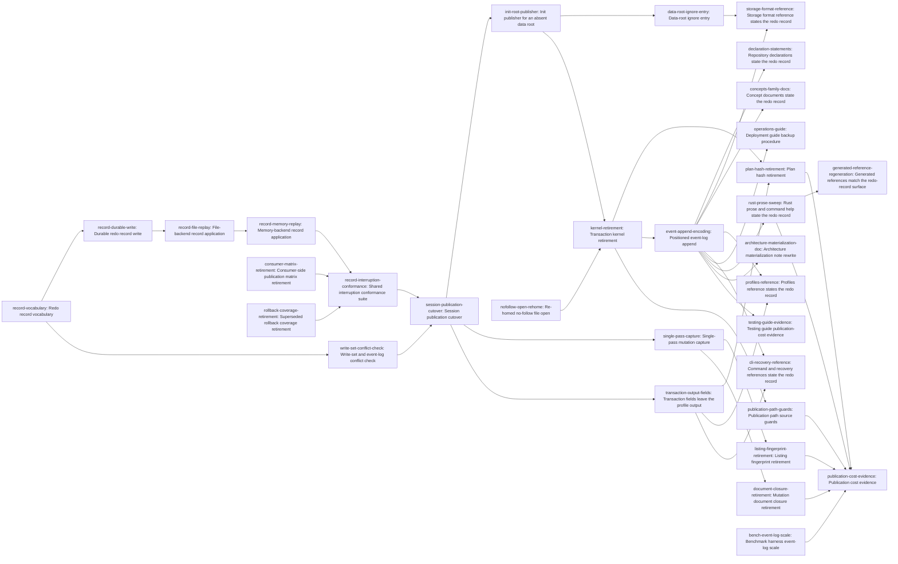

# Plan: Mutations commit through a redo record and never scale with project history (f1dc843a)

> Planning node: 99a12b66. Authoritative graph:
> [breakdown.json](breakdown.json).

## Outcome and criterion approach

A mutation's cost is to be bounded by what it changes. Three costs make it unbounded today:
publication rewrites a multi-megabyte event log and digests it about eight times, capture
reads and hashes the repository in six rounds, and apply re-reads the whole read set to
revalidate it. `@/charter/D-17` replaces the mechanism rather than tuning it, and the
storage layer is expected to end smaller than it started.

The work is ordered around one fact from the investigation: every repository publisher in
the workspace converges on the mutation session's `apply`, so the commit mechanism can be
replaced beneath that seam with no publisher touched. Foundation first, then the cutover at
the seam, then the constructs whose consumers the cutover removed, then prose.

| Criterion | Approach | Evidence / open gap |
|---|---|---|
| REQ-01 | Two independent costs fall: capture collapses from six rounds to two (one preflight, one attempt), and the event log stops being rewritten whole. The write-scoped preimage comparison replaces the apply-time re-capture, so nothing is read twice. The target is evidenced, not asserted in the suite (OD-2). | Capture round inventory and the six-round count: investigation §1 claim 3. Profile attribution of the remaining time: `intake.md:57-69`. |
| REQ-02 | The event append is encoded as an offset with its bytes, so the only log bytes a mutation writes are the ones it adds. A fourth benchmark fixture isolates the log term: same issues, same index, ten times the log bytes, built by replaying real lines with fresh identifiers. | Whole-file rewrite and the absent append action: investigation §1 claim 2. Fixture conditions: §7 Q7. Idempotency conditions for a positioned write: §4.3. |
| REQ-03 | The record's crash matrix is proven once against the record, on both backends, from one driver, compile-enforced over the interruption-point enum. Each consumer keeps at most one test that it reaches the mechanism, which retires the thirty-six-arm consumer matrix that duplicates it. | Current duplication and the 30-of-36 gap in the non-enforced list: investigation §7 Q6, §9 item 9. Cross-backend driver pattern already in use: §7 Q3. |
| REQ-04 | The comparison is scoped to the files the mutation writes, plus the event log's length and its last four kilobytes as bytes rather than as complete lines, because the torn-tail protocol admits an incomplete final line. | Absence of any length-or-tail check today: investigation §7 Q4. Accepted cost of not revalidating read-only files: `@/charter/D-17`. |
| REQ-05 | Five of the ten terms name no construct, so the criterion is discharged against the construct map rather than by a name grep, one construct family per task. Initialization is the one stated exception and gets a publisher of its own (OD-6). | Term-to-construct map: investigation §1 claim 9. Initialization's nine dependencies on the kernel: §1 claim 6. |
| REQ-06 | Every removal task carries its own removal criterion, every additive task carries a line ceiling, and the balance is measured once at the end over the workspace's Rust sources from `34d37f8be` (LD-6). The largest levers are the kernel with its suite, the consumer-side matrix, and the superseded rollback coverage. | Per-file baseline and certain-deletion subtotal: investigation §8. Base-revision analysis: §8, "How the diff would be measured". |
| REQ-07 | One task per bounded document family, plus the registry rewrite that owns the invariant wording, plus a source-prose sweep and a regeneration pass. The docs gate's footprint stays `docs/` (LD-3), so the families outside it are discharged by explicit tasks under `doc-review`. | Document inventory by family and verdict: investigation §7 Q5. Gate coverage gap: §7 Q5, "The CI gap". Archived documents need no edit: §7 Q5. |

## Shared architectural contracts

### `publication-seam` [plan-fixed] — The one place the mechanism changes

Every repository publisher — issue commands, dependency edits, template application,
validation repair, profile lifecycle, configuration edits, archive execution, gate runs,
project rendering, document commands, and the server's startup session — reaches durable
publication through `RepositoryMutationSession::apply`
(`crates/jit/src/storage/repository_state_store.rs:185`, JSON impl `:507`, memory impl
`:599`). The kernel is called from exactly one line of that body
(`repository_state_store.rs:558`). The record is therefore introduced beneath the seam with
no publisher changed, and the ordering follows from it: foundation under the seam, cutover
at the seam, then removal of what the cutover orphaned, then the kernel, then the event
encoding, then prose. `commands/breakdown.rs` is the one publisher that fans out several
sessions; it has no CLI arm and stays as it is, each of its calls publishing one record
(LD-2).

### `lock-and-record-scope` [plan-fixed] — What the lock and the record cover

The repository write lock serializes writers of *repository state*, not every jit writer.
Eleven writers bypass it, four of them inside the data root: worktree identity, the server
pid file, the server log, and the orphan temp sweep (investigation §1 claim 8). Those are
machine-local control files: they stay outside the lock and outside the record (LD-1). The
premise D-17 leans on to drop listing fingerprints holds for the files a mutation writes,
and this plan states that scoping rather than inheriting the unqualified sentence.

### `req05-construct-map` [plan-fixed] — What REQ-05's terms name

Five of REQ-05's ten terms name no construct in the code. Transaction backup is
`prepare_repository_backup`, `restore_verified_backup`, `remove_redundant_backup`,
`backup_authority`, the backups control subdirectory, and the journal's backup fields.
Staging directory is the `transaction_staging` module, `stage_authority`,
`prepare_staged_data_action`, `create_directory_stage_name`, the stages control
subdirectory, and the journal's stage fields. Reverse action is the two reverse-action
failure-point variants over `rollback_repository_action(s)`. Worktree companion is
`COMPANION_MARKER`, `CompanionDirs`, four companion control functions, the orphan-companion
sweep, and `needs_worktree_companion`. Phased capture is `CaptureSpec::phase_one`, the
ad-hoc protocol in `capture_proposed_base_inner`, and `has_stable_overlap`. Mutation
document closure is `document_capture_closure`, `DocumentClosure`, and `DocumentCapture` —
not the whole-repository `validate_capture_closure`, which stays. The full map with
`file:line` and sizes is investigation §1 claim 9; REQ-05 is discharged against it, never by
a name grep.

### `interruption-matrix-placement` [plan-fixed] — Where the crash matrix lives

`@/inv/orthogonal-tests` places a mechanism's behaviour matrix once, against the mechanism.
The record's matrix lives in the storage layer, runs on both backends from one driver, and
is compile-enforced over the interruption-point enum, which the current hand-maintained
point list is not — it covers thirty of thirty-six. Each consumer keeps at most one test
that it publishes through the mechanism; no successor to the thirty-six-arm consumer matrix
is created in any shape. Replacement coverage lands at the unit and harness layers, and no
new integration-test target is added: two of twelve remain (investigation §7 Q6).

### `line-budget` [plan-fixed] — How REQ-06 is measured and budgeted

The base is `34d37f8be`, the last commit carrying non-epic Rust changes and Rust-identical
to the revision at which this work began; the intake's `f69b98455` would credit this work
with six lines another issue produced (investigation §8). The balance is
`git diff --shortstat 34d37f8be -- '*.rs'` over the workspace, counting production code and
tests, measured once by the evidence task (LD-6). Each additive task states its own expected
ceiling in its body; each removal task carries a removal criterion of its own, so the
balance is not discovered at the end.

### `record-prose-statement` [plan-fixed] — What every document must say

A document describing mutation publication states four things and nothing about rollback:
file replacement by temp-file and rename; event-log growth by positioned append; one synced
redo record under the data root's scratch directory as the commit point, replayed
idempotently when a session opens; and repository initialization's synced stage with a
no-replace rename for an absent root. The invariant registry is the sole authority for the
statement's wording (three physical copies exist, only the registry authoritative —
investigation §6.2); every other document states the mechanism in its own register or cites
the invariant. Nothing under `dev/archive/**` is edited: archived work products are pinned
(investigation §7 Q5).

### `redo-record-shape` [implementation-produced] — The record vocabulary

Three operations over data-root and worktree paths: put file with bytes and mode, delete
file, append events at an offset with its bytes. Parent directories are created as a put
needs them, because both backends verify parents and a delta omitting ancestors fails apply
(investigation §7 Q1). A move is a put and a delete in one record, which is what archive
execution is. Replay is idempotent: a put overwrites, a delete tolerates absence, an append
rewrites the same bytes at the same offset (OD-7).

### `record-commit-point` [implementation-produced] — Durability of the record

The record is `sync_all`'d and its directory fsynced before the first live write, because a
redo-only protocol has no way back once a live file is replaced. The shared atomic-write
helper does neither today (investigation §4.2), so it gains both as named operations
(LD-5). The record lives under the data root's scratch directory and its name carries no
`.tmp` extension, because the orphan temp sweep matches by that extension and recurses into
subdirectories (investigation §9 item 5, verified at `storage/temp_cleanup.rs:85`).

### `redo-interruption-points` [implementation-produced] — The interruption vocabulary

A closed enum over the steps of the record's apply and replay, reached through a
`check(&Point) -> io::Result<()>` injector plumbed identically into both backends — the
shape the storage layer already uses, minus the thirty-six-variant kernel enum it replaces.
Both backends step the same points in the same order, so an injected interruption means the
same thing on either (OD-3).

### `commit-conflict-check` [implementation-produced] — The pre-commit comparison

The live bytes of every path the mutation writes or deletes are compared with the bytes it
read; the event log is compared as its length plus its last `min(len, 4096)` bytes, as bytes
rather than as complete lines (OD-4). Any difference is a retryable conflict naming the path
that moved, raised before anything durable is written. A file the mutation read but does not
write is not compared — the accepted cost D-17 names.

### `positioned-event-append` [implementation-produced] — The append encoding

The finalizer emits the event-log change as the captured file length with the appended
bytes, rather than composing the log's whole next contents. The offset is the file length,
not a line boundary, since the composer may legitimately begin the appended bytes with a
separator newline. Torn-tail certification is preserved unchanged: the certifier is simply
the first appended line (investigation §4.3, §7 Q4).

### `init-root-publication` [implementation-produced] — The one stated exception

Creating an absent data root cannot go through the record, because the record's home is
inside the root that does not exist yet. Initialization gets a small publisher of its own:
the new root is written into a sibling stage directory, synced, and published with
`renameat2 RENAME_NOREPLACE`, yielding `OccupiedDataRoot` when the destination is taken; an
orphan stage is removed by the next initialization. No journal, no external bootstrap
control directory, no post-publication identity re-verification (OD-6). Worktree files the
initialization writes publish through the record like any other worktree target.

## Generated decomposition overview

<!-- jit:breakdown-overview:begin -->
| Key | Title | Type | Outcome | Contracts | Sources | Footprint | Landing | Depends on |
|---|---|---|---|---|---|---|---|---|
| record-vocabulary | Redo record vocabulary | task | A typed record names put-file, delete-file, and event-append operations over rooted paths. | lock-and-record-scope | REQ-03, OD-7, OD-8, F-04, F-07 | creates 1, touches 2 | record-foundation | — |
| record-durable-write | Durable redo record write | task | The record reaches disk synced with its directory fsynced before any live write. | redo-record-shape | REQ-03, OD-4, LD-5, F-05 | touches 2 | record-foundation | record-vocabulary |
| record-file-replay | File-backend record application | task | The JSON backend applies a record idempotently through named interruption points. | redo-record-shape, record-commit-point | REQ-03, OD-3, OD-7, F-07, F-08 | creates 1, touches 2 | record-foundation | record-durable-write |
| record-memory-replay | Memory-backend record application | task | The in-memory backend holds a record as a value and steps the same interruption points. | redo-interruption-points, redo-record-shape | REQ-03, OD-3, F-01 | touches 2 | record-foundation | record-file-replay |
| write-set-conflict-check | Write-set and event-log conflict check | task | A moved write target or event-log tail yields a retryable conflict before anything changes. | redo-record-shape, lock-and-record-scope | REQ-04, OD-4, LD-1 | touches 2 | record-foundation | record-vocabulary |
| consumer-matrix-retirement | Consumer-side publication matrix retirement | task | Each publication consumer keeps one test that it reaches the shared mechanism. | interruption-matrix-placement | REQ-06, F-09, LD-7 | touches 4 | test-consolidation | — |
| rollback-coverage-retirement | Superseded rollback coverage retirement | task | The session suite keeps convergence coverage and sheds rollback coverage. | interruption-matrix-placement | REQ-06, OD-3, F-09 | touches 1 | test-consolidation | — |
| record-interruption-conformance | Shared interruption conformance suite | task | One suite proves the record's interruption matrix on both backends, compile-enforced. | redo-interruption-points, interruption-matrix-placement | REQ-03, OD-3, F-09, F-21 | touches 1 | test-consolidation | record-memory-replay, consumer-matrix-retirement, rollback-coverage-retirement |
| session-publication-cutover | Session publication cutover | task | The mutation session commits through the record and replays a leftover one at open. | publication-seam, redo-record-shape, record-commit-point, commit-conflict-check, lock-and-record-scope | REQ-03, REQ-04, REQ-05, OD-1, OD-7, LD-1, LD-2, F-01 | touches 5 | cutover | write-set-conflict-check, record-interruption-conformance |
| init-root-publisher | Init publisher for an absent data root | task | A fresh data root appears whole through a synced stage directory and a no-replace rename. | publication-seam, record-commit-point | REQ-05, OD-6, F-02 | creates 1, touches 3 | cutover | session-publication-cutover |
| data-root-ignore-entry | Data-root ignore entry | task | A fresh data root carries an ignore file naming its scratch directory. | init-root-publication, record-commit-point | REQ-05, OD-8, F-03 | touches 2 | cutover | init-root-publisher |
| nofollow-open-rehome | Re-homed no-follow file open | task | The no-follow regular-file open lives outside the transaction kernel module. | — | REQ-05, F-06 | touches 4 | — | — |
| kernel-retirement | Transaction kernel retirement | task | The journaled kernel with its journal, staging, recovery, and control plane leaves storage. | publication-seam, req05-construct-map, line-budget | REQ-05, REQ-06, OD-7, LD-6, F-06 | touches 10, uncertain | kernel-retirement | init-root-publisher, nofollow-open-rehome |
| single-pass-capture | Single-pass mutation capture | task | A mutation reads the repository once rather than in three gated rounds. | publication-seam, req05-construct-map, line-budget | REQ-01, REQ-05, REQ-06, OD-1, F-12 | touches 5 | capture-reduction | session-publication-cutover |
| listing-fingerprint-retirement | Listing fingerprint retirement | task | Repository images carry no listing fingerprints and no listing discovery. | req05-construct-map, line-budget | REQ-05, REQ-06, OD-1, F-12 | touches 5, uncertain | capture-reduction | single-pass-capture |
| document-closure-retirement | Mutation document closure retirement | task | Mutation capture resolves no issue-linked document closure. | req05-construct-map, line-budget | REQ-05, REQ-06, OD-1, F-12 | touches 3 | capture-reduction | single-pass-capture |
| transaction-output-fields | Transaction fields leave the profile output | task | Profile output carries no plan hash, transaction identifier, or cleanup-pending flag. | publication-seam | REQ-05, REQ-07, OD-9, F-10 | touches 7 | adopter-cutover | session-publication-cutover |
| plan-hash-retirement | Plan hash retirement | task | The plan carries its delta with no digest over captured entries. | req05-construct-map, line-budget | REQ-05, REQ-06, OD-9, F-10 | touches 5 | capture-reduction | transaction-output-fields, kernel-retirement |
| event-append-encoding | Positioned event-log append | task | The finalizer emits the event-log change as an offset with its bytes. | redo-record-shape, positioned-event-append, publication-seam | REQ-01, REQ-02, OD-7, F-08 | touches 4 | cutover | kernel-retirement |
| declaration-statements | Repository declarations state the redo record | task | The invariant registry and the gate scope name the record's publication. | record-prose-statement, positioned-event-append, init-root-publication | REQ-07, OD-5, F-11 | touches 5 | prose-sweep | event-append-encoding |
| storage-format-reference | Storage format reference states the redo record | task | The storage-format reference names the record's home, its publication, and its replay. | record-prose-statement, positioned-event-append, init-root-publication | REQ-07, OD-8, LD-3, F-03 | touches 1 | prose-sweep | event-append-encoding, data-root-ignore-entry |
| concepts-family-docs | Concept documents state the redo record | task | The concepts family describes record-based publication with no journaled rollback. | record-prose-statement, positioned-event-append | REQ-07, OD-8, LD-3, F-14 | touches 4 | prose-sweep | event-append-encoding |
| profiles-reference | Profiles reference states the redo record | task | The profiles reference describes profile publication as a record replayed forward. | record-prose-statement | REQ-07, OD-9, LD-3, F-13 | touches 1 | prose-sweep | event-append-encoding, transaction-output-fields |
| cli-recovery-reference | Command and recovery references state the redo record | task | The command and recovery references describe the record and the replay that recovers it. | record-prose-statement, init-root-publication | REQ-07, LD-3, F-19, F-20 | touches 5 | prose-sweep | event-append-encoding, transaction-output-fields |
| operations-guide | Deployment guide backup procedure | task | The backup procedure excludes a pending redo record. | record-prose-statement | REQ-07, OD-8, LD-3, F-14 | touches 1 | prose-sweep | event-append-encoding |
| rust-prose-sweep | Rust prose and command help state the redo record | task | Module docs, error strings, and recover help name the record mechanism. | record-prose-statement | REQ-07, LD-3, F-20 | touches 8, uncertain | prose-sweep | event-append-encoding |
| generated-reference-regeneration | Generated references match the redo-record surface | task | The generated references match the redo-record surface. | record-prose-statement, positioned-event-append | REQ-07, LD-3, F-19 | touches 5 | prose-sweep | rust-prose-sweep |
| architecture-materialization-doc | Architecture materialization note rewrite | task | The materialization architecture note describes record publication. | record-prose-statement, publication-seam, positioned-event-append | REQ-07, LD-3, F-13 | touches 3 | prose-sweep | event-append-encoding |
| testing-guide-evidence | Testing guide publication-cost evidence | task | The testing guide names the redo-record harness as its publication-cost evidence. | record-prose-statement, line-budget | REQ-06, REQ-07, LD-3, LD-4, F-15 | touches 3 | prose-sweep | event-append-encoding |
| publication-path-guards | Publication path source guards | task | Source guards fail if a second repository publication path appears. | publication-seam, req05-construct-map, init-root-publication | REQ-05, OD-6, F-18, F-21 | touches 1 | kernel-retirement | kernel-retirement |
| bench-event-log-scale | Benchmark harness event-log scale | task | The harness measures a label update against a ten-times larger event log. | — | REQ-02, OD-2, F-16, F-17 | touches 1 | evidence | — |
| publication-cost-evidence | Publication cost evidence | task | A committed artifact reports label-update latency before and after plus the line balance. | line-budget, positioned-event-append | REQ-01, REQ-02, REQ-06, OD-2, LD-6, F-16, F-17 | creates 1, touches 1 | evidence | bench-event-log-scale, rust-prose-sweep, plan-hash-retirement, listing-fingerprint-retirement, document-closure-retirement, publication-path-guards |

<!-- jit:breakdown-overview:end -->

## Material risks and owner decisions

| Risk / decision | Resolution and rationale |
|---|---|
| OD-1 Read set per mutation | Chosen: one pass reading every issue, no hashing, no phases — the cost scales with issue count (about 10 ms at a thousand issues), not with history, which is what REQ-01 and REQ-02 require. Rejected: dependency-neighbourhood reads, because cycle detection and hierarchy validation need the full issue set and scoping them is a derivation change with its own rule, cycle and index variants; index-first lazy loading, because it makes `index.json` load-bearing for correctness rather than for membership. |
| OD-2 Performance protection | Chosen: benchmark evidence only, through the committed harness, with a before-and-after artifact including a ten-times-log run. Rejected: a structural byte-count test, which measures a proxy; a wall-clock test in the suite, which would be the workspace's first throughput assertion, contradicts the project's stated position that elapsed time is the wrong thing to decide a test on, and could not be parked under `@/inv/no-ignored-tests` when it flaked. |
| OD-3 Memory backend modelling | Chosen: the in-memory backend holds the same record as a value and steps the same interruption-point enum, with one shared conformance suite driving both. Rejected: a generic apply loop over a storage trait, which pushes filesystem concerns into the trait; an atomic in-memory swap with fewer points, which would make an injected interruption mean different things on the two backends. |
| OD-4 Event-log preimage | Chosen: file length plus the last `min(len, 4 KiB)` bytes, compared under the lock before the record is written. Rejected: the last complete line, which the torn-tail protocol makes ill-defined; length alone, which misses an in-place edit of the tail. |
| OD-5 Invariant wording | Chosen: rewrite both `atomic-writes` and `derived-state-coherence` in the registry, render the projection, and move the shipped profile package's hand-maintained copies with them. Rejected: a new `redo-publication` invariant beside a narrow amendment, and amending `atomic-writes` alone, both of which leave a statement in the registry that the code contradicts. The exact wording is drafted in the task that owns it and must carry the four clauses of `record-prose-statement`. |
| OD-6 `jit init` publication | Chosen: a small init-only publisher in its own module — sibling stage directory, sync, `renameat2 RENAME_NOREPLACE`, `OccupiedDataRoot` when taken, orphan stage reclaimed by the next init; no journal, no identity re-verification, no bootstrap directory. Rejected: publishing init through the record, which would expose a partial root; keeping the kernel's init slice, which fails REQ-05 and REQ-06. |
| OD-7 Record vocabulary | Chosen: put, delete, and event-append over data-root and worktree paths, with parents created on apply, a move expressed as put plus delete, idempotent replay, and every current kernel publisher switching. Rejected: a data-root-only record with worktree outputs re-derived afterwards, which splits one mutation across two commit points; literal writes and appends with deletes handled outside the record, which leaves archive execution and profile asset departure unrecoverable. |
| OD-8 Scratch directory containment | Chosen: `jit init` writes the data root's own ignore file naming the scratch directory, the record's name carries no `.tmp` extension so the extension sweep never matches it, and the two adopter documents instructing a bulk temp delete and a whole-data-root tar are rewritten. Rejected: editing the adopter's root ignore file, which the engine does not own; documentation alone, which leaves a correctness property unenforced. |
| OD-9 Profile output fields | Chosen: `plan_hash`, `transaction_id`, and `transaction_cleanup_pending` leave the output, the schema, the bridge, and the reference in one cutover, per `@/inv/canonical-cutover`. Rejected: a re-derived plan identifier, which keeps a representation with no consumer; keeping all three, which documents a mechanism that no longer exists. |
| LD-1 Lock and record scope (planning-lead default) | The repository lock serializes writers of repository state; machine-local control files — worktree identity, the server pid file and log, and claims — stay outside the lock and the record. Stated rather than inherited, because D-17's premise is unqualified and eleven writers bypass the lock. |
| LD-2 `commands/breakdown.rs` (planning-lead default) | Left untouched: it is a test-reachable library API with no CLI arm, and each of its calls publishes one record. It is a second *pattern*, not a second *mechanism*, so REQ-05 is unaffected. |
| LD-3 REQ-07 enforcement (planning-lead default) | Met by explicit sweep tasks under `doc-review` plus the mechanical gate; the mechanical gate's footprint stays `docs/`. Widening it would change a shared gate's contract for one epic's benefit. |
| LD-4 Journal benchmark harness (planning-lead default) | `scripts/benchmark-transaction.sh` and the `transaction-benchmark-evidence` contract retire with the journal they measure — the fsync-count figure is a property of the journal's phase barriers. `bench.sh` is the evidence harness. |
| LD-5 Replay durability (planning-lead default) | The record is synced and its directory fsynced before the first live write; per-file replacement stays on temp-file and rename, whose durability the record's own supplies. `atomic_write.rs` gains the synced write and the directory fsync it lacks today. |
| LD-6 REQ-06 base (planning-lead default) | `34d37f8be`, measured with `git diff --shortstat 34d37f8be -- '*.rs'` over the workspace. |
| LD-7 Known unrelated flake (planning-lead default) | The nextest twenty-second per-test bound against the dogfood fixture's hundred-and-twenty-second cold-build lock fires on the first full run after a rebuild. A rerun is the remedy; no task in this graph fixes it, and a rerun is not evidence of a regression. |
| Risk: rollback coverage outlives its guarantee | Coverage asserting rollback reachability fails the moment publication changes, so it retires in its own task before the cutover, on the authority of D-17's supersession of archived D11. The convergence property that survives — complete old state, or complete new state after the next session opens — is kept and re-proved against the record. |
| Risk: `open_regular_file_nofollow` dies with its module | Six consumers outside the transaction path use it, including the event-log read path. It is re-homed in a task of its own that gates the kernel's retirement. |
| Risk: adopter contract change | Removing three fields from profile output is adopter-visible. It lands as one cutover across output, schema, bridge and reference, with a release-note entry, rather than as collateral of an internal change. |

## Investigation sources

- [Investigation](investigation.md) — the exhaustive consumer, construct, test, document
  and line-count inventories this plan cites rather than copies. Claim classification §1,
  prior-art supersession §2, consumer sweep §3, primitive verification §4, architecture fit
  §5, invariant check §6, open-question facts §7, line budget §8, contradictions §9.
- [Intake brief](intake.md) — measurements, profile attribution, and the owner decisions
  settled before the epic was filed.
- [Benchmark harness](bench.sh) — the evidence harness for REQ-01 and REQ-02.
- `@/charter/D-17` — the governing decision.
