# Plan: Mutations commit through a redo record and never scale with project history (f1dc843a)

> Planning node: 99a12b66. Authoritative graph:
> [breakdown.json](breakdown.json).

## Outcome and criterion approach

A mutation's cost is to be bounded by what it changes. Three costs make it unbounded today:
publication rewrites a multi-megabyte event log and digests it about eight times, capture
reads and hashes the repository in six rounds, and apply re-reads the whole read set to
revalidate it. `@/charter/D-17` replaces the mechanism, and the storage layer is expected to
end smaller than it started.

| Criterion | Approach | Evidence / open gap |
|---|---|---|
| REQ-01 | Two independent costs fall: capture collapses from six rounds to two, and the event log stops being rewritten whole. The write-scoped preimage comparison replaces the apply-time re-capture. The target is evidenced, not asserted in the suite (OD-2). | Capture round inventory and the six-round count: investigation §1 claim 3. Profile attribution of the remaining time: `intake.md:57-69`. |
| REQ-02 | The event append is encoded as an offset with its bytes, so the only log bytes a mutation writes are the ones it adds. A fourth benchmark fixture isolates the log term: same issues, same index, ten times the log bytes, built by replaying real lines with fresh identifiers. | Whole-file rewrite and the absent append action: investigation §1 claim 2. Fixture conditions: §7 Q7. Idempotency conditions for a positioned write: §4.3. |
| REQ-03 | The record's crash matrix is proven once against the record, on both backends, from one driver, compile-enforced over the interruption-point enum. Session-open application is a separate property with its own owner. Each consumer then keeps at most one test that it reaches the mechanism. | Current duplication and the 30-of-36 gap in the non-enforced list: investigation §7 Q6, §9 item 9. Cross-backend driver pattern already in use: §7 Q3. |
| REQ-04 | The comparison is scoped to the files the mutation writes, plus the event log's length and its last four kilobytes as bytes rather than as complete lines, because the torn-tail protocol admits an incomplete final line. The log is compared once, by that check alone. | Absence of any length-or-tail check today: investigation §7 Q4. Accepted cost of not revalidating read-only files: `@/charter/D-17`. |
| REQ-05 | Five of the ten terms name no construct, so the criterion is discharged against the construct map, one construct family per task, with the story-level check running construct by construct. Initialization is the one stated exception and gets a publisher of its own (OD-6). | Term-to-construct map: investigation §1 claim 9. Initialization's nine dependencies on the kernel: §1 claim 6. Recovery discovery as the one live functional consequence: `storage/discovery.rs:84-92`. |
| REQ-06 | Every removal task carries its own removal criterion, every additive task carries a line ceiling, and the balance is measured once at the end over the workspace's Rust sources from `34d37f8be` (LD-6). The largest levers are the kernel with its suite, the consumer-side matrix, and the superseded rollback coverage. | Per-file baseline and certain-deletion subtotal: investigation §8. Base-revision analysis: §8, "How the diff would be measured". |
| REQ-07 | One task per bounded document family, each landing in the phase whose code change falsifies its pages, so no phase closes with adopter documentation describing behaviour the repository no longer has. A page falsified twice is owned in the earlier phase, with the later sentence carried by a task in the later phase. The docs gate's footprint stays `docs/` (LD-3); the families outside it are discharged by explicit tasks under `doc-review` and by each phase's aggregate check. | Document inventory by family and verdict: investigation §7 Q5. Gate coverage gap: §7 Q5, "The CI gap". Archived documents need no edit: §7 Q5. Cone derivation: `scripts/doc-review-prompt.md`. |

## Shared architectural contracts

### `publication-seam` [plan-fixed] — The one place the mechanism changes

Every repository publisher — issue commands, dependency edits, template application,
validation repair, profile lifecycle, configuration edits, archive execution, gate runs,
project rendering, document commands, and the server's startup session — reaches durable
publication through `RepositoryMutationSession::apply`
(`crates/jit/src/storage/repository_state_store.rs:185`, JSON impl `:507`, memory impl
`:599`). The kernel is called from one line of that body (`:558`). The record is introduced
beneath the seam with no publisher changed.

The ordering follows from the seam, and it runs as four phases, each a story that passes its
automated gates before the next builds on it (OD-10).

1. **Foundation.** The record, its durable write, its application on both backends, the
   scoped conflict check, and the conformance suite that proves its crash matrix — all
   beside the kernel, with no publisher on them.
2. **Cutover.** Coverage of the superseded guarantee and failure injection naming kernel
   points are retired or repointed first, because both go vacuous the moment the seam
   changes. The seam then changes in three steps whose sizes are reviewable on their own:
   session open learns to apply a leftover record while the kernel still commits, apply
   switches to the record — after the data root's composed ignore file lands, so no
   repository holds a commit point version control has not been asked to ignore — while a
   delta that creates an absent root still reaches the kernel, and initialization takes
   over that last case. The kernel then has no caller, so
   it retires in the same phase (LD-11), and the pages and the gate scope its removal
   falsifies close behind it.
3. **Retirement.** The capture constructs, the plan hash, the transaction fields in command
   output, and the event encoding, which lands here because the delta's action vocabulary
   is matched exhaustively inside the kernel module (LD-9). The declarations, the Rust
   prose, the generated reference and the architecture note follow their sources.
4. **Evidence.** The benchmark artifact, the line balance, and the testing guide's
   evidence contract, measured over the finished workspace.

Documentation is not a phase. Each page lands in the phase whose code change falsifies it:
the storage-format reference, the concepts family, the profiles reference, the command and
recovery references, and the deployment guide's backup procedure move in the cutover, where
publication changes and a whole-data-root archive starts capturing a pending commit point;
the declarations, the generated references, the Rust prose, and the architecture note move
in the retirement, where the statements they make stop being true.

`commands/breakdown.rs` is the one publisher that fans out several sessions; it has no CLI
arm and stays as it is, each of its calls publishing one record (LD-2).

### `lock-and-record-scope` [plan-fixed] — What the lock and the record cover

The repository write lock serializes writers of *repository state*. Eleven writers bypass
it, four of them inside the data root: worktree identity, the server pid file, the server
log, and the orphan temp sweep (investigation §1 claim 8). Those are machine-local control
files: they stay outside the lock and outside the record (LD-1). The premise D-17 leans on
to drop listing fingerprints holds for the files a mutation writes, and this plan states
that scoping.

### `req05-construct-map` [plan-fixed] — What REQ-05's terms name

Five of REQ-05's ten terms name no construct in the code. Transaction backup is
`prepare_repository_backup`, `restore_verified_backup`, `remove_redundant_backup`,
`backup_authority`, the backups control subdirectory, and the journal's backup fields.
Staging directory is the `transaction_staging` module, `stage_authority`,
`prepare_staged_data_action`, `create_directory_stage_name`, the stages control
subdirectory, and the journal's stage fields. Reverse action is the two reverse-action
failure-point variants over `rollback_repository_action(s)`. Worktree companion is
`COMPANION_MARKER`, `CompanionDirs`, four companion control functions, the orphan-companion
sweep, and `needs_worktree_companion`. Phased capture is `CaptureSpec::phase_one`, the
ad-hoc protocol in `capture_proposed_base_inner`, and `has_stable_overlap`. Mutation
document closure is `document_capture_closure`, `DocumentClosure`, and `DocumentCapture`;
the whole-repository `validate_capture_closure` stays. The full map with `file:line` and
sizes is investigation §1 claim 9. Five of the ten leave with the kernel in the cutover
phase and five in the retirement phase, so the construct-by-construct check runs at the
later checkpoint, where the whole set is gone.

Two consequences of the map are functional rather than textual. `discover_recovery_from`
(`crates/jit/src/storage/discovery.rs:84-92`) keys recovery discovery on
`.jit-bootstrap/transaction-protocol-v1` and `.jit/tmp/transactions`, so it must learn the
record's location or a leftover record in a repository with no index goes undiscovered.
`open_regular_file_nofollow` (`file_transaction.rs:2744`) has six consumers outside the
transaction path, including the event-log read path, so it is re-homed before its module
retires.

### `interruption-matrix-placement` [plan-fixed] — Where the crash matrix lives

`@/inv/orthogonal-tests` places a mechanism's behaviour matrix once, against the mechanism.
The record's matrix lives in the storage layer, runs on both backends from one driver, and
is compile-enforced over the interruption-point enum; the hand-maintained point list it
replaces covers thirty of thirty-six. The matrix lands before the consumer copies are
retired, so the property has an owner throughout.

Session-open application is a separate property, owned once by the task that delivers it.
Each consumer keeps at most one test that it publishes through the mechanism, and no
successor to the thirty-six-arm consumer matrix is created in any shape. Stale-capture
rejection under concurrent profile application is a property of its own: its suite is
repointed onto the record's interruption points rather than retired. Replacement coverage
lands at the unit and harness layers, and no new integration-test target is added: two of
twelve remain (investigation §7 Q6).

### `line-budget` [plan-fixed] — How REQ-06 is measured and budgeted

The base is `34d37f8be`, the last commit carrying non-epic Rust changes and Rust-identical
to the revision at which this work began; the intake's `f69b98455` would credit this work
with six lines another issue produced (investigation §8). The balance is
`git diff --shortstat 34d37f8be -- '*.rs'` over the workspace, counting production code and
tests, measured once by the evidence task (LD-6). Each additive task states its own expected
ceiling in its body; each removal task carries a removal criterion of its own.

### `record-prose-statement` [plan-fixed] — What every document must say

A document describing mutation publication states three things: file replacement by
temp-file and rename; one synced redo record under the data root's scratch directory as the
commit point, applied idempotently when a session opens; and repository initialization's
synced stage with a no-replace rename for an absent root. How the event log grows is stated
by `positioned-event-append`, delivered into the same pages by the task that lands that
encoding. The invariant registry is the sole authority for the statement's wording; two further
physical copies follow it (investigation §6.2). Every
other document states the mechanism in its own register or cites the invariant. Nothing
under `dev/archive/**` is edited: archived work products are pinned (investigation §7 Q5).

### `redo-record-shape` [implementation-produced] — The record vocabulary

Three operations over data-root and worktree paths: put file with bytes and mode, delete
file, append events at an offset with its bytes. Parent directories are created as a put
needs them, because both backends verify parents and a delta omitting ancestors fails apply
(investigation §7 Q1). A move is a put and a delete in one record, which is what archive
execution is. Re-application is idempotent: a put overwrites, a delete tolerates absence, an
append rewrites the same bytes at the same offset (OD-7).

### `record-commit-point` [implementation-produced] — Durability of the record

The record is `sync_all`'d and its directory fsynced before the first live write, because a
redo-only protocol has no way back once a live file is replaced. The shared atomic-write
helper does neither today (investigation §4.2), so it gains both as named operations
(LD-5). The record lives under the data root's scratch directory, and its name ends in an
extension the orphan temp sweep does not match: that sweep matches by `.tmp` and recurses
into subdirectories (`storage/temp_cleanup.rs:85`).

### `redo-interruption-points` [implementation-produced] — The interruption vocabulary

A closed enum over the steps of the record's apply and re-application, reached through a
`check(&Point) -> io::Result<()>` injector plumbed identically into both backends — the
shape the storage layer already uses. Both backends step the same points in the same order,
so an injected interruption means the same thing on either (OD-3). Injection sites outside
the storage layer reach nine command and test modules; they move onto this vocabulary
before the seam changes.

### `commit-conflict-check` [implementation-produced] — The pre-commit comparison

The live bytes of every path the mutation writes or deletes, other than the event log, are
compared with the bytes it read; the event log is compared as its length plus its last
`min(len, 4096)` bytes, as bytes rather than as complete lines (OD-4). While the log is
still a put path, the byte comparison leaves it out. Any difference is a
retryable conflict naming the path that moved, raised before anything durable is written. A
file the mutation read but does not write is left out — the accepted cost D-17 names.

### `positioned-event-append` [implementation-produced] — The append encoding

The finalizer emits the event-log change as the captured file length with the appended
bytes. The offset is the file length rather than a line boundary, since the composer may
begin the appended bytes with a separator newline. Torn-tail certification is preserved: the
certifier is the first appended line (investigation §4.3, §7 Q4).

### `init-root-publication` [implementation-produced] — The one stated exception

Creating an absent data root cannot go through the record, because the record's home is
inside the root that does not exist yet. Initialization gets a small publisher of its own:
the new root is written into a sibling stage directory, synced, and published with
`renameat2 RENAME_NOREPLACE`, yielding `OccupiedDataRoot` when the destination is taken; an
orphan stage is removed by the next initialization (OD-6). Worktree files the initialization
writes publish through the record like any other worktree target. The scratch directory's
ignore entry is a derived materialization composed beside the default ruleset and schemas,
reached by both initialization (`repository_state/initialize.rs:740`) and derived-state
repair (`repository_state/mod.rs:1058`), so an existing repository converges at its next
repair (LD-10).

## Generated decomposition overview

<!-- jit:breakdown-overview:begin -->
| Key | Title | Type | Outcome | Contracts | Sources | Footprint | Landing | Depends on |
|---|---|---|---|---|---|---|---|---|
| record-vocabulary | Redo record vocabulary | task | A typed record names put-file, delete-file, and event-append operations over rooted paths. | lock-and-record-scope | REQ-03, OD-7, OD-8, F-04, F-07, F-29 | creates 1, touches 2 | — | — |
| record-durable-write | Durable redo record write | task | The record reaches disk synced with its directory fsynced before any live write. | redo-record-shape | REQ-03, OD-4, LD-5, F-05 | touches 2 | — | record-vocabulary |
| record-file-replay | File-backend record application | task | The JSON backend applies a record idempotently through named interruption points. | redo-record-shape, record-commit-point | REQ-03, OD-3, OD-7, F-07, F-08, F-29 | creates 1, touches 2 | — | record-durable-write |
| record-memory-replay | Memory-backend record application | task | The in-memory backend holds a record as a value and steps the same interruption points. | redo-interruption-points, redo-record-shape | REQ-03, OD-3, F-01 | touches 2 | — | record-file-replay |
| write-set-conflict-check | Write-set and event-log conflict check | task | A moved write target or event-log tail yields a retryable conflict before anything changes. | redo-record-shape, lock-and-record-scope | REQ-04, OD-4, LD-1 | touches 2 | — | record-vocabulary |
| record-interruption-conformance | Shared interruption conformance suite | task | One suite proves the record's interruption matrix on both backends, compile-enforced. | redo-interruption-points, interruption-matrix-placement | REQ-03, OD-3, F-09, F-21 | touches 1 | — | record-memory-replay |
| consumer-matrix-retirement | Consumer-side publication matrix retirement | task | Each publication consumer keeps one test that it reaches the shared mechanism. | interruption-matrix-placement | REQ-06, F-09, LD-7 | touches 4 | — | redo-record-foundation |
| rollback-coverage-retirement | Superseded rollback coverage retirement | task | The session suite keeps byte parity and finalizer determinism, shedding rollback coverage. | interruption-matrix-placement | REQ-06, OD-3, F-09 | touches 1 | — | redo-record-foundation |
| publication-injection-repoint | Publication failure injection repoint | task | A publication-failure injection names an interruption point the record defines. | redo-interruption-points, interruption-matrix-placement | REQ-05, OD-3, F-24 | touches 11 | — | consumer-matrix-retirement, rollback-coverage-retirement |
| session-record-replay-open | Session open applies a leftover record | task | Opening a session applies a leftover redo record on both backends. | publication-seam, redo-record-shape, record-commit-point | REQ-03, OD-3, F-01, F-22 | touches 4 | — | publication-injection-repoint |
| session-record-commit | Session commit through the redo record | task | A mutation's apply commits through one redo record with no re-capture of its read set. | publication-seam, redo-record-shape, record-commit-point, commit-conflict-check, lock-and-record-scope, line-budget | REQ-03, REQ-04, REQ-05, OD-1, OD-7, LD-1, LD-2, F-01 | touches 6 | — | session-record-replay-open, data-root-ignore-entry |
| init-root-publisher | Init publisher for an absent data root | task | A fresh data root appears whole through a synced stage directory and a no-replace rename. | publication-seam, record-commit-point | REQ-05, OD-6, F-02, F-28 | creates 1, touches 3 | — | session-record-commit, nofollow-open-rehome |
| data-root-ignore-entry | Data-root ignore file as a derived materialization | task | The data root's ignore file is composed from the repository's own declarations. | record-commit-point | REQ-05, OD-8, LD-10, F-03, F-26 | creates 1, touches 6 | — | redo-record-foundation |
| security-scope-statement | Security review scope names live mechanisms | task | The security-review scope names the mechanisms the repository has. | record-prose-statement | REQ-07, LD-3, F-13 | touches 2 | — | kernel-retirement |
| nofollow-open-rehome | Re-homed no-follow file open | task | The no-follow regular-file open lives outside the transaction kernel module. | — | REQ-05, F-06 | touches 4 | — | redo-record-foundation |
| kernel-retirement | Transaction kernel retirement | task | The journaled kernel with its journal, staging, recovery, and control plane leaves storage. | publication-seam, req05-construct-map, line-budget | REQ-05, REQ-06, OD-7, LD-6, F-06, F-22 | touches 11, uncertain | — | init-root-publisher |
| single-pass-capture | Single-pass mutation capture | task | A mutation reads the repository once rather than in three gated rounds. | publication-seam, req05-construct-map, line-budget | REQ-01, REQ-05, REQ-06, OD-1, F-12 | touches 6 | — | record-publication-cutover |
| listing-fingerprint-retirement | Listing fingerprint retirement | task | Repository images carry child names without listing fingerprints. | req05-construct-map, line-budget | REQ-05, REQ-06, OD-1, F-12, F-25 | touches 5, uncertain | — | single-pass-capture |
| document-closure-retirement | Mutation document closure retirement | task | Mutation capture resolves no issue-linked document closure. | req05-construct-map, line-budget | REQ-05, REQ-06, OD-1, F-12 | touches 3 | — | single-pass-capture |
| transaction-output-fields | Transaction fields leave the command output | task | The profile and recover commands report the redo record in their output. | publication-seam | REQ-05, REQ-07, OD-9, LD-8, F-10, F-23 | touches 12 | — | record-publication-cutover |
| plan-hash-retirement | Plan hash retirement | task | The plan carries its delta with no digest over captured entries. | req05-construct-map, line-budget | REQ-05, REQ-06, OD-9, F-10 | touches 5 | — | transaction-output-fields |
| publication-path-guards | Publication path source guards | task | Source guards fail when a second repository publication path appears. | publication-seam, req05-construct-map, init-root-publication | REQ-05, OD-6, F-18, F-21 | touches 1 | — | record-publication-cutover |
| event-append-encoding | Positioned event-log append | task | The finalizer emits the event-log change as an offset with its bytes. | redo-record-shape, positioned-event-append, publication-seam | REQ-01, REQ-02, OD-7, LD-9, F-08, F-27 | touches 6 | — | record-publication-cutover |
| bench-event-log-scale | Benchmark harness event-log scale | task | The harness measures a label update against a ten-times larger event log. | — | REQ-02, OD-2, F-16, F-17 | touches 1 | — | — |
| publication-cost-evidence | Publication cost evidence | task | A committed artifact reports label-update latency before and after plus the line balance. | line-budget, positioned-event-append | REQ-01, REQ-02, REQ-06, OD-2, LD-6, F-16, F-17 | creates 1, touches 1 | — | bench-event-log-scale, superseded-design-retirement |
| declaration-statements | Repository declarations state the redo record | task | The invariant registry and the charter decision name the record. | record-prose-statement, positioned-event-append, init-root-publication | REQ-07, OD-5, LD-3, F-11 | touches 4 | — | event-append-encoding, single-pass-capture |
| storage-format-reference | Storage format reference states the redo record | task | The storage-format reference names the record's home, its publication, and its application. | record-prose-statement, init-root-publication | REQ-07, OD-8, LD-3, LD-10, F-03 | touches 1 | — | kernel-retirement |
| concepts-family-docs | Concept documents state the redo record | task | The concepts family describes record-based publication. | record-prose-statement | REQ-07, OD-8, LD-3, F-14 | touches 4 | — | kernel-retirement |
| profiles-reference | Profiles reference states the redo record | task | The profiles reference describes profile publication as a record applied forward. | record-prose-statement | REQ-07, OD-9, LD-3, F-13 | touches 4 | — | kernel-retirement |
| cli-recovery-reference | Command and recovery references state the redo record | task | The command and recovery references describe the record and the application that recovers it. | record-prose-statement, init-root-publication | REQ-07, LD-3, F-19, F-20 | touches 7 | — | kernel-retirement |
| operations-guide | Deployment guide backup procedure | task | The backup procedure excludes a pending redo record. | record-prose-statement | REQ-07, OD-8, LD-3, F-14 | touches 1 | — | kernel-retirement |
| rust-prose-sweep | Rust prose and command help state the redo record | task | Module docs, error strings, and recover help name the record mechanism. | record-prose-statement | REQ-07, LD-3, F-20 | touches 8, uncertain | — | event-append-encoding |
| generated-reference-regeneration | Generated storage-records reference matches the append encoding | task | The generated storage-records reference matches the append encoding. | record-prose-statement, positioned-event-append | REQ-07, LD-3, F-19 | touches 3 | — | rust-prose-sweep |
| architecture-materialization-doc | Architecture materialization note rewrite | task | The materialization architecture note describes record publication. | record-prose-statement, publication-seam, positioned-event-append | REQ-07, LD-3, F-13 | touches 3 | — | listing-fingerprint-retirement, document-closure-retirement, plan-hash-retirement, event-append-encoding |
| testing-guide-evidence | Testing guide publication-cost evidence | task | The testing guide names the redo-record harness as its publication-cost evidence. | record-prose-statement, line-budget | REQ-06, REQ-07, LD-3, LD-4, F-15 | touches 4 | — | publication-cost-evidence |
| redo-record-foundation | Redo record foundation | story | The record mechanism exists whole and proven, with no publisher on it yet. | redo-record-shape, record-commit-point, redo-interruption-points, commit-conflict-check, interruption-matrix-placement, line-budget | OD-10, REQ-03, REQ-04, OD-3, OD-7, LD-11 | — | — | record-interruption-conformance, write-set-conflict-check |
| record-publication-cutover | Record publication cutover | story | Mutations commit through the record, the kernel is gone, and the adopter surface is in step. | publication-seam, commit-conflict-check, init-root-publication, lock-and-record-scope, interruption-matrix-placement, record-prose-statement, req05-construct-map | OD-10, REQ-03, REQ-04, REQ-05, REQ-07, OD-1, OD-6, OD-8, LD-3, LD-10, LD-11 | — | — | storage-format-reference, concepts-family-docs, profiles-reference, cli-recovery-reference, operations-guide, security-scope-statement |
| superseded-design-retirement | Superseded design retirement | story | The phased capture, the plan hash, and the whole-log rewrite are gone. | req05-construct-map, publication-seam, line-budget, init-root-publication, positioned-event-append, record-prose-statement | OD-10, REQ-02, REQ-05, REQ-06, REQ-07, OD-5, OD-7, OD-9, LD-3, LD-6, LD-8, LD-9 | — | — | publication-path-guards, declaration-statements, generated-reference-regeneration, architecture-materialization-doc |
| mutation-cost-evidence | Mutation cost evidence | story | Committed evidence shows a mutation's wall time bounded by what it changes. | line-budget, positioned-event-append, record-prose-statement | OD-10, REQ-01, REQ-02, REQ-06, REQ-07, OD-2, LD-4, LD-6 | — | — | testing-guide-evidence |

```mermaid
flowchart LR
    N0["record-vocabulary: Redo record vocabulary"]
    N1["record-durable-write: Durable redo record write"]
    N2["record-file-replay: File-backend record application"]
    N3["record-memory-replay: Memory-backend record application"]
    N4["write-set-conflict-check: Write-set and event-log conflict check"]
    N5["record-interruption-conformance: Shared interruption conformance suite"]
    N6["consumer-matrix-retirement: Consumer-side publication matrix retirement"]
    N7["rollback-coverage-retirement: Superseded rollback coverage retirement"]
    N8["publication-injection-repoint: Publication failure injection repoint"]
    N9["session-record-replay-open: Session open applies a leftover record"]
    N10["session-record-commit: Session commit through the redo record"]
    N11["init-root-publisher: Init publisher for an absent data root"]
    N12["data-root-ignore-entry: Data-root ignore file as a derived materialization"]
    N13["security-scope-statement: Security review scope names live mechanisms"]
    N14["nofollow-open-rehome: Re-homed no-follow file open"]
    N15["kernel-retirement: Transaction kernel retirement"]
    N16["single-pass-capture: Single-pass mutation capture"]
    N17["listing-fingerprint-retirement: Listing fingerprint retirement"]
    N18["document-closure-retirement: Mutation document closure retirement"]
    N19["transaction-output-fields: Transaction fields leave the command output"]
    N20["plan-hash-retirement: Plan hash retirement"]
    N21["publication-path-guards: Publication path source guards"]
    N22["event-append-encoding: Positioned event-log append"]
    N23["bench-event-log-scale: Benchmark harness event-log scale"]
    N24["publication-cost-evidence: Publication cost evidence"]
    N25["declaration-statements: Repository declarations state the redo record"]
    N26["storage-format-reference: Storage format reference states the redo record"]
    N27["concepts-family-docs: Concept documents state the redo record"]
    N28["profiles-reference: Profiles reference states the redo record"]
    N29["cli-recovery-reference: Command and recovery references state the redo record"]
    N30["operations-guide: Deployment guide backup procedure"]
    N31["rust-prose-sweep: Rust prose and command help state the redo record"]
    N32["generated-reference-regeneration: Generated storage-records reference matches the append encoding"]
    N33["architecture-materialization-doc: Architecture materialization note rewrite"]
    N34["testing-guide-evidence: Testing guide publication-cost evidence"]
    N35["redo-record-foundation: Redo record foundation"]
    N36["record-publication-cutover: Record publication cutover"]
    N37["superseded-design-retirement: Superseded design retirement"]
    N38["mutation-cost-evidence: Mutation cost evidence"]
    N0 --> N1
    N1 --> N2
    N2 --> N3
    N0 --> N4
    N3 --> N5
    N35 --> N6
    N35 --> N7
    N6 --> N8
    N7 --> N8
    N8 --> N9
    N9 --> N10
    N12 --> N10
    N10 --> N11
    N14 --> N11
    N35 --> N12
    N15 --> N13
    N35 --> N14
    N11 --> N15
    N36 --> N16
    N16 --> N17
    N16 --> N18
    N36 --> N19
    N19 --> N20
    N36 --> N21
    N36 --> N22
    N23 --> N24
    N37 --> N24
    N22 --> N25
    N16 --> N25
    N15 --> N26
    N15 --> N27
    N15 --> N28
    N15 --> N29
    N15 --> N30
    N22 --> N31
    N31 --> N32
    N17 --> N33
    N18 --> N33
    N20 --> N33
    N22 --> N33
    N24 --> N34
    N5 --> N35
    N4 --> N35
    N26 --> N36
    N27 --> N36
    N28 --> N36
    N29 --> N36
    N30 --> N36
    N13 --> N36
    N21 --> N37
    N25 --> N37
    N32 --> N37
    N33 --> N37
    N34 --> N38
```

<!-- jit:breakdown-overview:end -->

## Material risks and owner decisions

| Risk / decision | Resolution and rationale |
|---|---|
| OD-1 Read set per mutation | Chosen: one pass reading every issue, no hashing, no phases — the cost scales with issue count, about 10 ms at a thousand issues, which is what REQ-01 and REQ-02 require. Rejected: dependency-neighbourhood reads, because cycle detection and hierarchy validation need the full issue set and scoping them is a derivation change with its own rule, cycle and index variants; index-first lazy loading, because it makes `index.json` load-bearing for correctness. |
| OD-2 Performance protection | Chosen: benchmark evidence only, through the committed harness, with a before-and-after artifact including a ten-times-log run. Rejected: a structural byte-count test, which measures a proxy; a wall-clock test in the suite, which would be the workspace's first throughput assertion, contradicts the project's position that elapsed time is the wrong thing to decide a test on, and could not be parked under `@/inv/no-ignored-tests` when it flaked. |
| OD-3 Memory backend modelling | Chosen: the in-memory backend holds the same record as a value and steps the same interruption-point enum, with one shared conformance suite driving both. Rejected: a generic apply loop over a storage trait, which pushes filesystem concerns into the trait; an atomic in-memory swap with fewer points, which would make an injected interruption mean different things on the two backends. |
| OD-4 Event-log preimage | Chosen: file length plus the last `min(len, 4 KiB)` bytes, compared under the lock before the record is written, and the log left out of the byte-for-byte write-set comparison so one path has one answer. Rejected: the last complete line, which the torn-tail protocol makes ill-defined; length alone, which misses an in-place edit of the tail. |
| OD-5 Invariant wording | Chosen: rewrite both `atomic-writes` and `derived-state-coherence` in the registry, render the projection, and move the shipped profile package's hand-maintained copies with them. Rejected: a new `redo-publication` invariant beside a narrow amendment, and amending `atomic-writes` alone, both of which leave a registry statement the code contradicts. The wording is drafted in the task that owns it and carries the four clauses of `record-prose-statement`. |
| OD-6 `jit init` publication | Chosen: a small init-only publisher in its own module — sibling stage directory, sync, `renameat2 RENAME_NOREPLACE`, `OccupiedDataRoot` when taken, orphan stage reclaimed by the next init. Rejected: publishing init through the record, which would expose a partial root; keeping the kernel's init slice, which fails REQ-05 and REQ-06. |
| OD-7 Record vocabulary | Chosen: put, delete, and event-append over data-root and worktree paths, with parents created on apply, a move expressed as put plus delete, idempotent re-application, and every current kernel publisher switching. Rejected: a data-root-only record with worktree outputs re-derived afterwards, which splits one mutation across two commit points; literal writes and appends with deletes handled outside the record, which leaves archive execution and profile asset departure unrecoverable. |
| OD-8 Scratch directory containment | Chosen: the data root carries a composed ignore file naming the scratch directory, the record's name ends in an extension the temp sweep does not match, and the two adopter documents instructing a bulk temp delete and a whole-data-root tar are rewritten. Rejected: editing the adopter's root ignore file, which the engine does not own; documentation alone, which leaves a correctness property unenforced. |
| OD-9 Profile output fields | Chosen: `plan_hash`, `transaction_id`, and `transaction_cleanup_pending` leave the output, the schema, the bridge, and the reference in one cutover, per `@/inv/canonical-cutover`. Rejected: a re-derived plan identifier, which keeps a representation with no consumer; keeping all three, which documents a mechanism that no longer exists. |
| OD-10 Story phases | Chosen: four stories as phase checkpoints, each carrying aggregate criteria an independent read-only reviewer can verify against repository artifacts — the mechanism built and unreached, the cutover with publishers untouched and the adopter surface in step, the retirement checked construct by construct, and the cost target on committed evidence. Every story carries `holistic-review` and `doc-review` without exception, plus `cargo-ci` where its tasks change Rust and `docs-mechanical` where they edit `docs/` — the evidence phase edits `dev/` and `scripts/` only, and that gate's footprint is `docs/`, so it carries neither. Both review gates derive their own scope from the delivered work rather than from a declared one, and the documentation gate treats an omitted required update as blocking (`scripts/doc-review-prompt.md`), which is why adopter documentation lands inside the phase that changes the behaviour it describes. A story's `depends_on` names its own maximal tasks, and every ordering edge that leaves a story runs from the dependent task to the predecessor *story*. That is what makes containment deterministic: hierarchy resolves from the DAG, a task's parent is the nearest dominating container, and a foreign story reaching a task through a task-to-task edge competes on fewest hops and then on the smallest container id (`crates/jit/src/graph/hierarchy.rs:49-68`). Routing through the story node puts every foreign container two hops further away, and a dependency into a same-tier node bounds the closure without conferring containment. Rejected: a documentation-only closing phase, whose deferral leaves the middle checkpoints unable to pass their documentation gate; dropping `doc-review` from the middle stories, which the owner's rule forbids; cross-story task-to-task edges, which assigned tasks to the wrong story and left ties decided by random ids; one flat task set, which leaves REQ-05's construct-by-construct check and the cross-task coherence checks with no owner. |
| LD-1 Lock and record scope | The repository lock serializes writers of repository state; machine-local control files — worktree identity, the server pid file and log, and claims — stay outside the lock and the record. Stated rather than inherited, because D-17's premise is unqualified and eleven writers bypass the lock. |
| LD-2 `commands/breakdown.rs` | Left untouched: a test-reachable library API with no CLI arm, each of whose calls publishes one record. It is a second *pattern*, not a second *mechanism*, so REQ-05 is unaffected. |
| LD-3 REQ-07 enforcement | Met by explicit sweep tasks under `doc-review`, the mechanical gate, and the documentation story's aggregate check; the mechanical gate's footprint stays `docs/`. Widening it would change a shared gate's contract for one epic's benefit. |
| LD-4 Journal benchmark harness | `scripts/benchmark-transaction.sh` and the `transaction-benchmark-evidence` contract retire with the journal they measure — the fsync-count figure is a property of the journal's phase barriers. `bench.sh` is the evidence harness. |
| LD-5 Replay durability | The record is synced and its directory fsynced before the first live write; per-file replacement stays on temp-file and rename, whose crash survivability rests on the record. `atomic_write.rs` gains the synced write and the directory fsync it lacks. |
| LD-6 REQ-06 base | `34d37f8be`, measured with `git diff --shortstat 34d37f8be -- '*.rs'` over the workspace. |
| LD-7 Known unrelated flake | The nextest twenty-second per-test bound against the dogfood fixture's hundred-and-twenty-second cold-build lock fires on the first full run after a rebuild. A rerun is the remedy; no task in this graph fixes it, and a rerun is not evidence of a regression. |
| LD-8 `transactions_recovered` | The recover command's JSON key and its rendered line are renamed to name applied redo records, inside `transaction-output-fields`, per `@/inv/canonical-cutover`. It is the same class as OD-9: an adopter-visible name for a deleted mechanism, fed by the session-open dispatch count (`main.rs:7806, 7820, 7835, 7848`). The count survives with the name of what it now counts. |
| LD-9 Append encoding lands after the kernel retires | `RepositoryAction` is matched exhaustively at six sites, four of them inside the kernel module, so an append variant landing earlier needs four unreachable match arms in library code that forbids panics. The append encoding therefore opens the retirement phase, beside the capture reduction it belongs with. |
| LD-11 The kernel retires in the cutover phase | `scripts/cargo-ci.sh:520` runs `cargo clippy --workspace --all-targets -- -D warnings`, so an item that loses its last caller fails the build unless it is externally reachable. `crates/jit/src/storage/mod.rs:22` declares `pub(crate) mod file_transaction` and `:39-41` three private modules, and `FileTransactionKernel` is `pub(in crate::storage)` (`file_transaction.rs:68`), so the kernel's items are all dead-code-eligible. `init-root-publisher` takes over the absent-root branch and orphans the publication half; the four modules themselves keep callers, because session open still runs journal recovery (`repository_state_store.rs:372-411`, `:786-803`). Chosen: `kernel-retirement` moves into the cutover phase directly after `init-root-publisher`, with `nofollow-open-rehome` ahead of both, and `init-root-publisher` carries dead-code allowances at the narrowest scope covering each orphaned item, each written with the removal condition "removed when the transaction kernel retires" — the named, versioned boundary `@/inv/canonical-cutover` requires. They live across one task and reach no story checkpoint. The gate scope naming recovery journals, and the adopter pages the kernel's removal falsifies, move into the same phase. The record's own modules need no such treatment: they join the storage layer's public surface beside `json`, `memory` and `repository_state_store` (`storage/mod.rs:29-33`, `lib.rs:32`), which is their intended end state, so they compile warning-free before their first caller and no later task narrows them. Rejected: leaving an allowance to span a phase boundary, which parks a warning suppression at a reviewed checkpoint; merging the init publisher and the kernel's deletion into one task, which mixes a publication mechanism with a subsystem removal. |
| Risk: the whole-log record window | The window opens in the cutover phase at `session-record-commit` and closes at `event-append-encoding`, the first task of the retirement phase. Inside it every mutation performs two synced multi-megabyte writes: the record holding the whole event log, then the log itself. That is slower than today, including for this repository's own dogfooding. Eight tasks and one story gate lie inside it: `init-root-publisher` and `kernel-retirement`, then `security-scope-statement` and the five adopter-page tasks, then the cutover phase's gates. Accepted because this repository's dogfood binary is installed explicitly by `./scripts/install-jit.sh`, so it is not reinstalled from inside the window. |
| LD-10 Data-root ignore file | Composed as a derived materialization beside the default ruleset and the default schemas, whose producer both initialization (`repository_state/initialize.rs:740`) and derived-state repair (`repository_state/mod.rs:1058`) already reach, so an existing repository gains the file at its next repair with no migration path. It is independent of how a mutation commits — the file is one more data-root action in the plan initialization already publishes — so it lands before the commit swap, and a repository never holds a record under a directory version control has not been told to ignore. The task also commits this repository's `.jit/.gitignore` and removes the hand-maintained scratch entry from its root ignore file (`@/inv/convention-convergence`). The worktree attributes file is the precedent for the engine owning a version-control control file. |
| Risk: one hot file across four tasks | `crates/jit/src/storage/repository_state_store_tests.rs` is 5,051 lines with 132 injection sites and is touched by the conformance suite, the rollback-coverage retirement, the injection repoint, and the plan-hash retirement. All four are sequential in the graph, so the overlap is landing-order-safe; it is the single hottest file in the epic and the one to rebase early. |
| Risk: documentation staleness inside a phase | Between the task that changes behaviour and the task that rewrites the pages it falsifies, the shipped documentation describes the old mechanism. Truthfulness is a checkpoint property, enforced by each story's documentation gate over its delivered children, rather than a property of every task boundary. Accepted because the alternative — pairing every code task with its own documentation edit — splits pages across tasks that share no outcome and puts the same sentence under several owners. |
| Risk: rollback coverage outlives its guarantee | Coverage asserting rollback reachability, and the two tests asserting interruption convergence over the kernel's point set, fail or go vacuous the moment publication changes. They retire in their own task after the record's conformance suite takes ownership of the surviving property and before the seam changes, so the property has an owner at every step. |
| Risk: adopter contract change | Removing three fields from profile output and renaming the recover command's count are adopter-visible. They land as one cutover across output, schema, bridge and reference, with a release-note entry. |

## Investigation sources

- [Investigation](investigation.md) — the exhaustive consumer, construct, test, document
  and line-count inventories this plan cites rather than copies. Claim classification §1,
  prior-art supersession §2, consumer sweep §3, primitive verification §4, architecture fit
  §5, invariant check §6, open-question facts §7, line budget §8, contradictions §9. Its
  §10 finding index defines every `F-` id the manifest cites, each with the section and the
  `file:line` that substantiate it. `OD-` and `LD-` ids resolve in this plan's decision
  table, and `REQ-` ids in the container's success criteria.
- [Intake brief](intake.md) — measurements, profile attribution, and the owner decisions
  settled before the epic was filed.
- [Benchmark harness](bench.sh) — the evidence harness for REQ-01 and REQ-02.
- `@/charter/D-17` — the governing decision.
