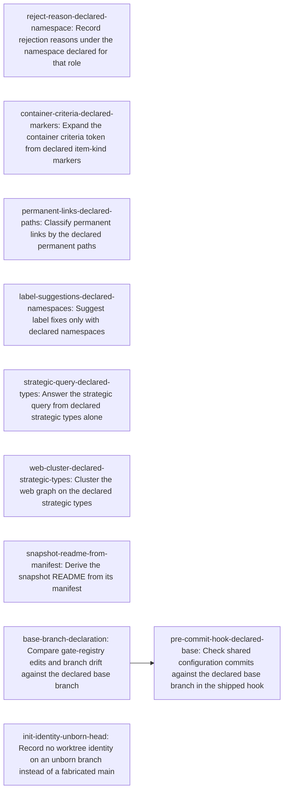

# Plan: Take engine vocabulary and test switches only from declarations and caller inputs (f368ce3d)

> **Diátaxis Type:** Reference

> Planning node: 3204f6a5. Authoritative graph:
> [breakdown.json](breakdown.json).

## Outcome and criterion approach

Every hardcoded instance the [investigation](investigation.md) classifies as
valid-and-open is either rebound to an existing or new declaration or confined
to test support. Each rebound site's terminal owns its two REQ-13 tests at the
cheapest layer (D8). The graph is a flat task list under the epic: ten
terminals in disjoint consumer families, one real edge (the hook reads the key
the engine terminal adds). An intermediate story tier would group nothing.

| Criterion | Approach | Evidence / open gap |
|---|---|---|
| REQ-01 | Union of the per-site terminals plus the D5 sweep item S2 and the S7 lease decoupling. S3 is already done; S1, S4 (except `cli.rs` reject help) and C22 are exempt; S5, S6 are out of scope (D5). | Investigation §1, §3.1 |
| REQ-02 | `reason-namespace-role` on the namespace declaration. | C1, C2, §3.2 |
| REQ-04 | `container-criteria-token` over the existing item extraction. | C3, C4, §3.3, §4 |
| REQ-05 | Link permanence through `ArtifactClassificationPolicy` over declared `permanent_paths`; literal list deleted. | C5, §3.4 |
| REQ-06 | Suggestion takes the namespace registry as an argument. | C6, §3.5 |
| REQ-07 | Fallback deleted; the pure query already returns empty for no types. | C7, §3.6 |
| REQ-08 | `strategic-cluster-selection`. | C8, §3.7 |
| REQ-09 | README generated from `SnapshotManifest` fields only. | C10, §3.8 |
| REQ-10 | Already met (C11, C14, C16). The base-branch terminal keeps the guard decided by caller-supplied executor inputs and adds no ambient read (D6). | §1 REQ-10 |
| REQ-11 | `base-branch-declaration` for guard, drift check and hook. | C13, C17-C20, §3.9 |
| REQ-12 | Prose fixes travel with the two base-branch terminals. | §1 REQ-12 |
| REQ-13 | Per-terminal tests (D8). No open site names a rule: REQ-13's "rule name" example has no remaining consumer since REQ-03 was removed. | §1 REQ-13 |

## Shared architectural contracts

### `reason-namespace-role` [plan-fixed] — Rejection-reason namespace role

`[namespaces.<ns>] role = "rejection-reason"` (optional field on
`NamespaceConfig`, `config.rs`). The role vocabulary is one semantic type with
the single wire token `rejection-reason` (`@/inv/semantic-types`); an unknown
token fails configuration parsing. `issue reject --reason` writes
`<ns>:<reason>` for the unique declaring namespace. Zero declaring namespaces:
error naming the missing `role = "rejection-reason"` declaration. Two or more:
error naming each. Both errors write nothing. Uniqueness is checked at use
time, not in `config validate`. Declared by the `jit-default` profile's
`resolution` entry and by this repository's `.jit/config.toml`.

### `container-criteria-token` [plan-fixed] — `{container.hard_criteria}` expansion

The token expands to the container's addressable items, extracted through
`domain/item.rs` (`index_items` path), of every item kind with
`scope = "issue"` and a non-empty `markers` list. Each kind is scanned in its
own declared `section` and an item is kept when `marker_matches` holds for one
of that kind's markers; a marked line with no id-pattern match is prose and is
dropped. Items render as their source text, one per line, in description
order. No such kind declared: empty string. In this repository only
`requirement` qualifies, so `[hard]` and `[aspirational]` items both expand.

### `strategic-cluster-selection` [plan-fixed] — Web cluster container

The primary cluster container type is the served strategic type
(`GET /config/hierarchy` → `strategic_types`) with the greatest served level
among types present in the graph. The sub-cluster level is the next greater
level in the served level map. No strategic type served, or none present: no
clustering. This repository (`milestone`, `epic`) keeps epic clusters with
milestones as visible nodes.

### `base-branch-declaration` [plan-fixed] — Declared base branch

`[worktree] base_branch = "<revision>"` (`WorktreeConfig`, `config.rs`), any
revision git resolves. Consumers: the gate-registry guard (gate define,
update, remove), `validate --branch-drift`, and the shipped pre-commit hook
(through `jit config get worktree.base_branch`). The value is a non-empty
revision other than `null`. The effective configuration always carries the
key, so `jit config get worktree.base_branch` prints the revision, or `null`
with exit status 0 when undeclared; a missing key would exit 2, which the hook
already treats as "jit unreadable, skip". Undeclared: the guard allows and the
command output reports the skip; the drift check is reported not run with that
reason and does not fail; the hook prints the reason and allows.
With a declaration, each keeps its current outcome policy (guard allows an
unresolved base or unrelated histories; drift fails on them). The hook's
check no longer depends on `worktree.enforce_leases`. This repository
declares `origin/main` as repository-local policy; the shipped default
profile declares none and documents the key in its adopter-left comment
(`profiles/jit-default/manifest.toml`), since `[worktree]` is
adopter-authored.

## Generated decomposition overview

<!-- jit:breakdown-overview:begin -->
| Key | Title | Type | Outcome | Contracts | Sources | Footprint | Landing | Depends on |
|---|---|---|---|---|---|---|---|---|
| reject-reason-declared-namespace | Record rejection reasons under the namespace declared for that role | task | issue reject --reason records under the declared rejection-reason namespace and refuses when none is declared | reason-namespace-role | REQ-01, REQ-02, REQ-13, C1, C2, D1 | touches 13, uncertain | — | — |
| container-criteria-declared-markers | Expand the container criteria token from declared item-kind markers | task | The container criteria token expands from declared item-kind markers and sections | container-criteria-token | REQ-01, REQ-04, REQ-13, C3, C4, D3 | touches 5 | — | — |
| permanent-links-declared-paths | Classify permanent links by the declared permanent paths | task | Link permanence follows the declared permanent paths alone | — | REQ-01, REQ-05, REQ-13, C5, D4 | touches 5 | — | — |
| label-suggestions-declared-namespaces | Suggest label fixes only with declared namespaces | task | Label-format suggestions name only declared namespaces | — | REQ-01, REQ-06, REQ-13, C6 | touches 4 | — | — |
| strategic-query-declared-types | Answer the strategic query from declared strategic types alone | task | query strategic returns declared strategic types only, empty when none declared | — | REQ-01, REQ-07, REQ-13, C7 | touches 3 | — | — |
| web-cluster-declared-strategic-types | Cluster the web graph on the declared strategic types | task | The web graph clusters on the served strategic types with no level literal | strategic-cluster-selection | REQ-01, REQ-08, REQ-13, C8, C9, D7 | touches 9 | — | — |
| snapshot-readme-from-manifest | Derive the snapshot README from its manifest | task | The snapshot README lists only manifest-recorded contents | — | REQ-01, REQ-09, REQ-13, C10 | touches 2 | — | — |
| base-branch-declaration | Compare gate-registry edits and branch drift against the declared base branch | task | The gate-registry guard and branch-drift check compare against the declared base branch or report it undeclared | base-branch-declaration | REQ-01, REQ-10, REQ-11, REQ-12, REQ-13, C11, C12, C13, C14, C15, C16, C17, C18, C19, C21, D2, D6 | touches 16 | — | — |
| pre-commit-hook-declared-base | Check shared configuration commits against the declared base branch in the shipped hook | task | The shipped pre-commit hook compares against the declared base branch whatever the lease mode | base-branch-declaration | REQ-01, REQ-11, REQ-12, REQ-13, C20, S7 | touches 8 | — | base-branch-declaration |
| init-identity-unborn-head | Record no worktree identity on an unborn branch instead of a fabricated main | task | Init records no worktree identity on an unborn branch rather than the literal main | — | REQ-01, S2, D5 | touches 3, uncertain | — | — |

<!-- jit:breakdown-overview:end -->

## Material risks and owner decisions

| Risk / decision | Resolution and rationale |
|---|---|
| D1 reason namespace (REQ-02) | Chosen: `role` field on the namespace declaration, carried by existing profile namespace entries. Rejected: a scalar binding key (needs a new profile `ScalarTarget`, more mechanism, `@/charter/D-18`); deleting `--reason` (contradicts REQ-02). |
| D2 base branch (REQ-11/12) | Chosen: `[worktree] base_branch`, the one source for guard, drift and hook. Rejected: deleting the three comparisons (removes capabilities, `@/charter/D-9`); a new `[git]` table (a table for one key). |
| D3 token name (REQ-04) | Chosen: literal reading, token name kept, aspirational items included. **Owner decision:** rename to `{container.criteria}` and amend REQ-04. No shipped template uses the token, so a rename costs one string. |
| D4 permanent links (REQ-05) | Chosen: permanent exactly under declared `permanent_paths`; the `config.rs` rustdoc stops scoping them to the development root. Risk: declaring `docs/` or root files in this repository may change archival classification; the terminal declares them only if archive plans stay unchanged, otherwise those links report as risky. |
| D5 sweep (REQ-01) | In scope: S2 (init records no identity on an unborn `HEAD`, as outside git, rather than an optional identity field, `@/charter/D-18`), S7 lease decoupling. Already done: S3 (`71c258a8c` gated `registry_region` to test support). Exempt: S1 (`PLAN_DOC_LABEL`, read only at `templates.rs:708`): a document label is outside REQ-01's listed categories (namespace, rule, type, level, marker, branch, documentation path); S4: illustrative help prose the product never reads, except `cli.rs` reject help, which changes with REQ-02; C22 mechanism vocabulary. Out of scope: S5 (owned by c140921c); S6 (`JIT_SERVER_REPORT_FIRST_READS`, follow-up candidate for the owner). C23 (`mcp-server/`) is vacuous. |
| D6 REQ-10 | Already met; covered by the base-branch terminal's no-ambient-read criterion. No separate work. |
| D7 web cluster (REQ-08) | Chosen: served `strategic_types`. Rejected: served per-node `cluster`, which names the topmost container (milestone), changing this repository's epic-level view. |
| D8 REQ-13 tests | Each rebound terminal owns its differing-declaration and none-declared tests (`@/inv/orthogonal-tests`); no test terminal. |
| b697a3f7 config work | Off limits: `JitConfig::load`, `EffectiveConfig::load`, `config validate`, `commands/config.rs`, `commands/claim.rs`, `TemplateRegistry::load`, `configuration_store.rs`. Coordination points: struct-field additions to `NamespaceConfig` and `WorktreeConfig` (no loader edit); one key added to `EffectiveConfig::full_snapshot`'s `worktree` object by the hook terminal. |
| `commands/gate.rs`, `cli.rs` | c2b3cefa, 9a2563fd, 1a737bb4 change lease checks, gate define registry writes, presets and claims-first classification; the base-branch terminal rebases onto them, and the strategic-query, label-suggestion, reject and hook terminals rebase on the `cli.rs` changes. |
| `commands/issue.rs`, `commands/mod.rs`, lease tests | 783b33fa is done; no overlap remains. b697a3f7 changes field updates and readiness in `issue.rs`/`mod.rs`; c2b3cefa edits `cli.rs` and `tests/cli_repo_workflow/lease_enforcement_tests.rs`, whose `issue reject --reason` case runs in a repository declaring no role. The reject terminal fixes the order: lease refusal precedes the role check. |
| 0723860e, cd1da611, 1a737bb4 | Touch template apply, `InterpolationContext` and presets reached from `commands/template.rs`; the criteria-token terminal rebases. |
| c140921c, 19404174 | Touch `commands/snapshot.rs`; the README terminal rebases. If declaration files enter the manifest, the README lists them through the same derivation. |
| 030df4b1 | Moves config reads onto captured declarations; the REQ-05, REQ-06, REQ-07, REQ-08 and base-branch reads use whichever path exists. |

## Investigation sources

- [Investigation](investigation.md): claim classification C1-C23, sweep S1-S7, consumer inventories §3, primitives §4 and overlaps §7 remain there; its §8 open decisions carry this table's numbering.
