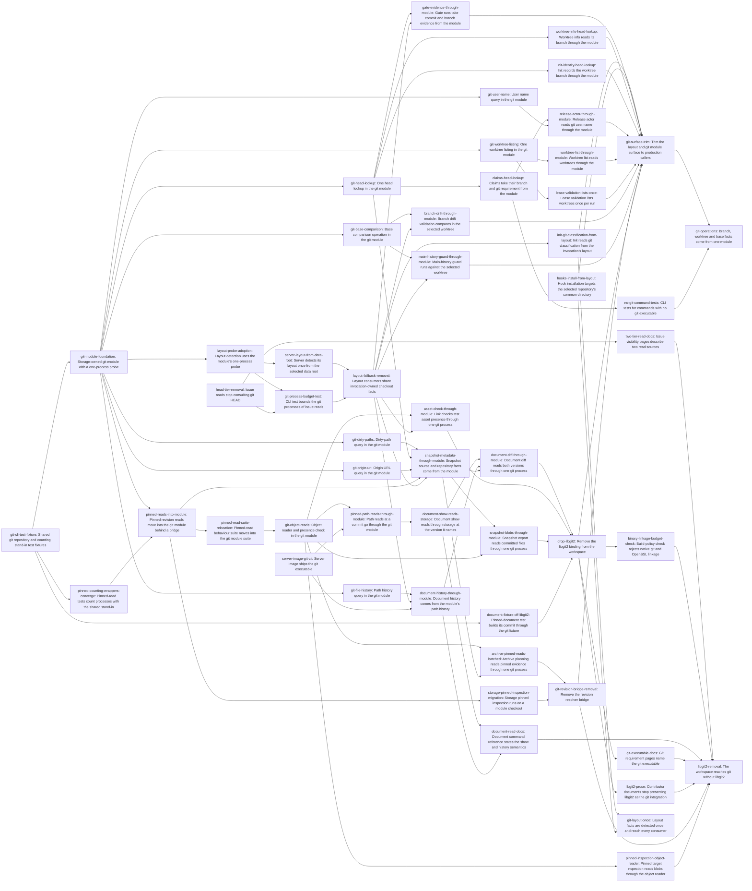

# Plan: Reach git through one storage-owned CLI module instead of libgit2 (f4d9502a)

> Planning node: 28ccf9a9. Authoritative graph:
> [breakdown.json](breakdown.json).

## Outcome and criterion approach

One file, `crates/jit/src/storage/git.rs`, starts every git process through one executable value, always with `-C` the selected worktree (`@/charter/D-21`). Each git fact a consumer needs gets one module operation, introduced with or just before its first production caller. Layout detection computes each distinct checkout context once per invocation (DEC-27). Issue reads lose the `HEAD` tier, so they need no git at all. Once the last libgit2 reader moves, the binding goes. Core commands keep working without git, and claims fail with the typed error (`@/charter/D-4`). Each issue body is written against the code as it stands after the upstream tasks the entry follows, and cites current lines.

| Criterion | Approach | Evidence / open gap |
|---|---|---|
| REQ-01 | Every libgit2 reader moves onto the module, then `drop-libgit2` removes both manifest lines and the lock entries with a dependency-policy test, and `binary-linkage-budget-check` rejects libgit2 and OpenSSL linkage in the build-policy script (DEC-15). | Investigation, libgit2 §1 C1, C3; §5d |
| REQ-02 | `git-module` is the one spawning file. Each spawn site moves in its own consumer entry, and `git-surface-trim` checks the end state. Test code is `#[cfg(test)]` modules, code compiled only under `test-support` (`jit::test_harness`) and integration tests; it may start git. | CLI surface §3.1 |
| REQ-03 | The module's helper always passes `-C`, and the executable is one `Git` value (DEC-07). The process-cwd sites (drift, guard, gate evidence, hooks, server) move to the selected worktree. | CLI surface C5, C7, C9, REQ-03 row |
| REQ-04 | `layout-once` shares invocation-owned observations. `layout-fallback-removal` owns reuse and removal of lazy detection; server startup consumes shared bootstrap. Ordinary reads retain one process, external bootstrap at most two layout probes, and external N-context traversal at most N+1 including the failed data-root probe. | [Layout investigation](layout-probe-investigation.md), DEC-27 |
| REQ-05 | `git-head` with one rendering of the branch label; claims, coordinator, worktree info, init identity, gate evidence and snapshot use it (DEC-10). | CLI surface §4.3 |
| REQ-06 | `head-tier-removal` (DEC-05) and the working-tree `doc show` (DEC-06); `git-process-budget-test` also bounds the linked checkout. | libgit2 §1 finding, §5a |
| REQ-07 | A PATH-prepended counting stand-in in one `cli_repo_workflow` module (DEC-08). | libgit2 §5b |
| REQ-08 | `git-worktree-listing`, then `lease-validation-lists-once` with a counting test. | CLI surface C8, §4.5 |
| REQ-09 | `gate-evidence-through-module`; in-memory runs record none (DEC-11). | CLI surface C7 |
| REQ-10 | `git-object-reads` (one reader per command), then path reads at a commit, document show, diff, history, asset checks, snapshot and archive planning each move in their own entry. The server image gains the git executable first. | libgit2 §3 replacement table |
| REQ-11 | Each operation lands as a primitive just before its first production consumer; `git-surface-trim` checks that every public item has a production caller, restricts `Git::with_program` to `test-support` once the bridge and storage have migrated, and deletes test-only layout entry points. | CLI surface REQ-11 row, §5.4 |
| REQ-12 | A typed mapping in `claims-head-lookup`; `no-git-command-tests` covers the no-executable condition; the outside-repository tests already exist (DEC-17). | CLI surface REQ-12 row, §4.6 |
| REQ-13 | The `ureq` comment and Dockerfile builder step change with the removal; `libgit2-prose` corrects `dev/vision`. | libgit2 §3 REQ-13 sites |

## Shared architectural contracts

### `git-module` [implementation-produced] — Module foundation

`crates/jit/src/storage/git.rs` (`storage::git`, public) is the only production file that starts git or names its executable. `Git` names the executable. `Git::default()` is the bare name `git`, looked up on the invocation's `PATH` when a process starts. `Git::with_program` names another program; the revision resolver bridge and storage need it in production builds until they migrate, and `git-surface-trim` then restricts it to `test-support`. One private helper runs `<program> -C <dir> <args…>`. A failure to start it is the module error for an unavailable executable, naming the program. `GitCheckout` pairs a `Git` with a worktree root and carries every operation. `WorktreePaths::git()` returns one built with the default executable for a git checkout and `None` otherwise. `Git::probe(dir)` classifies a directory with one `rev-parse --git-common-dir --show-toplevel` process. The behaviour suite is `crates/jit/tests/fast_docs_templates/git_module_tests.rs`. Producer: `git-module-foundation`. 5f82e09a's dependency is re-homed onto this producer through `git-dirty-paths` (DEC-04).

### `layout-once` [plan-fixed] — Layout detected at the invocation boundary

The shared `commands/bootstrap::open_repository` resolves the selected data root first, then the invoking checkout when the data root is external. CLI and server consume the same result, preserving recovery before validation. Ordinary reads retain one Git process; external bootstrap uses at most two layout probes. Storage, executor, recovery and projected checkout paths share one private invocation-owned context on `WorktreePaths` (DEC-27). Missing supplied context is non-Git and never triggers discovery.

The context retains each query's successful, absent or error outcome using the existing `Git` executable choice. Exact input paths, available filesystem-canonical aliases and Git-returned top levels share observations; neither arbitrary descendants nor common/private Git directories are equivalent worktree query paths. Lookup/probe/publication is serialized only within the context, without repository or identity locks. Clones share observations; equality compares layout facts, not mutable observations. Sibling projection reuses the selected checkout and resolves each new listed context once. For N queried contexts, including stale or missing candidates, external listing/lease validation uses at most N+1 layout probes including the failed data-root probe, independent of leases/issues.

Context lifetime is the explicit CLI invocation or server startup layout; it makes no process-lifetime freshness promise for future HTTP traversals. New invocations start fresh. Data ownership, linked-store policy, relocated coordination and Git-reported private identity directories remain unchanged. `git()` and `write_checkout()` retain their distinct authorities. Data discovery's `.git` existence check remains a Git-optional filesystem boundary, not layout classification.

5046408a selects a worktree root from the data root's `config.toml`, relative to the data root, with `JIT_WORKTREE_ROOT` overriding it. It replaces only the worktree root: the common directory (including leases), linked-checkout classification and primary data root still come from the resolved data-root or relocated coordination context. Taking the configured root adds no second probe or other Git discovery. Every subsequent Git call, including gate evidence, uses the selected worktree.

### `git-test-fixtures` [implementation-produced] — Shared git fixtures

`jit::test_harness` offers a git repository fixture (init through the CLI, repository-local identity, write, commit returning the id) and, on Unix, a counting stand-in: a `git` file in its own directory that records each invocation and runs the real git by an absolute path resolved at creation. Each recorded invocation exposes its arguments with a leading `-C <dir>` pair removed. A test passes the stand-in as an explicit program or prepends its directory to a child's `PATH`. Producer: `git-cli-test-fixture`.

### `git-head` [implementation-produced] — One head lookup

`GitCheckout::head()` uses at most two configured git processes to read HEAD identity and validate the captured commit or unborn symbolic target, without unrelated ref, reflog, ancestor or worktree traversal or lazy fetch. Command failures and malformed or missing commit evidence return typed errors; prior checkout recognition is not sufficient. The exact protocol and required guards are recorded in [the head experiment](head-lookup-experiment.md) (DEC-25). It returns `Ok(None)` on an unborn branch, or `Head { commit: CanonicalCommitOid, branch: Option<String> }`, with `branch` absent on a detached HEAD. `Head::branch_label()` is the branch name, or `HEAD` when detached. Consumers that record a branch record the label, so their values are unchanged; only init's identity changes (DEC-10). Producer: `git-head-lookup`.

### `git-worktree-listing` [implementation-produced] — One worktree listing

`GitCheckout::list_worktrees()` runs one `worktree list --porcelain` and returns each worktree's path and branch name, absent when detached or bare. Consumers apply their own filters. Producer: `git-worktree-listing`.

### `git-base-comparison` [implementation-produced] — One base comparison

`GitCheckout::compare_with_base(base)` returns `Compared { merge_base, base_commit }`, `BaseUnresolved` when the base does not resolve to a commit, or `NoMergeBase` when `HEAD` and the base share no history (DEC-21). A missing git checkout is the caller's case: it has no `GitCheckout`. Each caller states its text and exit status per outcome. The caller names the base (`origin/main` today); whether the drift check and the guard run, and against which base, is f368ce3d's decision. Producer: `git-base-comparison`.

### `git-pinned-reads` [implementation-produced] — Revision reads in the module

`GitCheckout::{resolve_commit, read_pinned_path, inspect_pinned_targets}` hold the logic and semantics of `storage/git_revision.rs`, and the module error carries its variants. Producer: `pinned-reads-into-module`. Storage moves onto it in `storage-pinned-inspection-migration`, holding a `Git` in place of `git_program`; pinned inspection reads blobs through the object reader after `pinned-inspection-object-reader`.

### `git-revision-resolver-bridge` [implementation-produced] — Interim revision resolver

`storage/git_revision.rs` keeps `GitRevisionResolver` with its public methods, each delegating to a `GitCheckout` built from its program and root, and `GitRevisionError` names the module error type. The logic exists once, in the module, while callers move one at a time. It is a named temporary bridge with one producer, `pinned-reads-into-module`. Its users are storage's pinned inspection (moved by `storage-pinned-inspection-migration`), the behaviour suite (moved by `pinned-read-suite-relocation`) and the archive planner (moved by `archive-pinned-reads-batched`). Its one remover is `git-revision-bridge-removal`, which depends on all three moves. Removal criterion: none of `storage/git_revision.rs`, `GitRevisionResolver`, `GitRevisionError`, `GitCheckout::read_pinned_path` or `PinnedArtifactRead` exists (`@/inv/canonical-cutover`).

### `git-object-reads` [implementation-produced] — One object reader per command

`GitCheckout::object_reader()` holds one `cat-file --batch` process that answers reads one at a time until dropped. A read returns the object's id, type and bytes, or absent for a missing name. `GitCheckout::object_types(names)` answers presence in one `--batch-check` process. A name containing a newline is rejected before git sees it. Pinned inspection moves onto it in `pinned-inspection-object-reader`, leaving one answer parser. Every command that reads git objects holds at most one reader. Producer: `git-object-reads`.

### `git-dirty-paths` [implementation-produced] — One dirty-path query

`GitCheckout::dirty_paths()` runs one `status --porcelain -z --untracked-files=all` and returns the repository-relative paths that are modified, staged, deleted, renamed (both names) or untracked, excluding ignored files. Producer: `git-dirty-paths`. Consumers: snapshot export here, and 5f82e09a's apply refusal (DEC-04, DEC-12).

### `git-file-history` [implementation-produced] — One path history query

`GitCheckout::file_history(path)` runs one `git log` over the path and returns commits newest first with full id, author, commit time and message, under git's default history simplification. Producer: `git-file-history`; the document history commands consume it in `document-history-through-module`. 0f8efc37's document convergence consumes it (DEC-04).

### `issue-read-sources` [plan-fixed] — Two issue read sources

Issue and index reads consult the checkout's own data root and, in a linked checkout, the primary checkout's data root (`WorktreePaths::primary_data_root`). The first source naming an id wins, and a local tombstone hides a primary-checkout record. No issue read starts git or loads a git object.

### `document-read-versions` [plan-fixed] — Document version selection

A document read uses the explicit `--at` revision, else the reference's pinned commit, else the working tree, in the CLI and the server alike. Reads at a commit go through the module's object reader, one per command. History and diff read git objects by definition.

## Generated decomposition overview

<!-- jit:breakdown-overview:begin -->
| Key | Title | Type | Outcome | Contracts | Sources | Footprint | Landing | Depends on |
|---|---|---|---|---|---|---|---|---|
| git-cli-test-fixture | Shared git repository and counting stand-in test fixtures | task | Tests build git repositories and count git processes through one shared fixture pair. | — | REQ-07, DEC-08, DEC-16, DEC-19 | touches 1 | — | — |
| document-fixture-off-libgit2 | Pinned-document test builds its commit through the git fixture | task | The pinned-document test builds its repository without libgit2. | git-test-fixtures | REQ-01, DEC-16 | touches 1 | — | git-cli-test-fixture |
| git-module-foundation | Storage-owned git module with a one-process probe | task | One public storage module owns the git executable and a one-process directory probe. | git-test-fixtures | REQ-02, REQ-03, REQ-12, DEC-07, DEC-09, DEC-17 | creates 2, touches 3 | — | git-cli-test-fixture |
| layout-probe-adoption | Layout detection uses the module's one-process probe | task | WorktreePaths detection runs one probe process instead of three. | git-module, layout-once | REQ-02, REQ-04, DEC-09 | touches 1 | — | git-module-foundation |
| server-layout-from-data-root | Server detects its layout once from the selected data root | task | jit-server consumes the shared core bootstrap for one selected-root layout and configured handles. | layout-once, git-module | REQ-03, REQ-04, DEC-09 | touches 2 | — | layout-probe-adoption |
| layout-fallback-removal | Layout consumers share invocation-owned checkout facts | task | Bootstrap and checkout projections reuse invocation-owned layout facts within the distinct-context process bounds. | layout-once, git-module, git-test-fixtures | REQ-04, REQ-07, DEC-09, DEC-27 | touches 8 | — | server-layout-from-data-root, git-process-budget-test |
| init-git-classification-from-layout | Init reads git classification from the invocation's layout | task | jit init classifies git from the invocation's layout and starts no git process. | layout-once | REQ-02, REQ-04, DEC-09 | touches 1 | — | layout-fallback-removal |
| hooks-install-from-layout | Hook installation targets the selected repository's common directory | task | jit hooks install writes into the selected repository's common git directory. | layout-once | REQ-03, REQ-04, DEC-09, DEC-19 | touches 3 | — | — |
| git-process-budget-test | CLI test bounds the git processes of issue reads | task | A CLI test shows issue reads start at most one git process in either checkout kind. | git-test-fixtures, git-module, issue-read-sources | REQ-06, REQ-07, DEC-05, DEC-08 | creates 1, touches 1 | — | layout-probe-adoption, head-tier-removal |
| git-head-lookup | One head lookup in the git module | task | The git module validates commit and branch with one bounded head operation using at most two processes. | git-module | REQ-05, DEC-10, DEC-18, DEC-25 | touches 2 | — | git-module-foundation |
| gate-evidence-through-module | Gate runs take commit and branch evidence from the module | task | Exec gate runs record the selected worktree's head passed in from the git module. | git-head, layout-once | REQ-02, REQ-03, REQ-05, REQ-09, DEC-10, DEC-11 | touches 2 | — | git-head-lookup, layout-fallback-removal |
| worktree-info-head-lookup | Worktree info reads its branch through the module | task | jit worktree info reads its branch from the module head lookup. | git-head | REQ-02, REQ-05, DEC-10, DEC-18, DEC-26 | touches 6 | — | git-head-lookup |
| init-identity-head-lookup | Init records the worktree branch through the module | task | jit init records the worktree branch from the module head lookup. | git-head | REQ-02, REQ-05, DEC-10, DEC-18 | touches 1 | — | git-head-lookup |
| claims-head-lookup | Claims take their branch and git requirement from the module | task | Claims read the branch through the module and report a missing git as the typed error. | git-head | REQ-02, REQ-05, REQ-12, DEC-03, DEC-10, DEC-17 | touches 2 | — | git-head-lookup |
| git-user-name | User name query in the git module | task | The git module answers the configured user name with one process. | git-module | REQ-03, DEC-07 | touches 4 | — | git-module-foundation |
| release-actor-through-module | Release actor reads git user.name through the module | task | The claim-release actor fallback reads user.name through the module. | git-module | REQ-02, REQ-03, DEC-07 | touches 7 | — | claims-head-lookup, git-user-name |
| git-worktree-listing | One worktree listing in the git module | task | The git module lists worktrees with one process and one parser. | git-module | REQ-08, DEC-09 | touches 2 | — | git-module-foundation |
| worktree-list-through-module | Worktree list reads worktrees through the module | task | jit worktree list reads its worktrees from the module listing. | git-worktree-listing | REQ-02, REQ-08, DEC-09, DEC-26 | touches 6 | — | git-worktree-listing |
| lease-validation-lists-once | Lease validation lists worktrees once per run | task | jit validate --leases lists worktrees once per run and states its no-git failure. | git-worktree-listing, git-test-fixtures | REQ-02, REQ-08, REQ-12, DEC-03, DEC-08, DEC-17, DEC-28 | touches 3 | — | git-worktree-listing |
| git-base-comparison | Base comparison operation in the git module | task | The git module compares HEAD with a named base and reports a typed outcome. | git-module | REQ-03, DEC-04, DEC-09, DEC-21 | touches 2 | — | git-module-foundation |
| branch-drift-through-module | Branch drift validation compares in the selected worktree | task | jit validate --branch-drift compares the selected worktree and names each failure. | git-base-comparison | REQ-02, REQ-03, DEC-04, DEC-21, DEC-28 | touches 2 | — | git-base-comparison, layout-fallback-removal |
| main-history-guard-through-module | Main-history guard runs against the selected worktree | task | The gate-registry guard compares the selected worktree through the module. | git-base-comparison | REQ-02, REQ-03, REQ-04, DEC-04, DEC-21 | touches 4 | — | git-base-comparison, layout-fallback-removal |
| no-git-command-tests | CLI tests for commands with no git executable | task | CLI tests show core commands work and claims fail typed with no git executable. | layout-once | REQ-12, DEC-17 | creates 1, touches 1 | — | claims-head-lookup |
| git-surface-trim | Trim the layout and git module surface to production callers | task | Test-only detection entry points are gone and the module exposes only production-called items. | git-module | REQ-02, REQ-04, REQ-11, DEC-07, DEC-09 | touches 5 | — | init-git-classification-from-layout, hooks-install-from-layout, gate-evidence-through-module, worktree-info-head-lookup, init-identity-head-lookup, release-actor-through-module, worktree-list-through-module, lease-validation-lists-once, branch-drift-through-module, main-history-guard-through-module, git-revision-bridge-removal, drop-libgit2 |
| head-tier-removal | Issue reads stop consulting git HEAD | task | Issue reads use local and primary-checkout data roots only, with no git process. | issue-read-sources | REQ-02, REQ-06, DEC-05 | touches 3 | — | — |
| two-tier-read-docs | Issue visibility pages describe two read sources | task | Four user pages describe issue reads as checkout plus primary checkout. | issue-read-sources | REQ-06, DEC-05 | touches 4 | — | head-tier-removal |
| pinned-reads-into-module | Pinned revision reads move into the git module behind a bridge | task | Pinned revision logic lives in the git module and the old resolver delegates to it. | git-module, git-test-fixtures | REQ-02, REQ-03, DEC-07, DEC-13 | touches 3 | — | git-module-foundation, pinned-counting-wrappers-converge |
| storage-pinned-inspection-migration | Storage pinned inspection runs on a module checkout | task | Storage pinned inspection uses a module checkout built from an injectable Git. | git-pinned-reads, git-revision-resolver-bridge | REQ-03, REQ-11, DEC-07 | touches 2 | — | pinned-reads-into-module |
| pinned-read-suite-relocation | Pinned-read behaviour suite moves into the git module suite | task | The pinned-read behaviour suite runs against the module API in the module suite. | git-pinned-reads | REQ-02, DEC-16 | touches 3 | — | pinned-reads-into-module |
| pinned-counting-wrappers-converge | Pinned-read tests count processes with the shared stand-in | task | Pinned-read tests count git processes through the shared stand-in only. | git-test-fixtures | REQ-07, DEC-16 | touches 2 | — | git-cli-test-fixture |
| git-object-reads | Object reader and presence check in the git module | task | The git module reads many objects through one cat-file process per reader. | git-pinned-reads | REQ-10, DEC-13, DEC-14 | touches 2 | — | pinned-read-suite-relocation |
| pinned-inspection-object-reader | Pinned target inspection reads blobs through the object reader | task | Pinned inspection reads blobs through the single object reader. | git-object-reads, git-pinned-reads | REQ-10, DEC-13 | touches 1 | — | git-object-reads |
| archive-pinned-reads-batched | Archive planning reads pinned evidence through one git process | task | Archive planning resolves pinned documents through one object reader process. | git-object-reads, git-revision-resolver-bridge, git-test-fixtures | REQ-03, REQ-10, DEC-13 | touches 2 | — | git-object-reads, snapshot-metadata-through-module |
| git-revision-bridge-removal | Remove the revision resolver bridge | task | The revision resolver bridge and the single-path pinned read are gone. | git-revision-resolver-bridge, git-object-reads | REQ-02, REQ-11, DEC-13 | touches 4 | — | archive-pinned-reads-batched, storage-pinned-inspection-migration |
| pinned-path-reads-through-module | Path reads at a commit go through the git module | task | Storage reads a path at a commit through the module object reader. | git-object-reads, document-read-versions | REQ-01, REQ-10, DEC-13, DEC-22 | touches 1 | — | git-object-reads, server-image-git-cli |
| document-show-reads-storage | Document show reads through storage at the version it names | task | jit doc show reads unpinned documents from the working tree through storage. | document-read-versions | REQ-06, REQ-10, DEC-06, DEC-22 | touches 3 | — | pinned-path-reads-through-module |
| document-diff-through-module | Document diff reads both versions through one git process | task | Both document diff variants read their two versions through one reader process. | git-object-reads, document-read-versions, git-test-fixtures | REQ-01, REQ-10, DEC-13 | touches 2 | — | document-show-reads-storage, document-history-through-module, snapshot-metadata-through-module |
| git-file-history | Path history query in the git module | task | The git module lists a path's history with one git log process. | git-module | REQ-10, DEC-13 | touches 2 | — | git-module-foundation |
| document-history-through-module | Document history comes from the module's path history | task | Both document history variants read the module's path history. | git-file-history | REQ-01, REQ-10, DEC-13 | touches 4 | — | git-file-history, layout-fallback-removal, server-image-git-cli |
| asset-check-through-module | Link checks test asset presence through one git process | task | The link check tests unpinned asset presence through one presence-check process. | git-object-reads, git-test-fixtures | REQ-01, REQ-10, DEC-13 | touches 4 | — | git-object-reads, layout-fallback-removal |
| git-dirty-paths | Dirty-path query in the git module | task | The git module reports uncommitted paths with one status process. | git-module | REQ-10, DEC-12 | touches 2 | — | git-module-foundation |
| git-origin-url | Origin URL query in the git module | task | The git module answers the origin remote's URL with one process. | git-module | REQ-10, DEC-14 | touches 2 | — | git-module-foundation |
| snapshot-metadata-through-module | Snapshot source and repository facts come from the module | task | Snapshot export takes commit, origin, branch and dirtiness from the git module. | git-dirty-paths, git-head, git-pinned-reads, git-test-fixtures | REQ-05, REQ-10, DEC-10, DEC-12, DEC-14 | touches 2 | — | git-dirty-paths, git-head-lookup, git-origin-url, pinned-reads-into-module, layout-fallback-removal |
| snapshot-blobs-through-module | Snapshot export reads committed files through one git process | task | A git-mode snapshot export reads its files through one reader process. | git-object-reads, git-test-fixtures | REQ-01, REQ-10, DEC-14 | touches 2 | — | snapshot-metadata-through-module, git-object-reads |
| server-image-git-cli | Server image ships the git executable | task | The server image carries the git executable its document reads need. | — | REQ-10, DEC-13, DEC-20 | touches 2 | — | — |
| drop-libgit2 | Remove the libgit2 binding from the workspace | task | The workspace has no git2 dependency and a policy test keeps it out. | — | REQ-01, REQ-13, DEC-02, DEC-15, DEC-16 | touches 5 | — | document-diff-through-module, asset-check-through-module, snapshot-blobs-through-module, document-fixture-off-libgit2 |
| binary-linkage-budget-check | Build-policy check rejects native git and OpenSSL linkage | task | The build-policy script fails when a built executable links libgit2 or OpenSSL. | — | REQ-01, DEC-15 | touches 2 | — | drop-libgit2 |
| document-read-docs | Document command reference states the show and history semantics | task | The command reference states working-tree show and git-log history semantics. | document-read-versions, git-file-history | REQ-10, DEC-06, DEC-13 | touches 1 | — | document-show-reads-storage, document-history-through-module |
| git-executable-docs | Git requirement pages name the git executable | task | The git-requirement pages say git-backed operations need the git executable. | git-module | REQ-12, DEC-07, DEC-17 | touches 3 | — | drop-libgit2 |
| libgit2-prose | Contributor documents stop presenting libgit2 as the git integration | task | Contributor documents describe the git CLI module as the git integration. | — | REQ-13, DEC-15 | touches 2 | — | drop-libgit2 |
| git-layout-once | Layout facts are detected once and reach every consumer | story | Layout facts are resolved once per distinct invocation context and shared with every consumer. | — | REQ-04, REQ-07, DEC-09, DEC-27 | — | — | init-git-classification-from-layout, hooks-install-from-layout |
| git-operations | Branch, worktree and base facts come from one module | story | Every git fact consumers need has one module operation run in the selected worktree. | — | REQ-05, REQ-08, REQ-09, REQ-11, DEC-10 | — | — | git-surface-trim, no-git-command-tests |
| libgit2-removal | The workspace reaches git without libgit2 | story | No libgit2 remains and every git read goes through the module. | — | REQ-01, REQ-06, REQ-10, REQ-13, DEC-05 | — | — | two-tier-read-docs, binary-linkage-budget-check, document-read-docs, git-executable-docs, libgit2-prose, git-revision-bridge-removal, pinned-inspection-object-reader |

<!-- jit:breakdown-overview:end -->

## Material risks and owner decisions

| Risk / decision | Resolution and rationale |
|---|---|
| DEC-01 Upstream 2195c98f | Chosen: each root whose code a 2195c98f task changes depends on those specific tasks, picked by function overlap and reduced so no edge is implied by another. The epic-level f4d9502a → 2195c98f edge stays. Rejected: one edge per root to the whole epic, which would hold every entry until 2195c98f closes. External dependency 0102769f → `head-tier-removal`. External dependency e1a6c8c2 → `head-tier-removal`. External dependency 79aa3aa7 → `gate-evidence-through-module`. External dependency 417be079 → `gate-evidence-through-module`, `main-history-guard-through-module`. External dependency 855d027d → `document-show-reads-storage`, `document-history-through-module`, `asset-check-through-module`, `snapshot-metadata-through-module`. External dependency f8f80eea → `archive-pinned-reads-batched`. Reached transitively, so a direct edge would be rejected as redundant: 0102769f, e1a6c8c2 and 945f65f3 for `layout-fallback-removal`, its dependants and `init-git-classification-from-layout` (through `head-tier-removal`), 89e7a273 and c400730c (through 0102769f), d50d6976 and c1c86312 (through 855d027d and 5e1ba005), 488eb3c1 (through 417be079), 8e82fa49, faa19def and 842b0ac6's 86d3625d (through 79aa3aa7), and 8cfbf19d, a50e9be9 and 6e8b9f31 (through 614a6f97 and c3e3e2ff). Entries that change no code a 2195c98f task changes carry no 2195c98f edge; their roots follow 842b0ac6's sink instead (DEC-19). |
| DEC-02 Upstream 842b0ac6 | Chosen: no edge onto 84745746, 52732879 or f11514dd; all three are done, and 84745746 already removed `validate.rs`'s git2 use. ec190bd5's cfg-twin removal, which rewrites the `JsonFileStorage` constructors `pinned-reads-into-module` edits, is reached through 63c11d08 (DEC-19), so a direct edge would be redundant. Every entry with a 2195c98f edge follows all of 842b0ac6, since each 2195c98f root depends on it. Rejected: an edge onto 34361448, whose `claim.rs` limit resolution touches no function this plan edits. |
| DEC-03 Upstream f8a6b298 | Chosen: external dependency 614a6f97 → `claims-head-lookup`, `lease-validation-lists-once`. 614a6f97 subsumes 2f563673, dd53527f, c3e3e2ff and 98184c64, and it rewrites the renew, heartbeat and force-evict functions and the orphaned-lease remedy that these two entries also edit. External dependency c3e3e2ff → `worktree-list-through-module`. External dependency 5e1ba005 → `archive-pinned-reads-batched`, which edits `plan_archive_target` after f8 moves preview onto archive evidence. `git-surface-trim` follows 98184c64 through `claims-head-lookup`. No f8a6b298 task depends on an entry here. Rejected: replacing `WorktreePaths.git_repository` with a checkout field, which would edit `WorktreePaths` struct literals inside the f8 lease tests of `storage/claim_coordinator.rs`; `WorktreePaths::git()` derives the checkout instead. |
| DEC-04 Cross-epic edges for the steward | Not wired here, because each would delay another epic. 0f8efc37's document-convergence task depends on `document-history-through-module` (contract `git-file-history`). 5f82e09a is re-homed from the f4d9502a epic onto `git-dirty-paths`, which implies `git-module-foundation`, the module-foundation producer (`git-module`); a direct edge onto the foundation as well would be redundant. Steward amendment: the already-landed a807e699 owns the shared bootstrap; `server-layout-from-data-root` consumes it and also satisfies 0f8efc37 REQ-01. The server/web plan depends on that external owner rather than creating a second startup migration. 5046408a integrates split roots through this shared bootstrap and selected-worktree gate evidence; its live dependency graph is authoritative for sequencing (DEC-23). It is external to this manifest and earns no REQ-01–13 credit. Overlaps with no edge: f368ce3d REQ-10/11/12 decides whether the main-history guard and `--branch-drift` run and against which base, and this plan only routes their git calls; 182f4c03 and a015dcbb touch `snapshot.rs` and `archive.rs`; 083c9a91, 66790c84, cd8e04cc and 06ee9b67 move the claim, worktree and validate entry points. |
| DEC-05 `HEAD` tier | Chosen: delete it (`head-tier-removal`, `issue-read-sources`), which also fixes the full-id resurrection of a locally deleted issue. Rejected: a linked-only lazy `cat-file --batch` session, which goes stale in the long-lived server and adds mechanism (`@/charter/D-18`); gating today's per-issue spawns, which fails REQ-06. |
| DEC-06 Unpinned `doc show` | Chosen: working tree, as the server already reads (`document-show-reads-storage`, `document-read-versions`). Rejected: keeping the `HEAD` preference, a git-object read by a read command in a primary checkout. |
| DEC-07 Git executable | Chosen: one `Git` value whose default is the bare `git` on `PATH`, named only in the module, with a `test-support` constructor; storage's test hook takes a `Git`. No configuration surface. Rejected: a `JIT_GIT` environment variable (a new documented surface and a process-global read); a `config.toml` key (repository data naming a machine-local program). |
| DEC-08 Counting stand-in | Chosen: the shared stand-in prepended to the spawned `jit`'s `PATH`, in one `cli_repo_workflow` module (`git-process-budget-test`) after the probe and the `HEAD`-tier removal. Rejected: in-process injection alone, which does not prove the CLI wiring. |
| DEC-09 Layout facts | Chosen: `WorktreePaths` carries layout facts; `layout-probe-adoption` replaces each three-process probe with one, `layout-fallback-removal` shares explicit invocation context and removes hidden fallback detection, and `git-surface-trim` removes obsolete entry points. DEC-27 permits its private context field; DEC-23 later selects the effective worktree root. Rejected: Git handles in pure `RepositoryLayout`, or lazy discovery when context was omitted. |
| DEC-10 Branch lookup | Chosen: `git-head`. An unborn branch reports no head, which keeps claims' "make a first commit" error. A detached HEAD reports no branch name, and `Head::branch_label()` renders it as `HEAD` for every consumer that records a branch, so only init's recorded branch changes: `HEAD` when detached (was empty) and `main` without commits (was the unborn branch's name), stated in `init-identity-head-lookup`. Rejected: a symbolic-ref-only answer that lets claims succeed without commits. The bounded validation protocol in DEC-25 confirms unborn state separately and returns typed failures for invalid checkout or commit evidence. |
| DEC-11 Gate evidence | Chosen: the executor passes the selected worktree's head into the checker entry point (`gate-evidence-through-module`), and in-memory runs record none. Rejected: evidence from the checker's working directory, which can be another repository or the process directory. |
| DEC-12 Dirty paths | Chosen: `git-dirty-paths` lands right after the foundation, with `--untracked-files=all` so a per-path refusal sees every untracked file. Snapshot export uses it, and 5f82e09a is re-homed onto it. Rejected: a snapshot-local status call, which would leave two implementations. |
| DEC-13 Object and history reads | Chosen: one `cat-file --batch` reader per command, answering one request at a time because snapshot export discovers assets after reading documents; presence through one `--batch-check`. Diffs keep the in-Rust `similar` rendering for byte-identical output. History is one `git log`, and its merge and deletion semantics change, as stated in `document-history-through-module`. The server image gains git first (`server-image-git-cli`). Rejected: a write-all-then-read batch only, which cannot serve snapshot's second round in one process; `git diff` output, which is not byte-identical. |
| DEC-14 Snapshot export | Chosen: commits through `resolve_commit`, files through one reader with the blob id as `blob_sha`, origin through `git remote get-url origin`, branch through `Head::branch_label()`, and dirtiness through `git-dirty-paths`, which no longer counts ignored files. Rejected: `git archive` (no per-file object id, reads the whole tree); `ls-tree` (ids without bytes). |
| DEC-15 Linkage proof | Chosen: `drop-libgit2` asserts the manifest and lock facts in `dependency_feature_policy_tests.rs`, and `binary-linkage-budget-check` makes `scripts/rust-build-budget.sh` fail on a dynamic dependency on libgit2, libssl or libcrypto, through an injectable listing with fixtures. Rejected: an `ldd` assertion inside a Rust test, since the build-policy script is where linkage policy runs. |
| DEC-16 Git test fixtures | Chosen: `git-test-fixtures` in `jit::test_harness`. The libgit2-built document fixture moves in `document-fixture-off-libgit2`, which `drop-libgit2` follows, the snapshot unit test in `snapshot-metadata-through-module`, and both local counting wrappers in `pinned-counting-wrappers-converge`, before the pinned reads move into the module, so the stand-in's prefix-stripped records keep their assertions unchanged. Rejected: converging the other local `git()` helpers here; that is unrelated test churn. |
| DEC-17 No-git behaviour | Chosen: the typed mapping in `claims-head-lookup`, and `no-git-command-tests` for the no-executable condition. The outside-repository condition keeps its existing owners (`profile_no_git_lifecycle_tests.rs`, `claim_integration_tests.rs`, `@/inv/orthogonal-tests`). |
| DEC-18 Detached HEAD | Accepted: `git-head` returns no branch name on a detached HEAD, and `Head::branch_label()` renders it as `HEAD`; consumers that record a branch keep today's values, so only init's recorded branch for detached or commit-less repositories changes (`init-identity-head-lookup`). |
| DEC-19 Cutover sink | Chosen: every root with no other upstream edge follows 842b0ac6's sink 63c11d08 (single-domain-module-paths), whose crate-wide domain path move would otherwise conflict textually. External dependency 63c11d08 → `git-cli-test-fixture`, `hooks-install-from-layout`, `server-image-git-cli`. `head-tier-removal` reaches it through its 2195c98f edges, and every other entry through a root. Rejected: roots with no upstream edge. |
| DEC-20 Server image | Chosen: `server-image-git-cli` installs git in the runtime stage, and `pinned-path-reads-through-module` and `document-history-through-module` follow it, so the container server keeps document history, diffs and reads at a commit once libgit2 is gone (`@/charter/D-10`). |
| DEC-21 Base comparison outcome | Chosen: `git-base-comparison` returns `Compared`, `BaseUnresolved` or `NoMergeBase`. `branch-drift-through-module` states each failure through the existing validation findings response with exit 4 (DEC-28), including a missing selected/relocated checkout, with asserting tests, and `main-history-guard-through-module` allows on every outcome but a diverged `Compared`. Rejected: one `None` with one stated error, which hides distinct outcomes. |
| DEC-22 `doc show` error contract | Chosen: 22189592 owns the classification of path-read failures. External dependency 22189592 → `pinned-path-reads-through-module`; `document-show-reads-storage` follows it through that entry, since a direct edge would be redundant. `document-show-reads-storage` keeps the contract 22189592 establishes and states it with asserting tests (`--at` an unresolvable revision and a pinned path absent at its commit both report the document-not-found code with exit 3). Rejected: re-owning the classification here, or landing first and changing the contract under 22189592. |
| DEC-23 Split roots | Chosen: 5046408a lands after the `layout-once` carrier and shared bootstrap are final, and before `git-surface-trim` judges the final surface, as the live graph records (DEC-04). It preserves the data-root-derived facts in `layout-once` while replacing only the worktree root. DEC-27 first permits a private observation-context field; this later root-selection change retains that context and the data/common-directory authority. Every earlier struct-literal-touching entry precedes it. External dependency 5046408a → `snapshot-metadata-through-module` preserves code-root authority after the split; the live graph reduces its now-transitive head and layout edges. Surface trim still reaches split-root selection through that downstream chain, so its redundant direct edge is removed. The manifest retains the internal contract prerequisites because this external issue remains outside its 53-node graph. Rejected: landing it first, which would invalidate the line citations and the unchanged-fields contract of the layout entries. |
| DEC-24 Existing graph refresh | The steward preserves the reviewed and instantiated 53-node manifest for this refresh; no new nodes are authorized. Use the helper's supported `--max-issues 53` and only the manifest's per-entry `chain-link` overrides, each naming its prior ownership boundary. Preserve completed and assigned identities. This exception expires when f4d9502a closes; new fan-out follows current sizing policy or requires a new owner decision. The planning review still evaluates every criterion and contract. |
| DEC-25 Bounded head validation | Steward-approved reconciliation: at most two processes validate HEAD identity and its captured commit or unborn symbolic target. Only confirmed unborn state yields no head. Both commands disable replacements; commit validation disables commit-graph shortcuts and lazy fetch. Ref enumeration and detached reflog scans are rejected under `@/charter/D-19`; constructor restriction alone does not classify failures. [Experiment and preserved prior decision](head-lookup-experiment.md). No new project Git minimum or Docker change. |
| DEC-26 Worktree Git requirements | Steward-approved correction initially reconciled worktree-info; the same existing contract now applies to worktree-list. Earlier command-specific `WORKTREE_INFO_ERROR`/`WORKTREE_LIST_ERROR` promises were incorrect. Reuse `RequiresGitError`: missing checkout is `NoRepository`, unborn info is `NoCommits`, with canonical `REQUIRES_GIT`/exit 10/remediation and `raises [RequiresGit]`; propagate other failures. Preserve current-branch/stable-ID, list filtering and external-store checkout authority. Historical contracts remain in version history. |
| DEC-27 Distinct layout contexts | Steward-approved reconciliation replaces the universal one-process promise with one computation per distinct checkout context; the bounds and aliases are defined in `layout-once`. Expand the existing unassigned `layout-fallback-removal` leaf, retaining all 53 issue identities; add the completed budget-test prerequisite and reduce its now-redundant head-tier/story edges. Permit only its private shared context field before split-root selection. This preserves automatic external-store selection and moved/unvisited identities; new authority flags, Git-file parsers and global caches add mechanism without satisfying the behavior (`@/charter/D-18`, `@/charter/D-20`). The [historical investigation](layout-probe-investigation.md) explains the rejected universal bound. Independent plan review precedes implementation. |
| DEC-28 Validation findings | Steward-approved reconciliation follows current `dispatch/validate.rs` and the generated exit-code reference: lease and branch-drift check failures remain `Outcome::findings(ErrorCode::ValidationFailed, ...)`, `VALIDATION_FAILED`/exit 4, with their structured report and planned specific messages. The earlier exit-1 assumption is superseded; no classifier change or ordinary typed-error envelope is introduced. Branch drift uses the already-resolved selected/relocated checkout without probing. Lease listing is already once per run; its migration preserves that bound. |
| Terminal sizing | Each terminal delivers one class (new primitive, caller migration, bridge, deletion, test relocation or docs) with at most four criteria. The revision-reader move is split into the module primitive with its bridge, storage migration, suite relocation, archive migration, bridge removal and pinned-inspection convergence; the user-name, origin-URL and path-history queries land as primitives before their consumers. Entries that delete a private function their migration leaves uncalled state that build reason in Background. |
| Investigation corrections | C7: gate execution starts two processes, both removed by `gate-evidence-through-module`. C10: no production `git_program` setting exists; DEC-07 covers it. Missed sites: `read_path_bytes` → `pinned-path-reads-through-module`; the `snapshot.rs` git2 unit test → `snapshot-metadata-through-module`; `document_event_log_tests.rs` → `document-fixture-off-libgit2`; `archive.rs`'s literal-`git` resolver → bridge, then `archive-pinned-reads-batched` and `git-revision-bridge-removal`. |
| Behaviour changes | Each change is stated with its asserting test in the owning entry: a `.git` directory classified as outside version control; server layout from `--data-dir`; hooks follow the selected data root; init identity branch in detached and commit-less repositories; gate evidence from the selected worktree, none in memory; a locally deleted issue stays deleted by full id; unpinned `doc show` reads the working tree; history lists deletions and drops merges identical to a parent; snapshot dirtiness ignores ignored files.; worktree info adopts the shared typed Git requirement contract (DEC-26) and reports branch switches without changing identity; worktree list uses the same Git requirement contract (DEC-26); branch drift and lease validation retain shared findings while naming missing facts (DEC-28); `doc show` read failures take the path-read codes (DEC-22); a submodule path no longer counts as a present asset |
| Layout observation risks | Concurrent alias publication must not duplicate probes; absent/error outcomes are retained without speculative descendant aliases. Equality excludes mutable observations. The context keeps the configured `Git` choice and explicit invocation/startup lifetime; future server traversal requires its own freshness boundary. The N+1 proof counts stale/missing queried contexts and preserves moved/unvisited identity semantics. |
| Container identity | Git refuses a repository its process user does not own, so a container that runs as the default `10001` identity over a host-owned mount probes as non-git and serves without history. The documented deployment maps the owner onto the container identity, which passes git's check. Chosen: no `safe.directory` override in the image. |
| Interim server window | `pinned-path-reads-through-module` and `document-history-through-module` follow `server-image-git-cli`, so the image carries git before any server path depends on it. |
| Lazy-detection test sweep | A grep of in-process tests that build a git repository with a storage handle or executor and no paths finds three groups. The primary-checkout tier tests in `storage/json.rs` move with `layout-fallback-removal`. The server routes `test_executor` moves with `document-history-through-module`, which diff follows. The archive fixture moves with `archive-pinned-reads-batched`. Every entry whose consumer reads the executor's checkout depends on `layout-fallback-removal`. |
| Shared-file contention | `storage/git.rs` and `git_module_tests.rs` receive one operation per mechanism entry, in distinct functions; `commands/document.rs`, `commands/worktree.rs`, `commands/claim.rs` and `storage/json.rs` are edited by several entries in distinct functions. Same-function edits are ordered by edges: show and history before diff, claims before the release actor, and the module-operation entries before their consumers. The remaining footprint advisories are distinct functions, and workers rebase. |

## Post-plan sequencing correction

The archive pinned-read consumer resolves the original revision expression before canonical-ID peeling, then requests the path at that canonical commit in the same reader. Appending peeling syntax to a message-search expression changes its meaning; the [shared revision-producer design](../c140921c/revision-producer-plan.md) records the correction and unchanged budgets. Steward-approved sequencing makes that producer a prerequisite of archive migration, replacing the now-transitive layout-context edge. Existing issue identities and completed migration history remain intact; archive implementation waits for the producer to land and pass gates.

Snapshot source selection and repository metadata use `code_checkout()`, preserving the existing `layout.worktree_root()` authority. Archive pinned evidence and document diff use that same selected code authority; data Git history remains separate as specified in the [accepted split-root design](../5046408a/design.md). The snapshot implementation remains held until split-root selection is Done, in addition to its existing producer authorization conditions.

The two-version document diff likewise waits for the shared revision producer: it resolves each original expression before requesting canonical commit:path, using one reader child for both versions. This post-plan prerequisite preserves the existing diff criteria and libgit2 expression semantics; document show retains its existing prerequisite chain.

## Investigation sources

- [Layout process-budget investigation](layout-probe-investigation.md): prior universal-bound failure and evidence for the distinct-context reconciliation.

- [Investigation](investigation.md): the consumer sweeps, spawn measurements, primitive verification and option analyses for the CLI surface, layout, branch lookups and no-git behaviour, and for libgit2 removal and `HEAD`-tree reads.
