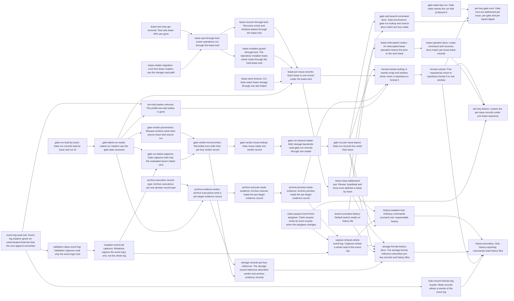

# Plan: Restructure storage so reads never scale with project history (f8a6b298)

> Planning node: 5e615dc2. Authoritative graph:
> [breakdown.json](breakdown.json).

## Outcome and criterion approach

Every per-key read gets a record addressed by that key, written in the same redo record as the change that produces it (`@/charter/D-17`, `@/charter/D-19`). No index, pointer or cache is derived from a history file (`@/charter/D-18`). Each history file becomes append-only and is read only by named history readers. Issue bodies name symbols at 3255e80d4.

| Criterion | Approach | Evidence / open gap |
|---|---|---|
| REQ-01 | Runs load by `(issue, run)`, latest-run readers use one accessor over `run_id`, and both backends read through one shared reader. One entry then moves the constructor, its callers and the shared listing to `gate-runs/<issue-id>/<run-id>.json`. Recorded runs are rewritten in the format window. | Investigation gate runs §5a, §5c; drift audit, gate runs |
| REQ-02 | `GateState.run_id` already names the latest run. The accessor replaces the remaining run lists, and the scanning selections are deleted. | Drift audit, gate runs |
| REQ-03 | Runs holding a reusable verdict write a per-key verdict record; reuse then reads only that record and the run it names. | Gate runs §5b (R1) |
| REQ-04 | Captures request the run each required gate state names, whenever a checker consumes history. Only whole-repository fidelity lists the root. | Drift audit, gate runs |
| REQ-05 | A lease read API and its reader migration come first, then CLI fixtures move behind one helper, then the store flips to per-issue lease files behind the lock and the read API. Renew, heartbeat and force-evict move to issue addressing. The limit check reads current lease files (DEC-13). | Leases §5.1, §5.2 |
| REQ-06 | Tests move to the production path as the test-only APIs go. A held `LeaseLock` (`lease-sequence`) lands with the coordinator operations, then the mutation guard and recovery move onto it. Listings read without it (DEC-02). | Leases C4–C6; drift audit, leases |
| REQ-07 | The lease-file rename or unlink is the commit point, and history is appended after it. A deletion entry removes every rebuild from the log, and an injector matrix proves prior-or-next. | Leases §5.1 option A |
| REQ-08 | Claim acquire's and `issue claim`'s event follows the assignee change, with the issue record plus the tail probe as capture (DEC-04, DEC-12, DEC-16). | Leases §5.3; drift audit REQ-08 |
| REQ-09 | Archive executions become one domain record type. Evidence records are written first, then execute and then preview read them, and the event-log archive reader goes with preview. Targets are seeded in the format window. | Events §5.3 (A) |
| REQ-10 | Appends land at the committed length and the parser keeps one torn-line rule (DEC-15, DEC-21). The marker protocol is deleted, and the file backend's second parser goes with the archive readers. | Events §5.1; drift audit, history |
| REQ-11 | Anchored ripgrep negations are built from one history-path declaration. | Events §5.4; drift audit, history |
| REQ-12 | The claims index and its rebuild machinery are deleted, and `RedoRecord` refuses a put or delete at the log. Nothing is seeded from history at runtime; `format-4-window` is a one-off outside the product. The only bytes the tracker overwrites in the log are an uncommitted unterminated final line (DEC-21). | Leases R12c; Events §4 |
| REQ-13 | Validation, mutation captures, claim and archive move to the tail probe, with the archive base keeping its whole read until archive execute reads evidence. Test images follow, and then `CaptureSpec` refuses a whole read of the log. Whole-repository fidelity reads the log through `history-log-read`. The storage-format reference names the readers (DEC-19). | Events §3.1; drift audit, history |
| REQ-14 | One CLI integration module in `cli_repo_workflow`, with one shared fixture and corruption helper and one test per command family (DEC-20). | Events §5.6 |
| REQ-15 | The generated storage-record reference is regenerated where a change moves it, and new records get one section entry. Hand-written pages are covered by three docs entries and the marker-removal sweep. | Gate runs §1 REQ-15; Leases §2 |

## Shared architectural contracts

### `gate-run-record-layout` [plan-fixed] — Per-issue gate-run records

A run record lives at `gate-runs/<issue-id>/<run-id>.json`, built only by `VirtualPath::gate_run_record(&IssueId, &GateRunId)`; `VirtualPath::gate_run_issue_directory(&IssueId)` names the directory. An issue's run history is one listing of that directory. Loading one run takes `(issue, run)` and reports a record of another issue as not found. Enumerators with no issue in hand start from the root listing, skip `verdicts/`, and take one listing per issue; only `capture_record_fidelity_validation` does this. Everything under `gate-runs/` is a tracker-written path (`VirtualPath::RECORDS`, `repository_state/path.rs`).

### `gate-state-run-id` [plan-fixed] — Latest run on the gate state

`GateState.run_id: Option<GateRunId>` is serialized only when present. Every status write records a run and names it: `gate_state_from_run` for evaluations and prechecks, and the attestation run for a manual write. A gate whose state has no `run_id` has no latest run, even when runs of it exist. Landed by 8673dc5e (`domain/types.rs`, `docs/reference/storage-format.md`, `web/src/types/models.ts`).

### `latest-run-accessor` [implementation-produced] — One latest-run lookup

`get_last_gate_runs_for_issue`, in the gate-check family, returns, for an issue, the run each gate state's `run_id` names, loaded by `(issue, run)`; it lists no runs. Producer: `gate-latest-run-reads`.

### `gate-verdict-record` [plan-fixed] — Per-key reusable verdict

`gate-runs/verdicts/<gate-key>/<inputs-digest>.json` holds `{issue_id, run_id}` for the latest recorded run of that gate over that digest that executed its checker and passed or failed (`GateRunResult::is_reusable_for`). The finalizer writes or replaces it in the run's redo record, with the captured preimage as the expected value. Reuse reads only this record and the run it names. A run that no verdict record names is never a reuse source.

### `reused-verdict-provenance` [implementation-produced] — Reused verdict names issue and run

`GateVerdictOrigin` is internally tagged on `derivation`. `Reused { source_issue: IssueId, source_run: GateRunId }` serializes as `{"derivation":"reused","source_issue":…,"source_run":…}`, and a record without `source_issue` fails to decode. `Executed` and `Attested` stay tag-only, and a record with no `origin` decodes as executed. Producer: `gate-verdict-provenance`.

### `lease-record-layout` [plan-fixed] — Per-issue lease records

An active lease is `.git/jit/leases/<issue-id>.json`, named by one constructor on `WorktreePaths` built on `shared_jit`, which is `<common-dir>/jit` in every layout. Control-plane paths have no `VirtualPath` home (2195c98f DEC-14). An absent file means no lease; a name not of that form is residue. `.git/jit/claims.seq` holds the last sequence number as a decimal u64. `.git/jit/claims.jsonl` is append-only history that no command reads. `claims.index.json` does not exist. A lease record stores no `stale` field. The lease-file rename or unlink is the commit point. The sequence bump and the history lines follow it, so a crash loses at most the interrupted operation's history lines, which are appended in one write, and never lease state. `jit recover` removes stale stage files.

### `lease-read-api` [implementation-produced] — One lock-free lease read path

`Lease::is_active(now)` means neither expired nor stale. `read_leases(&WorktreePaths)` (every stored lease, for `validate --leases`), `read_active_leases(&WorktreePaths, now)` and `read_active_lease(&WorktreePaths, &IssueId, now)` in `storage/claim_coordinator.rs` are the only lock-free lease reads. `claim list` and `claim status` read through `read_leases`, keep each lease that is not `Lease::is_expired`, mark it stale by `Lease::is_stale`, and write nothing and evict nothing (DEC-02). They read the index until `lease-per-issue-records` reimplements them over lease files with the same signatures. Producer: `lease-reader-migration`.

### `lease-sequence` [implementation-produced] — One held lease lock

`ClaimCoordinator::lock() -> LeaseLock` enters `CoordinationOrderGuard` and takes `claims.lock`; dropping the handle releases both. The handle offers `load(&IssueId)`, `list()` and `apply(&IssueId, op)`, where `op(current, now) -> LeaseChange { Keep | Put(Lease) | Remove(reason) | Reclaim(reason) }` is pure. `apply` evicts an expired lease, publishes a change or an eviction (temp file synced, rename, directory sync; or unlink, directory sync), then bumps `claims.seq`, then appends the operation's history lines in one write. Each operation takes the handle once. Acquire checks the indefinite-lease limits through `list()` and runs `repository_sync` while holding it; release reads through `load`, and recovery uses `list()` and `apply`. Lock order is fixed: `LeaseLock` first, then the repository write lock. `CoordinationOrderGuard::enter` fails while a `RepositoryOrderGuard` is held (`storage/guard_order.rs`), so a lease lock is never taken inside a repository session, and `jit recover` is claims-first. The repository-mutation guard takes its `LeaseLock` before `open_mutation_session` and holds it across the session, reading targets through `load` only: it writes nothing and nests no second claims lock. The lifecycle's preliminary guard is dropped before the held one is taken. Producer: `lease-ops-through-lock`, over the current index-and-log store; `lease-per-issue-records` moves its storage to lease files and `claims.seq` without changing its interface.

### `lease-id-scan-bridge` [implementation-produced] — Interim lease-id lookup

Until renew, heartbeat and force-evict are addressed by issue (DEC-11), they find a lease by id through `LeaseLock::list()`. This is a named temporary bridge with one producer, `lease-ops-through-lock`, and one remover, `lease-issue-addressed-ops`. The pair stays apart because the remover changes the CLI surface on top of 083c9a91's claims facade and the lease store. Removal criterion: no lease operation lists leases to find one by id (`@/inv/canonical-cutover`).

### `lease-store-test-helper` [implementation-produced] — One test path to lease storage

One `test-support` module, `crates/jit/src/test_lease_store.rs`, takes `shared_jit` and plants, reads, names and corrupts lease storage; no CLI test spells a lease storage file elsewhere. The store flip retargets only this module. Producer: `lease-store-fixtures`.

### `event-log-rule` [plan-fixed] — One event-log parser

`domain::parse_known_events` is the only parser, and it skips blank lines. A final line without a terminating newline is an uncommitted append, and readers ignore it. The length a mutation reads, in the sense of `@/inv/atomic-writes`, is the log's committed length: the end of its last newline-terminated line, which the end-of-log probe determines. Every event append is positioned at that length, so an uncommitted tail is overwritten and never becomes a middle line, and no separator newline is written (DEC-21). A line with an unknown tag is an error naming that line, and so is any other malformed line. Callers select events by typed tag.

### `event-append-probe` [plan-fixed] — Bounded end-of-log probe

An ordinary command reaches the event log only through `CaptureSpec::discover_tail`: the length plus the bytes back to the final line's start, per owner decision `@/issue/c88822a5/decision/D-1`. It parses no record. "Reads no event-log content" in REQ-08 and REQ-13 means exactly this (DEC-16).

### `history-log-read` [implementation-produced] — One admitted whole-log read

`RepositoryMutationSession::read_history_log(&mut self) -> Result<Option<Vec<u8>>, RepositoryStateStoreError>` returns the event log's bytes through a no-follow read on both backends, or `None` when absent. It sits outside `CaptureSpec` and adds nothing to any image, so a captured log entry is always a tail and no plan can derive from the whole log. `capture_record_fidelity_validation` is its only production caller, reached from whole-repository `jit validate` and the `repository_validation` checker (DEC-19). Under a held session it reads under the lock. When b697a3f7's `read-session` splits the session traits, the method moves to `RepositoryReadSession`, and a read between open and `admit` is covered by the same tail comparison as any capture. Producer: `validation-skips-event-log`.

### `archive-execution-record` [implementation-produced] — Archive execution payload

`domain::artifact_execution::ArchiveExecution` holds the target, destination root, publications, reference changes, planned deletions and the reconciling flag. `EventBody::ArtifactArchiveExecuted` wraps it with its bytes unchanged. The archive folds take `&[ArchiveExecution]`. Producer: `archive-execution-record-type`.

### `archive-evidence-record` [plan-fixed] — Per-target archive evidence

`archive-evidence/<target-key>.json` holds the target and its ordered executions. The key is `container/<issue-id>` or `document/<sha256 of the normalized path>`, built by one `VirtualPath` constructor. The directory joins `VirtualPath::RECORDS`. Execute writes `prior + this` in the redo record of its event. Execute reads it once in the planner and passes the decoded record to the finalizer; preview reads it once.

### `history-paths` [implementation-produced] — Declared history paths

`repository_state/path.rs` declares the data-root history paths once: the event log, the gate-run directory and the redo scratch directory. Default search excludes them. The storage-format reference names these declared paths plus the machine-local `claims.jsonl`. Producer: `search-excludes-history`.

### `format-4-window` [plan-fixed] — One format bump, one window

Everything this epic changes on disk is repository format 4. There is one bump and one window across this repository, gf2, mealie-fi, inflected-messages and research.

**The bump.** `SUPPORTED_INDEX_SCHEMA_VERSION` (`repository_state/index.rs`) goes from 3 to 4 in `gate-latest-run-reads`, the first `gate-run-cutover` landing. From there a gate state without `run_id` has no latest run, and four repositories hold thousands of such states, so that is the first change a format 3 repository cannot be read under. Every entry that changes a layout or a stored record depends on it, directly or transitively: all of `gate-run-cutover`, `lease-cutover` and `archive-evidence-cutover`, and `torn-tail-marker-removal`. Those landing groups name related integrations; none lands with data.

**Between landings.** Immediately before that landing the lead installs the last format 3 build and records its commit. The installed `jit` stays that binary until the window. It reads and writes this repository's format 3 tracker throughout; gates run through it (`repo-validate` is `jit validate` from `PATH`), and `cargo-ci` tests only temporary repositories. A build of main refuses the tracker with the existing one-line error, which is the intended failure for an accidental reinstall. No reinstall happens between the bump and the window, whichever epic asks. The freeze therefore lasts from the first gate-run landing to the window, so the lead keeps the three groups moving together.

**The rewrite.** `format-rewrite-tooling` folds the run relayout, the `run_id` backfill, the reused-verdict rewrite, verdict records, evidence seeding, the `isolated_torn_tail` line rewrite, and the lease rewrite into one idempotent script per checkout, with one window driver. It depends on the last entry of each format change: `gate-run-per-issue-layout`, `lease-index-machinery-removal`, `archive-preview-reads-evidence` and `torn-tail-marker-removal`. Counts are derived when it runs.

**Leases in other checkouts.** Leases live under `git rev-parse --git-common-dir`/`jit`, which linked checkouts share, so one rewrite per repository covers them. They are machine-local and never committed. Each unexpired lease is carried, including a stale one, and `claims.seq` starts from the greater of the log's highest sequence and the index's `last_seq`. A linked checkout's tracked `.jit` arrives by merging main; re-running the script there converts what its branch added.

**The window.** A worker delivers `format-rewrite-tooling`, dry-running on copies under its worktree and writing nothing outside it. The lead executes `format-cutover`, which depends on that tooling, as one window with no tracker writer anywhere: live sessions are coordinated first, the old binaries are copied for rollback, the new ones are installed, and each repository is rewritten, validated and committed. Each write to another repository takes its own user confirmation, per repository. Staging is limited to tracked `.jit` paths, since gf2 and research ignore `gate-runs`, and gf2's uncommitted work outside `.jit` stays untouched. A repository with uncommitted `.jit` paths stops the window. An older binary refuses a format 4 repository and a newer one refuses format 3; neither reads an empty tree.

## Generated decomposition overview

<!-- jit:breakdown-overview:begin -->
| Key | Title | Type | Outcome | Contracts | Sources | Footprint | Landing | Depends on |
|---|---|---|---|---|---|---|---|---|
| gate-state-last-run | Gate state names the run that produced it | task | Tests pin that a gate state names the latest run recorded for that gate. | gate-state-run-id | REQ-02, DEC-05, DEC-01 | touches 2 | — | — |
| gate-run-latest-captures | Gate captures hold only the evaluated issue's latest runs | task | Gate captures request the evaluated issue's named runs by path and list no gate-run root. | gate-state-run-id, gate-run-record-layout | REQ-04, DEC-05 | touches 3 | gate-run-cutover | gate-latest-run-reads, mutation-event-tail-captures |
| gate-run-load-by-issue | Gate-run records load by issue and run id | task | One gate-run record loads by its issue id and run id through storage, the executor and the server route. | gate-run-record-layout | REQ-01, DEC-05, DEC-01 | touches 10 | — | — |
| gate-latest-run-reads | Latest-run readers use the gate-state accessor | task | Readers of an issue's latest gate runs load one record per gate through one accessor under repository format 4. | gate-state-run-id, format-4-window | REQ-01, REQ-02, DEC-05, DEC-22, DEC-23 | touches 9 | gate-run-cutover | gate-run-load-by-issue |
| gate-verdict-provenance | Reused verdicts name their source issue and source run | task | A reused verdict's provenance names its source issue and source run in the store, the server and the web type. | format-4-window | REQ-01, DEC-07, DEC-01 | touches 7 | gate-run-cutover | gate-latest-run-reads |
| gate-verdict-record-writes | Recorded runs write their per-key verdict record | task | Each run holding a reusable verdict writes its per-key verdict record in the same redo record. | gate-verdict-record | REQ-03, DEC-06 | touches 5 | gate-run-cutover | gate-verdict-provenance, gate-run-latest-captures |
| gate-verdict-reuse-lookup | Gate reuse reads one verdict record | task | Gate reuse reads one per-key verdict record and the run it names, and no run-list selection remains. | gate-verdict-record, reused-verdict-provenance | REQ-03, DEC-06, REQ-02, DEC-05 | touches 8 | gate-run-cutover | gate-verdict-record-writes |
| gate-run-shared-reader | Both storage backends read gate-run records through one reader | task | Both backends read gate-run records through one shared reader over a small backend seam. | — | REQ-01, DEC-05 | creates 1, touches 4 | gate-run-cutover | gate-verdict-reuse-lookup |
| gate-run-per-issue-layout | Gate-run records live under their issue | task | Gate-run records are stored per issue, and an issue's run history is one directory listing. | gate-run-record-layout, format-4-window | REQ-01, DEC-05, REQ-15 | touches 16 | gate-run-cutover | gate-run-shared-reader |
| lease-test-only-api-removal | Test-only lease APIs are gone | task | Claim tests drive production entry points, and the three test-only lease APIs no longer exist. | — | REQ-06, DEC-10, DEC-01 | touches 5 | — | — |
| lease-reader-migration | Lock-free lease readers use the storage read path | task | Lock-free lease readers use one activeness predicate and three storage reads. | — | REQ-05, DEC-09, DEC-01 | touches 4 | — | — |
| lease-ops-through-lock | Lease operations run through the lease lock | task | Lease changes run through one held lease lock, and listings read unexpired leases without it. | lease-read-api | REQ-06, DEC-02, DEC-10, DEC-09, DEC-01 | touches 3 | — | lease-test-only-api-removal, lease-reader-migration |
| lease-mutation-guard-through-lock | The repository-mutation lease check reads through the held lease lock | task | The repository-mutation lease check reads its targets through one held lease lock. | lease-sequence | REQ-05, REQ-06, DEC-10 | touches 3 | — | lease-ops-through-lock |
| lease-recover-through-lock | Recovery evicts and reclaims leases through the lease lock | task | Recovery's lease passes run through the held lease lock, with recover classified claims-first. | lease-sequence | REQ-06, DEC-03 | touches 4 | — | lease-ops-through-lock |
| lease-store-fixtures | CLI tests reach lease storage through one test helper | task | CLI tests reach lease storage only through one test-support module. | — | REQ-05, DEC-09 | creates 1, touches 7 | — | — |
| lease-per-issue-records | Each lease is one record under the lease lock | task | Leases are per-issue records read and changed only through the lease lock and the lock-free reads. | lease-record-layout, lease-read-api, lease-sequence, lease-store-test-helper, format-4-window | REQ-05, REQ-07, DEC-09, DEC-13, REQ-12 | touches 4 | lease-cutover | lease-recover-through-lock, lease-mutation-guard-through-lock, lease-store-fixtures, gate-latest-run-reads |
| lease-issue-addressed-ops | Renew, heartbeat and force-evict address a lease by issue | task | Renew, heartbeat and force-evict find the lease from the issue id directly, and force-evict reaches a lease on a deleted issue. | lease-sequence, lease-id-scan-bridge | REQ-05, DEC-11, DEC-03 | touches 9 | — | lease-per-issue-records |
| lease-interruption-matrix | An interrupted lease operation leaves the prior or the next lease | task | One matrix test proves an interrupted lease operation leaves the prior or the next lease, and recover clears its residue. | lease-sequence, lease-record-layout | REQ-07, DEC-09 | touches 4 | — | lease-issue-addressed-ops |
| claim-acquire-event-from-assignee | Claim acquire emits its event exactly when the assignee changes | task | Claim acquire and issue claim append their claim event exactly when the assignee changes. | event-append-probe | REQ-08, DEC-04, DEC-12, DEC-16, DEC-01 | touches 4 | — | — |
| event-log-read-rule | Event-log readers ignore an unterminated final line that the next append overwrites | task | Appends land at the log's committed length, and the parser ignores only an unterminated final line. | — | REQ-10, DEC-15, DEC-21, REQ-12, DEC-01 | touches 5 | — | — |
| torn-tail-marker-removal | The profile torn-tail marker is gone | task | No torn-tail marker field, stamping or refusal remains, and append-position prose says committed length. | event-log-rule, format-4-window | REQ-10, DEC-15, DEC-21 | touches 13 | — | event-log-read-rule, gate-latest-run-reads |
| validation-skips-event-log | Validation captures read only the event log's end | task | Validation captures read only the log's bounded end, and record fidelity reads the whole log through one named path. | event-append-probe | REQ-13, DEC-19, DEC-01 | touches 6 | — | event-log-read-rule |
| mutation-event-tail-captures | Mutations capture the event log's end, not the whole log | task | Event-appending mutations capture only the event log's bounded end. | event-append-probe | REQ-13, DEC-19 | touches 8 | — | validation-skips-event-log |
| archive-execution-record-type | Archive executions are one domain record type | task | Archive evidence folds read one domain execution record type shared with the event. | — | REQ-09, DEC-17, DEC-01 | touches 8 | — | — |
| archive-evidence-writes | Archive executions write a per-target evidence record | task | Each archive execution writes its target's evidence record in the same redo record. | archive-evidence-record, archive-execution-record, format-4-window | REQ-09, DEC-17 | touches 6 | archive-evidence-cutover | archive-execution-record-type, gate-latest-run-reads |
| archive-execute-reads-evidence | Archive execute reads the per-target evidence record | task | Archive execute reads a target's evidence from its record once. | archive-evidence-record, event-append-probe | REQ-09, DEC-17 | touches 4 | archive-evidence-cutover | archive-evidence-writes |
| archive-preview-reads-evidence | Archive preview reads the per-target evidence record | task | Archive preview reads each target's evidence record once, and no archive reader of the event log remains. | archive-evidence-record | REQ-09, DEC-17, DEC-03, REQ-10, DEC-15 | touches 7 | archive-evidence-cutover | archive-execute-reads-evidence |
| capture-refuses-whole-event-log | Captures refuse a whole read of the event log | task | The capture layer admits only the end-of-log probe on the event log, and no code handles a whole-log entry. | event-append-probe, history-log-read | REQ-13, DEC-19 | touches 12 | — | archive-preview-reads-evidence, claim-acquire-event-from-assignee, mutation-event-tail-captures |
| redo-record-refuses-log-rewrite | Redo records refuse a rewrite of the event log | task | A redo record can change the event log only by its positioned append, and the publish check has no other branch. | event-append-probe | REQ-12, DEC-19 | touches 2 | — | event-log-read-rule |
| search-excludes-history | Default search reads no history file | task | A search without an explicit file selection excludes the declared history paths. | — | REQ-11, DEC-18, DEC-01 | touches 2 | — | — |
| storage-records-per-key-reference | The storage-record reference describes verdict and archive-evidence records | task | The generated storage-record reference covers verdict and archive-evidence records. | gate-verdict-record, archive-evidence-record | REQ-15, DEC-06, DEC-17 | touches 2 | — | archive-evidence-writes, gate-verdict-record-writes |
| history-isolation-test | Ordinary commands succeed over unparseable history | task | A CLI integration module proves ordinary commands succeed over unparseable history files. | — | REQ-14, DEC-20, DEC-16 | creates 1, touches 1 | — | lease-issue-addressed-ops, capture-refuses-whole-event-log, gate-run-per-issue-layout |
| storage-format-history-docs | The storage-format reference describes per-key records and history files | task | The storage-format and concepts pages describe per-key records and name history files and their readers. | gate-run-record-layout, gate-verdict-record, lease-record-layout, archive-evidence-record, history-paths, history-log-read | REQ-12, REQ-13, REQ-15, DEC-19 | touches 4 | — | lease-issue-addressed-ops, capture-refuses-whole-event-log, gate-run-per-issue-layout, search-excludes-history, storage-records-per-key-reference |
| lease-operator-docs | Lease command and recovery docs match per-issue lease records | task | Lease command, recovery and testing pages match issue-addressed lease commands and lease records. | lease-record-layout | REQ-12, REQ-15, DEC-11 | touches 11 | — | lease-interruption-matrix |
| gate-and-search-command-docs | Gate provenance, gate-run lookup and search docs match per-key reads | task | Command docs show reused-verdict provenance with its source issue and the default history exclusion of search. | reused-verdict-provenance, history-paths | REQ-11, DEC-07, DEC-18 | touches 4 | gate-run-cutover | gate-run-per-issue-layout, search-excludes-history |
| format-rewrite-tooling | A rewrite script and window driver move a repository to format 4 | task | An idempotent format 4 rewrite script and a window driver pass on copies of the five repositories. | format-4-window, gate-run-record-layout, gate-verdict-record, gate-state-run-id, reused-verdict-provenance, lease-record-layout, archive-evidence-record, event-log-rule | REQ-01, REQ-05, REQ-09, REQ-10, DEC-08, DEC-14, DEC-17, DEC-22 | creates 2 | — | gate-run-per-issue-layout, lease-per-issue-records, archive-preview-reads-evidence, torn-tail-marker-removal |
| format-cutover | Five repositories move to repository format 4 in one window | task | This repository, gf2, mealie-fi, inflected-messages and research hold format 4 data, and the installed binary reads it. | format-4-window, gate-run-record-layout | REQ-01, REQ-05, REQ-09, REQ-10, DEC-08, DEC-14, DEC-17, DEC-22 | creates 3, touches 5 | — | format-rewrite-tooling |
| per-key-gate-runs | Gate runs are addressed per issue, per gate and per inputs digest | story | Gate-run records are stored and read per issue, per gate and per inputs digest. | — | REQ-01, REQ-02, REQ-03, REQ-04 | — | — | gate-state-last-run, format-cutover, gate-and-search-command-docs |
| per-key-leases | Leases are per-issue records under one lease sequence | story | Leases are per-issue records under one held lease lock, and claims decide their event from the assignee. | — | REQ-05, REQ-06, REQ-07, REQ-08 | — | — | format-cutover, lease-operator-docs, claim-acquire-event-from-assignee |
| history-boundary | Only history-reporting commands read history files | story | Only history-reporting commands read history files, and the boundary is enforced, documented and tested. | — | REQ-09, REQ-10, REQ-11, REQ-12, REQ-13, REQ-14, REQ-15 | — | — | history-isolation-test, storage-format-history-docs, format-cutover, redo-record-refuses-log-rewrite |

<!-- jit:breakdown-overview:end -->

## Material risks and owner decisions

| Risk / decision | Resolution and rationale |
|---|---|
| DEC-01 Upstream 2195c98f | Chosen: each root depends on the specific 2195c98f task it consumes. Those tasks are done (79aa3aa7, 417be079, 98404e0c, 855d027d, e98ae5a4, 3ee3a4d1, 945f65f3, 18dc6e3e, 8673dc5e, 72d89161). Edges from absorbed issues to them are not carried. |
| DEC-02 Eviction and listings | Chosen (owner): `claim list` and `claim status` read per-file leases without the lock, keep every unexpired lease and mark a stale one `stale`; writers and `recover` do the evicting, and every eviction `lease-sequence` makes is persisted. d7d0d0db's persist-on-read is retired, which satisfies `@/charter/D-22` and closes the `renew_lease` leak. A stale lease is inactive, so it blocks nobody, but listings show it marked `stale` (owner ruling, replacing an `is_active` filter); heartbeat refreshes it and recover reclaims it. |
| DEC-24 Index removal absorbed | Steward ruling (2026-11-04, for the user): `lease-index-machinery-removal` (53d19851) is absorbed into `lease-per-issue-records` (2f563673) after code-review found the claims-index replay still live through recovery and validation once leases became per-issue records. Its criteria are 2f563673 REQ-05 to REQ-09, and 53d19851 is rejected as merged-into-2f563673. |
| DEC-25 Lease commit point in docs | Steward ruling (2026-11-04, for the user): the redo-record guarantee covers repository per-key records only (gate runs, verdict records, archive evidence). Leases are machine-local coordination state under `.git/jit`, committed by the lease-file rename or unlink (lease-record-layout). `storage-format-history-docs` (ac8f07c2) REQ-01 and the epic Constraints line are amended to say so. |
| DEC-03 Cross-epic seams | Chosen: external dependency 5b37a806 → `lease-recover-through-lock`; the reclaim pass lands first and appends to the claims log (5b37a806 REQ-04), and then moves onto the lease lock. External dependency 083c9a91 → `lease-issue-addressed-ops`: the claims facade lands first, and issue addressing changes the facade's methods. Rejected: the reverse order, which makes the facade wait on the end of the lease chain. b697a3f7 REQ-06 depends on `archive-preview-reads-evidence`. External dependency cf49da17 (9876a23a) → `capture-refuses-whole-event-log` (owner ruling): the shared test image builder lands first, so the tail change edits one builder instead of the private helpers it replaces. `recover` becomes claims-first in `lease-recover-through-lock`, which is what makes 083c9a91's "claim coordination before the operation session" true of it. Rejected: folding 5b37a806 in. |
| DEC-04 19e7298a REQ-02 | Chosen: reverse it. A claim no longer repairs a missing claim event (steward-approved). Reachable states are in the drift audit, REQ-08. |
| DEC-05 Latest run | Chosen: `gate-state-run-id` plus `gate-runs/<issue>/<run>.json`. Rejected: time-ordered run filenames, which read other runs' names, and a `latest.json` pointer, an extra file. Rejected: renaming the landed `run_id` to `last_run`, which rewrites stored states for no behaviour. |
| DEC-06 Reuse key | Chosen: `gate-verdict-record`, latest recorded wins. Rejected: scanning runs by digest. |
| DEC-07 Provenance | Chosen: `Reused` carries the source issue and run. Rejected: run id only. |
| DEC-08 Existing runs | Chosen: `format-rewrite-tooling` rewrites them in `format-4-window`. Rejected: deleting history, since run ids are cited. No migration reader remains. |
| DEC-09 Lease layout | Chosen: `lease-record-layout`. `claims.index.json` is a second authority, not a cache (investigation C3), and is deleted. Rejected: one `leases.json`, which reads other leases. |
| DEC-10 One sequence | Chosen: `lease-sequence`. Tests move to production entry points as the test-only APIs go, so the property tests drive production. |
| DEC-11 Issue addressing | Chosen: renew, heartbeat and force-evict take an issue id. Renew and heartbeat resolve through the issue store; force-evict resolves against stored lease records, so a lease on a deleted issue stays evictable. Rejected: a per-lease-id pointer file. |
| DEC-12 Claim event | Chosen: `IssueClaimed` exactly when the assignee changes, for both `claim acquire` and `issue claim`. Fixes acquire → unassign → acquire emitting nothing. |
| DEC-13 Limit check | Chosen: the indefinite-lease limits read current lease records only (REQ-05 amended). |
| DEC-14 Checkout leases | Chosen: `format-rewrite-tooling` rewrites them, per `format-4-window`. No reader of the old index remains. |
| DEC-15 Parser rule | Chosen (owner): `event-log-rule`. An unknown tag stays an error naming its line, as landed by c47d78c8; the logs hold no retired-tag lines, since 2a504b17 and b01208cb rewrote them. Rejected: skipping retired tags, which hides real corruption and needs a parser exception. The marker protocol is removed. Kept: `@/issue/c88822a5/decision/D-1`. `format-rewrite-tooling` rewrites gf2's marker lines. |
| DEC-16 Content | Chosen: `event-append-probe`. The bounded probe is allowed, and no record is parsed. |
| DEC-17 Archive evidence | Chosen: `archive-evidence-record`, seeded by `format-rewrite-tooling`. A repository left unseeded would silently lose re-archive coverage and residue identities. Rejected: evidence on the `.jit-container` marker or on the issue record. |
| DEC-18 Search | Chosen: anchored negations from `history-paths`, with `rg` running at the data root as landed by d98b59261, so a nested file of the same name stays searchable. Result paths stay absolute. |
| DEC-19 History readers | Chosen (owner): `jit events`, `jit worktree store-divergence`, `gate status --all` and `--limit`, the server gate-run list, whole-repository `jit validate` and the `repository_validation` checker. Fidelity reads the whole log through `history-log-read` and every run through a dedicated listing budget, because duplicate-id detection has no other home and `merge=union` keeps producing the risk. Every other validation capture stays on the tail probe. Rejected: `CaptureSpec` carve-out, which would keep whole-log arms alive in every consumer of a captured entry. Rejected: moving fidelity to `jit events`, which amends 0a6fd04e's landed criteria. |
| DEC-20 REQ-14 test | Chosen: a module in `cli_repo_workflow` with one shared file-backed fixture and no new target (`@/inv/bounded-rust-build-footprint`). |
| DEC-21 Torn tail | Chosen: a final line without its terminating newline is an uncommitted append, so the parser's only torn rule is "ignore an unterminated final line", and the length a mutation reads is the committed length. An append at that length overwrites an uncommitted tail and complies with `@/inv/atomic-writes` as written; it also satisfies REQ-12, since no committed line is rewritten, and both backends already truncate to the append offset. Only a foreign writer can leave such a tail, since a crash mid-apply leaves a record the next session completes. In that edge the log's length can stay equal or shrink, which the charter's "length counts commits" wording does not cover; admission stays safe because eaca3f52 compares the whole tail. Rejected: newline-prefixing the next append, which turns the fragment into a permanent malformed middle line. |
| DEC-22 Format cutover | Chosen (owner): `format-4-window`, with tooling and window as separate entries because the window is lead-run, confirmation-gated release work. Rejected: one bump per landing group, which means three reinstalls and three rewrites across five repositories. Rejected: bumping at the end, which leaves builds of main accepting format 3 and silently reading no latest runs. Rejected: rewriting this repository per landing while others wait, which makes a single installed binary unable to serve both. |
| DEC-23 Redo order | Chosen: the finalizer orders a run record's write ahead of the issue record naming it, so an apply window or crash never exposes a `run_id` without a record. Rejected: accepting the window until `@/charter/D-22` reads land, since `issue show` would hard-fail with not-found in it. |
| Attestation runs | 8673dc5e (done) records a manual attestation as a run named by `run_id`. |
| Investigation seams | External dependency 72d89161 → `gate-latest-run-reads`. External dependency 8673dc5e → `gate-run-per-issue-layout`. Both are done. |
| Fidelity on new records | Verdict and evidence records join `record_drift` in the entries that write them, so the pass stays the guard that stored records reproduce. |
| Freeze length | `format-4-window` holds the dogfood binary at the last format 3 build from the first gate-run landing to the window. Other epics landing in that span wait for the reinstall. Mitigation: format-free work such as the lease lock, the parser rule and the tail captures stays installable ahead of `gate-latest-run-reads`, and the groups have no reason to land far apart. |
| Live branches over the relayout | A linked checkout on an older branch is refused after the window until it merges main and re-runs the script. Mitigation: sessions finish or merge first, and the script converts what a merge brings back. |
| b697a3f7 overlap | Its `read-session` and `read-session-driver` work rebases over `history-log-read` and the fidelity capture. External dependency 97f5f2b7 → c517b88b, whose event composition follows the marker's removal. Any format change another epic needs joins format 4 before the window. |
| Shared-file contention | `commands/gate_check.rs`, `commands/mod.rs`, `storage/claim_coordinator.rs`, `storage/json.rs`, `storage/memory.rs` and `repository_state/mutation.rs` are edited by several entries. Edges order every same-function edit: gate-run entries chain through the layout, lease entries chain through the lease lock, and event entries chain through the parser and the capture refusal. The remaining footprint advisories are distinct functions, such as `archive-evidence-writes` beside the layout in the tracker-written-paths test and `storage-records-per-key-reference` beside the layout in the generated page; workers rebase or regenerate. |

## Investigation sources

- [Investigation](investigation.md) holds the consumer sweeps, primitive verification and option analyses for gate runs, leases and claims, and the event log, archive, search and history boundary.
- [Drift audit](drift-audit.md) holds the audit of every issue body against the code at 804acc4d6, including the REQ-08 reachable-state table.
- [Format 3 window](../../archive/3d9a0ce3-lead-friction/active/format3-window.sh) is the precedent for `format-rewrite-tooling`.
