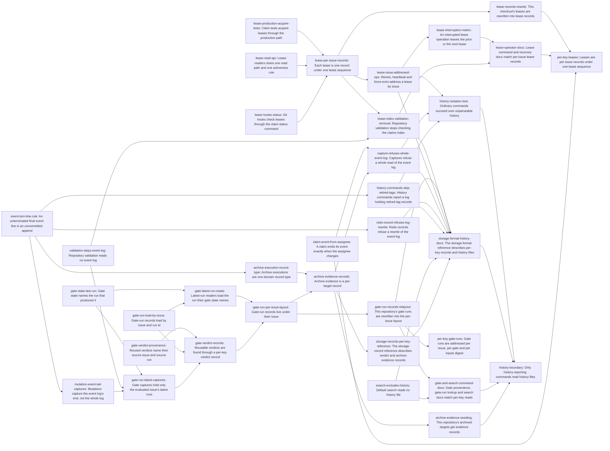

# Plan: Restructure storage so reads never scale with project history (f8a6b298)

> Planning node: 5e615dc2. Authoritative graph:
> [breakdown.json](breakdown.json).

## Outcome and criterion approach

Every per-key read gets a record addressed by that key, written in the same redo record as the change that produces it (`@/charter/D-17`, `@/charter/D-19`). No index, pointer or cache is derived from a history file (`@/charter/D-18`). Each history file becomes append-only and is read only by history-reporting commands. Issue bodies are written against the post-2195c98f code (`IssueId`, `GateRunId`, `GateKey`, `LeaseId`, the `Event`/`EventBody` envelope, `VirtualPath` constructors) and cite current lines.

| Criterion | Approach | Evidence / open gap |
|---|---|---|
| REQ-01 | Runs move to `gate-runs/<issue-id>/<run-id>.json`, load by `(issue, run)`, and latest-run readers load the run their gate state names. The repository's runs are rewritten once. | Investigation, gate runs §5a, §5c |
| REQ-02 | `GateState.last_run` names the latest run. The five latest-run selections collapse into one accessor. | Gate runs §1 REQ-02 row |
| REQ-03 | A verdict record per `(gate, digest)` names the source run, and reuse reads only that record inside the image. | Gate runs §5b (R1) |
| REQ-04 | Captures request the `last_run` record of each history-consuming gate on the evaluated issue, and the root listing is deleted. | Gate runs §1 capture rows |
| REQ-05 | A lease read API comes first, then per-issue lease files behind it. Renew, heartbeat and force-evict move to issue addressing. The limit check reads current lease files (DEC-13). | Leases §5.1, §5.2 |
| REQ-06 | Test-only APIs go first. Then every lease operation, the repository-mutation guard included, reads and changes leases only through one held `LeaseLock` (`lease-sequence`). | Leases C4–C6 |
| REQ-07 | The lease-file rename or unlink is the commit point, and history is appended after it. An injector matrix proves prior-or-next. | Leases §5.1 option A |
| REQ-08 | The claim event follows the assignee change (DEC-12). The capture is the issue record plus the tail probe (DEC-16). | Leases §5.3 |
| REQ-09 | Archive executions become one domain record type. Per-target evidence records are written in the execute redo record, and this repository's targets are seeded once. | Events §5.3 (A) |
| REQ-10 | One torn-line rule (DEC-15, DEC-21) removes the marker protocol and the file backend's second archive reader. 47a082ef converges the memory backend and e98ae5a4 types tag selection; a CLI test shows that history commands omit retired-tag records. | Events §5.1 |
| REQ-11 | Unanchored ripgrep negations are built from one history-path declaration. | Events §5.4 (A) |
| REQ-12 | The claims index is deleted, nothing is seeded from history at runtime, and `RedoRecord` refuses a put or delete at the log. The only bytes the tracker ever overwrites in the log are an uncommitted unterminated final line (DEC-21). | Leases R12c; Events §4 |
| REQ-13 | Validation, mutation captures, claim and archive move to the tail probe, and `CaptureSpec` refuses a whole read of the log. The storage-format reference names the readers (DEC-19). | Events §3.1 |
| REQ-14 | One CLI integration module in `cli_repo_workflow`, with one shared fixture and corruption helper and one test per command family (DEC-20). | Events §5.6 |
| REQ-15 | The generated storage-record reference is updated where the layout changes, plus one section entry for the new records. Hand-written pages are covered by three docs entries. | Gate runs §1 REQ-15; Leases §2 |

## Shared architectural contracts

### `gate-run-record-layout` [plan-fixed] — Per-issue gate-run records

A run record lives at `gate-runs/<issue-id>/<run-id>.json`, built only by `VirtualPath::gate_run_record(&IssueId, &GateRunId)`. 2195c98f's 79aa3aa7 introduces the constructor with `(&GateRunId)`, and this epic adds the issue. An issue's run history is one listing of `gate-runs/<issue-id>/`. Loading one run takes `(issue, run)` and reports a record of another issue as not found. Everything under `gate-runs/` is already a tracker-written path (`repository_state/path.rs:537-560`).

### `gate-state-last-run` [implementation-produced] — Latest run on the gate state

`GateState.last_run: Option<GateRunId>` is serialized only when present. It is set to the run recorded in the same plan as the gate state, through `gate_state_from_run`. A status write that records no run keeps the prior value. A gate whose state has no `last_run` has no latest run, even when runs of it exist. Producer: `gate-state-last-run`.

### `gate-verdict-record` [plan-fixed] — Per-key reusable verdict

`gate-runs/verdicts/<gate-key>/<inputs-digest>.json` holds `{issue_id, run_id}` for the latest recorded run of that gate over that digest that executed its checker and passed or failed. The finalizer writes or replaces it in the run's redo record, with the captured preimage as the expected value. Reuse reads only this record and the run it names. A run that no verdict record names is never a reuse source.

### `reused-verdict-provenance` [implementation-produced] — Reused verdict names issue and run

`GateVerdictOrigin` is internally tagged on `derivation`. `Reused { source_issue: IssueId, source_run: GateRunId }` serializes as `{"derivation":"reused","source_issue":…,"source_run":…}`, and a record without `source_issue` fails to decode. The old shape is rewritten by the repository's run rewrite in the same landing group. Producer: `gate-verdict-provenance`.

### `lease-record-layout` [plan-fixed] — Per-issue lease records

An active lease is `.git/jit/leases/<issue-id>.json`, named by one constructor on `WorktreePaths`. Control-plane paths have no `VirtualPath` home (2195c98f DEC-14). An absent file means no lease. `.git/jit/claims.seq` holds the last sequence number as a decimal u64. `.git/jit/claims.jsonl` is append-only history that no command reads. `claims.index.json` does not exist. A lease record stores no `stale` field; readers report `Lease::is_stale(now)`. The lease-file rename or unlink is the commit point. The sequence bump and the history lines follow it, so a crash loses at most the interrupted operation's history lines, which are appended in one write, and never lease state.

### `lease-read-api` [implementation-produced] — One lock-free lease read path

`Lease::is_active(now)` means neither expired nor stale. `read_leases(&WorktreePaths)` (every stored lease, for `validate --leases`), `read_active_leases(&WorktreePaths, now)` and `read_active_lease(&WorktreePaths, &IssueId, now)` in `storage/claim_coordinator.rs` are the only lock-free lease reads. They read the index until `lease-per-issue-records` reimplements them over lease files with the same signatures. Producer: `lease-read-api`.

### `lease-sequence` [implementation-produced] — One held lease lock

`ClaimCoordinator::lock() -> LeaseLock` enters `CoordinationOrderGuard` and takes `claims.lock`; dropping the handle releases both. The handle offers `load(&IssueId)`, `list()` and `apply(&IssueId, op)`, where `op(current, now) -> LeaseChange { Keep | Put(Lease) | Remove(reason) }` is pure. `apply` evicts an expired lease, publishes a change or an eviction (temp file synced, rename, directory sync; or unlink, directory sync), then bumps `claims.seq`, then appends the operation's history lines in one write. Each operation takes the handle once. Acquire checks the indefinite-lease limits through `list()` and runs `repository_sync` while holding it; listing and recovery use `list()` and `apply`. Lock order is fixed: `LeaseLock` first, then the repository write lock. `CoordinationOrderGuard::enter` fails while a `RepositoryOrderGuard` is held (`storage/guard_order.rs:52-62`), so a lease lock is never taken inside a repository session. The repository-mutation guard therefore takes its `LeaseLock` before `open_mutation_session`, as `claims_mutation_guard` does today (`commands/mod.rs:2600-2607`, `:720-739`), holds it across the session, and reads targets through `load` only: it writes nothing, takes no second claims lock and enters no second coordination guard, and an expired lease counts as inactive. Producer: `lease-per-issue-records`.

### `lease-id-scan-bridge` [implementation-produced] — Interim lease-id lookup

Until renew, heartbeat and force-evict are addressed by issue (DEC-11), they find a lease by listing the lease directory. This is a named temporary bridge with one producer, `lease-per-issue-records`, and one remover, `lease-issue-addressed-ops`, which depends on the producer. Its removal criterion: no lease operation lists the lease directory to find a lease by id (`@/inv/canonical-cutover`).

### `event-log-rule` [plan-fixed] — One event-log parser

`domain::parse_known_events` is the only parser, and it skips blank lines. A final line without a terminating newline is an uncommitted append, and readers ignore it. The length a mutation reads, in the sense of `@/inv/atomic-writes`, is the log's committed length: the end of its last newline-terminated line, which the end-of-log probe determines. Every event append is positioned at that length, so an uncommitted tail is overwritten and never becomes a middle line, and no separator newline is written (DEC-21). A well-formed record whose tag is not a current `EventTag` (a retired tag) is skipped by every caller. Any other malformed line is an error that names the line. Callers select events by typed tag.

### `event-append-probe` [plan-fixed] — Bounded end-of-log probe

A non-history command reaches the event log only through `CaptureSpec::discover_tail`: the length plus the bytes back to the final line's start, per owner decision `@/issue/c88822a5/decision/D-1`. It parses no record. "Reads no event-log content" in REQ-08 and REQ-13 means exactly this (DEC-16).

### `archive-execution-record` [implementation-produced] — Archive execution payload

`domain::artifact_execution::ArchiveExecution` holds the target, destination root, publications, reference changes, planned deletions and the reconciling flag. `EventBody::ArtifactArchiveExecuted` wraps it with its bytes unchanged. The archive folds take `&[ArchiveExecution]`. Producer: `archive-execution-record-type`.

### `archive-evidence-record` [plan-fixed] — Per-target archive evidence

`archive-evidence/<target-key>.json` holds the target and its ordered executions. The key is `container/<issue-id>` or `document/<sha256 of the normalized path>`, built by one `VirtualPath` constructor. The directory joins `tracker_written_paths`. Execute writes `prior + this` in the redo record of its event. Planner, finalizer and preview each read it once.

### `history-paths` [implementation-produced] — Declared history paths

`repository_state/path.rs` declares the data-root history paths once: the event log, the gate-run directory and the redo scratch directory. Default search excludes them. The storage-format reference names these declared paths plus the machine-local `claims.jsonl`. Producer: `search-excludes-history`.

## Generated decomposition overview

<!-- jit:breakdown-overview:begin -->
| Key | Title | Type | Outcome | Contracts | Sources | Footprint | Landing | Depends on |
|---|---|---|---|---|---|---|---|---|
| gate-state-last-run | Gate state names the run that produced it | task | Each recorded gate run's id is stored on the issue's gate state for that gate. | gate-run-record-layout | REQ-02, DEC-05, DEC-01 | touches 12 | — | — |
| gate-run-latest-captures | Gate captures hold only the evaluated issue's latest runs | task | Gate captures request the evaluated issue's latest run of each gate by path and list no gate-run root. | gate-state-last-run, gate-run-record-layout | REQ-04, DEC-05 | touches 5 | gate-run-cutover | gate-state-last-run, validation-skips-event-log, mutation-event-tail-captures |
| gate-run-load-by-issue | Gate-run records load by issue and run id | task | One gate-run record loads by its issue id and run id through storage, the executor and the server route. | gate-run-record-layout | REQ-01, DEC-05, DEC-01 | touches 8 | — | — |
| gate-latest-run-reads | Latest-run readers load the run their gate state names | task | Readers of an issue's latest gate runs load one record per gate, named by its gate state. | gate-state-last-run | REQ-01, REQ-02, DEC-05 | touches 7 | gate-run-cutover | gate-state-last-run, gate-run-load-by-issue |
| gate-verdict-provenance | Reused verdicts name their source issue and source run | task | A reused verdict's provenance names its source issue and source run. | — | REQ-01, DEC-07, DEC-01 | touches 7 | gate-run-cutover | — |
| gate-verdict-records | Reusable verdicts are found through a per-key verdict record | task | Gate reuse reads one per-key verdict record written with the run that holds the verdict. | gate-verdict-record, reused-verdict-provenance | REQ-03, DEC-06 | touches 9 | gate-run-cutover | gate-verdict-provenance, gate-run-load-by-issue, gate-run-latest-captures |
| gate-run-per-issue-layout | Gate-run records live under their issue | task | Gate-run records are stored per issue, and an issue's run history is one directory listing. | gate-run-record-layout, gate-state-last-run | REQ-01, REQ-15, DEC-05 | touches 14 | gate-run-cutover | gate-latest-run-reads, gate-verdict-records |
| gate-run-records-relayout | This repository's gate runs are rewritten into the per-issue layout | task | This repository's recorded gate runs, latest-run references and verdict records match the per-issue layout. | gate-run-record-layout, gate-verdict-record, gate-state-last-run, reused-verdict-provenance | REQ-01, DEC-08 | creates 1, touches 2 | gate-run-cutover | gate-run-per-issue-layout |
| lease-hooks-status | Git hooks check leases through the claim status command | task | The shipped git hooks decide lease ownership through the claim status command. | — | REQ-12, DEC-09, DEC-01 | creates 1, touches 5 | — | — |
| lease-production-acquire-tests | Claim tests acquire leases through the production path | task | Claim unit tests and property tests acquire and evict leases only through production entry points. | — | REQ-06, DEC-10, DEC-01 | touches 5 | — | — |
| lease-read-api | Lease readers share one read path and one activeness rule | task | Lock-free lease readers use one storage read path and one activeness predicate. | — | REQ-05, DEC-09, DEC-01 | touches 5 | — | — |
| lease-per-issue-records | Each lease is one record under one lease sequence | task | Leases are per-issue records read and changed only through one held lease lock. | lease-record-layout, lease-read-api | REQ-05, REQ-06, REQ-07, REQ-12, DEC-02, DEC-03, DEC-09, DEC-10, DEC-13 | touches 13 | lease-cutover | lease-production-acquire-tests, lease-read-api, lease-hooks-status |
| lease-index-validation-removal | Repository validation stops checking the claims index | task | Repository validation holds no claims-index check and the index type is gone. | — | REQ-12, DEC-09 | touches 5 | — | lease-per-issue-records, validation-skips-event-log |
| lease-issue-addressed-ops | Renew, heartbeat and force-evict address a lease by issue | task | Renew, heartbeat and force-evict find the lease from the issue id directly. | lease-sequence, lease-id-scan-bridge | REQ-05, DEC-11, DEC-03 | touches 8 | — | lease-per-issue-records |
| lease-interruption-matrix | An interrupted lease operation leaves the prior or the next lease | task | One matrix test proves an interrupted lease operation leaves the prior or the next lease. | lease-sequence, lease-record-layout | REQ-07, DEC-09 | touches 1 | — | lease-issue-addressed-ops |
| lease-records-rewrite | This checkout's leases are rewritten into lease records | task | This checkout's active leases are lease records and its claims index is gone. | lease-record-layout | REQ-05, DEC-14 | creates 1, touches 3 | lease-cutover | lease-per-issue-records |
| claim-event-from-assignee | A claim emits its event exactly when the assignee changes | task | Claims decide their claim event from the issue's assignee and parse no event-log record. | event-append-probe | REQ-08, DEC-04, DEC-12, DEC-16, DEC-01 | touches 4 | — | — |
| event-torn-line-rule | An unterminated final event line is an uncommitted append | task | The event log has one torn-line rule, appends overwrite an uncommitted tail, and the marker protocol is gone. | event-log-rule | REQ-10, DEC-15, DEC-21, DEC-01 | touches 15 | — | — |
| validation-skips-event-log | Repository validation reads no event log | task | Repository validation and broad prechecks read only the event log's bounded end. | event-append-probe | REQ-13, DEC-19, DEC-01 | touches 2 | — | — |
| mutation-event-tail-captures | Mutations capture the event log's end, not the whole log | task | Event-appending mutations capture only the event log's bounded end. | event-append-probe | REQ-13, DEC-19 | touches 7 | — | event-torn-line-rule |
| archive-execution-record-type | Archive executions are one domain record type | task | Archive evidence folds read one domain execution record type shared with the event. | — | REQ-09, DEC-17, DEC-01 | touches 8 | — | event-torn-line-rule |
| archive-evidence-records | Archive evidence is a per-target record | task | Archive preview and execute read a target's evidence from its per-target record once. | archive-evidence-record, archive-execution-record, event-append-probe | REQ-09, DEC-17, DEC-03 | touches 12 | archive-evidence-cutover | archive-execution-record-type, gate-run-per-issue-layout |
| archive-evidence-seeding | This repository's archived targets get evidence records | task | This repository's archived targets each have an evidence record matching the event log. | archive-evidence-record | REQ-09, DEC-17 | creates 1, touches 1 | archive-evidence-cutover | archive-evidence-records |
| history-commands-skip-retired-tags | History commands report a log holding retired-tag records | task | History commands succeed over a log holding retired-tag records and omit them. | event-log-rule | REQ-10, DEC-15 | touches 1 | — | event-torn-line-rule |
| capture-refuses-whole-event-log | Captures refuse a whole read of the event log | task | The capture layer admits only the end-of-log probe on the event log. | event-append-probe | REQ-13, DEC-19 | touches 10 | — | claim-event-from-assignee, archive-evidence-records |
| redo-record-refuses-log-rewrite | Redo records refuse a rewrite of the event log | task | A redo record can change the event log only by its positioned append. | event-append-probe | REQ-12, DEC-19 | touches 2 | — | event-torn-line-rule |
| search-excludes-history | Default search reads no history file | task | A search without an explicit file selection excludes the declared history paths. | — | REQ-11, DEC-18, DEC-01 | touches 2 | — | — |
| storage-records-per-key-reference | The storage-record reference describes verdict and archive-evidence records | task | The generated storage-record reference covers verdict and archive-evidence records. | gate-verdict-record, archive-evidence-record | REQ-15, DEC-06, DEC-17 | touches 2 | — | archive-evidence-records |
| history-isolation-test | Ordinary commands succeed over unparseable history | task | A CLI integration module proves ordinary commands succeed over unparseable history files. | — | REQ-14, DEC-20, DEC-16 | creates 1, touches 1 | — | lease-issue-addressed-ops, capture-refuses-whole-event-log, history-commands-skip-retired-tags |
| storage-format-history-docs | The storage-format reference describes per-key records and history files | task | The storage-format and concepts pages describe per-key records and name history files and their readers. | gate-run-record-layout, gate-verdict-record, lease-record-layout, archive-evidence-record, history-paths | REQ-12, REQ-13, REQ-15, DEC-19 | touches 3 | — | gate-run-records-relayout, lease-index-validation-removal, lease-issue-addressed-ops, capture-refuses-whole-event-log, redo-record-refuses-log-rewrite, history-commands-skip-retired-tags, search-excludes-history, storage-records-per-key-reference |
| lease-operator-docs | Lease command and recovery docs match per-issue lease records | task | Lease command, recovery and testing pages match issue-addressed lease commands and lease records. | lease-record-layout | REQ-12, REQ-15, DEC-11 | touches 10 | — | lease-interruption-matrix, lease-index-validation-removal |
| gate-and-search-command-docs | Gate provenance, gate-run lookup and search docs match per-key reads | task | Command docs show reused-verdict provenance with its source issue and the default history exclusion of search. | reused-verdict-provenance, history-paths | REQ-11, DEC-07, DEC-18 | touches 4 | gate-run-cutover | gate-run-records-relayout, search-excludes-history |
| per-key-gate-runs | Gate runs are addressed per issue, per gate and per inputs digest | story | Gate-run records are stored and read per issue, per gate and per inputs digest. | — | REQ-01, REQ-02, REQ-03, REQ-04 | — | — | gate-run-records-relayout |
| per-key-leases | Leases are per-issue records under one lease sequence | story | Leases are per-issue records under one held lease lock, and claims decide their event from the assignee. | — | REQ-05, REQ-06, REQ-07, REQ-08 | — | — | lease-records-rewrite, lease-operator-docs, claim-event-from-assignee |
| history-boundary | Only history-reporting commands read history files | story | Only history-reporting commands read history files, and the boundary is enforced, documented and tested. | — | REQ-09, REQ-10, REQ-11, REQ-12, REQ-13, REQ-14, REQ-15 | — | — | history-isolation-test, storage-format-history-docs, gate-and-search-command-docs, archive-evidence-seeding |

<!-- jit:breakdown-overview:end -->

## Material risks and owner decisions

| Risk / decision | Resolution and rationale |
|---|---|
| DEC-01 Upstream 2195c98f | Chosen: each root depends on the specific 2195c98f task it consumes. Rejected: one edge to the whole epic. External dependency 79aa3aa7 → `gate-state-last-run`, `gate-run-load-by-issue`, `gate-verdict-provenance`. External dependency 417be079 → `gate-state-last-run`. External dependency 98404e0c → `lease-production-acquire-tests`, `lease-read-api`. External dependency 855d027d → `claim-event-from-assignee`, `validation-skips-event-log`. External dependency e98ae5a4 → `claim-event-from-assignee`, `event-torn-line-rule`. External dependency 3ee3a4d1 → `archive-execution-record-type`. External dependency 945f65f3 → `mutation-event-tail-captures`. External dependency 18dc6e3e → `search-excludes-history`. External dependency 2195c98f → `lease-hooks-status`, which consumes nothing specific. 8cfbf19d, a50e9be9, 0102769f, d72bf093 and 641bd14e are reached transitively, so a direct edge would be rejected as redundant. |
| DEC-02 Eviction persistence | Chosen: `lease-sequence` persists every eviction it makes, which keeps d7d0d0db's property and closes the `renew_lease` leak (`claim_coordinator.rs:1025-1046`). |
| DEC-03 Cross-epic seams | Chosen: external dependency 5b37a806 → `lease-per-issue-records` (recovery reclaim lands on the old layout first). 083c9a91 depends on `lease-issue-addressed-ops`, the final lease-API entry. b697a3f7 REQ-06 depends on `archive-evidence-records`; record this for the steward. Rejected: folding 5b37a806 in. |
| DEC-04 19e7298a REQ-02 | Chosen: reverse it. A claim no longer repairs a missing claim event (steward-approved). |
| DEC-05 Latest run | Chosen: `GateState.last_run` plus `gate-runs/<issue>/<run>.json`. Rejected: time-ordered run filenames, which read other runs' names, and a `latest.json` pointer, an extra file. |
| DEC-06 Reuse key | Chosen: `gate-verdict-record`, latest recorded wins. Rejected: scanning runs by digest. |
| DEC-07 Provenance | Chosen: `Reused` carries the source issue and run. This changes the wire shape after 79aa3aa7 types `GateRunId`. Rejected: run id only. |
| DEC-08 Existing runs | Chosen: one idempotent rewrite task, `gate-run-records-relayout`, in landing group `gate-run-cutover` with the reinstall of the dogfood binary. Rejected: deleting history, since 92 run ids are cited. No migration reader remains. |
| DEC-09 Lease layout | Chosen: `lease-record-layout`. `claims.index.json` is a second authority, not a cache (investigation C3), and is deleted. Rejected: one `leases.json`, which reads other leases. |
| DEC-10 One sequence | Chosen: `lease-sequence`. Test-only APIs are deleted first, so the property tests drive production. |
| DEC-11 Issue addressing | Chosen: renew, heartbeat and force-evict take an issue id. 8cfbf19d first types these lease-id arguments as `LeaseId`, and `lease-issue-addressed-ops` replaces them; that is where the churn falls. Rejected: a per-lease-id pointer file. |
| DEC-12 Claim event | Chosen: `IssueClaimed` exactly when the assignee changes, for both `claim acquire` and `issue claim`. Fixes acquire → unassign → acquire emitting nothing. |
| DEC-13 Limit check | Chosen: the indefinite-lease limits read current lease records only (REQ-05 amended). |
| DEC-14 Checkout leases | Chosen: one idempotent rewrite, `lease-records-rewrite`, in landing group `lease-cutover`. No reader of the old index remains. |
| DEC-15 Parser rule | Chosen: `event-log-rule`. Retired-tag records are skipped uniformly, since history is append-only (REQ-12) and this log holds 7 `document_archived` records, plus 1 `lifecycle_timestamps_backfilled` once 2492ab29 retires its tag. Rejected: erroring on retired tags, which would require rewriting history. The marker protocol is removed. Kept: `@/issue/c88822a5/decision/D-1`. d72bf093 REQ-03 (byte-identical re-serialization of this log) is unaffected: no line here carries `isolated_torn_tail`. External dependency 47a082ef (memory backend through the parser, cross-backend retired-tag test) and e98ae5a4 (typed `--event-type`) → `history-commands-skip-retired-tags`, which only adds the CLI proof; both are already predecessors (through 842b0ac6 and `event-torn-line-rule`), so no direct edge is added. |
| DEC-16 Content | Chosen: `event-append-probe`. The bounded probe is allowed, and no record is parsed. |
| DEC-17 Archive evidence | Chosen: `archive-evidence-record`, plus one seeding task in landing group `archive-evidence-cutover`. Rejected: evidence on the `.jit-container` marker or on the issue record. |
| DEC-18 Search | Chosen: exclusion by construction of the default selection from `history-paths`. Rejected: running `rg` from the data root, which changes result paths. |
| DEC-19 History readers | Chosen: `jit events`, `jit worktree store-divergence`, `gate status --all` and `--limit`, and the server gate-run list. Validation drops its log parse, and the whole-log mutation captures move to the probe. |
| DEC-20 REQ-14 test | Chosen: a module in `cli_repo_workflow` with one shared file-backed fixture and no new target (`@/inv/bounded-rust-build-footprint`). |
| DEC-21 Torn tail | Chosen: a final line without its terminating newline is an uncommitted append, so the parser's only torn rule is "ignore an unterminated final line". The length a mutation reads is defined once as the log's committed length, the end of its last newline-terminated line, which the end-of-log probe determines. An append at that length overwrites an uncommitted tail and complies with `@/inv/atomic-writes` as written ("a positioned append at the length the mutation read"); the invariant is not amended. It also satisfies REQ-12, since no committed line is rewritten, and both backends already truncate to the append offset. `event-torn-line-rule` corrects every restatement to "committed length". Rejected: newline-prefixing the next append, which turns the fragment into a permanent malformed middle line. |
| 8673dc5e attestation runs | Chosen: 8673dc5e records a manual attestation as a run, and that run sets `last_run` through `gate-state-last-run` because it is recorded in the same plan as the gate state. Edge: 8673dc5e depends on `gate-run-per-issue-layout`. |
| Investigation seams | External dependency 72d89161 → `gate-latest-run-reads`. 47a082ef (memory parser), 2492ab29 (migrate removal), 86d3625d (`reusable_verdict` removal) and d759d606 (claim command signatures) are children of 842b0ac6, on which every 2195c98f root depends, so every entry here already follows them and a direct edge would be rejected as redundant. Reverse edge: 8673dc5e depends on `gate-run-per-issue-layout`; add it with `--reduce`, because it makes 8673dc5e → 72d89161 redundant. 083c9a91 → `lease-issue-addressed-ops` likewise needs `--reduce` (it subsumes 083c9a91 → d759d606). |
| Hook lease checks | Chosen: hooks call `jit claim status`, giving one activeness computation (`@/charter/D-20`). This lands before the layout, so no hook ever reads a lease file. Rejected: jq over lease files, which cannot compute staleness. |
| Landing groups | `gate-run-cutover` (captures, latest reads, provenance, verdicts, layout, rewrite, gate-run lookup docs), `lease-cutover` and `archive-evidence-cutover`. Each lands with its data task and a binary reinstall. An older binary reads the new tree as having no runs, leases or evidence. |
| Shared-file contention | `commands/gate_check.rs`, `commands/mod.rs`, `storage/claim_coordinator.rs`, `storage/json.rs`, `storage/memory.rs` and `repository_state/mutation.rs` are edited by several entries. Edges order every same-function edit: gate-run entries chain through the layout, `archive-evidence-records` follows the layout (both edit the tracker-written-paths test in `gate_execution.rs`), lease entries chain through the lease lock, and event entries chain through the parser and the capture refusal. The remaining footprint advisories are distinct functions; workers rebase. |

## Investigation sources

- [Investigation](investigation.md) holds the consumer sweeps, primitive verification and option analyses for gate runs, leases and claims, and the event log, archive, search and history boundary.
