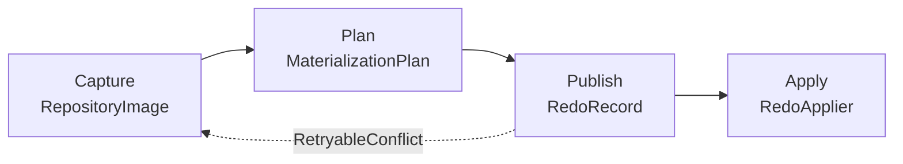
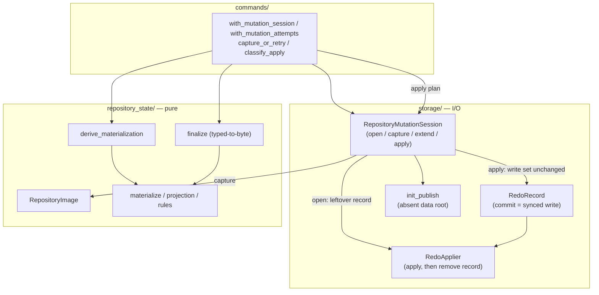
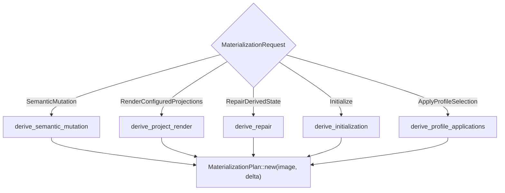
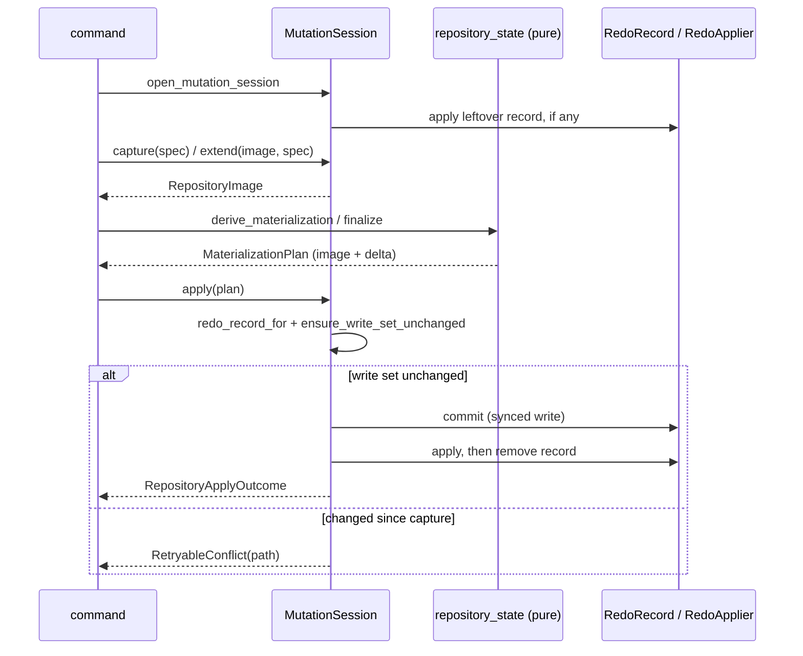

# Repository-State and Materialization Architecture

> **Diátaxis Type:** Explanation

This document gives a contributor a working mental model of the subsystem that
turns a semantic mutation into durable repository bytes. It describes the code in
`crates/jit/src/repository_state/` (the pure vocabulary and producers) and
`crates/jit/src/storage/` (the session, the redo record, and its application) as
it exists in the tree. Read it before touching capture, planning, publication, or
recovery. The adopter-facing statement of the same mechanism is
[Publication and Recovery](../../docs/reference/storage-format.md#publication-and-recovery).

Repository data is plain git-versioned JSON with no external database
(`@/charter/D-1`). Every semantic mutation derives its coupled materializations
from one read of the repository and publishes through one synced redo record
over the files it writes (`@/inv/derived-state-coherence`, `@/charter/D-17`).

---

## The pipeline in one sentence

A command captures **one immutable repository view** under the repository write
lock, hands it to a **pure planning boundary** that derives an exact plan of file
actions, and publishes that plan as **one redo record** that is synced, applied,
and removed.

The stages are strictly separated:

- **Capture and publish** perform filesystem I/O and live in `storage/`.
- **Planning** is pure — it reads only the captured image and declared authority,
  performs no I/O, and imports no storage, command, validation, or profile
  modules (`repository_state/mod.rs` module contract).

The arrow back from publish to capture is the conflict-retry edge: if a path the
plan creates, writes, or removes changed since capture, the store returns a typed
`RetryableConflict` before writing anything durable, and the command captures
again in a fresh session.

### Layer map

---

## The captured repository view

A `RepositoryImage` (`repository_state/image.rs`) is the single closed input to
all planning. `RepositoryImage::close` builds it from a `CaptureSpec` bounded by a
`CaptureBudget` (`max_listings`, `max_bytes`, `max_depth`), so capture cannot walk
an unbounded tree. The image holds, per canonical path, a `RepositoryEntry` —
`File` (exact bytes and mode), `FileTail` (a path read as `ReadMode::Tail`),
`Directory`, `Symlink` (never followed), `Unsupported`, or `Absent` — plus
`DirectoryListing`s, which hold child names only, and pinned-document evidence.

A mutation reads the repository in one pass. What it reads first names what it
reads next (the issues listing names the issue files, the issues name the plan documents
their transition rules read), so the session grows the image with
`RepositoryMutationSession::extend`, which reads only the requests the image does
not already hold. Nothing is read twice, so no read is compared with an earlier
one. The command-layer entries are `capture_mutation_preflight` and
`capture_mutation_base` over `capture_proposed_base_inner` (`commands/validate.rs`).
A mutation captures only the plan documents its transition rules read;
issue-linked documents and pinned evidence are validation's reads
(`@/issue/8454236c/decision/D-1`).

The event log is the one path a mutation reads as a tail: an `EventLogTail`
(`EventLogTail::read_tail`) holds the log's exact length and its last bytes,
reaching back to the start of the final line. That tail determines the committed
length where event appends are positioned and is bounded by the final line,
never by the log's history (`@/issue/c88822a5/decision/D-1`). Validation, which
parses the log, reads it whole.

The budgets bound the one place a capture grows beyond what a caller declared:
expanding a complete listing names children nobody asked for, and `max_listings`
bounds how many listings may be requested while `max_bytes` charges every listed
child's name alongside the bytes read. `max_depth` bounds the shape of each
path, and so the ancestor closure a caller reaches by declaring one path.

There is no budget on how many exact paths a caller may declare. A declared path
is not growth — it is one thing the caller decided to read — and its count is
bounded by whatever the caller derives the declaration from. A budget here would
restate that bound as a number `CaptureBudget` cannot derive; publishing a
profile package tree did exactly that, assuming a path depth the package model
does not constrain, and so refused packages the model accepts. Each caller's
budget therefore documents what bounds its own declaration
(`commands/profile.rs::package_tree_capture_budget` is the worked example, since
its declaration is the one that arrives from outside the repository).

An `EntryIdentity` pairs a boundary-acquired no-follow object identity with the
SHA-256 and byte size of the exact captured bytes; the write-scoped comparison at
apply compares live entries with captured ones through it.

Paths are addressed through `VirtualPath` over a `RepositoryLayout`, which
classifies every target as `Data(...)` (data-root-relative, the `.jit` tree) or
`Worktree(...)`. The layout is the sole authority that maps a repo-relative
spelling to a root class; producers never touch ambient paths.

Because the image is immutable and complete, planning is a pure function of it:
every producer reads existing target bytes from the image, never from the live
filesystem (`materialize.rs` module contract).

---

## The pure planning boundary

Planning converts semantic intent into a `MaterializationPlan`: an exact
`RepositoryDelta` of normalized `RepositoryAction`s (`CreateDirectory`,
`WriteFile`, `SetMode`, `DeleteFile`, `AppendEvents`), and the captured image.
Each action carries an `ExpectedPreimage` of its target as captured; apply refuses
a plan whose preimages disagree with the session's image or whose image
carries another session's token.

### One typed request enum, one shared tail

`derive_materialization` is the single closed entry to the constrained producer
graph. It matches on a `MaterializationRequest`, whose variants are the only ways
to enter planning:

- `SemanticMutation` — rebuild all state derived from declarations after a record change.
- `RenderConfiguredProjections` — render the selected configured projections
  (`None` selects all).
- `RepairDerivedState` — repair all derived state.
- `Initialize` — derive a fresh or missing-file repository scaffold.
- `ApplyProfileSelection` — derive one complete profile-selection application
  over an existing repository.

The match is deliberately closed: a caller cannot register a callback or select an
individual producer family; adding a family means extending this function. Every
variant funnels through one shared tail, `MaterializationPlan::new(image, delta)`,
so every plan carries the image it was derived from and its delta.

### The complete producer set

`compose_complete` is the complete derived-materialization producer set: default
rules and their schemas plus every configured projection, each derived from
declared authority (`@/inv/single-source-prose`). A caller cannot invoke a subset
— the intent selects the whole set. This is where the three intents differ in
scope while sharing the producer code:

- `derive_semantic_mutation` runs `compose_complete` over every declared
  projection.
- `derive_project_render` scopes *which declared projections* participate; an
  out-of-scope projection contributes no action, leaving its target untouched. The
  scope is declaration scope, never a choice of producer family.
- `derive_repair` is `derive_semantic_mutation` under the repair intent.

Shared projection targets compose through the one `managed_document` primitive
(`compose_managed_documents`), never last-writer-wins, so two projections into one
file merge deterministically. `rules.toml` splices only the generated
default-family spans, preserving authored content unconditionally. The engine
reads type names, gate keys, projection targets, and templates from captured
declarations, never from hardcoded domain assumptions (`@/inv/domain-agnostic`).

### Repair derivation

`derive_repair` composes each target without touching authored bytes: `rules.toml`
splices only generated default spans, region projections splice only their managed
region, and full-file projections replace only a target the declaration proves.
When a target is ambiguous — a duplicate rule name — repair refuses before
publication with a typed error rather than rewriting an authored boundary.

`compare_materializations` is the read-only counterpart: it diffs a plan's
expected actions against the same closed image and reports each
`MaterializationDrift` as `Missing`, `Stale`, or `Unexpected`. It is how a caller
detects that derived state has drifted without publishing anything.

### Typed producer errors

Planning failures are fully typed families whose leaves retain their concrete
source, so rendering lives in the error type's `Display` rather than at the call
site:

- `ProducerError` — a producer read an uncaptured path, malformed captured bytes,
  or an invalid declaration.
- `DeclarationParseError` — parsing captured declaration files into the canonical
  bundle (`declarations_from_image` / `validation_declarations_from_image`).
- `RulesDocumentError` — a `rules.toml` that could not be parsed or safely spliced.
- `GateRegistryEditError` — the typed tail of `finalize_gate_registry_edit`.
- `ArchiveExecutionError` — the typed tail of `finalize_archive_execution`.

These compose into `RepositoryStateError`, the single pure-derivation failure type
`derive_materialization` returns.

### Single-declaration edit entries

Two authored-declaration edits have their own constrained planning entries that
overlay the edited bytes onto the captured base, then run `compose_complete` over
the edited declarations so coupled schemas, rule membership, and projections all
reflect the proposed state before anything is published:

- `finalize_config_edit` — one authored `config.toml` edit. A malformed edit is a
  typed planning error, never a published file.
- `finalize_gate_registry_edit` — one typed `EditGateRegistry` intent, with the
  edited registry serialized only by the neutral declaration owner.

---

## The mutation-session contract

Record-level mutations (issue create/update/claim/delete, gate runs, events, index
membership) are driven by the typed-to-byte finalizer in
`repository_state/mutation.rs`. Commands submit timestamp-free semantic
`MutationIntent`s; a created issue carries the id its command derived through
`MutationContext::issue_id_at`, and the finalizer assigns every other identity and
the time and emits one exact plan.

- `MutationIntent` is a closed enum of repository-owned mutations. A new record
  class extends this enum.
- `MutationContext` is created once per command operation, before its conflict
  retry loop. It holds an `IdAuthority` and a `MutationClock`. Both the identity
  seed and the single mutation timestamp are sampled lazily and once — the seed on
  the first identifier allocation, the timestamp on the first transition — so a
  no-op mutation samples neither, and a retry reuses identical record identities
  and times.
- `finalize` (built on `finalize_delta`) follows a frozen identifier order — the
  indices of new issue ids first, reserved for the ids their commands derived,
  gate-run/record ids next, event ids last after canonical event ordering —
  stamps the one timestamp on every transition and emits event lines as one
  `AppendEvents` action positioned at the log's committed length, the end of its
  last newline-terminated line (`@/inv/event-log`). It derives `index.json`
  tombstones from the captured preimage. The captured tail determines that length,
  so an unterminated final line is overwritten. `finalize_audit_append` positions
  its append the same way for init/profile deltas that carry their own asset
  actions.

The finalizer serializes every record canonically (`serialize_issue`,
`serialize_event`, `serialize_gate_run`, `fresh_index_bytes`), so equivalent plans
are equal on the JSON-file and in-memory backends.

### Command-layer retry combinators

The command layer owns the capture/plan/apply/retry protocol in one place
(`commands/mod.rs`, the mutation-session-contract region). Every command site
drives its retry through these combinators rather than a hand-copied loop:

- `with_mutation_attempts` — the retry driver. It owns the retry bound and the
  terminal `MutationSessionExhausted` error, and holds no session, so a caller may
  open and release a preflight session, take a claims guard, and run a subprocess
  between attempts without inverting lock order.
- `with_mutation_session` — the convenience for pure single-session sites: open one
  fresh session per attempt, hand it to the closure, and apply the returned plan.
- `classify_apply` / `capture_or_retry` — the single interpreters of a
  `RetryableConflict` on apply and on capture, folding it into `AttemptOutcome` /
  `SessionStep` retry signals.

---

## The session: open, capture, apply

A `RepositoryStateStore` opens a `RepositoryMutationSession`
(`storage/repository_state_store.rs`). The session is the I/O boundary the pure
plan is published through:

- `open_mutation_session` takes the bootstrap locks, opens identity-bound root
  capabilities, and reads a leftover redo record under the data root's scratch
  directory (`tmp/redo.record`). With the repository write lock and the event-log
  lock held, it applies that record before the session serves any capture. A
  record that does not parse is refused with `UnreadableRedoRecord` over an
  untouched repository. The repository write lock stays held for the session.
- `capture` and `extend` revalidate the root capabilities and return the bounded
  `RepositoryImage`.
- `apply` checks that the plan's image carries the token of the session's latest
  capture (clones share the captured data and the token) and that
  every action's expected preimage matches it, then revalidates the root
  capabilities. It derives the redo record from the delta (`redo_record_for`) and
  runs `ensure_write_set_unchanged`: every path the record makes a directory at,
  puts, or deletes is read live and compared with its captured entry, and the
  event log is compared as its length and tail. A path the mutation read but does
  not write is left out of the comparison. The first difference returns
  `RetryableConflict { path }`, and nothing durable has been written. Otherwise
  the record is committed and applied.

---

## The redo record

A `RedoRecord` (`storage/redo_record.rs`) is one mutation's file changes: the
directories it makes, the complete new bytes and mode of every file it puts, the
paths it deletes, and one event append positioned at the log's committed length,
the end of its last newline-terminated line. A mode change is a put of the
captured bytes under the new mode. Operation paths are pairwise disjoint — no two operations name one path and
none is an ancestor of another, the event append's implicit target included —
checked identically by `RedoRecord::new` and `RedoRecord::parse`, so only a
directory no other operation lies beneath is carried as a make-directory.

`commit_redo_record` (`storage/redo_apply.rs`) writes the record in place under
the scratch directory of the data-root handle it is given, syncs it and the
directory, and refuses an occupied record path; the session commits through the
handle it verified, so a root rebound by path never receives the record. The synced write
is the mutation's commit point: before it the repository is unchanged; after it
the record is the mutation.

`RedoApplier` (`storage/redo_apply.rs`) applies a record in one forward pass:

1. Make each directory, tolerating one already there.
2. Put each file: write a synced `.tmp` stage beside the target, rename it into
   place, and sync the parent (`@/inv/atomic-writes`).
3. Delete each path, tolerating its absence.
4. Write the event append at its offset (seek, write, truncate to offset plus
   length, sync); positioned writing rather than append mode makes a repeated
   write land in the same place.
5. Remove the record.

Every step converges when repeated, so re-applying a record after an interruption
at any point reaches the same state. The same pass serves a session's own apply
and a session open over a leftover record. `MemoryRedoApplier` steps the same
operations over the in-memory backend.

### Absent data root

The record's home is inside the data root, so a delta that creates an absent root
publishes through `storage/init_publish.rs` instead: the new root is written into
a synced sibling stage directory and published by a no-replace rename that refuses
an occupied destination. Worktree targets of the same delta travel as a redo
record committed inside the stage, so the rename carries the record into the
published root and the next session open completes it if the process stops
first.

### Interruption seam

Tests interrupt a session through `MutationInterruptionInjector`
(`storage/mutation_interruption.rs`), whose `MutationPoint`s are `SessionOpen`,
`BeforeCommitCheck`, `BeforeRootPublication`, and `Redo(RedoPoint)`. `RedoPoint`
names each step of a record's application, and both backends step the same points
in the same order, so `storage/redo_conformance.rs` proves the interruption matrix
once against both. The production injectors proceed at every point.

---

## Where to start reading

- The pipeline vocabulary and the closed request/plan API: `repository_state/mod.rs`.
- The immutable view and exact delta: `repository_state/image.rs`.
- The pure producers and projections: `repository_state/materialize.rs`,
  `repository_state/projection.rs`, `repository_state/rules_document.rs`.
- The typed-to-byte record finalizer: `repository_state/mutation.rs`.
- The session, capture, and write-scoped comparison:
  `storage/repository_state_store.rs`.
- The redo record and its application: `storage/redo_record.rs`,
  `storage/redo_apply.rs`; absent-root publication: `storage/init_publish.rs`.
