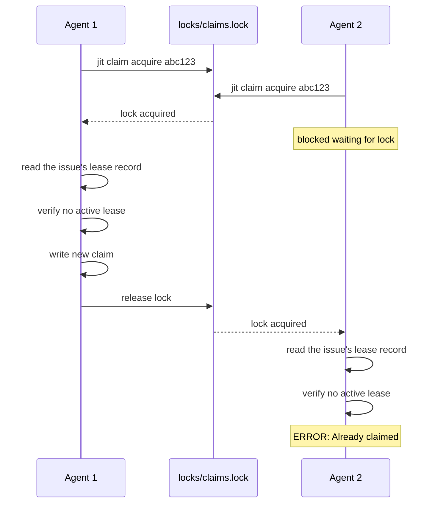

# System Guarantees

> **Diátaxis Type:** Explanation  
> **Audience:** Users who need to understand JIT's reliability properties

This document explains what JIT guarantees about data integrity, consistency, and failure handling. Understanding these guarantees helps you build reliable workflows and troubleshoot issues.

## Invariants

JIT's project invariants are cited below by their address (`@/invariant/<id>`);
run `jit item show <address>` for the registry's canonical statement. The
invariant registry (`.jit/invariants.toml`) renders into the invariant region of
the project `AGENTS.md` via `jit project render` (the `invariants` projection).

### DAG Property

**Guarantee:** Dependencies always form a directed acyclic graph (DAG) - cycles are strictly prevented. (`@/invariant/dag-acyclic`)

Dependencies in JIT represent "FROM depends on TO" relationships. If issue A depends on B, then A cannot proceed until B reaches an effective terminal state (done, rejected, or archived from one of those). To prevent deadlock, JIT enforces that the dependency graph is always acyclic.

**How it works:**

JIT uses depth-first search (DFS) to detect potential cycles before adding any dependency:

```rust
// Simplified algorithm from crates/jit/src/graph/mod.rs
fn would_create_cycle(from: &str, to: &str) -> bool {
    // Adding edge from → to creates a cycle if there's already a path to → from
    // In other words: if 'from' is reachable from 'to'
    is_reachable(to, from)
}
```

**Example:**

```bash
# Create issues
jit issue create --title "Task A"  # → a1b2c3
jit issue create --title "Task B"  # → d4e5f6
jit issue create --title "Task C"  # → g7h8i9

# Build dependency chain: A ← B ← C
jit dep add a1b2c3 d4e5f6  # A depends on B
jit dep add d4e5f6 g7h8i9  # B depends on C

# Try to create a cycle: C ← A
jit dep add g7h8i9 a1b2c3  # fails: Cycle detected
```

**Why this matters:**

- **No deadlocks:** Issues can always make progress once dependencies become effectively terminal
- **Clear work order:** Topological sort determines execution order
- **Predictable scheduling:** Agents can identify ready work deterministically

**Transitive reduction:**

JIT keeps the dependency graph transitively reduced. When `A→B→C` already holds, adding the redundant `A→C` is rejected by default, and `jit validate` enforces the reduced form. `jit dep add --reduce` instead accepts the new edge and drops whatever it makes redundant, in the same operation. Either way the graph represents the *minimal* set of relationships needed.

### Atomic Operations

**Guarantee:** A repository mutation is published through one durable redo record
over the files it writes. The record extends the event log, and it replaces each other
file by temp-file-and-rename.
(`@/invariant/atomic-writes`, `@/invariant/derived-state-coherence`,
`@/charter/D-17`)

**How it works:**

Before it touches anything live, a mutation describes everything it will write:
the directories it creates, the complete new bytes of every file it replaces,
the lines it appends to the event log, and the paths it removes. That description is the **redo record**. JIT writes
it as `redo.record` in the data root's scratch directory, `.jit/tmp/`, syncs its
bytes and fsyncs the directory entries naming them, and only then writes a live
file. The record's durable write is the mutation's commit point
(`crates/jit/src/storage/redo_record.rs`).

Applying it is one forward pass: make the directories, replace the files,
remove the deleted paths, extend the event log, then remove the record. Every
step tolerates being redone — a directory already present, a replacement that
overwrites, a removal whose target is already gone, an append written again at
the same place — so applying a record twice reaches the same state as applying
it once (`crates/jit/src/storage/redo_apply.rs`).

**Converging forward:**

Recovery runs forward only. A crash between the commit point and the record's
removal leaves the record in place; the next session opened over the repository
reads it and applies it before anything else mutates, so an interrupted mutation
completes rather than unwinds
(`crates/jit/src/storage/repository_state_store.rs`). Session opening is the one
recovery boundary, and every mutating command passes through it — as does
`jit recover`, whose whole job is to reach it.

**How one file lands:**

A replacement stages its bytes beside the target under a unique `.tmp` name,
syncs them, and renames onto the target. Keeping both paths in one directory
makes the rename a same-filesystem operation, so readers never observe a
partially written replacement (`crates/jit/src/storage/atomic_write.rs`).

`events.jsonl` is the exception: the record extends it in place rather than
replacing it, as the
[storage format reference](../reference/storage-format.md#publication-and-recovery)
specifies. The record is applied under the repository
write lock and `.events.lock`; reading events takes no lock, since a final line
still being written is ignored
(`crates/jit/src/storage/json.rs`).

**Multi-agent safety:**

JIT also uses advisory file locks to coordinate operations that share mutable
state. The locks are released with their guards and work only among cooperating
processes; they serialize competing writers rather than joining unrelated
commands into one operation. Advisory work-lease coordination uses
`.git/jit/locks/claims.lock` (`crates/jit/src/storage/lock.rs`).

Leases use a separate publication boundary: renaming a staged lease file onto
`.git/jit/leases/<issue-id>.json`, or unlinking that file, commits the lease
change. The sequence counter and claim-history append follow it. An interrupted
operation can lose history lines while retaining its committed lease change.

**Example - Two agents claiming simultaneously:**



**Benefits:**

- **No partial replacement:** Readers do not observe a partially written target file.
- **No half-finished mutation:** A mutation interrupted after its commit point is applied at the next session open; one interrupted before it never started.
- **Coordinated operations:** Cooperating JIT processes use advisory locks where shared access must be serialized.

### Recoverable Profile Publication

Applying a repository profile writes many files at once, which is a stronger
problem than one atomic replacement. JIT validates the complete planned
repository image before publication, then publishes every file that application
writes through a single redo record. A failure before the record is durable
leaves the repository untouched, because nothing live has been written yet.

Past the record, publication only converges forward. A record left by a crash is
applied at the next session open, ahead of any later mutation: the same forward
pass, over a repository that may already carry part of it. Re-applying an
operation the interrupted run had already performed changes nothing, so a
half-applied profile becomes a fully applied one.

This guarantee covers the files JIT publishes under its own locks and recovery
protocol; writes another process makes to those files stay outside it. The
canonical package, composition, and lifecycle-event contract is in [Repository Profiles](../reference/profiles.md).

### Event Logging

**Guarantee:** Every issue state change appends an event to `.jit/events.jsonl`.
(`@/invariant/event-log`)

This guarantee is about lifecycle state changes. Other operations may emit their
own event variants, but the event log is not a promise that every repository
mutation is recorded or that it reconstructs complete repository history.

**Event types:**

Each event is tagged by a snake-case `type` field, including
`issue_state_changed` for lifecycle transitions. The generated
[Event Log Tags](../reference/events.md) catalog defines the vocabulary.

**Log format:**

Events are stored as newline-delimited JSON (JSONL):

```jsonl
{"type":"issue_created","id":"evt-001","issue_id":"abc123","timestamp":"2026-02-02T20:00:00Z","title":"Fix bug","priority":"high"}
{"type":"issue_claimed","id":"evt-002","issue_id":"abc123","timestamp":"2026-02-02T20:01:00Z","assignee":"agent:worker-1"}
{"type":"issue_state_changed","id":"evt-003","issue_id":"abc123","timestamp":"2026-02-02T20:05:00Z","from":"ready","to":"in_progress"}
```

**Properties:**

- **Append-only:** Events are appended to the log.
- **State-transition evidence:** The state-change invariant is recorded as
  `issue_state_changed` events.

Issue operations read only the log's length and final line, without parsing
event records. An unknown tag or malformed middle line therefore does not block
them. History readers report these errors with their line number and ignore an
unterminated final line. Whole-repository `jit validate` and the
`repository_validation` checker read the whole event log and every gate-run
record for fidelity; per-issue validation does not. The
[history-files reference](../reference/storage-format.md#history-files) lists
the readers and paths. No file is derived from history.

**Benefits:**

- **Observability:** Inspect recorded lifecycle transitions for an issue.

**Query examples:**

```bash
# View recent activity
jit events tail -n 20

# Find all events for specific issue
jit events query --issue-id abc123

# Track state transitions
jit events query --event-type issue_state_changed
```

### Git Optional

**Guarantee:** Core issue tracking works without git - repository versioning is optional.

JIT is designed as a standalone issue tracker that *enhances* git workflows but doesn't require them. This supports use cases beyond software development.

Issue assignment (`jit issue assign` / `jit issue claim` / `jit issue release` / `jit issue unassign`) is bookkeeping on the issue record and works fully without git. Advisory work leases (`jit claim acquire` and its sibling `jit claim` subcommands) coordinate exclusive, time-boxed access across worktrees; they need a git repository with a resolvable `HEAD` for worktree identity and branch tracking. A missing repository and a repository with zero commits both fail with a typed `ClaimRequiresGitError` (exit code 10): `git init` alone is not enough, since `HEAD` does not resolve to a branch until the first commit exists.

**What works without git:**

✅ Issue creation, updates, queries  
✅ Dependency management  
✅ Quality gates (automated and manual)  
✅ Issue assignment (`jit issue assign` / `jit issue claim` / `jit issue release` / `jit issue unassign`)  
✅ `jit archive document` / `jit archive container` (subject to the repository's documentation policy and archive checks)<br>
✅ Event logging and queries  
✅ Status and visualization  

**What requires git:**

❌ `jit claim acquire` / `release` / `renew` / `heartbeat` / `status` / `list` / `force-evict` - Advisory work leases (`ClaimRequiresGitError`, exit code 10)  
❌ `jit doc show --at <commit>` - View document at specific git revision  
❌ `jit snapshot export --at <tag>` - Export from specific git revision  
❌ Document asset validation from git history  

**Fallback behavior:**

When git is unavailable:

- **Document operations:** Fall back to working tree only
- **Filesystem-backed documents:** `jit doc add`, `jit doc list`, dependency-aware
  `jit archive`, and `jit doc show` without a commit reference remain available;
  history, diff, and commit-specific reads require git
- **Snapshot export:** Export from current working tree
- **History commands:** Return error with helpful message
- **Advisory leases:** Fail outright with `ClaimRequiresGitError` (exit code 10) instead of falling back; use issue assignment (`jit issue claim`) as the git-free alternative

**Example:**

```bash
# Without git - core functionality and issue assignment work
mkdir my-project && cd my-project
jit init
jit issue create --title "Task 1"
jit issue create --title "Task 2"
jit dep add <task1> <task2>
jit query available
jit issue claim <task2> agent:worker-1
# All basic operations and issue assignment work (task2 has no unmet dependencies)

jit claim acquire <task2> --agent-id agent:worker-1
# fails with exit code 10: Claims and leases require a git repository

# git init alone is not enough - HEAD must resolve to a commit
git init
git config user.email "you@example.com"
git config user.name "Your Name"
jit claim acquire <task2> --agent-id agent:worker-1
# fails with exit code 10: HEAD has no commit yet

git commit --allow-empty -m "Initial commit"
jit claim acquire <task2> --agent-id agent:worker-1
# Acquired lease: <lease-id>

mkdir -p path/to
echo "Initial design notes" > path/to/design.md
jit doc add <task2> path/to/design.md
git add -A && git commit -m "Add design doc"
echo "Revised notes" >> path/to/design.md
git add -A && git commit -m "Revise design doc"
jit doc show <task2> path/to/design.md --at HEAD~1
# Shows the version from before the revision
```

**Design rationale:**

Making git optional allows JIT to be used for:
- Research projects without version control
- Knowledge work and personal task management
- Environments where git isn't available
- Rapid prototyping and experimentation

## Consistency Model

JIT provides **eventual consistency** through file-based coordination. Understanding the consistency model helps you build reliable multi-agent workflows.

### Consistency Guarantees

**1. Read-your-own-writes**

A process always sees its own updates immediately:

```bash
# Same process (shell session)
jit issue update abc123 --state in_progress
jit issue show abc123
# Shows in_progress immediately
```

**2. Scoped atomic operations**

One mutation publishes every file it writes through one redo record, and lease
acquisition has a scope of its own; neither joins unrelated commands into one
operation:

```bash
# Agent 1 acquires an advisory lease atomically (in a Git worktree).
jit claim acquire abc123
# Agent 2's simultaneous claim will either succeed or fail cleanly
# The lease operation does not make ordinary issue claims atomic.
```

**3. Eventually consistent across processes**

Different processes see updates after file operations complete:

```bash
# Terminal 1                     # Terminal 2
jit issue update abc --state done
                                 jit query available
                                 # Sees updated state (file reread)
```

### What JIT Does NOT Guarantee

Understanding limitations prevents incorrect assumptions:

❌ **Strong consistency across processes**  
- Updates are not instantly visible to other processes
- File operations are the synchronization point
- Use claims for coordination, not assumptions about state

❌ **Distributed coordination**  
- JIT is designed for single-machine use
- No distributed locking or consensus
- Network filesystems may violate atomicity guarantees

❌ **Snapshot isolation**  
- Long-running operations may see intermediate state
- Use claims to establish boundaries
- The event log records state-transition events; it is not a cross-operation ordering guarantee

❌ **Automatic conflict resolution**  
- Concurrent writers race on the whole issue file: the last atomic rename wins, with no field-level merge
- Ordinary `jit issue claim` reads the existing assignee and any lease only to reject a conflict it can see, not to serialize; `jit claim acquire` holds an exclusive lock for that
- No CRDTs or operational transformation

### Implications for Multi-Agent Workflows

**✓ Safe patterns:**

```bash
# Issue assignment works without git, but it is not atomic coordination.
jit issue claim <issue> agent:worker-1
# Work on issue
jit issue update <issue> --state done

# Polling for ready work (eventually consistent)
while true; do
  jit query available --json | process_available_work
  sleep 5
done

# Event-driven workflows (poll the event tail for new events)
while true; do
  jit events tail -n 10 --json | react_to_events
  sleep 5
done
```

**✗ Unsafe patterns:**

```bash
# Assuming state without claiming
state=$(jit issue show abc123 --json | jq -r '.state')
# State may change before next operation
jit issue update abc123 --state in_progress  # Race condition!

# Better: claim to record ownership; for guaranteed exclusivity acquire a lease
jit issue claim abc123 agent:worker-1  # Rejects a claim it can see is already assigned, but does not lock
jit claim acquire abc123 --agent-id agent:worker-1  # Exclusive, serialized (Git worktrees)
```

### File-Based Synchronization

All coordination happens through filesystem operations:

Two directories at the repository root carry coordination state. `.jit/` holds
per-worktree issue data; `.git/jit/` is the control plane shared across every
worktree of the repository.

```
.jit/
├── issues/{id}.json          # Issue data
├── index.json                # Format version and deletion tombstones
├── gates.toml                # Gate registry
├── gate-runs/
│   ├── <issue-id>/<run-id>.json
│   └── verdicts/<gate-key>/<inputs-digest>.json
├── archive-evidence/<target-key>.json
├── tmp/                      # Scratch space; git-ignored
│   └── redo.record           # A pending mutation's commit point
└── events.jsonl              # Append-only event log

.git/jit/
├── leases/{issue-id}.json    # The issue's lease (changed under the lock)
├── claims.seq                # Last claim-log sequence number
├── claims.jsonl              # Claim history (append-only)
└── locks/claims.lock         # Advisory lock serializing lease changes
```

Latest gate views load the run named by the issue's gate state; verdict reuse
loads the record for that gate and inputs. Archive operations read evidence by
target. These reads address records directly rather than reconstructing state
from history. The [storage-format reference](../reference/storage-format.md)
defines their paths and publication boundaries.

**Synchronization points:**

1. **Advisory file locks** - Coordinate operations that acquire the same lock
2. **Atomic renames** - Publish updates atomically
3. **Claims** - Establish exclusive access boundaries
4. **Event log** - Record state-transition events

## Failure Modes

JIT is designed to handle failures gracefully without data loss or corruption.

### Partial Write Recovery

**Scenario:** Process crashes mid-mutation.

**Recovery:**

Where the crash falls relative to the commit point decides the outcome. Before
the record is durable, no live file has been written and the mutation simply did
not happen. After it, the record survives the crash and the next command that opens a
mutation session applies it
([Publication and Recovery](../reference/storage-format.md#publication-and-recovery)):

```bash
# After an interrupted mutation:
.jit/tmp/redo.record                           # The mutation, waiting to be applied
.jit/issues/.redo.<hex>.tmp                    # Staging a rename did not reach
.jit/issues/abc123.json                        # Previous or new version, never torn

# Every mutating command applies the record before its own work. This one also
# clears provably stale temporary files and locks.
jit recover
```

**Result:** No corruption, no data loss; a mutation either never started or is
carried to completion.

### Corrupted JSON Detection

**Scenario:** Manual edit creates invalid JSON, or disk corruption occurs.

**Symptom:**

```bash
jit issue show abc123
Error: Failed to deserialize data: expected value at line 15 column 3
  File: .jit/issues/abc123.json
```

**Recovery options:**

1. **Restore from git:**
   ```bash
   git checkout HEAD -- .jit/issues/abc123.json
   ```

2. **Manual repair:**
   ```bash
   # Edit file with proper JSON syntax
   vim .jit/issues/abc123.json
   # Validate
   jit issue show abc123
   ```

3. **Check event log for last known state:**
   ```bash
   jit events query --issue-id abc123 | tail -n 10
   # Reconstruct from events
   ```

**Prevention:** Use `jit` commands instead of manual editing.

### Stale Temporary Files

**Scenario:** Crash leaves staging files behind.

**Impact:** Harmless. Read operations only consider the published file names, so
an orphaned staging sibling is never served and never corrupts state.

**Safe to remove by hand:** files whose name ends in `.tmp`, anywhere under
`.jit/`. Each one is a staging file whose rename never happened. Give them the
age `jit recover` does — one hour by default — so a sweep leaves staging that a
running mutation is about to rename.

**Not safe to remove:** the data root's scratch directory, `.jit/tmp/`, and the
record it holds. That record, `redo.record`, is a mutation's commit point: the
mutation may already be partly written to live files, and the record is the only
thing that can finish it. Its name deliberately does not end in `.tmp`, so a
sweep for staging files cannot match it
(`crates/jit/src/storage/redo_record.rs`). Leave it where it is — the next
mutating command applies it.

**Cleanup:**

```bash
# Applies a pending record through its session open, then removes orphaned .tmp
# files older than one hour (ordinary claim commands do not run temp-file
# cleanup).
jit recover

# Manual sweep at any time. Match regular files with the .tmp suffix, which
# the scratch directory and its record do not carry.
find .jit -type f -name '*.tmp' -mmin +60 -delete
```

The one-hour age is the default temp-file cleanup threshold — see
[Runtime Defaults](../reference/runtime-defaults.md), the
generated source of that value.

### Stale Claim Leases

**Scenario:** Agent crashes while holding a claim.

**Detection:**

```bash
jit claim list
Lease: b53beeba-32f2-4671-a407-2d94e4d13d41
  Issue:    abc123
  Agent:    agent:worker-1
  TTL:      indefinite
  Last beat: <timestamp before the stale threshold>
  STALE: Lease marked stale (no heartbeat for 75 minutes)
```

Listings omit expired finite leases and mark stale indefinite ones.

**Recovery:**

```bash
# Evict expired leases and reclaim stale indefinite ones
jit recover

# Or evict one issue's lease immediately
jit claim force-evict abc123 --reason "agent crashed"

# Clear the current assignee before looking for unassigned ready work.
jit issue release abc123 "return to the available pool"
# Or: jit issue unassign abc123
jit query available
```

**Prevention:** Renew finite leases before expiry; heartbeat indefinite leases:

```bash
# Renew lease before expiry
jit claim renew abc123 --extension 600

# Refresh an indefinite lease
jit claim heartbeat abc123
```

### Missing File Handling

**Scenario:** Issue file deleted manually or corrupted beyond recovery.

**Symptom:**

```bash
jit issue show abc123
Error: Issue not found: abc123
  Expected at: .jit/issues/abc123.json
```

**Recovery:**

1. **Check git history:**
   ```bash
   git log -- .jit/issues/abc123.json
   git checkout <commit> -- .jit/issues/abc123.json
   ```

2. **Recreate from event log:**
   ```bash
   jit events query --issue-id abc123
   # Use events to reconstruct state
   ```

3. **Manual recreation:**
   ```bash
   # Create new issue with same ID (requires manual JSON editing)
   # NOT RECOMMENDED - use git recovery
   ```

**Prevention:**

- Commit `.jit/` directory regularly
- Use `jit validate` to detect inconsistencies
- Never manually delete issue files

### Network Errors (External Assets)

**Scenario:** Document references external URL, but network is unavailable.

**Impact:** Document operations fail, but core issue tracking unaffected.

```bash
jit doc check-links --scope all
Warning: External URL not validated: https://example.com/diagram.png
  Referenced in: dev/design.md

# Core functionality still works
jit query available  # succeeds
jit issue update abc123 --state done  # succeeds
```

**Mitigation:** Download critical assets locally using per-document asset pattern.

### Graceful Degradation

JIT is designed with isolation and fault tolerance:

**✓ Isolated failures:**

- Corrupted issue → Only that issue affected, others work normally (`list_issues` skips an unreadable file)
- Missing git → Core issue operations and filesystem-backed document operations
  still work; leases, document history/diff, and commit-specific document reads
  are unavailable
- Expired finite lease → evicted during a later lease acquisition; a stale
  indefinite lease remains until a heartbeat, `jit claim release`,
  `jit claim force-evict`, or `jit recover` reclaims it. Either way the issue stays
  assigned until `jit issue release` or `jit issue unassign` clears its assignee
- Malformed newline-terminated `events.jsonl` line or unknown event tag → history reads and whole-repository validation fail with an error naming the line; an unterminated final line is ignored. Issue operations and claims keep working

**✓ No cascading failures:**

- Storage errors don't crash the CLI (return error codes)
- Validation errors suggest recovery steps
- Lock timeouts prevent indefinite hangs (see the [default lock acquisition timeout](../reference/runtime-defaults.md))
- Event log corruption doesn't prevent issue operations

**✓ Recovery-oriented design:**

```bash
# Comprehensive health check
jit validate
# Reports validation findings (hierarchy, dependency, and format issues).

# Include lease consistency
jit validate --leases
# Lists expired or dangling leases, each with the exact fix command
# (jit claim release / jit claim force-evict).

# Auto-fix what is mechanically fixable
jit validate --fix
# Applies repairable rule/graph/state fixes and derived-state repairs
# Publishes every fix in one recoverable mutation, then validates the result;
# an ambiguous target writes nothing
```

## See Also

- [Core Model](core-model.md) - Understanding issues, dependencies, and gates
- [Design Philosophy](design-philosophy.md) - Why these guarantees matter
- [Troubleshooting Guide](../how-to/troubleshooting.md) - Practical recovery procedures
- Implementation: `crates/jit/src/storage/` - Atomic operations and locking
- Implementation: `crates/jit/src/graph/mod.rs` - Cycle detection algorithm
